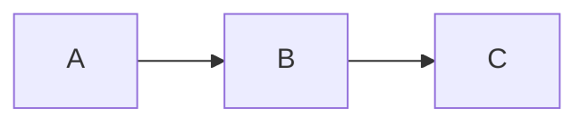

# mmdfmtで図だけを整形する

Markdownと`.mmd`ファイルの[Mermaid](https://mermaid.js.org/)の図を整形し、
ほかはすべて書いたまま残します。

`mmdfmt`は`.mmd`と`.mermaid`ファイルと、
`.md`と`.markdown`ファイルの`mermaid`と`mmd`コードブロックを整形します。
Markdownファイルのほかの部分は、1バイトも変えません。
図は、[Prettier](https://prettier.io/)と、
そのMermaidプラグインの[`prettier-plugin-mmd`](./index.ja.md)で整形します。
[Prettierを知っている方へ](#prettierを知っている方へ)の場合を除き、
プラグインと同じ結果になります。

## どんなときに使うか

図を整形したいけれど、MarkdownはPrettierで整形しないときに使います。

- `markdownlint --fix`やdprintなど、別のフォーマッターでMarkdownを整形する。
  Prettierを使うと、同じテキストをPrettierのやり方で書き換えてしまいます。
- Markdownを、意図して書いたまま保つ。
- ほかのファイルにはPrettierを使い、Markdownには使わない。

すでにPrettierでMarkdownを整形しているなら、
代わりに`prettier-plugin-mmd`を追加してください。
同じ実行で図も整形されるため、`mmdfmt`は不要です。

`mmdfmt`はPrettierの設定なしに、1つのコマンドで使えます。

## しないこと

- 図のほかは整形しません。
- 図の誤りは、mermaid.jsが拒否するもの以外は報告しません。
  それは[`@mmd-toolkit/eslint-plugin`](../linter/index.ja.md)が行います。

## まず使ってみる

`mmdfmt`にはNode.js `^22.13.0 || >=24`が必要です。
`--write`はファイルを直接書き換えるので、先に作業をコミットするか、
`npx mmdfmt --check .`でどのファイルが変わるか確認してください。
現在のディレクトリの下にある図をすべて整形するには、次を実行します。

```sh
npx mmdfmt --write .
```

変わるのは図だけです。
この`notes.md`は、

<!-- prettier-ignore -->
````md
# Notes

*   A list item that mmdfmt leaves as it is.


````

次のようになります。

<!-- prettier-ignore -->
````md
# Notes

*   A list item that mmdfmt leaves as it is.


````

`mmdfmt`をインストールしていない場合、`npx`はダウンロードしてよいか尋ね、
最新版を実行します。
同じバージョンを使い続けるには、[インストール](#インストール)してください。

## インストール

`mmdfmt`の新しいバージョンでは、図の整形が少し変わることがあります。
プロジェクトに関わる全員とCIが同じように整形するよう、
プロジェクトでバージョンを厳密に固定します。

```sh
npm install --save-dev --save-exact mmdfmt
```

pnpmでは、`pnpm add --save-dev --save-exact mmdfmt`を使います。
以降は`npx mmdfmt`（または`pnpm exec mmdfmt`）がそのバージョンを実行します。

自分で複数のリポジトリにまたがって使うには、グローバルにインストールし、
`mmdfmt`として実行します。

```sh
npm install --global mmdfmt
```

グローバルなインストールはプロジェクトに固定されないので、
2台のマシンで図の整形結果が異なることがあります。

## 使い方

```sh
mmdfmt --write <pattern>...
mmdfmt --check <pattern>...
mmdfmt --stdin-filepath <path>
```

| オプション                | 動作                                                           |
| ------------------------- | -------------------------------------------------------------- |
| `--write`                 | ファイルを直接整形し、変わったものを標準出力に挙げます。       |
| `--check`                 | 何も変えず、`--write`が変えるファイルを標準出力に挙げます。    |
| `--stdin-filepath <path>` | 標準入力を`<path>`のファイルとして整形し、標準出力に書きます。 |
| `-h`, `--help`            | 使い方を標準出力に書きます。                                   |
| `-v`, `--version`         | バージョンを標準出力に書きます。                               |

`--write`か`--check`のどちらかにパターンを付けるか、
`--stdin-filepath`を単独で指定します。
`--help`と`--version`は、表のほかのオプションを一緒に付けても出力するだけです。
ほかの組み合わせはエラーです。
引数がまったくないときは、`mmdfmt`は使い方を標準エラー出力に書き、
`2`で終了します。

ほかのオプションはありません。
整形オプションも、独自の設定ファイルも、
無視ファイルを指定するオプションもありません。
値を取らないオプションは、`=`の後ろの値を無視します。
引数のライブラリ[gunshi](https://gunshi.dev)が読むとおり、
`--write=false`は`--write`と同じに読みます。

`head`が必要な行数を読み終えたときのように、標準出力の読み手がいなくなると、
`mmdfmt`はそこへの出力を止め、何も報告せずに最後まで処理します。
`--write`は引き続きすべてのファイルを書き換え、
終了コードも処理の結果を示します。

### パターン

- ファイルのパスは、そのファイルを選びます。
- `.`などのディレクトリのパスは、その下のファイルを選びます。
- ほかのパターンはglobで、名前がドットで始まるものにも一致します。
  シェルではなく`mmdfmt`が展開するよう、引用符で囲みます。
  例: `npx mmdfmt --write "docs/**/*.md"`。
  Windowsでは、globの`\`を`/`と読みます。
- `!`で始まるパターンは、
  一致するファイルをほかのパターンの選択から取り除きます。
  [ファイルの除外](#ファイルの除外)を参照してください。
- `--`の後ろの引数はすべてパターンなので、`mmdfmt --write -- -a.md`のように、
  `-`で始まる名前のファイルも渡せます。

選んだファイルのうち、名前が`.md`、`.markdown`、`.mmd`、
`.mermaid`で終わるものを、いくつのパターンが選んでも1回ずつ整形します。
そのどれも選ばないパターンはエラーです。
そのようなファイルのないプロジェクトでは`mmdfmt --check .`は失敗し、
ほかの語尾のファイルを名前で指定しても同じです。
PrettierのCLIと同じく、
`!`のパターンによって選んだファイルがすべて取り除かれるパターンもエラーです。
`.gitignore`が挙げるファイルだけを選ぶパターンはエラーではありません。

PrettierのCLIと同じく、`mmdfmt`は、
`node_modules`やバージョン管理のディレクトリ内のパスを名指すパターンを、
ファイル、ディレクトリ、globのどれであっても何も報告せずに飛ばします。
例: `node_modules/pkg`や`"node_modules/**/*.md"`。
ファイルを選ぶパターンが1つも残らないときはエラーです。

## ファイルの除外

`mmdfmt`は次のファイルを除外します。

- `node_modules`と、バージョン管理のディレクトリ（`.git`、`.hg`、`.jj`、`.sl`、
  `.svn`）の下にあるファイル。
  パターンで名指す場合も同じです（[パターン](#パターン)）。
- `mmdfmt`を実行するディレクトリの`.gitignore`が挙げるファイル。
  サブディレクトリや親ディレクトリの`.gitignore`は読みません。
- `!`のパターンに一致するファイル。
  bashでは、二重引用符内の`!`は履歴展開を始めるため、単一引用符で囲みます。
  例: `npx mmdfmt --write . '!vendor/**'`。
  Windowsのコマンドプロンプトでは二重引用符を使います。

`mmdfmt`は`.prettierignore`を読みません。
そこにMarkdownを挙げてPrettierで整形しないようにしたプロジェクトでも、
図を整形できます。

Markdownファイルの図を1つそのまま残すには、
コードブロックの前に`<!-- prettier-ignore -->`を置き、
間には空行以外を入れません。
リストや引用の外では、
`<!-- prettier-ignore-start -->`と
`<!-- prettier-ignore-end -->`の間の図をすべてそのまま残します。
これらはPrettierが読むコメントです。
`.mmd`ファイル全体をそのまま残すには、`!`のパターンか`.gitignore`で除外します。

## CIで確認する

プロジェクトに`mmdfmt`をインストールし、
CIで依存パッケージをインストールして（`npm ci`）、次を実行します。

```sh
npx mmdfmt --check .
```

整形されていないファイルがあると、`--check`は標準出力に挙げ、`1`で終了します。
すべて整形済みなら、何も出力せず`0`で終了します。
依存パッケージをインストールしていないと、
`npx`は固定したバージョンではなく最新版を実行してしまいます。

mermaid.jsが拒否する図のある`.mmd`や`.mermaid`ファイルは、
`2`でチェックに失敗します。
Markdown内の図をmermaid.jsが拒否しても、警告にとどまります。
文書では壊れた図を意図して示すことがあり、
`mmdfmt`にはそれで失敗させるオプションはありません。
そのような図でCIを失敗させるには、
図を報告する[`@mmd-toolkit/eslint-plugin`](../linter/markdown.ja.md)で
Markdownをlintします。

図のファイルが1つもないプロジェクトでは、`--check .`は`2`で失敗します。
`.`の代わりに、図のあるディレクトリを指定してください。

## コミット前に整形する

huskyやsimple-git-hooksなどのGitフックマネージャーがコミットごとに実行する
[lint-staged](https://github.com/lint-staged/lint-staged)を使う場合は、
`package.json`に次を追加します。

```json
{
  "lint-staged": {
    "*.{md,markdown,mmd,mermaid}": "mmdfmt --write"
  }
}
```

globはこの4つの語尾に限ってください。
`mmdfmt`にはPrettierの`--ignore-unknown`のようなオプションはなく、
ほかの語尾のファイルはエラーです。
lint-stagedが渡す絶対パスを、`mmdfmt`は受け付けます。

## エディターやほかのツールから使う

`mmdfmt`にはエディターの拡張機能はありません。
標準入力に対してフォーマッターを実行するエディターやツールでは、
ファイルのテキストを標準入力に渡して次を実行し、
標準出力から整形結果を受け取れます。

```sh
mmdfmt --stdin-filepath docs/guide.md
```

そのパスのファイルは、読み書きしません。
相対パスは`mmdfmt`を実行するディレクトリを基準に解決します。
パスの語尾がテキストを図として読むかMarkdownとして読むかを決め、
ディレクトリがどの`.editorconfig`とPrettierの設定を適用するかを決めます。

- Markdownのテキストは、整形したか、すでに整形済みかにかかわらず全体を出力し、
  図が拒否されても終了コードは`0`です。
  警告は標準エラー出力に書きます。
- mermaid.jsがテキストを拒否する図では、標準出力に何も書かず、
  標準エラー出力にエラーを書き、終了コードは`2`です。
- `node_modules`やバージョン管理のディレクトリの下にあるパス、
  または`mmdfmt`を実行するディレクトリの`.gitignore`が挙げるパスでは、
  テキストをそのまま返します。
- ほかの語尾のパスはエラーです。

## スクリプトから使う

`format`はPrettierの`format`と同じようにテキストを整形しますが、
MarkdownではMermaidのコードブロックだけを整形し、ほかは書いたまま残します。
コマンドと同じようにパスの設定を探す`resolveConfig`と組み合わせると、
エディターで開いているファイルの図を整形する言語サーバーなど、
Node.js向けのツールでは、コマンドを実行せずに同じことができます。

```js
import { readFile } from "node:fs/promises"
import { format, resolveConfig } from "mmdfmt"

const filepath = "docs/notes.md"
const source = await readFile(filepath, "utf8")
const formatted = await format(source, {
  ...(await resolveConfig(filepath)),
  filepath,
})
```

`resolveConfig(fileUrlOrPath)`は、
Prettierの`resolveConfig`と同じくパスかファイルURLを受け取り、
`.editorconfig`も含めてコマンドと同じように設定を探し、
そのパスの設定からコマンドが読むオプションを返すPromiseを返します。
適用する設定がなければ`null`を返します。
[設定](#設定)のオプションから、コマンドが設定から読まないものを除いて返します。
コマンドが自分で決める`parser`、`plugins`、`endOfLine`と、
図全体を整形するために使わない`rangeStart`、`rangeEnd`です。
コマンドには設定の探し方を変えるオプションがないため、
`resolveConfig`もオプションを受け取りません。

`format(source, options)`は、整形したテキストを返すPromiseを返します。
オプションは`resolveConfig`が返せるものと、
語尾でテキストを図として読むかMarkdownとして読むかを決める`filepath`で、
コマンドが読まないオプションは型エラーになります。
Prettierの`format`と同じく、ファイルも設定も読みません。
設定の`overrides`はパスごとに適用されるため、
同じパスについて`resolveConfig`が返すものを渡してください。
すると、`--stdin-filepath`がそのパスについて書き出すテキストを返します。

- Markdownでは、`printWidth`はファイルの行の幅で、
  [コードブロックの詳細](../../../mmdfmt/README.ja.md#コードブロックの詳細)
  のとおり、リスト項目や引用の中の図には、
  その幅から図の各行の前にあるものの幅を引いた幅を渡します。
- 改行コードとバイトオーダーマークはテキストに書かれたまま保ち、
  `format`は`endOfLine`を受け取りません。
- mermaid.jsが拒否する`.mmd`や`.mermaid`の図では、`format`は、
  Prettierの`format`が`prettier-plugin-mmd`を使って投げる`SyntaxError`を、
  その`loc`とともに投げます。
- Markdownでは、mermaid.jsが拒否する図も、
  コマンドが警告してそのまま残すブロックも、
  Prettierが整形できない埋め込みのコードブロックを残すのと同じく、
  エラーを投げずにそのまま残します。
  どの図が拒否されるか知る必要のあるツールでは、
  [`@mmd-toolkit/parser`](../parser/index.ja.md)で解析するか、
  [`@mmd-toolkit/eslint-plugin`](../linter/index.ja.md)でlintできます。
- ほかの語尾のパスではエラーを投げます。

コマンドと異なり、整形するファイルは呼び出し元が選ぶため、
`format`はどのパスも飛ばさず、
`node_modules`やバージョン管理のディレクトリの下にあるパスも、
`.gitignore`が挙げるパスも同じように整形します。

## 設定

図のインデントは空白2つで、行の幅はPrettierの80です。
ファイルに`.editorconfig`やPrettierの設定が適用されるときは、
`mmdfmt`はそれをPrettierにそのまま渡します。
`overrides`も含めてPrettierのCLIと同じように探します。
`.editorconfig`の`indent_style`、`indent_size`、`tab_width`、
`max_line_length`と、Prettierの設定ファイルのオプションです。
設定ファイルについては、
[Prettierの文書](https://prettier.io/docs/configuration)を参照してください。
コードブロックでは、そのファイルはMarkdownファイルです。
読めない設定ファイルはエラーです。
たとえば、この`.editorconfig`は図に空白4つのインデントを付け、
行を100桁まで許します。

```ini
[*.{md,mmd,mermaid}]
indent_style = space
indent_size = 4
max_line_length = 100
```

図の印字を決めるのは、`tabWidth`、`useTabs`、`printWidth`です。
行の幅が図の中で決めるのは、2つです。
1行に書いたデータブロック`@{ … }`を複数行で印字するかどうかと、
Ganttのセクションのタスクの`:`をそろえるかどうかです。
詳しくは、
[フォーマッターのオプション](./options.ja.md#行の長さ)を参照してください。
`max_line_length = off`は制限なしです。
図のYAML frontmatterのオプションである`singleQuote`などはそこに効き、
`embeddedLanguageFormatting: "off"`はfrontmatterを書かれたまま残します。
Prettierと`prettier-plugin-mmd`を使う場合と同じです。

`mmdfmt`が自分で決めるオプションは4つあります。
パーサーはプラグインのもので、プラグインは`prettier-plugin-mmd`だけなので、
設定が挙げるプラグインは読み込みません。
`endOfLine`は使いません。
ファイルの改行コードを残すからです。
詳しくは、
[`mmdfmt`のREADME](../../../mmdfmt/README.ja.md#コードブロックの詳細)
を参照してください。
リスト項目や引用の中のコードブロックでは、`printWidth`は、
各行の前に`mmdfmt`が書くものの幅を引いた幅です。
こちらも同じ節を参照してください。
`rangeStart`と`rangeEnd`は使いません。
`mmdfmt`は図全体を整形するからです。

## エラーと終了コード

mermaid.jsが拒否する図はそのまま残し、行と桁を付けて標準エラー出力に報告します。
ほかのファイルと、同じファイルのほかの図は整形します。

```txt
docs/flow.mmd:3:1: error: Unexpected end of text
notes.md:6:1: warning: Unexpected end of text
```

`.mmd`や`.mermaid`ファイルではエラーです。
Markdownのコードブロックでは警告です。
`--write`と`--stdin-filepath`では、警告の位置は整形後のテキストの位置です。
それより前の図の行が増減していても、実行後に開くテキストのブロックを指します。
何も書き換えない`--check`では、整形前のファイル内の位置です。
行と桁は1から数え、桁は多くのエディターと同じくUTF-16のコード単位で数えます。
どの図が拒否されるかは、
[フォーマッターの互換性](./compatibility.ja.md)で説明しています。

| コード | 意味                                                    |
| ------ | ------------------------------------------------------- |
| `0`    | エラーがなく、`--check`ではどのファイルも整形済みです。 |
| `1`    | `--check`で、変わるファイルがあり、エラーはありません。 |
| `2`    | エラーです。                                            |

エラーとは、`.mmd`や`.mermaid`ファイル内の拒否された図、
読めないか書けないファイル、ファイルを選ばないパターン、読めない設定、
オプションの誤った使い方です。
エラーがあれば、変わるファイルがあっても終了コードは`2`です。

## Prettierを知っている方へ

図はPrettierと`prettier-plugin-mmd`で整形するので、
プラグインの規則が適用されます。
MarkdownにPrettierとプラグインを使う場合とは、結果が4点で異なります。

- Prettierは、コードブロックの最後の行の末尾の空白を、
  mermaid.jsが図の一部として読む場合も、
  取り除きます（[行末の空白](./compatibility.ja.md#行末の空白)）。
  `mmdfmt`はブロックのテキストだけを置き換えるので、その空白は残ります。
- Prettierは、`md`と指定したものなど、
  MarkdownのコードブロックをMarkdown文書として整形し、
  その中のコードブロックの図も整形します。
  `mmdfmt`はほかのコードブロックをすべてそのまま残します。
- Prettierはリスト項目のマーカーを自分で印字し、
  項目の内容を`tabWidth`にそろえますが、
  `mmdfmt`はマーカーを書かれたまま残します。
  内容の桁が違うと、項目の中の図に残る行の幅がその差だけ違い、
  幅の近くにある1行のブロックを、一方は分け、他方は分けないことがあります。
- リスト項目や引用の中では、Prettierは行の前にあるものの幅を引かずに、
  行の幅をそのままプラグインに渡し、
  プラグインはそれでGanttのセクションの行を数えて、コロンをそろえます。
  `mmdfmt`は、各行の前に書くものの幅を引いた幅を渡すので、幅の近くでは、
  Prettierはセクションをそろえ、`mmdfmt`はそろえないことがあり、
  その行は行の幅に収まります。

コマンドもPrettierのCLIとは異なります。
`.prettierignore`は読まず、`--ignore-path`、`--ignore-unknown`、
独自の整形オプションはなく、設定は図のためだけに読みます。

[`mmdfmt`のREADME](../../../mmdfmt/README.ja.md#コードブロックの詳細)では、
コードブロックを詳しく説明しています。
整形するブロック、リストや引用の中のブロックと残る行の幅、
警告してそのまま残すブロック、改行コードについてです。
