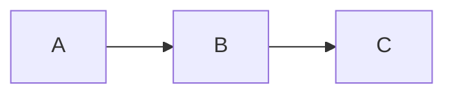

# mmdfmtで図だけを整形する

`mmdfmt`は、Mermaidの図だけを整形するコマンドです。
`.mmd`・`.mermaid`ファイルと、
Markdown内の`mermaid`・`mmd`コードブロックを整形します。
Markdownファイルのほかの部分は、1バイトも変えません。

Markdownを別のツールで整形している場合や、整形していない場合など、
PrettierでMarkdownを整形しないときに使います。
[`prettier-plugin-mmd`](./index.ja.md)がコードブロックを整形するには、
Prettierを通す必要があり、PrettierはMarkdownファイル全体を整形します。
`mmdfmt`は、図だけをPrettierとプラグインで整形するため、
図の整形結果はプラグインと同じで、プロジェクトにPrettierの設定は不要です。

## インストール

プロジェクトに`mmdfmt`をインストールします。

```sh
npm install --save-dev mmdfmt
```

Node.js `^22.13.0 || >=24`が必要です。

## 最初のファイルを整形する

次のMarkdownを`notes.md`として保存します。

<!-- prettier-ignore -->
````md
# Notes

*   Prettier would rewrite this list item.


````

ファイルを指定し、`--write`で`mmdfmt`を実行します。

```sh
npx mmdfmt --write notes.md
```

`mmdfmt`は、変わるファイルを書き換え、標準出力にその一覧を書きます。
変わるのは図だけで、リスト項目の`*`と空白はそのまま残ります。

<!-- prettier-ignore -->
````md
# Notes

*   Prettier would rewrite this list item.


````

プロジェクト全体を整形するには、globを指定します。
シェルではなく`mmdfmt`が展開するように、引用符で囲みます。

```sh
npx mmdfmt --write "**/*.{md,mmd,mermaid}"
```

## CIで整形を確認する

`--check`はファイルを変えず、`--write`で変わるファイルを列挙します。
変わるファイルがあると終了コード`1`を返すため、
CIジョブを失敗させることができます。

```sh
npx mmdfmt --check "**/*.{md,mmd,mermaid}"
```

## 標準入力

`--stdin-filepath`は標準入力を整形し、結果を標準出力に書きます。
パスは、テキストが図かMarkdownかと、
どの設定と無視ファイルが適用されるかを示します。
そのパスのファイルを読み書きすることはありません。

```sh
npx mmdfmt --stdin-filepath diagram.mmd < diagram.mmd
```

## 整形するファイル

パターンには、ファイルのパス、ディレクトリーのパス、globを指定できます。
パターンで選ばれたファイルのうち、
拡張子が`.md`・`.markdown`・`.mmd`・`.mermaid`のものを整形します。
そのどれも選ばないパターンはエラーです。

PrettierのCLIと同じく、`mmdfmt`は、
`node_modules`やバージョン管理のディレクトリーの下にあるファイルを除外します。
カレントディレクトリーに`.gitignore`や`.prettierignore`があれば、
それらが挙げるファイルも除外します。
Markdownでは、
`<!-- prettier-ignore -->`の直後のコードブロックをそのまま残します。

## インデント

`mmdfmt`には整形オプションはありません。
図のインデントはスペース2個です。
プロジェクトにPrettierの設定や`.editorconfig`がある場合は、
その`tabWidth`と`useTabs`を使います。
[オプション](./options.ja.md)では、これらによる図のインデントを説明しています。
設定のほかの項目は使いません。

## エラーと終了コード

mermaid.jsが拒否する図は、そのまま残します。
`.mmd`・`.mermaid`ファイルではエラーです。
Markdownのコードブロックでは警告になり、ファイルのほかのブロックは整形します。
文書は拒否される図を意図して載せることがあるためです。
エラーと警告は、ファイル内の行と桁を付けて標準エラー出力に書きます。

```txt
docs/flow.mmd:3:1: error: Unexpected end of text
notes.md:6:1: warning: Unexpected end of text
```

| 終了コード | 意味                                                  |
| ---------- | ----------------------------------------------------- |
| `0`        | 問題がなく、`--check`ではどのファイルも整形済みです。 |
| `1`        | `--check`で、変わるファイルがあり、問題はありません。 |
| `2`        | エラーです。                                          |

エラーとは、図のファイルの構文エラー、読み込みか書き込みができないファイル、
ファイルを選ばないパターン、読み込めないPrettierの設定、
オプションの誤った使い方です。
エラーがあれば、変わるファイルがあっても終了コードは`2`です。

## Prettierとプラグインによる整形との違い

Markdownでは、Prettierとプラグインによる整形と結果が異なる点が2つあります。

- Prettierは、コードブロックの最後の行の末尾の空白を、
  mermaid.jsが読む場合も取り除きます（[互換性](./compatibility.ja.md)）。
  `mmdfmt`はブロックのテキストだけを置き換えるため、その空白は残ります。
- Prettierは、Markdownのコードブロック（`md`と指定したものなど）を、
  Markdown文書として整形し、その中のコードブロックの図も整形します。
  `mmdfmt`はほかのコードブロックをすべてそのまま残します。

[`mmdfmt`のREADME](../../../mmdfmt/README.ja.md)では、
リストや引用内のコードブロック、インデント内のタブ、改行コードなど、
すべての場合を詳しく説明しています。
