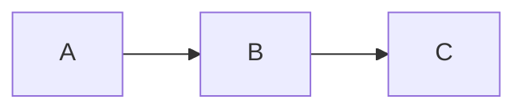

# mmdfmtで図だけを整形する

Markdownと`.mmd`ファイルの[Mermaid](https://mermaid.js.org/)の図を整形し、
ほかはすべて書いたまま残します。

`mmdfmt`は`.mmd`と`.mermaid`ファイルと、
`.md`と`.markdown`ファイルの`mermaid`と`mmd`コードブロックを整形します。
Markdownファイルのほかの部分は、1バイトも変えません。
図は、[Prettier](https://prettier.io/)と、
そのMermaidプラグインの[`prettier-plugin-mmd`](./index.ja.md)で整形します。
[Prettierを知っている方へ](#prettierを知っている方へ)の場合を除き、
プラグインと同じ結果になります。

## どんなときに使うか

図を整形したいけれど、MarkdownはPrettierで整形しないときに使います。

- `markdownlint --fix`やdprintなど、別のフォーマッターでMarkdownを整形する。
  Prettierを使うと、同じテキストをPrettierのやり方で書き換えてしまいます。
- Markdownを、意図して書いたまま保つ。
- ほかのファイルにはPrettierを使い、Markdownには使わない。

すでにPrettierでMarkdownを整形しているなら、
代わりに`prettier-plugin-mmd`を追加してください。
同じ実行で図も整形されるため、`mmdfmt`は不要です。

`mmdfmt`はPrettierの設定なしに、1つのコマンドで使えます。

## しないこと

- 図のほかは整形しません。
- 図の誤りは、mermaid.jsが拒否するもの以外は報告しません。
  それは[`@mmd-toolkit/eslint-plugin`](../linter/index.ja.md)が行います。

## まず使ってみる

`mmdfmt`にはNode.js `^22.13.0 || >=24`が必要です。
`--write`はファイルを直接書き換えるので、先に作業をコミットするか、
`npx mmdfmt --check .`でどのファイルが変わるか確認してください。
現在のディレクトリの下にある図をすべて整形するには、次を実行します。

```sh
npx mmdfmt --write .
```

変わるのは図だけです。
この`notes.md`は、

<!-- prettier-ignore -->
````md
# Notes

*   A list item that mmdfmt leaves as it is.


````

次のようになります。

<!-- prettier-ignore -->
````md
# Notes

*   A list item that mmdfmt leaves as it is.


````

`mmdfmt`をインストールしていない場合、`npx`はダウンロードしてよいか尋ね、
最新版を実行します。
同じバージョンを使い続けるには、[インストール](#インストール)してください。

## インストール

`mmdfmt`の新しいバージョンでは、図の整形が少し変わることがあります。
プロジェクトに関わる全員とCIが同じように整形するよう、
プロジェクトでバージョンを厳密に固定します。

```sh
npm install --save-dev --save-exact mmdfmt
```

pnpmでは、`pnpm add --save-dev --save-exact mmdfmt`を使います。
以降は`npx mmdfmt`（または`pnpm exec mmdfmt`）がそのバージョンを実行します。

自分で複数のリポジトリにまたがって使うには、グローバルにインストールし、
`mmdfmt`として実行します。

```sh
npm install --global mmdfmt
```

グローバルなインストールはプロジェクトに固定されないので、
2台のマシンで図の整形結果が異なることがあります。

## 使い方

```sh
mmdfmt --write [--check | --list-different] <pattern>...
mmdfmt --check <pattern>...
mmdfmt --list-different <pattern>...
mmdfmt --stdin-filepath <path>
```

| オプション                | 動作                                                                           |
| ------------------------- | ------------------------------------------------------------------------------ |
| `-w`, `--write`           | ファイルを直接整形し、整形した各ファイルを所要時間とともに標準出力に挙げます。 |
| `-c`, `--check`           | 整形済みか確認し、要約と整形されていないファイルを報告します。                 |
| `-l`, `--list-different`  | 何も変えず、`--write`が変えるファイルを標準出力に挙げます。                    |
| `--stdin-filepath <path>` | 標準入力を`<path>`のファイルとして整形し、標準出力に書きます。                 |
| `-h`, `--help`            | 使い方を標準出力に書きます。                                                   |
| `-v`, `--version`         | バージョンを標準出力に書きます。                                               |

`--write`、`--check`、`--list-different`の少なくとも1つにパターンを付けます。
`--write`は`--check`か`--list-different`のどちらかと組み合わせられます。
`--write --check`はファイルを書き換え、チェックの要約と警告を出力します。
`--write --list-different`はファイルを書き換えて、変わったものだけを挙げます。
`--check`と`--list-different`は組み合わせられません。
`--no-write`、`--no-check`、`--no-list-different`は、そのオプションを外します。
`--stdin-filepath`はパターンを取らず、
一緒に使うと`--write`はファイルを書きません。
`--help`と`--version`は、表のほかのオプションを一緒に付けても出力するだけです。
引数がまったくないときは、`mmdfmt`は使い方を標準エラー出力に書き、
`2`で終了します。

`--write`単独ではPrettierと同じく、整形したファイルごとに1行出力します。
その名前と整形にかかった時間を、`docs/flow.mmd 12ms`のように書き、
変わらなかったファイルには、その後ろに`(unchanged)`を付けます。
色を出せる端末では、変わらなかったファイルの名前は灰色です。
変わったファイルだけを挙げるには、`--write --list-different`を付けます。
`mmdfmt`が出力するファイルの名前は、実行するディレクトリからの相対パスで、
WindowsでもPrettierと同じく、区切りは`/`です。

ほかのオプションはありません。
整形オプションも、独自の設定ファイルも、
無視ファイルを指定するオプションもありません。
値を取らないオプションは、`=`の後ろの値を無視します。
`--write=false`は`--write`と同じに読みます。

`head`が必要な行数を読み終えたときのように、標準出力の読み手がいなくなると、
`mmdfmt`はそこへの出力を止め、何も報告せずに最後まで処理します。
`--write`は引き続きすべてのファイルを書き換え、
終了コードも処理の結果を示します。

### パターン

- ファイルのパスは、そのファイルを選びます。
- `.`などのディレクトリのパスは、その下のファイルを選びます。
- ほかのパターンはglobで、名前がドットで始まるものにも一致します。
  シェルではなく`mmdfmt`が展開するよう、引用符で囲みます。
  例: `npx mmdfmt --write "docs/**/*.md"`。
  Windowsでは、globの`\`を`/`と読みます。
- `!`で始まるパターンは、
  一致するファイルをほかのパターンの選択から取り除きます。
  [ファイルの除外](#ファイルの除外)を参照してください。
- `--`の後ろの引数はすべてパターンなので、`mmdfmt --write -- -a.md`のように、
  `-`で始まる名前のファイルも渡せます。

選んだファイルのうち、名前が`.md`、`.markdown`、`.mmd`、
`.mermaid`で終わるものを、いくつのパターンが選んでも1回ずつ整形します。
そのどれも選ばないパターンはエラーです。
そのようなファイルのないプロジェクトでは`mmdfmt --check .`は失敗し、
ほかの拡張子のファイルを名前で指定しても同じです。
PrettierのCLIと同じく、
`!`のパターンによって選んだファイルがすべて取り除かれるパターンもエラーです。
`.gitignore`が挙げるファイルだけを選ぶパターンはエラーではありません。

PrettierのCLIと同じく、`mmdfmt`は、
`node_modules`やバージョン管理のディレクトリ内のパスを名指すパターンを、
ファイル、ディレクトリ、globのどれであっても何も報告せずに飛ばします。
例: `node_modules/pkg`や`"node_modules/**/*.md"`。
ファイルを選ぶパターンが1つも残らないときはエラーです。

## ファイルの除外

`mmdfmt`は次のファイルを除外します。

- `node_modules`と、バージョン管理のディレクトリ（`.git`、`.hg`、`.jj`、`.sl`、
  `.svn`）の下にあるファイル。
  パターンで名指す場合も同じです（[パターン](#パターン)）。
- `mmdfmt`を実行するディレクトリの`.gitignore`が挙げるファイル。
  サブディレクトリや親ディレクトリの`.gitignore`は読みません。
- `!`のパターンに一致するファイル。
  bashでは、二重引用符内の`!`は履歴展開を始めるため、単一引用符で囲みます。
  例: `npx mmdfmt --write . '!vendor/**'`。
  Windowsのコマンドプロンプトでは二重引用符を使います。

`mmdfmt`は`.prettierignore`を読みません。
そこにMarkdownを挙げてPrettierで整形しないようにしたプロジェクトでも、
図を整形できます。

Markdownファイルの図を1つそのまま残すには、
コードブロックの前に`<!-- prettier-ignore -->`を置き、
間には空行以外を入れません。
リストや引用の外では、
`<!-- prettier-ignore-start -->`と
`<!-- prettier-ignore-end -->`の間の図をすべてそのまま残します。
これらはPrettierが読むコメントです。
`.mmd`ファイル全体をそのまま残すには、`!`のパターンか`.gitignore`で除外します。

## CIで確認する

プロジェクトに`mmdfmt`をインストールし、
CIで依存パッケージをインストールして（`npm ci`）、次を実行します。

```sh
npx mmdfmt --check .
```

依存パッケージをインストールしていないと、
`npx`は固定したバージョンではなく最新版を実行してしまいます。

`--check`は、`Checking formatting...`を標準出力に書き、
変わるファイルごとに`[warn] <name>`を標準エラー出力に書き、
最後に要約を1つ書きます。
変わるファイルがあれば、要約は標準エラー出力に書き、終了コードは`1`です。

```txt
[warn] Code style issues found in the above file. Run mmdfmt with --write to fix.
```

該当するファイルが複数なら、`in the above file`は`in <n> files`になります。
色を出せる端末では、`warn`の語は黄色です。
変わるファイルがなければ、
要約は標準出力の`All diagrams in the matched files use Prettier code style!`で、
終了コードは`0`です。
`--list-different`は、変わるファイルの名前だけを標準出力に書き、
終了コードは同じです。

`--write --check`では、ファイルを書き換え、
要約は`[warn] Code style issues fixed in the above file.`で、
複数なら末尾が`in <n> files.`になり、終了コードは`0`です。
エラーがあれば、終了コードは`2`です。
そのときの要約は、[エラーと終了コード](#エラーと終了コード)に書いてあります。

mermaid.jsが拒否する図のある`.mmd`や`.mermaid`ファイルは、
`2`でチェックに失敗します。
Markdown内の図をmermaid.jsが拒否しても、警告にとどまります。
文書では壊れた図を意図して示すことがあり、
`mmdfmt`にはそれで失敗させるオプションはありません。
そのような図でCIを失敗させるには、
図を報告する[`@mmd-toolkit/eslint-plugin`](../linter/markdown.ja.md)で
Markdownをlintします。

図のファイルが1つもないプロジェクトでは、`--check .`は`2`で失敗します。
`.`の代わりに、図のあるディレクトリを指定してください。

## コミット前に整形する

huskyやsimple-git-hooksなどのGitフックマネージャーがコミットごとに実行する
[lint-staged](https://github.com/lint-staged/lint-staged)を使う場合は、
`package.json`に次を追加します。

```json
{
  "lint-staged": {
    "*.{md,markdown,mmd,mermaid}": "mmdfmt --write"
  }
}
```

globはこの4つの拡張子に限ってください。
`mmdfmt`にはPrettierの`--ignore-unknown`のようなオプションはなく、
ほかの拡張子のファイルはエラーです。
lint-stagedが渡す絶対パスを、`mmdfmt`は受け付けます。

## エディターやほかのツールから使う

`mmdfmt`にはエディターの拡張機能はありません。
標準入力に対してフォーマッターを実行するエディターやツールでは、
ファイルのテキストを標準入力に渡して次を実行し、
標準出力から整形結果を受け取れます。

```sh
mmdfmt --stdin-filepath docs/guide.md
```

そのパスのファイルは、読み書きしません。
相対パスは`mmdfmt`を実行するディレクトリを基準に解決します。
パスの拡張子がテキストを図として読むかMarkdownとして読むかを決め、
ディレクトリがどの`.editorconfig`とPrettierの設定を適用するかを決めます。

- Markdownのテキストは、整形したか、すでに整形済みかにかかわらず全体を出力し、
  図が拒否されても終了コードは`0`です。
  警告は標準エラー出力に書きます。
- mermaid.jsがテキストを拒否する図では、標準出力に何も書かず、
  標準エラー出力にエラーを書き、終了コードは`2`です。
- `node_modules`やバージョン管理のディレクトリの下にあるパス、
  または`mmdfmt`を実行するディレクトリの`.gitignore`が挙げるパスでは、
  テキストをそのまま返します。
- `--check`や`--list-different`では、テキストを出力しません。
  変わるなら、`--write`も付けたときを除き、標準出力に`(stdin)`を書き、
  終了コードは`1`です。
  それ以外は何も書かず、終了コードは`0`です。
  警告の位置は、読んだときのテキストの中の位置です。
- ほかの拡張子のパスはエラーです。

## スクリプトから使う

エディターの拡張機能や言語サーバーなど、Node.js向けに書かれたツールは、
`mmdfmt`コマンドを実行しなくても、
コマンドと同じようにファイルの図を整形できます。
Node.js向けに書かれていないツールは、
[`--stdin-filepath`](#エディターやほかのツールから使う)を付けて、
コマンドを実行できます。
新しいバージョンでは図の整形が少し変わることがあるため、
ツールの依存パッケージに`mmdfmt`を追加するときは、
[インストール](#インストール)と同じようにバージョンを固定します。

```sh
npm install --save-exact mmdfmt
```

Node.js `^22.13.0 || >=24`が必要です。
`mmdfmt`から、関数`resolveConfig`、`format`、
`clearConfigCache`をインポートして使います。
引数と戻り値はPrettierの同じ名前の関数にそろえてあり、
違う点は関数ごとの節で説明します。
次の例は、`docs/notes.md`の図を整形します。

```js
import { readFile } from "node:fs/promises"
import { format, resolveConfig } from "mmdfmt"

const filepath = "docs/notes.md"
const source = await readFile(filepath, "utf8")
const config = await resolveConfig(filepath)
const formatted = await format(source, { ...config, filepath })
```

`formatted`には、
コマンドが`docs/notes.md`を整形して書き出すのと同じテキストが入ります。
図は整形され、ほかの部分は書かれたままです。
ファイルに書き込むかどうかは、ツールが決めます。

### `resolveConfig(fileUrlOrPath)`

`resolveConfig`は、
ファイルに適用されるPrettierの設定ファイルと`.editorconfig`を、
コマンドと同じように`overrides`も含めて探します（[設定](#設定)を参照）。
引数には、ファイルのパスかファイルURLを渡します。
相対パスは現在のディレクトリを基準に解決されるため、
言語サーバーでは絶対パスかURLを渡します。
ファイルそのものは読まないので、存在しないファイルのパスでもかまいません。

`resolveConfig`はPromiseを返します。
ファイルに適用される設定があれば、
Promiseは`format`に渡すオプションのオブジェクトで解決され、
なければ`null`で解決されます。
`null`を展開しても何も加わらないため、
`{ ...config, filepath }`はどちらの場合にも使えます。
オブジェクトが持つのは、`mmdfmt`が設定から読む8つのオプションのうち、
設定が指定しているものだけです。
8つのオプションの一覧は、[設定](#設定)にあります。
たとえば、設定が`tabWidth`を指定していなければ、
`{ tabWidth: 4, ...config, filepath }`の`tabWidth`は4のままです。
TypeScriptでは、このオブジェクトの型は`ReadOptions`です。
設定ファイルを読めないときは、Promiseは拒否されます。

`resolveConfig`は、コマンドと同じく`.editorconfig`も読みます。
PrettierのCLIも既定では読みますが、Prettierの`resolveConfig`が読むのは、
`editorconfig: true`を渡したときだけです。

### `clearConfigCache()`

`resolveConfig`は、Prettierの`resolveConfig`と同じく、
一度読んだ設定ファイルの内容をプロセスが終わるまで覚えています。
そのため、後で設定ファイルが変わっても、`resolveConfig`の結果は変わりません。
エディターのファイル監視などで、
Prettierの設定ファイルや`.editorconfig`が変わったことをツールが知ったときは、
`clearConfigCache`を呼び出します。
すると、次に`resolveConfig`を呼び出したときに、設定ファイルを読み直します。
`clearConfigCache`は、
覚えていた内容を消し終えたときに解決されるPromiseを返します。

### `format(source, options)`

`format`は、Prettierの`format`と同じようにテキストを整形します。
ただしMarkdownでは、Mermaidのコードブロックだけを整形し、
ほかは書かれたまま残します。
ファイルも設定も読みません。

- `source`: ファイルのテキスト。
- `options.filepath`: ファイルのパスで、必須です。
  パスのうち使うのは拡張子だけで、
  拡張子が`.mmd`か`.mermaid`ならテキストを1つの図として、
  `.md`か`.markdown`ならMarkdownとして読みます。
  ファイルは存在しなくてもかまいません。
- ほかのオプション: 同じパスについて`resolveConfig`が返したものを渡します。
  設定の`overrides`は、パスによって適用されるかどうかが変わるためです。
  使えるのは、[設定](#設定)に挙げた8つのオプションです。
  Markdownでは、`printWidth`はファイル全体の行の幅です。
  リスト項目や引用の中の図は、その幅から、
  図の各行の前にあるものの幅を引いた幅で整形します。
  詳しくは、
  [コードブロックの詳細](../../../mmdfmt/README.ja.md#コードブロックの詳細)
  を参照してください。
- `filepath`とこの8つ以外のオプション（`parser`、`endOfLine`、`semi`など）は、
  TypeScriptでは型エラーになり、JavaScriptでは無視されます。
  TypeScriptでは、`format`のオプションの型は`FormatOptions`です。

`format`は、整形したテキストで解決されるPromiseを返します。
改行コードとバイトオーダーマークは、テキストに書かれたまま残ります。
詳しくは、
[コードブロックの詳細](../../../mmdfmt/README.ja.md#コードブロックの詳細)
を参照してください。

Markdownでは、`format`は次の3種類のブロックを書かれたまま残し、
どれも報告しません。

- mermaid.jsが拒否する図。
- インデントにあるタブの一部がインデント、残りが図と読まれるブロック。
- 開きフェンスが脚注のラベルの行にあるブロック。

後の2種類は、
[コードブロックの詳細](../../../mmdfmt/README.ja.md#コードブロックの詳細)
で説明しています。
Prettierも、整形できない埋め込みのコードブロックを同じように残します。
mermaid.jsが拒否する図を見つけるには、
[`@mmd-toolkit/parser`](../parser/index.ja.md)で解析するか、
[`@mmd-toolkit/eslint-plugin`](../linter/index.ja.md)でファイルをlintします。

Promiseは、次のときに拒否されます。

- `.mmd`か`.mermaid`のテキストをmermaid.jsが拒否するときは、
  `SyntaxError`で拒否されます。
  このエラーは、
  Prettierが`prettier-plugin-mmd`でテキストを整形するときに投げるものです。
  エラーの`loc.start`と`loc.end`は、
  エラーの範囲の始まりと終わりを`line`と`column`で示します。
  `line`と`column`は、どちらも1から数えます。
  改行の位置のエラーのように、エラーの範囲が後の行の始まりまで続くときは、
  `loc.end`はありません。
- オプションにPrettierが受け付けない値があるときは、
  Prettierのエラーで拒否されます。
  たとえば`printWidth: "wide"`なら、エラーは`Invalid printWidth value. …`です。
  `.mmd`か`.mermaid`のテキストでは、
  mermaid.jsが図を拒否するかどうかにかかわらず、そうなります。
  Markdownのテキストでも、`mmdfmt`が図を整形するコードブロックを1つでも持てば、
  その図をmermaid.jsが拒否するかどうかにかかわらず、そうなります。
  どのブロックの図を整形するかは、
  [コードブロックの詳細](../../../mmdfmt/README.ja.md#コードブロックの詳細)
  にあります。
  そのようなブロックのないMarkdownのテキストは、そのまま返します。
  `mermaid`や`mmd`のコードブロックがないものと、
  そのようなブロックがどれも書かれたまま残されるものです。
  書かれたまま残されるのは、次のブロックです。
  - `<!-- prettier-ignore -->`の後のブロック。
  - `<!-- prettier-ignore-start -->`と、
    `<!-- prettier-ignore-end -->`の間のブロック。
  - 開きフェンスが脚注のラベルの行にあるブロック。
  - 字下げのタブの一部が図と読まれるブロック。
- `options.filepath`の拡張子が`.md`、`.markdown`、`.mmd`、
  `.mermaid`のどれでもないときは、エラーで拒否されます。

### 整形するファイル

コマンドが整形するのは、拡張子が`.md`、`.markdown`、`.mmd`、
`.mermaid`のファイルだけです。
また、`node_modules`やバージョン管理のディレクトリの下にあるパスと、
実行するディレクトリの`.gitignore`が挙げるパスは飛ばします。
詳しくは、[ファイルの除外](#ファイルの除外)を参照してください。
`format`は、ほかの拡張子のパスを拒否しますが、それ以外は、
パスがどこにあっても整形します。
コマンドと同じファイルを飛ばしたいツールは、
`format`を呼び出す前にパスを調べます。

## 設定

図のインデントは空白2つで、行の幅はPrettierの80です。
ファイルに`.editorconfig`やPrettierの設定が適用されるときは、
`mmdfmt`はそのうち8つのオプションを読みます。
`overrides`も含めてPrettierのCLIと同じように探します。
`.editorconfig`の`indent_style`、`indent_size`、`tab_width`、
`max_line_length`と、Prettierの設定ファイルのオプションです。
設定ファイルについては、
[Prettierの文書](https://prettier.io/docs/configuration)を参照してください。
コードブロックでは、そのファイルはMarkdownファイルです。
読めない設定ファイルはエラーです。
たとえば、この`.editorconfig`は図に空白4つのインデントを付け、
行を100桁まで許します。

```ini
[*.{md,mmd,mermaid}]
indent_style = space
indent_size = 4
max_line_length = 100
```

読む8つのオプションは次のとおりです。

- `printWidth`は行の幅です。
  行の幅が図の中で決めるのは、2つです。
  1行に書いたデータブロック`@{ … }`を複数行で印字するかどうかと、
  Ganttのセクションのタスクの`:`をそろえるかどうかです。
  詳しくは、
  [フォーマッターのオプション](./options.ja.md#行の長さ)を参照してください。
  `max_line_length = off`は制限なしです。
  リスト項目や引用の中のコードブロックでは、`printWidth`は、
  各行の前に`mmdfmt`が書くものの幅を引いた幅です。
  詳しくは、
  [`mmdfmt`のREADME](../../../mmdfmt/README.ja.md#コードブロックの詳細)
  を参照してください。
- `tabWidth`と`useTabs`は、図のインデントを決めます。
- `embeddedLanguageFormatting`、`singleQuote`、`bracketSpacing`、`proseWrap`、
  `trailingComma`は、図のYAML frontmatterに効きます。
  Prettierが`prettier-plugin-mmd`で整形する場合と同じです。
  `embeddedLanguageFormatting: "off"`はfrontmatterを書かれたまま残します。

`mmdfmt`はこれ以外のオプションを読みません。
後の版のPrettierが足すオプションも読みません。
範囲（`rangeStart`と`rangeEnd`）、`cursorOffset`、
プラグマのオプション（`requirePragma`、`insertPragma`、`checkIgnorePragma`）、
`filepath`、ほかの言語のオプションは使いません。
`plugins`と`parser`も使いません。
`mmdfmt`は常に`prettier-plugin-mmd`で整形するので、
設定が挙げるプラグインは読み込みません。
`endOfLine`は使いません。
ファイルの改行コードを残すからです。
詳しくは、
[`mmdfmt`のREADME](../../../mmdfmt/README.ja.md#コードブロックの詳細)
を参照してください。

## エラーと終了コード

mermaid.jsが拒否する図はそのまま残し、行と桁を付けて標準エラー出力に報告します。
ほかのファイルと、同じファイルのほかの図は整形します。

```txt
docs/flow.mmd:3:1: error: Unexpected end of text
notes.md:6:1: warning: Unexpected end of text
```

`.mmd`や`.mermaid`ファイルではエラーです。
Markdownのコードブロックでは警告です。
`--write`と`--stdin-filepath`では、警告の位置は整形後のテキストの位置です。
それより前の図の行が増減していても、実行後に開くテキストのブロックを指します。
`--write`のない`--check`と`--list-different`では、整形前のファイル内の位置です。
行と桁は1から数え、桁は多くのエディターと同じくUTF-16のコード単位で数えます。
どの図が拒否されるかは、
[フォーマッターの互換性](./compatibility.ja.md)で説明しています。

| コード | 意味                                                                                             |
| ------ | ------------------------------------------------------------------------------------------------ |
| `0`    | エラーがなく、`--check`と`--list-different`では変わるファイルがないか、`--write`が付いています。 |
| `1`    | `--write`のない`--check`か`--list-different`で、変わるファイルがあり、エラーはありません。       |
| `2`    | エラーです。                                                                                     |

エラーとは、`.mmd`や`.mermaid`ファイル内の拒否された図、
読めないか書けないファイル、ファイルを選ばないパターン、読めない設定、
オプションの誤った使い方です。
エラーがあれば、変わるファイルがあっても終了コードは`2`です。

`.mmd`や`.mermaid`ファイルの図をmermaid.jsが拒否するときのように、
ファイルを整形できないとき、`--check`の要約は、
標準出力の`Error occurred when checking code style in the above file.`で、
複数なら末尾が`in <n> files.`になります。
Prettierの`--check`と同じく、要約は整形できないファイルだけを数えます。
読めないファイルと、ファイルを選ばないパターンは、エラーとして報告しますが、
要約はそれらがないときと同じです。
パターンがファイルを1つも選ばないときもそうです。
書けないファイルは、問題を修正したファイルとして数え、
`--write`と`--write --list-different`でも名前を挙げます。

## Prettierを知っている方へ

図はPrettierと`prettier-plugin-mmd`で整形するので、
プラグインの規則が適用されます。
Markdownと`.mmd`ファイルにPrettierとプラグインを使う場合とは、
結果が5点で異なります。

- Prettierは、コードブロックの最後の行の末尾の空白を、
  mermaid.jsが図の一部として読む場合も、
  取り除きます（[行末の空白](./compatibility.ja.md#行末の空白)）。
  `mmdfmt`はブロックのテキストだけを置き換えるので、その空白は残ります。
- Prettierは、`md`と指定したものなど、
  MarkdownのコードブロックをMarkdown文書として整形し、
  その中のコードブロックの図も整形します。
  `mmdfmt`はほかのコードブロックをすべてそのまま残します。
- Prettierはリスト項目や引用で行の前にあるものを自分で印字しますが、
  `mmdfmt`は書かれたまま残します。
  リスト項目では、Prettierはマーカーを印字して内容を`tabWidth`にそろえます。
  引用では、`> `を印字し、`>`とフェンスの間の空白とタブを取り除きます。
  内容の桁が違うと、項目や引用の中の図に残る行の幅がその差だけ違い、
  幅の近くにある1行のブロックを、一方は分け、他方は分けないことがあります。
- リスト項目や引用の中では、PrettierはGanttのセクションのコロンを、
  行の前にあるものを数えずにそろえるので、
  そろえた行が行の幅を超えることがあります。
  `mmdfmt`はそれを数えるので、幅の近くでは、Prettierはセクションをそろえ、
  `mmdfmt`はそろえないことがあります。
  そのとき`mmdfmt`はコロンをそろえるために名前を空白で埋めず、
  各コロンの前の空白は書かれたままです。
  行の幅より広く書かれた行も、そのままです。
  タスクは、どのGanttの図でも同じ字下げに直すので、書かれた字下げが違うと、
  コロンは行といっしょに動きます。
- Prettierは、次の4つの設定のもとで、図を書かれたまま残します。
  `requirePragma: true`は、ファイルの先頭に、
  `<!-- @format -->`か`<!-- @prettier -->`のコメントがない、
  Markdownファイルを残します。
  frontmatterがあるときは、その後ろが先頭です。
  `checkIgnorePragma: true`は、そこに、
  `<!-- @noformat -->`か`<!-- @noprettier -->`のコメントがある、
  Markdownファイルを残します。
  ファイル全体を覆わない範囲は、Markdownファイルも`.mmd`ファイルも残します。
  `embeddedLanguageFormatting: "off"`は、
  Markdownファイルのすべてのコードブロックを残します。
  `mmdfmt`は、この4つのどれのもとでも図を整形します。
  最初の3つは読みません。
  どのファイルを整形するかは自分で決め（パターンと`.gitignore`）、
  図全体を整形するからです。
  `embeddedLanguageFormatting`は図のfrontmatterにだけ読み、
  そのときはfrontmatterを書かれたまま残します。

コマンドもPrettierのCLIとは異なります。
`.prettierignore`は読まず、`--ignore-path`、`--ignore-unknown`、
独自の整形オプションはなく、設定は図のためだけに読みます。
`mmdfmt`が読まないオプションに、Prettierが拒む値を書いても、
ここではエラーになりません。
PrettierのCLIはそれをエラーにします。
たとえば、`semi: "yes"`です。

チェックの成功時には、
Prettierの`All matched files use Prettier code style!`の代わりに、
`All diagrams in the matched files use Prettier code style!`と書きます。
`mmdfmt`は図のほかを整形しないので、
Markdownファイルの残りの部分はその形式とは限らないためです。
警告は`mmdfmt --write`の実行を案内します。
`prettier --write`ではMarkdownファイル全体が整形され、
プラグインが設定されていないと図は整形されないためです。

Prettierは`--write=false`をfalseと読みます。
`mmdfmt`は、値を取らないオプションでは`=`の後ろの値を無視し、
`--write`と読みます。
`--check=false`と`--list-different=false`も同じです。
また、Prettierは`--write`の後ろに書いた`true`や`false`をその値と読みますが、
`mmdfmt`はパターンと読みます。
そのため、`mmdfmt --write false notes.md`は`notes.md`を整形し、
`false`に合うファイルがないと報告します。

`--check --list-different`はどちらでもエラーです。
`mmdfmt`は、ほかのオプションの誤った使い方と同じく`2`で終了し、書く誤りの文は、
`mmdfmt: error: Optional argument '--check' conflicts with '--list-different'`。
Prettierは`[error] Cannot use --check and --list-different together.`を書き、
`1`で終了します。
`mmdfmt`は、一緒に使えるオプションかを確かめるとき、
`--no-`の形もそのオプションを付けたと数えます。
そのため、`--check --list-different`と同じく、
`--no-check --list-different`もエラーになります。
Prettierは`--no-check --list-different`を受け付けます。

標準入力で`--check`や`--list-different`を使うとき、
Prettierは読めないテキストでも`0`で終了しますが、`mmdfmt`は、
ほかの場合と同じく、
拒否された図では`2`で終了します（[エラーと終了コード](#エラーと終了コード)）。
`.mmd`や`.mermaid`のファイルの拒否された図を、`mmdfmt`は、
`docs/flow.mmd:3:1: error: Unexpected end of text`のように、
位置を付けた1行で報告します。
Prettierは`[error] docs/flow.mmd: SyntaxError: Unexpected end of text`を書き、
続けてその場所の前後の行を、それぞれ`[error]`の後に書きます。
Markdownのファイルの中の拒否された図では、
`mmdfmt`は`notes.md:6:1: warning: Unexpected end of text`のような警告を1行書き、
Prettierは何も書きません。
どちらも、これをエラーとはしません。

Prettierは、`CI`の環境変数があるときやWindowsでは、
出力先が端末でなくても`warn`の語を黄色にし、
変わらなかったファイルの名前を灰色にします。
`mmdfmt`がそれらに色を付けるのは、色を出せる端末か、
`FORCE_COLOR`があるときだけで、`--color`や`--no-color`はありません。

[`mmdfmt`のREADME](../../../mmdfmt/README.ja.md#コードブロックの詳細)では、
コードブロックを詳しく説明しています。
整形するブロック、リストや引用の中のブロックと残る行の幅、
警告してそのまま残すブロック、改行コードについてです。
