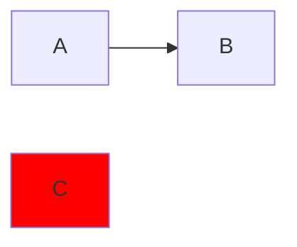

# Markdownのlint

[はじめに](./index.ja.md)の設定では、
`@eslint/markdown`のprocessorでコードブロックを取り出し、
`@mmd-toolkit/eslint-plugin`でMermaidの図をチェックします。
このページでは、対象ブロック、報告される位置、
Markdown本文もlintする場合の方法を説明します。

## コードブロックと診断

`mermaid`・`mmd`のどちらのコードブロックも対象です。
次のMarkdownを`diagram.md`として保存します。

````md
# Diagram



```mmd
sequenceDiagram
  Alice ->> Bob: Hello
```
````

Markdownファイルに対してESLintを実行します。

```sh
npx eslint diagram.md
```

`@mmd-toolkit/flowchart-no-undef`が、 `diagram.md`の7行目、
9列目の`C`を報告します。
processorは、それぞれの図の診断を元のMarkdown上の位置に対応させます。
シーケンス図の例には報告がありません。

パースのエラーも、Markdown上の位置で報告します。
Mermaidブロックに図のヘッダーがない場合や、対応していない構文がある場合は、
ルールを実行する前にパースのエラーを報告します。
フェンスの間に 1 行もないブロックは報告されません。
対応する構文は、[図の対応状況](../reference/support.ja.md)を参照してください。

他の言語のコードブロックは、`@mmd-toolkit/eslint-plugin`の対象外です。
それぞれの言語に対応するESLintのルールや言語プラグインで設定します。

## 設定でコードブロックを指定する

processorは既定では、各ブロックに、
その言語を拡張子とする仮想ファイル名を付けます。
`mermaid`ブロックは`.md`ファイル内の`.mermaid`ファイル、
`mmd`ブロックは`.mmd`ファイルとして扱います。
そのため、`mmdToolkit.configs.recommended`が追加の設定なしに両方へ適用されます。

Markdown内の図だけルール設定を上書きするには、次の指定を使います。

```js
const mermaidCodeBlocks = {
  files: ["**/*.md/*.mmd", "**/*.md/*.mermaid"],
  rules: {
    "@mmd-toolkit/flowchart-no-undef": "warn",
  },
}
```

エクスポートする設定配列の`mmdToolkit.configs.recommended`より後に、
このオブジェクトを追加します。
設定全体とルールの選択は、[設定](./configuration.ja.md)で説明しています。
図の中の[設定コメント](./comments.ja.md)は、そのコードブロックに適用します。

## Markdown本文もlintする

`@eslint/markdown`には、役割が異なる2つの設定があります。

- `markdown.configs.processor`は、コードブロックを取り出し、
  他のルールや言語プラグインにチェックさせます。
- `markdown.configs.recommended`は、Markdownのルールで本文をチェックします。

現在のprocessorでは、
1回のESLint実行で本文とコードブロックを両方チェックすることはできません。
両方の設定を1つの配列に追加しても、
取り出したコードブロックだけが対象になります。
これは、[ESLintのprocessorの制限][processor-docs]です。

両方チェックする場合は、図の設定を`eslint.config.mjs`に残し、
本文用に`eslint.config.markdown.mjs`を作成します。

```js
import markdown from "@eslint/markdown"

export default markdown.configs.recommended
```

それぞれの設定でESLintを1回ずつ実行します。

```sh
npx eslint "**/*.md"
npx eslint --config eslint.config.markdown.mjs "**/*.md"
```

1つ目は、図の設定でコードブロックをチェックします。
2つ目は、`@eslint/markdown`の推奨ルールでMarkdown本文をチェックします。

[processor-docs]: https://github.com/eslint/markdown#processors
