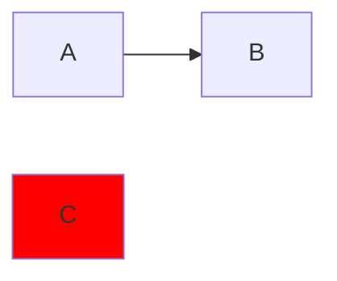

# Linting Markdown

The [getting-started configuration](./index.md) uses `@eslint/markdown`'s
processor to extract code blocks and `@mmd-toolkit/eslint-plugin` to check
Mermaid diagrams. This page explains which blocks it checks, where reports
appear, and how to also lint the Markdown content itself.

## Code blocks and diagnostics

Both `mermaid` and `mmd` code blocks are checked. Save this Markdown as
`diagram.md`:

````md
# Diagram



```mmd
sequenceDiagram
  Alice ->> Bob: Hello
```
````

Run ESLint on the Markdown file:

```sh
npx eslint diagram.md
```

`@mmd-toolkit/flowchart-no-undef` reports `C` at line 7, column 9 of
`diagram.md`. The processor maps each diagram's diagnostics back to its place in
the Markdown file. The sequence diagram produces no reports.

Parsing errors are also reported in the Markdown file. If a Mermaid block has no
diagram header or contains unsupported syntax, the plugin reports a parsing
error before running its rules. A block with no line between its fences is not
reported. See [diagram support](../reference/support.md) for the supported
syntax.

Other code-block languages are outside `@mmd-toolkit/eslint-plugin`'s scope.
Configure them with the appropriate ESLint rules or language plugins.

## Matching code blocks in configuration

By default, the processor gives each block a virtual filename ending in its
code-block language. A `mermaid` block becomes a `.mermaid` file inside its
`.md` file; an `mmd` block becomes an `.mmd` file. This lets
`mmdToolkit.configs.recommended` match both without additional configuration.

To apply a rule override only to diagrams in Markdown, use:

```js
const mermaidCodeBlocks = {
  files: ["**/*.md/*.mmd", "**/*.md/*.mermaid"],
  rules: {
    "@mmd-toolkit/flowchart-no-undef": "warn",
  },
}
```

Add this object after `mmdToolkit.configs.recommended` in your exported
configuration array. See [Configuration](./configuration.md) for a complete
setup and how to choose rules. [Configuration comments](./comments.md) inside a
diagram apply to that code block.

## Linting Markdown content too

`@eslint/markdown` provides two different configurations:

- `markdown.configs.processor` extracts code blocks for other rules and language
  plugins to check.
- `markdown.configs.recommended` checks the Markdown content itself with
  Markdown rules.

With the current processor, a single ESLint run cannot check both the Markdown
content and its code blocks. Adding both configurations to one array still
checks only the extracted blocks. This is an [ESLint processor
limitation][processor-docs].

To check both, keep your diagram configuration in `eslint.config.mjs` and create
a separate `eslint.config.markdown.mjs` for the Markdown content:

```js
import markdown from "@eslint/markdown"

export default markdown.configs.recommended
```

Run ESLint once with each configuration:

```sh
npx eslint "**/*.md"
npx eslint --config eslint.config.markdown.mjs "**/*.md"
```

The first command checks code blocks using your diagram configuration. The
second checks the Markdown content using `@eslint/markdown`'s recommended rules.

[processor-docs]: https://github.com/eslint/markdown#processors
