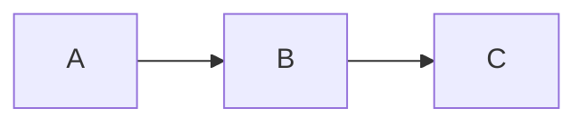

# mmdfmt

英語版: [README.md](./README.md)

Markdown と `.mmd` ファイルの [Mermaid](https://mermaid.js.org/) の図を整形し、
ほかはすべて書いたまま残します。

`mmdfmt` は `.mmd` と `.mermaid` ファイルと、
`.md` と `.markdown` ファイルの `mermaid` と `mmd` コードブロックを整形します。
Markdown ファイルのほかの部分は、1 バイトも変えません。
図は、
Prettier の Mermaid プラグインである
[`prettier-plugin-mmd`](../prettier-plugin-mmd) を使って
[Prettier](https://prettier.io/) で整形するため、
[Prettier を知っている方へ](#prettier-を知っている方へ)の 2 つの場合を除き、
プラグインと同じ結果になります。

[mermaid-js](https://mermaid.js.org/) とは関係のない第三者のプロジェクトです。
文書サイトに
[mmdfmt の案内](https://mmd-toolkit.github.io/mmd-toolkit/ja/formatter/mmdfmt.html)
があります。

## どんなときに使うか

図を整形したいけれど、Markdown は Prettier で整形しないときに使います。

- `markdownlint --fix` や dprint など、
  別のフォーマッターで Markdown を整形する。
  Prettier を使うと、同じテキストを Prettier のやり方で書き換えてしまいます。
- Markdown を、意図して書いたまま保つ。
- ほかのファイルには Prettier を使い、Markdown には使わない。

すでに Prettier で Markdown を整形しているなら、
代わりに `prettier-plugin-mmd` を追加してください。
同じ実行で図も整形されるため、`mmdfmt` は不要です。

`mmdfmt` は Prettier の設定なしに、1 つのコマンドで使えます。

## しないこと

- 図のほかは整形しません。
- 図の誤りは、mermaid.js が拒否するもの以外は報告しません。
  それは [`@mmd-toolkit/eslint-plugin`](../eslint-plugin) が行います。

## まず使ってみる

`mmdfmt` には Node.js `^22.13.0 || >=24` が必要です。
引数を読む gunshi が Node.js 22 以上を必要とするため、
Node.js 20 には対応しません。
`--write` はファイルを直接書き換えるので、先に作業をコミットするか、
`npx mmdfmt --check .` でどのファイルが変わるか確認してください。
現在のディレクトリの下にある図をすべて整形するには、次を実行します。

```sh
npx mmdfmt --write .
```

変わるのは図だけです。
この `notes.md` は、

<!-- prettier-ignore -->
````md
# Notes

*   A list item that mmdfmt leaves as it is.


````

次のようになります。

<!-- prettier-ignore -->
````md
# Notes

*   A list item that mmdfmt leaves as it is.


````

`mmdfmt` をインストールしていない場合、`npx` はダウンロードしてよいか尋ね、
最新版を実行します。
同じバージョンを使い続けるには、[インストール](#インストール)してください。

## インストール

`mmdfmt` の新しいバージョンでは、図の整形が少し変わることがあります。
プロジェクトに関わる全員と CI が同じように整形するよう、
プロジェクトでバージョンを厳密に固定します。

```sh
npm install --save-dev --save-exact mmdfmt
```

pnpm では、`pnpm add --save-dev --save-exact mmdfmt` を使います。
以降は `npx mmdfmt`（または `pnpm exec mmdfmt`）がそのバージョンを実行します。

自分で複数のリポジトリにまたがって使うには、グローバルにインストールし、
`mmdfmt` として実行します。

```sh
npm install --global mmdfmt
```

グローバルなインストールはプロジェクトに固定されないので、
2 台のマシンで図の整形結果が異なることがあります。

## 使い方

```sh
mmdfmt --write [--check | --list-different] <pattern>...
mmdfmt --check <pattern>...
mmdfmt --list-different <pattern>...
mmdfmt --stdin-filepath <path>
```

| オプション                | 動作                                                             |
| ------------------------- | ---------------------------------------------------------------- |
| `-w`, `--write`           | ファイルを直接整形し、変わったものを標準出力に挙げます。         |
| `-c`, `--check`           | 整形済みか確認し、要約と整形されていないファイルを報告します。   |
| `-l`, `--list-different`  | 何も変えず、`--write` が変えるファイルを標準出力に挙げます。     |
| `--stdin-filepath <path>` | 標準入力を `<path>` のファイルとして整形し、標準出力に書きます。 |
| `-h`, `--help`            | 使い方を標準出力に書きます。                                     |
| `-v`, `--version`         | バージョンを標準出力に書きます。                                 |

`--write`、`--check`、`--list-different` の少なくとも 1 つにパターンを付けます。
`--write` は `--check` か `--list-different` のどちらかと組み合わせられます。
`--write --check` はファイルを書き換え、チェックの要約と警告を出力します。
`--write --list-different` は `--write` 単独と同じく、
ファイルを書き換えて変わったものを挙げます。
`--check` と `--list-different` は組み合わせられません。
`--stdin-filepath` はパターンを取らず、この 3 つとは組み合わせられません。
`--help` と `--version` は、
表のほかのオプションを一緒に付けても出力するだけです。
引数がまったくないときは、`mmdfmt` は使い方を標準エラー出力に書き、
`2` で終了します。

ほかのオプションはありません。
整形オプションも、独自の設定ファイルも、
無視ファイルを指定するオプションもありません。
値を取らないオプションでは、
引数のライブラリ [gunshi](https://gunshi.dev) の読み方に従い、
`=` の後ろの値を無視します。
`--write=false` は `--write` と同じに読みます。

`head` が必要な行数を読み終えたときのように、標準出力の読み手がいなくなると、
`mmdfmt` はそこへの出力を止め、何も報告せずに最後まで処理します。
`--write` は引き続きすべてのファイルを書き換え、
終了コードも処理の結果を示します。

### パターン

- ファイルのパスは、そのファイルを選びます。
- `.` などのディレクトリのパスは、その下のファイルを選びます。
- ほかのパターンは glob で、名前がドットで始まるものにも一致します。
  シェルではなく `mmdfmt` が展開するよう、引用符で囲みます。
  例: `npx mmdfmt --write "docs/**/*.md"`。
  Windows では、glob の `\` を `/` と読みます。
- `!` で始まるパターンは、
  一致するファイルをほかのパターンの選択から取り除きます。
  [ファイルの除外](#ファイルの除外)を参照してください。
- `--` の後ろの引数はすべてパターンなので、`mmdfmt --write -- -a.md` のように、
  `-` で始まる名前のファイルも渡せます。

選んだファイルのうち、名前が `.md`、`.markdown`、`.mmd`、
`.mermaid` で終わるものを、いくつのパターンが選んでも 1 回ずつ整形します。
そのどれも選ばないパターンはエラーです。
そのようなファイルのないプロジェクトでは `mmdfmt --check .` は失敗し、
ほかの語尾のファイルを名前で指定しても同じです。
Prettier の CLI と同じく、
`!` のパターンによって選んだファイルがすべて取り除かれるパターンもエラーです。
`.gitignore` が挙げるファイルだけを選ぶパターンはエラーではありません。

Prettier の CLI と同じく、`mmdfmt` は、
`node_modules` やバージョン管理のディレクトリ内のパスを名指すパターンを、
ファイル、ディレクトリ、glob のどれであっても何も報告せずに飛ばします。
例: `node_modules/pkg` や `"node_modules/**/*.md"`。
ファイルを選ぶパターンが 1 つも残らないときはエラーです。

## ファイルの除外

`mmdfmt` は次のファイルを除外します。

- `node_modules` と、バージョン管理のディレクトリ（`.git`、`.hg`、`.jj`、`.sl`、
  `.svn`）の下にあるファイル。
  パターンで名指す場合も同じです（[パターン](#パターン)）。
- `mmdfmt` を実行するディレクトリの `.gitignore` が挙げるファイル。
  サブディレクトリや親ディレクトリの `.gitignore` は読みません。
- `!` のパターンに一致するファイル。
  bash では、二重引用符内の `!` は履歴展開を始めるため、単一引用符で囲みます。
  例: `npx mmdfmt --write . '!vendor/**'`。
  Windows のコマンドプロンプトでは二重引用符を使います。

`mmdfmt` は `.prettierignore` を読みません。
そこに Markdown を挙げて Prettier で整形しないようにしたプロジェクトでも、
図を整形できます。

Markdown ファイルの図を 1 つそのまま残すには、
コードブロックの前に `<!-- prettier-ignore -->` を置き、
間には空行以外を入れません。
リストや引用の外では、
`<!-- prettier-ignore-start -->` と `<!-- prettier-ignore-end -->`
の間の図をすべてそのまま残します。
これらは Prettier が読むコメントです。
`.mmd` ファイル全体をそのまま残すには、
`!` のパターンか `.gitignore` で除外します。

## CI で確認する

プロジェクトに `mmdfmt` をインストールし、
CI で依存パッケージをインストールして（`npm ci`）、次を実行します。

```sh
npx mmdfmt --check .
```

依存パッケージをインストールしていないと、
`npx` は固定したバージョンではなく最新版を実行してしまいます。

`--check` は、`Checking formatting...` を標準出力に書き、
変わるファイルごとに `[warn] <name>` を標準エラー出力に書き、
最後に要約を 1 つ書きます。
変わるファイルがあれば、要約は標準エラー出力に書き、終了コードは `1` です。

```txt
[warn] Code style issues found in the above file. Run mmdfmt with --write to fix.
```

該当するファイルが複数なら、`in the above file` は `in <n> files` になります。
変わるファイルがなければ、
要約は標準出力の `All diagrams in the matched files use Prettier code style!`
で、終了コードは `0` です。
`--list-different` は、変わるファイルの名前だけを標準出力に書き、
終了コードは同じです。

`--write --check` では、ファイルを書き換え、
要約は `[warn] Code style issues fixed in the above file.` で、
複数なら末尾が `in <n> files.` になり、終了コードは `0` です。
エラーがあれば、終了コードは `2` で、
要約は「エラーと終了コード」に書いたものです。

mermaid.js が拒否する図のある `.mmd` や `.mermaid` ファイルは、
`2` でチェックに失敗します。
Markdown 内の図を mermaid.js が拒否しても、警告にとどまります。
文書では壊れた図を意図して示すことがあり、
`mmdfmt` にはそれで失敗させるオプションはありません。
そのような図で CI を失敗させるには、
図を報告する [`@mmd-toolkit/eslint-plugin`](../eslint-plugin) で Markdown を
lint します。

図のファイルが 1 つもないプロジェクトでは、`--check .` は `2` で失敗します。
`.` の代わりに、図のあるディレクトリを指定してください。

## コミット前に整形する

husky や simple-git-hooks などの Git フックマネージャーがコミットごとに実行する
[lint-staged](https://github.com/lint-staged/lint-staged) を使う場合は、
`package.json` に次を追加します。

```json
{
  "lint-staged": {
    "*.{md,markdown,mmd,mermaid}": "mmdfmt --write"
  }
}
```

glob はこの 4 つの語尾に限ってください。
`mmdfmt` には Prettier の `--ignore-unknown` のようなオプションはなく、
ほかの語尾のファイルはエラーです。
lint-staged が渡す絶対パスを、`mmdfmt` は受け付けます。

## エディターやほかのツールから使う

`mmdfmt` にはエディターの拡張機能はありません。
標準入力に対してフォーマッターを実行するエディターやツールでは、
ファイルのテキストを標準入力に渡して次を実行し、
標準出力から整形結果を受け取れます。

```sh
mmdfmt --stdin-filepath docs/guide.md
```

そのパスのファイルは、読み書きしません。
相対パスは `mmdfmt` を実行するディレクトリを基準に解決します。
パスの語尾がテキストを図として読むか Markdown として読むかを決め、
ディレクトリがどの `.editorconfig` と Prettier の設定を適用するかを決めます。

- Markdown のテキストは、整形したか、すでに整形済みかにかかわらず全体を出力し、
  図が拒否されても終了コードは `0` です。
  警告は標準エラー出力に書きます。
- mermaid.js がテキストを拒否する図では、標準出力に何も書かず、
  標準エラー出力にエラーを書き、終了コードは `2` です。
- `node_modules` やバージョン管理のディレクトリの下にあるパス、
  または `mmdfmt` を実行するディレクトリの `.gitignore` が挙げるパスでは、
  テキストをそのまま返します。
- ほかの語尾のパスはエラーです。

## インデント

図のインデントは空白 2 つです。
ファイルに `.editorconfig` や Prettier の設定が適用されるときは、
そのインデントを使います。
`.editorconfig` の `indent_style`、`indent_size`、`tab_width`、
または [Prettier の設定ファイル](https://prettier.io/docs/configuration)の
`useTabs` と `tabWidth` で、
`overrides` も含めて Prettier の CLI と同じように探します。
コードブロックでは、そのファイルは Markdown ファイルです。
読めない設定ファイルはエラーです。
たとえば、この `.editorconfig` は図に空白 4 つのインデントを付けます。

```ini
[*.{md,mmd,mermaid}]
indent_style = space
indent_size = 4
```

設定のほかの項目は使いません。

## エラーと終了コード

mermaid.js が拒否する図はそのまま残し、
行と桁を付けて標準エラー出力に報告します。
ほかのファイルと、同じファイルのほかの図は整形します。

```txt
docs/flow.mmd:3:1: error: Unexpected end of text
notes.md:6:1: warning: Unexpected end of text
```

`.mmd` や `.mermaid` ファイルではエラーです。
Markdown のコードブロックでは警告です。
`--write` と `--stdin-filepath` では、警告の位置は整形後のテキストの位置です。
それより前の図の行が増減していても、実行後に開くテキストのブロックを指します。
`--write` のない `--check` と `--list-different` では、
整形前のファイル内の位置です。
行と桁は 1 から数え、
桁は多くのエディターと同じく UTF-16 のコード単位で数えます。
どの図が拒否されるかは、
[フォーマッターの互換性](https://mmd-toolkit.github.io/mmd-toolkit/ja/formatter/compatibility.html)
で説明しています。

| コード | 意味                                                                                                 |
| ------ | ---------------------------------------------------------------------------------------------------- |
| `0`    | エラーがなく、`--check` と `--list-different` では変わるファイルがないか、`--write` が付いています。 |
| `1`    | `--write` のない `--check` か `--list-different` で、変わるファイルがあり、エラーはありません。      |
| `2`    | エラーです。                                                                                         |

エラーとは、`.mmd` や `.mermaid` ファイル内の拒否された図、
読めないか書けないファイル、ファイルを選ばないパターン、読めない設定、
オプションの誤った使い方です。
エラーがあれば、変わるファイルがあっても終了コードは `2` です。

`.mmd` や `.mermaid` ファイルの図を mermaid.js が拒否するときのように、
ファイルを整形できないとき、`--check` の要約は、
標準出力の `Error occurred when checking code style in the above file.` で、
複数なら末尾が `in <n> files.` になります。
Prettier の `--check` と同じく、要約は整形できないファイルだけを数えます。
読めないファイルと、ファイルを選ばないパターンは、報告しますが、
要約はそれらがないときと同じで、
パターンがファイルを 1 つも選ばないときもそうです。
書けないファイルは、問題を修正したファイルとして数え、
`--write` と `--write --list-different` でも名前を挙げます。

## Prettier を知っている方へ

図は Prettier と `prettier-plugin-mmd` で整形するので、
プラグインの規則が適用されます。
Markdown に Prettier とプラグインを使う場合とは、結果が 2 点で異なります。

- Prettier は、コードブロックの最後の行の末尾の空白を、
  mermaid.js が図の一部として読む場合も、
  取り除きます（[Markdown のコードブロック][markdown-code-blocks]）。
  `mmdfmt` はブロックのテキストだけを置き換えるので、その空白は残ります。
- Prettier は、`md` と指定したものなど、
  Markdown のコードブロックを Markdown 文書として整形し、
  その中のコードブロックの図も整形します。
  `mmdfmt` はほかのコードブロックをすべてそのまま残します。

コマンドも Prettier の CLI とは異なります。
`.prettierignore` は読まず、`--ignore-path`、`--ignore-unknown`、
整形オプションはなく、設定からはインデントだけを使います。

チェックの成功時には、
Prettier の `All matched files use Prettier code style!` の代わりに、
`All diagrams in the matched files use Prettier code style!` と書きます。
`mmdfmt` は図のほかを整形しないので、
Markdown ファイルの残りの部分はその形式とは限らないためです。
警告は `mmdfmt --write` の実行を案内します。
`prettier --write` では Markdown ファイル全体が整形され、
プラグインが設定されていないと図は整形されないためです。

Prettier は `--write=false` を false と読みます。
`mmdfmt` は、引数を読むライブラリ [gunshi](https://gunshi.dev) が、
値を取らないオプションでは `=` の後ろの値を無視するため、`--write` と読みます。
`--check=false` と `--list-different=false` も同じ違いがあります。

## コードブロックの詳細

コードブロックは、情報文字列の最初の語が `mermaid` か `mmd` のもので、
大文字と小文字を区別し、Prettier の Markdown パーサーと同じように見つけます。
ほかのコードブロックの中のフェンスは図として扱わず、
リストや引用の中のブロックは見つけます。

変わるのはフェンスの間の行だけです。
`mmdfmt` が書く各行は、開きフェンスと同じ行でその前にあるものから始まり、
リストのマーカーを空白に変えるので、図はリスト項目や引用の中にとどまります。
空の行には、その始まりから末尾の空白を取り除いたものを書き、
引用では `>` だけになります。
たとえば、このブロックは、

<!-- prettier-ignore -->
````md
> - ```mermaid
>   flowchart LR
>   A-->B
>
>   B-->C
>   ```
````

次のようになります。

<!-- prettier-ignore -->
````md
> - ```mermaid
>   flowchart LR
>     A --> B
>
>     B --> C
>   ```
````

開きフェンスが `>```mermaid` のように `>` の直後にあるときは、
書く行では `>` の後ろに空白を付けます。
引用は `>` の後ろの空白 1 つをマーカーの一部として読むので、そうしないと、
空白で始まる図の行がその空白を失います。

閉じていないブロックは、リスト項目、引用、またはファイルの終わりまで続き、
ほかと同じく整形します。
改行なしでファイルを終えるときは、最後の行も改行なしのままです。
そのブロックの最後にある空の行や空白とタブだけの行は書かれたまま残し、
それらだけのブロックも同じく残します。
Markdown はそれらをブロックの一部として読みますが、続くものとの区切りにもなり、
リストの項目の間の空の行は、項目の間を空けて描くリストを保ちます。

次の 2 種類のブロックは書かれたまま残し、位置を付けて警告します。

- インデントにあるタブの一部がインデント、残りが図と読まれるブロック。
  空白 2 つでインデントしたリスト項目の行頭などが当てはまります。
- `[^1]: ```mermaid` のように、開きフェンスが脚注のラベルの行にあるブロック。

フェンスの間が空か空白だけの図は空になります。

ファイルは改行コードを保ちます。
`mmdfmt` が書く各行は、ファイルの最初の行と同じ改行コードで終わり、
1 行だけのファイルでは `\n` で終わりますが、最後に書く行だけは、
整形前の図の最後の行と同じ改行コードで終わります。
そのため、書いた行の次の行の直前には、整形前と同じ改行コードが残ります。
別の改行コードにすると、その行の改行コードとつながって 1 つになることがあり、
`\n` で終わる空の行の前にある `\r` が 1 つの `\r\n` と読まれるように、
行の数が変わってしまいます。
図が空になるときは、開きフェンスの行を、元の改行コードの代わりに、
整形前の図の最後の行の改行コードで終えます。
フェンスの間の行の外で変わるのは、この場合だけです。
Markdown ファイルでは、変わる図の行だけを書きます。
エラーと警告の行と桁では、行は `\n`、`\r\n`、`\r` で終わります。

## 文書

- [フォーマッターのオプション](https://mmd-toolkit.github.io/mmd-toolkit/ja/formatter/options.html):
  図にインデントをどう適用するか。
- [フォーマッターの互換性](https://mmd-toolkit.github.io/mmd-toolkit/ja/formatter/compatibility.html):
  拒否される図、mermaid.js との違い、整形が保証すること。

[markdown-code-blocks]: ../prettier-plugin-mmd/docs/compatibility.ja.md#markdown-のコードブロック
