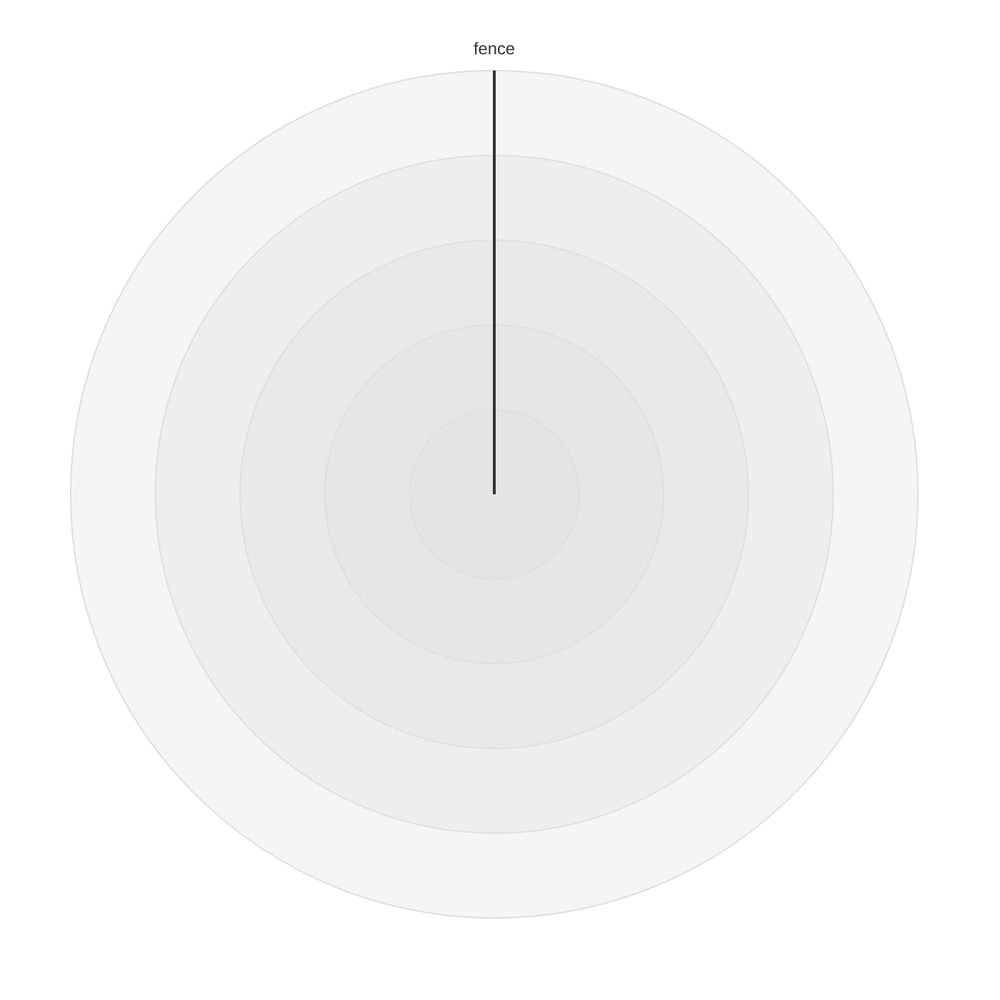

# Radar formatting rules

英語版: [radar.md](./radar.md)

決定された 29 項目に従い、
[radar の木](../../spec/docs/ast/radar.ja.md)
と共有の平坦な本文レイアウトを使います。
各規則で選択の理由を説明します。
保持する文字と mermaid.js との差は
[compatibility.ja.md](./compatibility.ja.md)に記します。

## Rules

### Header

`radar-beta` を第 1 列に置き、普通の最初の文を次の行へ移します。
見出しを見つけやすくするためです。
文をどの行に置くかは、規則 1 の場所ではないので、
[規則 2](./printed-form.ja.md#2-prettier-にない種類の隙間)が、
最初の文を置く行を決めます。
[packet](./packet.ja.md#header)、[architecture](./architecture.ja.md#header)、
[cynefin](./cynefin.ja.md#header)も、普通の最初の文を次の行に印字します。
ただし、ほかの規則が境界を書かれたままにする場合は別です。
あとに述べる隠れた形、大域的な注釈類、セミコロンの保護区間がそれに当たります。
見出しの語の直後のコロンは、その前の空白とともに落とします。
mermaid.js は `radar-beta:` と `radar-beta` を同じ見出しとして読み、
文書の例はコロンのない見出しを 3 回使い、ある形は使わないためです。
（[ヘッダーの後のコロン](./compatibility.ja.md#ヘッダーの後のコロン)を参照）。
コロンと語の間に隠れた形か大域的なディレクティブがあるときと、`;`、
隠れた YAML ブロックの `---`、閉じていないディレクティブがコロンに接するときは、
コロンを残します。
`radar-beta%%{wrap}%%:axis North` は、文を次の行に移し、
コロンを残して印字します。
文を同じ行に置いた `radar-beta%%{wrap}%%axis North` は、
フォーマッタが印字しない形で、対象にする版の mermaid.js のすべてが拒否します。
詳しくは
[対象にする版の mermaid.js のために残す形](./compatibility.ja.md#対象にする版の-mermaidjs-のために残す形)
を参照してください。
閉じたディレクティブの前、コロンの前、またはその両側にある空白とタブは、
印字から除きます。
`radar-beta %%{x}%%:`、`radar-beta%%{x}%% :`、
`radar-beta %%{x}%% :` は `radar-beta%%{x}%%:` と印字し、
空白の代わりにタブがあっても同じです。
`radar-beta %%{x}%% %%{y}%% :` は `radar-beta%%{x}%%%%{y}%%:` と印字します。
2 つのディレクティブの間の空白かタブも同じです。
`radar-beta%%{x}%% %%{y}%%:` は `radar-beta%%{x}%%%%{y}%%:` と印字します。
コロンがなければ空白は残ります。
`radar-beta %%{x}%%` と `radar-beta%%{x}%% %%{y}%%` は変えません。
隙間は、[ディレクティブ](./flowchart.ja.md#ディレクティブ)と同じく印字します。
mermaid.js はディレクティブを読む前に取り除くので、
隙間はディレクティブがないときの通常の規則どおりに印字し、
ディレクティブはその規則の空白の後に置きます。
見出しの後のコロンは、規則 1 の手順で種類がはっきりしません。
手順は、
[コロンがどの種類かの決め方](./printed-form.ja.md#コロンがどの種類かの決め方)
にあります。
見出しの語に値を与えず、印字した形では同じ行にあとの文字が続かないためです。
そのため種類を仮定せず、その前の空白もどの規則も与えないので、見出しの語、
ディレクティブ、コロンの間に何も置かない上の形は、
決まるまでリリース済みの形を残します。
詳しくは
[どの決まりも形を決めない所](./printed-form.ja.md#4-どの決まりも形を決めない所)
を参照してください。
同じ隙間にある 2 つのディレクティブが互いに接することと、
行の終わりで隙間が空白があったかどうかを保つことは、
flowchart でも同じです（`A %%{x}%% %%{y}%%` は書かれたまま）が、
flowchart でもこれらの形は、決まっていない形の一覧（D50）の問いです。
そのため、2 つのディレクティブの接し方はどの規則も与えず、
決まるまでリリース済みの形を残します。
詳しくは
[どの決まりも形を決めない所](./printed-form.ja.md#4-どの決まりも形を決めない所)
を参照してください。
閉じていないディレクティブの前でも、コロンを残します。
`radar-beta:%%{x y`、改行、`axis North` を書かれたまま残すのは、
mermaid.js がディレクティブを後ろの改行ごと取り除き、
見出しと `axis` を 1 つの語として読むことになり、
対象にする版の mermaid.js のすべてが、そのテキストを拒否するためです。
詳しくは
[対象にする版の mermaid.js のために残す形](./compatibility.ja.md#対象にする版の-mermaidjs-のために残す形)
を参照してください。
隠れた形、大域的な注釈類、セミコロンの保護区間では境界を保ちます。
空の本文は空のままです。

[fixture: radar/header/colon-removed]
[fixture: radar/header/colon-unclosed-directive-kept]
[fixture: radar/header/colon-yaml-kept]
[fixture: radar/header/colon-directive-before-hidden-yaml-kept]
[fixture: radar/header/joined-empty]
[fixture: radar/header/colon-spaced-before-directive-dropped]
[fixture: radar/header/colon-spaced-before-colon-dropped]
[fixture: radar/header/colon-tabs-around-directive-dropped]
[fixture: radar/header/colon-two-spaced-directives-dropped]
[fixture: radar/header/directive-no-colon-space-kept]
[fixture: radar/header/colon-between-directives-dropped]
[fixture: radar/header/directives-no-colon-space-between-kept]

[fixture: radar/header/join-separated-empty-alternative]

[fixture: radar/header/bare-inline]

[fixture: radar/header/joined-inline]

[fixture: radar/header/join-separated-inline-alternative]

[fixture: radar/header/inline-title]

[fixture: radar/header/inline-a11y]

[fixture: radar/header/inline-block]

[fixture: radar/header/header-hidden-colon]

[fixture: radar/header/header-global-colon]

[fixture: radar/header/header-comment]

[fixture: radar/header/hidden-yaml-before-header-colon]

[corpus fixture: radar/header-colon-inline]

[corpus fixture: radar/header-separated-colon]

[corpus fixture: radar/header-repeated]

[corpus fixture: radar/header-colon-newline]

[corpus fixture: radar/spec-radar-test-ts-f0d1a74d]

入力（エスケープ表記）: `"radar-beta : curve trial{4}\n"`

出力
([header/join-separated-inline-alternative-output.mmd](../tests/fixtures/radar/header/join-separated-inline-alternative-output.mmd)):

```mmd
radar-beta
  curve trial{4}
```

### Indentation

[規則 1](./printed-form.ja.md#1-記号の横の空白)により、普通の文、独立コメント、
`Root` ディレクティブは、見出しより設定の 1 段深く置きます。
Prettier がブロックの中の行をそう印字するためです。
通常は空白 2 つ、`tabWidth` 4 なら空白 4 つ、0 なら空白は置きません。
列に文法上の意味がないため、0 も使えます。
`useTabs` は幅 0 でも 1 タブを使います。
Prettier は、入れ子の JavaScript のブロックを、
`--tab-width 0` では字下げなしで、
`--use-tabs` では `--tab-width 0` でも 1 段につき 1 タブで印字します。
項目の継続行は 2 段です。
値の継続列、隠れた形の内側と閉じ記号、保持する前置部分は各規則に従います。

[fixture: radar/indentation/indent-two]

[fixture: radar/indentation/indent-four]

[fixture: radar/indentation/indent-zero]

[fixture: radar/indentation/indent-tabs]

[fixture: radar/indentation/zero-tabs]

入力（エスケープ表記）: `"radar-beta\naxis North\nticks 7\n"`

設定: `{"tabWidth": 4}`

出力
([indentation/indent-four-output.mmd](../tests/fixtures/radar/indentation/indent-four-output.mmd)):

```mmd
radar-beta
    axis North
    ticks 7
```

### Statements one per line

普通の axis、curve、options、共通文は 1 文ずつ改行します。
作者の文の単位を見せるためです。
文をどの行に置くかは、規則 1 の場所ではないので、
[規則 2](./printed-form.ja.md#2-prettier-にない種類の隙間)が決めます。
[er](./er.ja.md#1-行に-1-文)、[gantt](./gantt.ja.md#1-行に-1-文)、
[journey](./journey.ja.md#1-行に-1-文)も、各文を自分の行に印字します。
ただし、ほかの規則が書かれたままにする行は別です。
行の規則が無視する `;` のある行は、文を同じ行に残します。
文を自分の行へ移すと、規則が別の `;` を無視するようになることがあるためです。
詳しくは [`;` を含む行](./compatibility.ja.md#-を含む行)と
[セミコロン](#semicolons)にあります。
一つのキーワードのカンマ群は分割せず、キーワードも複製しません。
規則 1 は、リストのカンマの前に空白を置かず、
後に空白を 1 つ置きます（ER 図の `class A,B c` は `class A, B c` と印字し、
1 行 1 文のままです）。
そのため群は 1 行のままで、
分割するとカンマごとに改行と繰り返しのキーワードに置き換わります。
カンマのない隣接 option は別の文です。
`ticks 7max 8` も 2 文になります。
共通の行値は物理 EOL までのキーワードに見える文字も所有します。
空の説明ブロックも文として残し、保護された見出しと本文の群を優先します。

[fixture: radar/statements-one-per-line/all-inline-kinds]
[fixture: radar/statements-one-per-line/line-rule-semicolon-keeps-statements-together]

[fixture: radar/statements-one-per-line/line-owns-keywords]

[fixture: radar/statements-one-per-line/empty-block-interleaved]

[corpus fixture: radar/gram-inline-statements]

[corpus fixture: radar/tail-axis-semicolon]

入力（エスケープ表記）:
`"radar-beta axis North axis South curve one{1}curve two{2}ticks 7 max 9 min 2 showLegend false graticule polygon\n"`

出力
([statements-one-per-line/all-inline-kinds-output.mmd](../tests/fixtures/radar/statements-one-per-line/all-inline-kinds-output.mmd)):

```mmd
radar-beta
  axis North
  axis South
  curve one{1}
  curve two{2}
  ticks 7
  max 9
  min 2
  showLegend false
  graticule polygon
```

### Groups and commas

群のキーワードと最初の構成要素の間は普通の空白 1 個にします。
[規則 1](./printed-form.ja.md#1-記号の横の空白) は、
群のキーワードと最初の構成要素の間を普通の空白 1 個にします。
Prettier が `return  x` を `return x;` と印字するのと同じです。
axis、curve、options、項目のカンマは前を詰め、後を空白 1 つにします。
xychart と quadrant と同じ見た目にそろえるためです。
axis・curve・options の群には可視改行を追加しません。
その文法では拒否されるためです。
全体のディレクティブのある隙間は、
[Global directives](#global-directives)のとおりに印字します。
隠れた形のある隙間は、
書かれた接触を保ちます（[Hidden forms](#hidden-forms)を参照）。

[fixture: radar/groups-and-commas/axis-comma]

[fixture: radar/groups-and-commas/curve-comma]

[fixture: radar/groups-and-commas/options-comma]

[fixture: radar/groups-and-commas/entry-comma]

[corpus fixture: radar/gram-axis-before-comma-visible]

[corpus fixture: radar/gram-curve-newline-comma]

[corpus fixture: radar/gram-option-comma-trailing]

[corpus fixture: radar/gram-entry-newline-before-comma]

入力（エスケープ表記）: `"radar-beta\naxis North [\"N\"] ,\tSouth , East\n"`

出力
([groups-and-commas/axis-comma-output.mmd](../tests/fixtures/radar/groups-and-commas/axis-comma-output.mmd)):

```mmd
radar-beta
  axis North["N"], South, East
```

### Labels

ラベルは `axis A["label"]`、`curve c['label']` と印字します。
`[` の前後と `]` の前の普通の空白を詰めます。
規則 1 は括弧の内側に空白を置かず（その表の `f( a )` は `f(a)` と印字します）、
`[` の前にも空白を置きません（`x [ 0 ];` は `x[0];` と印字します。その表は、
添字の `[` の例に architecture の `service a (server) [A]` を挙げています）。
[architecture](./architecture.ja.md#declaration-spacing)と
[er](./er.ja.md#実体)も、
ラベルの括弧を名前に接して印字します（`service a  [ A ]` は `service a[A]`、
`A  [ "x" ]` は `A["x"]` と印字します）。
名前に付くラベルを一つに見せるためです。
ラベルの省略と空文字列は区別します。
空ラベルを削除すると、
代わりに ID を使う処理が変わるためです（[Quotes](#quotes)を参照してください）。
引用符の内側は値として扱い、隠れた形と大域的な処理の境界を優先します。

[fixture: radar/labels/axis-double-brackets]

[fixture: radar/labels/curve-single-brackets]

[fixture: radar/labels/empty-and-absent-label]

入力（エスケープ表記）: `"radar-beta\naxis North \t[ \t\"North label\"\t ]\n"`

出力
([labels/axis-double-brackets-output.mmd](../tests/fixtures/radar/labels/axis-double-brackets-output.mmd)):

```mmd
radar-beta
  axis North["North label"]
```

### Curve braces

値だけの曲線の波括弧は `c{1, 2}` のように内側を詰め、
名前と値の組の曲線の波括弧は `c["C"]{ A: 1, B: 2 }` のように、
内側の両端に空白を 1 つずつ置いて印字します。
開き波括弧の前の空白は、どちらも詰めます。
名前と値の組を並べた波括弧は、
Prettier がオブジェクト（`{ a: 1, b: 2 }`）として印字する種類で、
値を並べた波括弧は、配列（`[1, 2, 3]`）として印字する種類です。

コロンのない名前つきの項目（`{ A 1, B 2 }`）も、名前と値の組です。
名前つきの項目のコロンはキーのコロンで、項目が軸に値を 1 つ与えるので、
前は詰め、後に空白を 1 つ置きます。
詳しくは
[コロンがどの種類かの決め方](./printed-form.ja.md#コロンがどの種類かの決め方)
の手順 2 を参照してください。
これは項目の波括弧です。
説明ブロックの空白は共有の説明規則に従います。

[fixture: radar/curve-braces/brace-tight]

[fixture: radar/curve-braces/label-before-brace]

[fixture: radar/curve-braces/named-entries-space-inside]

[fixture: radar/curve-braces/named-entries-padding-collapsed]

[fixture: radar/curve-braces/named-and-value-curves-in-one-statement]

[fixture: radar/curve-braces/named-entries-directive-after-brace]

入力（エスケープ表記）: `"radar-beta\ncurve trial \t{ \t4, 5 \t}\n"`

出力
([curve-braces/brace-tight-output.mmd](../tests/fixtures/radar/curve-braces/brace-tight-output.mmd)):

```mmd
radar-beta
  curve trial{4, 5}
```

### Multi-line statements

コメントやディレクティブのない文では、
文法が空白として読む項目の改行を結合します。
対象は `{` の後、カンマの後、`}` の前です。
数だけのリストも名前つきリストも、
[xychart](./xychart.ja.md#複数行の文) と [quadrant](./quadrant.ja.md#複数行の文)
と同様に 1 行にします。
カンマの前や名前つき項目の途中へは、改行を追加しません。
mermaid.js がそこの改行を拒否するためです。
コメントや `Root` ディレクティブのある改行は残します。
普通の継続行とコメントは 2 段、別行の `}` は文の位置にそろえます。
コメントは行の残りを取るので、次の項目をそこへ結合すると、
項目がコメントの中に入ります。
[規則 1](./printed-form.ja.md#1-記号の横の空白)により、波括弧のリストの項目を、
そのリストを開く文より 1 段深く置き、別行の `}` をその文と同じ段に置きます。
Prettier がブロックの中の行を印字する形です。
閉じる行は開く行と同じ段です。
同じ深さの項目の間のコメント行と `Root` ディレクティブ行は、
Prettier がコメント行を周りの行と同じ段に置くように、
それらの項目と同じ段に置きます。
ディレクティブのある改行と、コメント付きのリストのほかの項目の改行は、
どの規則も与えず、書かれたまま残します。
[xychart](./xychart.ja.md#複数行の文)は、
コメントやディレクティブのある改行を残しますが、そこでもこの形は、
決まっていない形の一覧（D45）の問いです。
そのため、その印字は決まった形ではなく、決まるまでリリース済みの形を残します。
詳しくは
[どの決まりも形を決めない所](./printed-form.ja.md#4-どの決まりも形を決めない所)
を参照してください。
隠れた形の境界、値の行、セミコロンの保護区間は継続列を含め保ちます。
保護区間内に継続の字下げを足しません。
その後の普通の間隙には通常の空白規則を適用します。
終端行に別の文のセミコロンがある場合も共有の結合検査で保ちます。
前の style に似たラベルと結合すると、その文の Db が変わりうるうえ、
対象にする版の mermaid.js のすべてがタイトルのテキストを違って描くためです。
詳しくは
[対象にする版の mermaid.js のために残す形](./compatibility.ja.md#対象にする版の-mermaidjs-のために残す形)
を参照してください。

[fixture: radar/multi-line-statements/leading-trailing-entry-lines]

[fixture: radar/multi-line-statements/positional-after-comma]

[fixture: radar/multi-line-statements/named-after-comma]

[fixture: radar/multi-line-statements/entry-comment-after-comma]

[fixture: radar/multi-line-statements/entry-inline-comment]

[fixture: radar/multi-line-statements/entry-global-lines]

[fixture: radar/multi-line-statements/trailing-entry-comment]

[fixture: radar/multi-line-statements/leading-entry-comment]

[fixture: radar/multi-line-statements/named-outer-multiline-kept]

[fixture: radar/multi-line-statements/named-comment-after-comma]

[fixture: radar/multi-line-statements/semicolon-terminal-line]

[fixture: radar/multi-line-statements/protected-semicolon-later-curve-label]

[fixture: radar/multi-line-statements/protected-semicolon-entry-comment]

[fixture: radar/multi-line-statements/protected-semicolon-named-entries]

[fixture: radar/multi-line-statements/protected-semicolon-after-opening-brace]

[fixture: radar/multi-line-statements/protected-semicolon-before-closing-brace]

[fixture: radar/multi-line-statements/protected-semicolon-written-indentation]

[fixture: radar/multi-line-statements/protected-semicolon-tabs]

[fixture: radar/multi-line-statements/protected-semicolon-first-line-semicolon]

[fixture: radar/multi-line-statements/protected-semicolon-zero-width]

[fixture: radar/multi-line-statements/protected-semicolon-hidden-suffix]

[fixture: radar/multi-line-statements/protected-semicolon-root-directive]

[fixture: radar/multi-line-statements/protected-semicolon-same-line-suffix-gap]

[fixture: radar/multi-line-statements/protected-semicolon-semicolon-with-hidden-gap]

[fixture: radar/multi-line-statements/protected-semicolon-later-semicolon-blank-lines]

[corpus fixture: radar/gram-entry-newline-before-comma]

[corpus fixture: radar/gram-named-entry-line-before-comma]

[corpus fixture: radar/gram-detailed-line-after-colon]

入力（エスケープ表記）: `"radar-beta\ncurve trial{4,\n%% entry note\n5\n}\n"`

出力
([multi-line-statements/entry-comment-after-comma-output.mmd](../tests/fixtures/radar/multi-line-statements/entry-comment-after-comma-output.mmd)):

```mmd
radar-beta
  curve trial{4,
    %% entry note
    5
  }
```

### Named entries

作者が書いたコロンの有無を残します。
`A: 1` はコロンの前を詰め、後を空白 1 つにします。
`A 1` は間を空白 1 つにし、列揃えはしません。
[規則 1](./printed-form.ja.md#1-記号の横の空白)の「並んで続く値」の行が、
`A 1` の名前と値の間に空白 1 つを与えます。
Prettier が CSS の `margin: 1px    2px;` を `margin: 1px 2px;`
と印字するためです。
`North 4` と `North: 4` は、対象にする版で同じ Db と図になり、
整形はコロンを足しも除きもしません。
軸名 `accTitle` と `accDescr` へのコロン追加は安全ではありません。
共通の複合トークンが優先してしまううえ、
対象にする版の mermaid.js のすべてが `curve c{accTitle: 1, accDescr 2}`
を拒否するためです。
詳しくは
[対象にする版の mermaid.js のために残す形](./compatibility.ja.md#対象にする版の-mermaidjs-のために残す形)
を参照してください。

[fixture: radar/named-entries/named-colon-gap]

[fixture: radar/named-entries/named-no-colon-gap]

[fixture: radar/named-entries/mixed-colon-spelling]

[fixture: radar/named-entries/accessibility-identifiers]

入力（エスケープ表記）:
`"radar-beta\naxis North,South\ncurve trial{North 4,South:5}\n"`

出力
([named-entries/mixed-colon-spelling-output.mmd](../tests/fixtures/radar/named-entries/mixed-colon-spelling-output.mmd)):

```mmd
radar-beta
  axis North, South
  curve trial{ North 4, South: 5 }
```

### Numbers

項目と ticks・max・min の数は `NumericLiteral` の原文の範囲を印字します。
普通の十進表記は最短の形で印字し、`1.50` は `1.5`、`5.00` は `5` にします。
（[同じに描かれる綴り](./compatibility.ja.md#同じに描かれる綴り)）。
整数部の先頭のゼロ、丸められる精度、非正規化数、過小値の丸め、
桁あふれの綴りを保ちます。
倍精度浮動小数点数値からの再出力は、
radar が拒否する指数表記や `Infinity` を出すこともあるためです。

[fixture: radar/numbers/shortest-form]

[fixture: radar/numbers/forms-kept]

[fixture: radar/numbers/raw-number-forms]

[fixture: radar/numbers/raw-option-numbers]

[corpus fixture: radar/db-number-rounded]

[corpus fixture: radar/db-number-subnormal]

[corpus fixture: radar/db-number-underflow]

[corpus fixture: radar/db-number-overflow]

[corpus fixture: radar/db-option-overflow]

入力（エスケープ表記）:
`"radar-beta\ncurve trial{0004.5000,9007199254740993,0.12345678901234567890,0}\n"`

出力
([numbers/raw-number-forms-output.mmd](../tests/fixtures/radar/numbers/raw-number-forms-output.mmd)):

```mmd
radar-beta
  curve trial{0004.5000, 9007199254740993, 0.12345678901234567890, 0}
```

### Options

[規則 1](./printed-form.ja.md#1-記号の横の空白) が、
オプションのキーワードと値の間を普通の空白 1 個にします。
Prettier が `return  x` を `return x;` と印字するためです。
真偽値・`graticule` の固定小文字、数の綴り、カンマ群、反復と順序を保ちます。
数は [Numbers](#numbers)、カンマは [Groups and commas](#groups-and-commas)、
順序と反復した代入は [Source order](#source-order) にあります。
既定値への置換、ticks の 32 への制限、min・max の並べ替えはしません。
radar の描画設定から文の値を補いません。

[fixture: radar/options/option-gaps]

[fixture: radar/options/adjacent-numeric-option]

[fixture: radar/options/adjacent-boolean-option]

[fixture: radar/options/option-repetitions]

[fixture: radar/options/min-max-order-kept]

[corpus fixture: radar/db-ticks-cap-fraction]

[corpus fixture: radar/config-drawing-only]

[corpus fixture: radar/config-frontmatter-options-cannot-reject]

入力（エスケープ表記）:
`"radar-beta\nshowLegend\t false,ticks\t7,max  8,min\t2,graticule\tpolygon\n"`

出力
([options/option-gaps-output.mmd](../tests/fixtures/radar/options/option-gaps-output.mmd)):

```mmd
radar-beta
  showLegend false, ticks 7, max 8, min 2, graticule polygon
```

### Quotes

ラベルの `StringLiteral` は完全な原文の範囲を保ちます。
空文字列、エスケープ、HTML、実体参照、隠れた形に見える文字を含みます。
テキストの中の空白とタブの連なりは、空白 1 つにして印字します。
空白とタブだけの文字列は空白 1 つになり、`["   "]` は `[" "]` と印字します。
（[同じに描かれるテキスト中の空白の連なり](./compatibility.ja.md#同じに描かれるテキスト中の空白の連なり)）。
`'` で囲まれた文字列は、内容に `'`、`"`、バックスラッシュ、改行、U+2028、
U+2029、バッククォート、`&`、`#`、`<` がある場合を除き、`"` で囲んで印字します。
（[同じに描かれる綴り](./compatibility.ja.md#同じに描かれる綴り)）。
`singleQuote` は読みません。
[規則 3](./printed-form.ja.md#3-綴り)が `"` を与えるのであって、
オプションではありません。
mermaid.js の文書の例は、`'` で囲んだ文字列も読む図種の文字列 409 件のうち、
408 件を `"` で囲んで書いています。
詳しくは [`"` で囲む文字列](./compatibility.ja.md#-で囲む文字列)にあります。
空ラベルを削除すると、代わりに ID を使う処理が変わります。

[fixture: radar/quotes/single-quote-sensitive-kept]
[fixture: radar/quotes/quotes-and-empty]

[fixture: radar/quotes/padding-label]

[fixture: radar/quotes/escape-label]

[fixture: radar/quotes/label-html-entity]

[fixture: radar/quotes/hidden-looking-label]

[fixture: radar/quotes/whitespace-only-labels]

入力（エスケープ表記）:
`"radar-beta\naxis North['single \"other\"'],South[\"double 'other'\"],East[\"\"]\ncurve trial['']{1,2,3}\n"`

設定: `{"singleQuote": true}`

出力
([quotes/quotes-and-empty-output.mmd](../tests/fixtures/radar/quotes/quotes-and-empty-output.mmd)):

```mmd
radar-beta
  axis North['single "other"'], South["double 'other'"], East[""]
  curve trial[""]{1, 2, 3}
```

### Title

共有の共通行レイアウトを、
下の段落と[セミコロン](#semicolons)の節が述べるところを除いて使います。
共通空白の外端を除き、非空の値の前は空白 1 つにします。
`null` と空白だけの値は `title` にします。
[規則 1](./printed-form.ja.md#1-記号の横の空白) は、
Prettier が `return  x` を `return x;` と印字するのと同じく、
キーワードとそのテキストの間を空白 1 つにします。
Prettier は行末に空白を残しません。
[規則 1](./printed-form.ja.md#1-記号の横の空白) が与える空白 1 つの形は、
空白とタブに適用されます。
同じ意味の外端だけをそろえ、内部の綴り、引用符、見かけのキーワードを保ちます。
ただし、値の中の空白とタブの連なりは空白 1 つにして印字します。
（[同じに描かれるテキスト中の空白の連なり](./compatibility.ja.md#同じに描かれるテキスト中の空白の連なり)）。
コメントやディレクティブを挟んでも、次の物理行から値を取りません。
題やアクセシビリティの行のテキストの後の `;` は残します。
mermaid.js の行の規則がその行に働かないとき、
たとえば `title T;` や `title T;;` だけの行では、テキストがその `;` を持ち、
あるときとないときで、Db も、対象にするどの版の描かれるテキストも違います。
規則が働く行は [`;` を含む行](./compatibility.ja.md#-を含む行)にあります。
規則がその行に働くとき、`;` が 1 つなら、規則がそれを無視し、
テキストは持ちませんが、それでも残します（`title style:#red;`）。
`;` が 2 つ続くと、規則が最後の `;` を無視し、
1 つ除くと別の `;` を無視するようになります。
詳しくは [`;` が終わらせる行](./compatibility.ja.md#-が終わらせる行)にあります。
題にテキストがあり、そのテキストの前にも中にもディレクティブがなく、
テキストの中に U+2028 も U+2029 もないとき、題の終わりのディレクティブは、
その前と後に何があるかで、次のように印字します。
ただし、未決の行は除きます。
未決の行とは、ディレクティブのある行のうち、ディレクティブのほかに、
コメントの外の `;`（ディレクティブの中のものも含みます）がある行、
コメントの中の `;` と U+2028 か U+2029 がある行、
最初のディレクティブの中か後に U+2028 か U+2029 がある行、
ディレクティブが改行を含む行、または次の文までの間の行に、
コメントかディレクティブの中の `;` がある行です。
幅のある空白は、U+000B、U+000C、U+00A0、U+1680、U+2000 から U+200A、U+202F、
U+205F、U+3000、U+FEFF のどれかです。
項目 6 が行を分けるときは、ほかの項目はその行に当たりません。

- ディレクティブの前が空白とタブだけ、または何もなく、その前のテキストにも、
  どのディレクティブの中にも `;` がなく、どのディレクティブも改行、U+2028、
  U+2029 を含まず、最後のディレクティブの後が空白とタブだけのときは、
  それぞれのディレクティブの前に空白かタブがあれば空白 1 つを置き、
  行末の空白とタブの有無にかかわらず、
  最後のディレクティブの後の空白とタブを除いて印字します。
- ディレクティブの前に幅のある空白があり、ディレクティブが互いに接して、
  最後のディレクティブに行末かコメントが接するときは、その文字を、
  同じ連なりの残りとともに空白 1 つで印字します。
- ディレクティブの前に幅のある空白があり、最初のディレクティブの後に、
  空白かタブと、別のディレクティブかコメントが続くときは、その文字は残り、
  その後ろからディレクティブかコメントまでの、空白とタブの連なりを、
  それぞれ空白 1 つで印字します。
- ディレクティブの前に U+2028 か U+2029 があり、ディレクティブが互いに接して、
  最後のディレクティブに行末が接するときは、空白 1 つで印字します。
- ディレクティブの前に U+2028 か U+2029 があり、
  最後のディレクティブにコメントが続かず、
  最後のディレクティブの後に空白かタブが続くとき、
  または最初のディレクティブの後に空白かタブと別のディレクティブが続くときは、
  行を書かれたままにします。
- ディレクティブの前に U+2028 か U+2029 があり、
  最後のディレクティブの後にコメントが続くときは、
  コメント領域が次の行を結びます。
  詳しくは
  [U+2028 か U+2029 の後のコメント行](./compatibility.ja.md#u2028-か-u2029-の後のコメント行)
  にあります。
  コメント行は、その前の空行、空白だけの行、
  ディレクティブの行とともに取り除かれ、残った最初の行が決めます。
  それが文か空白だけの行なら、その行まで書かれたままにします。
  それが空行かディレクティブの行のとき、または残る行がないときは、
  U+2028 か U+2029 を落とし、ディレクティブとコメントを別の行に置き、
  それらの間の隙間は、どの空白文字でも空白 1 つで印字します。
  後ろにコメント行が続かないとき、ディレクティブの行は、ディレクティブだけが、
  前にも間にも後にも空白なしで並ぶ行です（`%%{y}%%`、`%%{y}%%%%{z}%%`）。
  字下げのあるディレクティブ、後ろに空白が続くディレクティブ、
  空白が間にあるディレクティブ、後ろに文字が続くディレクティブは、
  そこでは文です。
  コメント行は、コメントを含む行です（`%% d`、`  %% d`、`%%{y}%% %% e`）。
  空白だけの行は、空白、タブ、幅のある空白、U+2028、U+2029 だけの行です。
  U+0085 と U+180E は空白ではなく、それを含む行は文です。
  コメント行の前にある行は、空白、ディレクティブ、コメントだけを含むときは、
  その並び方によらずコメント行とともに取り除かれます。
  空行、空白だけの行、ディレクティブの行、字下げのあるディレクティブ、
  後ろに空白が続くディレクティブ、空白が間にあるディレクティブ（`%%{y}%%`、
  空白 2 つ、`%%{z}%%`）は取り除かれ、文字、U+0085、U+180E、
  コメントとディレクティブの外の `;` を含む行は文です。
- 幅のある空白がディレクティブの間にあるときは、
  最後のディレクティブの後に何が続いても、行を書かれたままにします。
- 最後のディレクティブの後に幅のある空白があるときは、
  その前に空白やタブがあっても、その後に何が続いても、行を書かれたままにします。
  テキストの中にディレクティブのある題も、書かれたままです。

最後のディレクティブの後にコメントが続き、
テキストとコメントの間に U+2028 も U+2029 もなく、行が未決でなく、
項目 7 と 8 のどちらにも当たらないときは、
それぞれのディレクティブの前とコメントの前の空白とタブの連なりを、
空白 1 つで印字します。
コメントの中に `;` があっても同じです。
（[同じに描かれるキーワードの後のテキスト
](./compatibility.ja.md#同じに描かれるキーワードの後のテキスト)）。
[規則 1](./printed-form.ja.md#1-記号の横の空白)は、
同じ行の何かの後ろにあるコメントの前に空白 1 つを与えます。
Prettier が `x = 1;   // c` を `x = 1; // c` と印字する形です。

[規則 1](./printed-form.ja.md#1-記号の横の空白)は、
Prettier が行末に空白を残さないのと同じく、行末の空白を除きます（項目 1）。
ほかの項目は、規則が決めない隙間と文字について、
リリース済みの版が印字する形を述べています。
ほかの図の種類が違う形で印字する形は、決まるまでそのまま残します。
（[どの決まりも形を決めない所](./printed-form.ja.md#4-どの決まりも形を決めない所)）。

テキストの中に U+2028 か U+2029 があるとき、または値がディレクティブだけで、
行が未決でないときは、
最後のディレクティブの後に空白かタブが続けば（その後が行末でもコメントでも）、
またはディレクティブの間に空白かタブがあれば、行を書かれたままにし、
項目 3 は適用しません。
どちらでもなければ、ほかの項目が、
ほかのテキストの行を印字するのと同じに印字するので、
ディレクティブの前の空白とタブの連なり（キーワードの後のものも）はそれぞれ空白 1
つになります。

未決の行は述べません。
そこでは出力が、`;` と U+2028 か U+2029 の両側の文字ごとに決まり、
規則 1 はこれらの隙間の印を挙げず、図の種類も同じには印字しません。
そこでリリース済みの版が印字する形は、
[どの決まりも形を決めない所](./printed-form.ja.md#4-どの決まりも形を決めない所)
のとおり、決めるまでそのままです。
行に U+2028 も U+2029 もないとき、
行そのもののコメントの中の `;` は行を変えないので、`;` がそこだけにある行は、
題と次の文の間の行のコメントかディレクティブの中に `;` がある場合を除き、
未決ではありません。
整形が投げる行は、そこでは述べません。

題のテキストが、キーワードの後の空白 1 つかタブ 1 つの後で、ディレクティブか、
互いに接するディレクティブで始まり、行のそれ以外の部分にディレクティブ、
コメント、`;`、幅のある空白、U+2028、U+2029 がなく、行が未決でないときは、
ディレクティブとそれ以外のテキストの間の空白とタブを除き、
行末の空白とタブも除きます（`title %%{x}%%  T  ` は `title %%{x}%%T` に、
`title %%{x}%%%%{y}%%  T  ` は `title %%{x}%%%%{y}%%T` になります）。
mermaid.js はテキストを読む前にディレクティブを除き、
題をその先頭の空白なしで描きます。
（[同じに描かれるキーワードの後のテキスト](./compatibility.ja.md#同じに描かれるキーワードの後のテキスト)）。
ディレクティブがテキストの前にあるほかの題は述べません。
ディレクティブがキーワードに接する題、
最初のディレクティブの前に空白文字が 2 つ続く題、
2 つのディレクティブの間に空白がある題、行のほかの所にディレクティブ、コメント、
`;`、幅のある空白、U+2028、U+2029 がある題、
テキストがディレクティブで始まる `accTitle:` と `accDescr:` の行です。
そこでリリース済みの版が印字する形は、
[どの決まりも形を決めない所](./printed-form.ja.md#4-どの決まりも形を決めない所)
のとおり、決めるまでそのままです。

[fixture: title/title-directives-end-blanks-dropped]
[fixture: title/title-directives-end-tabs-dropped]
[fixture: title/title-directives-in-the-text-kept]
[fixture: title/title-directives-end-before-comment-line-and-empty-line]
[fixture: title/title-directives-then-comment]
[fixture: title/title-directives-end-at-the-end-of-the-text]
[fixture: radar/title/title-edge-trim]
[fixture: radar/title/title-lone-semicolon-kept]
[fixture: radar/title/title-directive-semicolon-kept]
[fixture: radar/title/title-two-semicolons-kept]
[fixture: radar/semicolons/released-output-not-stated-semicolon-selected-kept]
[fixture: radar/semicolons/title-single-ignored-semicolon-kept]
[test: a no-break space after the last directive of a title of a radar chart]
[test: U+3000 after the last directive of a title of a radar chart]
[test: U+2028 after the last directive of a title of a radar chart]
[test: U+2029 after the last directive of a title of a radar chart]
[test: a space and a no-break space after the last directive of a title of a radar chart]
[test: a no-break space after the last of two directives of a title of a radar chart]
[test: a no-break space before the directive that ends a title of a radar chart]
[test: U+3000 before the directive that ends a title of a radar chart]
[test: a space, a no-break space, and a space before the directive that ends a title of a radar chart]
[test: a no-break space before two directives that touch and end a title of a radar chart]
[test: a no-break space before a directive that a comment touches in a title of a radar chart]
[test: U+2028 before the directive that ends a title of a radar chart]
[test: U+2029 before the directive that ends a title of a radar chart]
[test: a no-break space before a directive that a space and another directive follow in a title of a radar chart]
[test: U+3000 before a directive that a space and a comment follow in a title of a radar chart]
[test: a tab and a no-break space after the last directive of a title of a radar chart]
[test: U+3000 before a directive that a comment touches in a title of a radar chart]
[test: U+3000 before two directives that touch and end a title of a radar chart]
[test: U+3000 before a directive that a space and another directive follow in a title of a radar chart]
[test: a no-break space before a directive that a space and a comment follow in a title of a radar chart]
[test: a no-break space between two directives that end a title of a radar chart]
[test: U+3000 between two directives that end a title of a radar chart]
[test: a no-break space between two directives, spaces after the last, in a title of a radar chart]
[test: U+3000 between two directives, spaces after the last, in a title of a radar chart]
[test: U+2028 before two directives that touch and end a title of a radar chart]
[test: U+2029 before two directives that touch and end a title of a radar chart]
[test: U+2028 before the last directive, a space and a tab after it, in a title of a radar chart]
[test: U+2029 before the last directive, a space and a tab after it, in a title of a radar chart]
[test: U+2028 before a directive that a space and another directive follow in a title of a radar chart]
[test: U+2029 before a directive that a space and another directive follow in a title of a radar chart]
[test: U+2028 between two directives that end a title of a radar chart]
[test: U+2029 between two directives that end a title of a radar chart]
[test: U+2028 between two directives, spaces after the last, in a title of a radar chart]
[test: U+2029 between two directives, spaces after the last, in a title of a radar chart]
[test: a space, a tab, and a no-break space after the last directive of a title of a radar chart]
[test: a space, a tab, and U+3000 after the last directive of a title of a radar chart]
[test: a space, a tab, and U+2028 after the last directive of a title of a radar chart]
[test: a space, a tab, and U+2029 after the last directive of a title of a radar chart]
[test: a semicolon before the directive of a title of a radar chart, spaces after it]
[test: a semicolon and spaces before the directive that ends a title of a radar chart]
[test: a semicolon after the last directive of a title of a radar chart, spaces around it]
[test: a semicolon before the directive of a title of a radar chart, a tab after it]
[test: a semicolon and a no-break space before the directive of a title of a radar chart, spaces after it]
[test: a semicolon and a no-break space before the directive that ends a title of a radar chart]
[test: a semicolon touching the last directive of a title of a radar chart]
[test: U+000B before the directive that ends a title of a radar chart]
[test: U+000C before the directive that ends a title of a radar chart]
[test: U+1680 before the directive that ends a title of a radar chart]
[test: U+2000 before the directive that ends a title of a radar chart]
[test: U+2001 before the directive that ends a title of a radar chart]
[test: U+2002 before the directive that ends a title of a radar chart]
[test: U+2003 before the directive that ends a title of a radar chart]
[test: U+2004 before the directive that ends a title of a radar chart]
[test: U+2005 before the directive that ends a title of a radar chart]
[test: U+2006 before the directive that ends a title of a radar chart]
[test: U+2007 before the directive that ends a title of a radar chart]
[test: U+2008 before the directive that ends a title of a radar chart]
[test: U+2009 before the directive that ends a title of a radar chart]
[test: U+200A before the directive that ends a title of a radar chart]
[test: U+202F before the directive that ends a title of a radar chart]
[test: U+205F before the directive that ends a title of a radar chart]
[test: U+FEFF before the directive that ends a title of a radar chart]
[test: U+000B before two directives that touch and end a title of a radar chart]
[test: U+000B before a directive that a comment touches in a title of a radar chart]
[test: U+000B between two directives that end a title of a radar chart]
[test: U+000B after the last directive of a title of a radar chart]
[test: a semicolon and U+000B before the directive that ends a title of a radar chart]
[test: U+000C before two directives that touch and end a title of a radar chart]
[test: U+000C before a directive that a comment touches in a title of a radar chart]
[test: U+000C between two directives that end a title of a radar chart]
[test: U+000C after the last directive of a title of a radar chart]
[test: a semicolon and U+000C before the directive that ends a title of a radar chart]
[test: U+1680 before two directives that touch and end a title of a radar chart]
[test: U+1680 before a directive that a comment touches in a title of a radar chart]
[test: U+1680 between two directives that end a title of a radar chart]
[test: U+1680 after the last directive of a title of a radar chart]
[test: a semicolon and U+1680 before the directive that ends a title of a radar chart]
[test: U+2000 before two directives that touch and end a title of a radar chart]
[test: U+2000 before a directive that a comment touches in a title of a radar chart]
[test: U+2000 between two directives that end a title of a radar chart]
[test: U+2000 after the last directive of a title of a radar chart]
[test: a semicolon and U+2000 before the directive that ends a title of a radar chart]
[test: U+2001 before two directives that touch and end a title of a radar chart]
[test: U+2001 before a directive that a comment touches in a title of a radar chart]
[test: U+2001 between two directives that end a title of a radar chart]
[test: U+2001 after the last directive of a title of a radar chart]
[test: a semicolon and U+2001 before the directive that ends a title of a radar chart]
[test: U+2002 before two directives that touch and end a title of a radar chart]
[test: U+2002 before a directive that a comment touches in a title of a radar chart]
[test: U+2002 between two directives that end a title of a radar chart]
[test: U+2002 after the last directive of a title of a radar chart]
[test: a semicolon and U+2002 before the directive that ends a title of a radar chart]
[test: U+2003 before two directives that touch and end a title of a radar chart]
[test: U+2003 before a directive that a comment touches in a title of a radar chart]
[test: U+2003 between two directives that end a title of a radar chart]
[test: U+2003 after the last directive of a title of a radar chart]
[test: a semicolon and U+2003 before the directive that ends a title of a radar chart]
[test: U+2004 before two directives that touch and end a title of a radar chart]
[test: U+2004 before a directive that a comment touches in a title of a radar chart]
[test: U+2004 between two directives that end a title of a radar chart]
[test: U+2004 after the last directive of a title of a radar chart]
[test: a semicolon and U+2004 before the directive that ends a title of a radar chart]
[test: U+2005 before two directives that touch and end a title of a radar chart]
[test: U+2005 before a directive that a comment touches in a title of a radar chart]
[test: U+2005 between two directives that end a title of a radar chart]
[test: U+2005 after the last directive of a title of a radar chart]
[test: a semicolon and U+2005 before the directive that ends a title of a radar chart]
[test: U+2006 before two directives that touch and end a title of a radar chart]
[test: U+2006 before a directive that a comment touches in a title of a radar chart]
[test: U+2006 between two directives that end a title of a radar chart]
[test: U+2006 after the last directive of a title of a radar chart]
[test: a semicolon and U+2006 before the directive that ends a title of a radar chart]
[test: U+2007 before two directives that touch and end a title of a radar chart]
[test: U+2007 before a directive that a comment touches in a title of a radar chart]
[test: U+2007 between two directives that end a title of a radar chart]
[test: U+2007 after the last directive of a title of a radar chart]
[test: a semicolon and U+2007 before the directive that ends a title of a radar chart]
[test: U+2008 before two directives that touch and end a title of a radar chart]
[test: U+2008 before a directive that a comment touches in a title of a radar chart]
[test: U+2008 between two directives that end a title of a radar chart]
[test: U+2008 after the last directive of a title of a radar chart]
[test: a semicolon and U+2008 before the directive that ends a title of a radar chart]
[test: U+2009 before two directives that touch and end a title of a radar chart]
[test: U+2009 before a directive that a comment touches in a title of a radar chart]
[test: U+2009 between two directives that end a title of a radar chart]
[test: U+2009 after the last directive of a title of a radar chart]
[test: a semicolon and U+2009 before the directive that ends a title of a radar chart]
[test: U+200A before two directives that touch and end a title of a radar chart]
[test: U+200A before a directive that a comment touches in a title of a radar chart]
[test: U+200A between two directives that end a title of a radar chart]
[test: U+200A after the last directive of a title of a radar chart]
[test: a semicolon and U+200A before the directive that ends a title of a radar chart]
[test: U+202F before two directives that touch and end a title of a radar chart]
[test: U+202F before a directive that a comment touches in a title of a radar chart]
[test: U+202F between two directives that end a title of a radar chart]
[test: U+202F after the last directive of a title of a radar chart]
[test: a semicolon and U+202F before the directive that ends a title of a radar chart]
[test: U+205F before two directives that touch and end a title of a radar chart]
[test: U+205F before a directive that a comment touches in a title of a radar chart]
[test: U+205F between two directives that end a title of a radar chart]
[test: U+205F after the last directive of a title of a radar chart]
[test: a semicolon and U+205F before the directive that ends a title of a radar chart]
[test: a semicolon and U+3000 before the directive that ends a title of a radar chart]
[test: U+FEFF before two directives that touch and end a title of a radar chart]
[test: U+FEFF before a directive that a comment touches in a title of a radar chart]
[test: U+FEFF between two directives that end a title of a radar chart]
[test: U+FEFF after the last directive of a title of a radar chart]
[test: a semicolon and U+FEFF before the directive that ends a title of a radar chart]
[test: a semicolon and U+2028 before the directive that ends a title of a radar chart]
[test: a semicolon and U+2029 before the directive that ends a title of a radar chart]
[test: a semicolon and a tab before the directive that ends a title of a radar chart]
[test: released output that the document does not state: a semicolon that the line rule ignores and spaces before the directive that ends a title of a radar chart]
[test: released output that the document does not state: a semicolon that the line rule ignores before the directive of a title of a radar chart, spaces after it]
[test: a semicolon before the directive of a title of a radar chart, a space and a comment after it]
[test: a semicolon and spaces before a directive that a comment touches in a title of a radar chart]
[test: a comment that ends with a semicolon after the last directive of a title of a radar chart]
[test: a comment that has a space before its semicolon after the last directive of a title of a radar chart]
[test: a comment that starts with a semicolon after the last directive of a title of a radar chart]
[test: a semicolon inside the directive that ends a title, spaces after it, of a radar chart]
[test: a semicolon inside the directive that ends a title, spaces and a comment after it, of a radar chart]
[test: a semicolon inside the directive that ends a title, a space and a comment after it, of a radar chart]
[test: a semicolon inside the last of two directives that end a title, spaces after it, of a radar chart]
[test: a semicolon inside the first of two directives that end a title, spaces between them, of a radar chart]
[test: a semicolon inside the first of two directives that end a title, a space between them, of a radar chart]
[test: a semicolon inside the only directive that ends a title, spaces before it, of a radar chart]
[test: a semicolon inside the last of two directives that end a title, spaces before both, of a radar chart]
[test: a semicolon inside a directive that a comment touches in a title, spaces before the directive, of a radar chart]
[test: a semicolon inside the first of two directives that touch in a title, spaces before them, of a radar chart]
[test: a semicolon inside the directive that ends a title, a no-break space before it, of a radar chart]
[test: a semicolon inside the directive that ends a title, U+2028 before it, of a radar chart]
[test: a semicolon in the text, two directives with spaces between them, a title, of a radar chart]
[test: a semicolon in the text, two directives with a space between them, a title, of a radar chart]
[test: a semicolon and a space before two directives with spaces between them, a title, of a radar chart]
[test: a semicolon in the text, two directives with a tab between them, a title, of a radar chart]
[test: a semicolon in the text, two directives that touch, spaces before them, a title, of a radar chart]
[test: a semicolon that touches two directives in a title, of a radar chart]
[test: a semicolon that touches the second of two directives in a title, of a radar chart]
[test: a semicolon that touches the first of two directives in a title, of a radar chart]
[test: a semicolon between two directives in a title, spaces around it, of a radar chart]
[test: a semicolon touching the last of two directives in a title, of a radar chart]
[test: a semicolon after the last of two directives in a title, spaces around it and a comment after it, of a radar chart]
[test: released output that the document does not state: a second semicolon touching the semicolon that the line rule ignores, spaces and a directive after them, in a title of a radar chart]
[test: released output that the document does not state: a second semicolon touching the semicolon that the line rule ignores, a directive and spaces after them, in a title of a radar chart]
[test: released output that the document does not state: a second semicolon touching the semicolon that the line rule ignores, a directive touching them, in a title of a radar chart]
[test: released output that the document does not state: a second semicolon touching the semicolon that the line rule ignores, a directive that a comment touches, in a title of a radar chart]
[test: released output that the document does not state: a second semicolon touching the semicolon that the line rule ignores, a directive and a space and a comment, in a title of a radar chart]
[test: released output that the document does not state: spaces and a second semicolon after the semicolon that the line rule ignores, a directive after them, in a title of a radar chart]
[test: released output that the document does not state: a space and a second semicolon after the semicolon that the line rule ignores, a directive after them, in a title of a radar chart]
[test: released output that the document does not state: a tab and a second semicolon after the semicolon that the line rule ignores, a directive after them, in a title of a radar chart]
[test: released output that the document does not state: a no-break space and a second semicolon after the semicolon that the line rule ignores, a directive after them, in a title of a radar chart]
[test: released output that the document does not state: a second semicolon touching the semicolon that the line rule ignores, a no-break space and a directive after them, in a title of a radar chart]
[test: released output that the document does not state: a second semicolon touching the semicolon that the line rule ignores, U+2028 and a directive after them, in a title of a radar chart]
[test: released output that the document does not state: two semicolons after the semicolon that the line rule ignores, a directive after them, in a title of a radar chart]
[test: released output that the document does not state: U+2028 and a directive after the semicolon that the line rule ignores, in a title of a radar chart]
[test: released output that the document does not state: U+2029 and a directive after the semicolon that the line rule ignores, in a title of a radar chart]
[test: released output that the document does not state: U+2028, a directive and spaces after the semicolon that the line rule ignores, in a title of a radar chart]
[test: two semicolons that the line rule does not ignore, spaces and a directive after them, in a title of a radar chart]
[test: released output that the document does not state: text and a semicolon after the semicolon that the line rule does not ignore, spaces and a directive after them, in a title of a radar chart]
[test: released output that the document does not state: a tab and a directive after the semicolon that the line rule ignores, in a title of a radar chart]
[test: released output that the document does not state: a no-break space and a directive after the semicolon that the line rule ignores, in a title of a radar chart]
[test: released output that the document does not state: spaces and a directive that a comment touches after the semicolon that the line rule ignores, in a title of a radar chart]
[test: released output that the document does not state: spaces and two directives with spaces between them after the semicolon that the line rule ignores, in a title of a radar chart]
[test: a semicolon at the end of a title with whitespace around its text, of a radar chart]
[test: a semicolon in the text of a title, spaces and a directive after it, of a radar chart]
[test: spaces around a semicolon in the text of a title, a directive after it, of a radar chart]
[test: U+000B between two directives, spaces after the last, in a title of a radar chart]
[test: U+000B after the last directive and spaces of a title of a radar chart]
[test: U+000C between two directives, spaces after the last, in a title of a radar chart]
[test: U+000C after the last directive and spaces of a title of a radar chart]
[test: a no-break space after the last directive and spaces of a title of a radar chart]
[test: U+1680 between two directives, spaces after the last, in a title of a radar chart]
[test: U+1680 after the last directive and spaces of a title of a radar chart]
[test: U+2000 between two directives, spaces after the last, in a title of a radar chart]
[test: U+2000 after the last directive and spaces of a title of a radar chart]
[test: U+2001 between two directives, spaces after the last, in a title of a radar chart]
[test: U+2001 after the last directive and spaces of a title of a radar chart]
[test: U+2002 between two directives, spaces after the last, in a title of a radar chart]
[test: U+2002 after the last directive and spaces of a title of a radar chart]
[test: U+2003 between two directives, spaces after the last, in a title of a radar chart]
[test: U+2003 after the last directive and spaces of a title of a radar chart]
[test: U+2004 between two directives, spaces after the last, in a title of a radar chart]
[test: U+2004 after the last directive and spaces of a title of a radar chart]
[test: U+2005 between two directives, spaces after the last, in a title of a radar chart]
[test: U+2005 after the last directive and spaces of a title of a radar chart]
[test: U+2006 between two directives, spaces after the last, in a title of a radar chart]
[test: U+2006 after the last directive and spaces of a title of a radar chart]
[test: U+2007 between two directives, spaces after the last, in a title of a radar chart]
[test: U+2007 after the last directive and spaces of a title of a radar chart]
[test: U+2008 between two directives, spaces after the last, in a title of a radar chart]
[test: U+2008 after the last directive and spaces of a title of a radar chart]
[test: U+2009 between two directives, spaces after the last, in a title of a radar chart]
[test: U+2009 after the last directive and spaces of a title of a radar chart]
[test: U+200A between two directives, spaces after the last, in a title of a radar chart]
[test: U+200A after the last directive and spaces of a title of a radar chart]
[test: U+202F between two directives, spaces after the last, in a title of a radar chart]
[test: U+202F after the last directive and spaces of a title of a radar chart]
[test: U+205F between two directives, spaces after the last, in a title of a radar chart]
[test: U+205F after the last directive and spaces of a title of a radar chart]
[test: U+3000 after the last directive and spaces of a title of a radar chart]
[test: U+FEFF between two directives, spaces after the last, in a title of a radar chart]
[test: U+FEFF after the last directive and spaces of a title of a radar chart]
[test: U+2028 after the last directive and spaces of a title of a radar chart]
[test: U+2029 after the last directive and spaces of a title of a radar chart]
[test: a no-break space between two directives, a comment touching the last, in a title of a radar chart]
[test: a no-break space between two directives, a space and a comment after the last, in a title of a radar chart]
[test: a no-break space between two directives, spaces and a comment after the last, in a title of a radar chart]
[test: a no-break space after the last directive, a comment touching it, in a title of a radar chart]
[test: a no-break space after the last directive, spaces and a comment after it, in a title of a radar chart]
[test: a no-break space after the last directive and spaces, spaces and a comment after it, in a title of a radar chart]
[test: a no-break space after the last directive and a tab, spaces and a comment after it, in a title of a radar chart]
[test: U+2003 between two directives, a comment touching the last, in a title of a radar chart]
[test: U+2003 between two directives, a space and a comment after the last, in a title of a radar chart]
[test: U+2003 between two directives, spaces and a comment after the last, in a title of a radar chart]
[test: U+2003 after the last directive, a comment touching it, in a title of a radar chart]
[test: U+2003 after the last directive, spaces and a comment after it, in a title of a radar chart]
[test: U+2003 after the last directive and spaces, spaces and a comment after it, in a title of a radar chart]
[test: U+2003 after the last directive and a tab, spaces and a comment after it, in a title of a radar chart]
[test: a semicolon in the text, a no-break space between two directives, in a title of a radar chart]
[test: a semicolon in the text, a no-break space after the last directive, in a title of a radar chart]
[test: a semicolon inside the directive, a no-break space after it, in a title of a radar chart]
[test: released output that the document does not state: U+000B between a semicolon that the line rule ignores and a second semicolon, a directive after them, in a title of a radar chart]
[test: released output that the document does not state: U+000C between a semicolon that the line rule ignores and a second semicolon, a directive after them, in a title of a radar chart]
[test: released output that the document does not state: U+1680 between a semicolon that the line rule ignores and a second semicolon, a directive after them, in a title of a radar chart]
[test: released output that the document does not state: U+2000 between a semicolon that the line rule ignores and a second semicolon, a directive after them, in a title of a radar chart]
[test: released output that the document does not state: U+2001 between a semicolon that the line rule ignores and a second semicolon, a directive after them, in a title of a radar chart]
[test: released output that the document does not state: U+2002 between a semicolon that the line rule ignores and a second semicolon, a directive after them, in a title of a radar chart]
[test: released output that the document does not state: U+2003 between a semicolon that the line rule ignores and a second semicolon, a directive after them, in a title of a radar chart]
[test: released output that the document does not state: U+2004 between a semicolon that the line rule ignores and a second semicolon, a directive after them, in a title of a radar chart]
[test: released output that the document does not state: U+2005 between a semicolon that the line rule ignores and a second semicolon, a directive after them, in a title of a radar chart]
[test: released output that the document does not state: U+2006 between a semicolon that the line rule ignores and a second semicolon, a directive after them, in a title of a radar chart]
[test: released output that the document does not state: U+2007 between a semicolon that the line rule ignores and a second semicolon, a directive after them, in a title of a radar chart]
[test: released output that the document does not state: U+2008 between a semicolon that the line rule ignores and a second semicolon, a directive after them, in a title of a radar chart]
[test: released output that the document does not state: U+2009 between a semicolon that the line rule ignores and a second semicolon, a directive after them, in a title of a radar chart]
[test: released output that the document does not state: U+200A between a semicolon that the line rule ignores and a second semicolon, a directive after them, in a title of a radar chart]
[test: released output that the document does not state: U+202F between a semicolon that the line rule ignores and a second semicolon, a directive after them, in a title of a radar chart]
[test: released output that the document does not state: U+205F between a semicolon that the line rule ignores and a second semicolon, a directive after them, in a title of a radar chart]
[test: released output that the document does not state: U+3000 between a semicolon that the line rule ignores and a second semicolon, a directive after them, in a title of a radar chart]
[test: released output that the document does not state: U+FEFF between a semicolon that the line rule ignores and a second semicolon, a directive after them, in a title of a radar chart]
[test: U+000B before the first of two directives that a space separates, in a title of a radar chart]
[test: U+000B before the first of two directives that spaces separate, in a title of a radar chart]
[test: U+000B before a directive that spaces and a comment follow in a title of a radar chart]
[test: U+000C before the first of two directives that a space separates, in a title of a radar chart]
[test: U+000C before the first of two directives that spaces separate, in a title of a radar chart]
[test: U+000C before a directive that spaces and a comment follow in a title of a radar chart]
[test: a no-break space before the first of two directives that spaces separate, in a title of a radar chart]
[test: U+1680 before the first of two directives that a space separates, in a title of a radar chart]
[test: U+1680 before the first of two directives that spaces separate, in a title of a radar chart]
[test: U+1680 before a directive that spaces and a comment follow in a title of a radar chart]
[test: U+2000 before the first of two directives that a space separates, in a title of a radar chart]
[test: U+2000 before the first of two directives that spaces separate, in a title of a radar chart]
[test: U+2000 before a directive that spaces and a comment follow in a title of a radar chart]
[test: U+2001 before the first of two directives that a space separates, in a title of a radar chart]
[test: U+2001 before the first of two directives that spaces separate, in a title of a radar chart]
[test: U+2001 before a directive that spaces and a comment follow in a title of a radar chart]
[test: U+2002 before the first of two directives that a space separates, in a title of a radar chart]
[test: U+2002 before the first of two directives that spaces separate, in a title of a radar chart]
[test: U+2002 before a directive that spaces and a comment follow in a title of a radar chart]
[test: U+2003 before the first of two directives that a space separates, in a title of a radar chart]
[test: U+2003 before the first of two directives that spaces separate, in a title of a radar chart]
[test: U+2003 before a directive that spaces and a comment follow in a title of a radar chart]
[test: U+2004 before the first of two directives that a space separates, in a title of a radar chart]
[test: U+2004 before the first of two directives that spaces separate, in a title of a radar chart]
[test: U+2004 before a directive that spaces and a comment follow in a title of a radar chart]
[test: U+2005 before the first of two directives that a space separates, in a title of a radar chart]
[test: U+2005 before the first of two directives that spaces separate, in a title of a radar chart]
[test: U+2005 before a directive that spaces and a comment follow in a title of a radar chart]
[test: U+2006 before the first of two directives that a space separates, in a title of a radar chart]
[test: U+2006 before the first of two directives that spaces separate, in a title of a radar chart]
[test: U+2006 before a directive that spaces and a comment follow in a title of a radar chart]
[test: U+2007 before the first of two directives that a space separates, in a title of a radar chart]
[test: U+2007 before the first of two directives that spaces separate, in a title of a radar chart]
[test: U+2007 before a directive that spaces and a comment follow in a title of a radar chart]
[test: U+2008 before the first of two directives that a space separates, in a title of a radar chart]
[test: U+2008 before the first of two directives that spaces separate, in a title of a radar chart]
[test: U+2008 before a directive that spaces and a comment follow in a title of a radar chart]
[test: U+2009 before the first of two directives that a space separates, in a title of a radar chart]
[test: U+2009 before the first of two directives that spaces separate, in a title of a radar chart]
[test: U+2009 before a directive that spaces and a comment follow in a title of a radar chart]
[test: U+200A before the first of two directives that a space separates, in a title of a radar chart]
[test: U+200A before the first of two directives that spaces separate, in a title of a radar chart]
[test: U+200A before a directive that spaces and a comment follow in a title of a radar chart]
[test: U+202F before the first of two directives that a space separates, in a title of a radar chart]
[test: U+202F before the first of two directives that spaces separate, in a title of a radar chart]
[test: U+202F before a directive that spaces and a comment follow in a title of a radar chart]
[test: U+205F before the first of two directives that a space separates, in a title of a radar chart]
[test: U+205F before the first of two directives that spaces separate, in a title of a radar chart]
[test: U+205F before a directive that spaces and a comment follow in a title of a radar chart]
[test: U+3000 before the first of two directives that spaces separate, in a title of a radar chart]
[test: U+FEFF before the first of two directives that a space separates, in a title of a radar chart]
[test: U+FEFF before the first of two directives that spaces separate, in a title of a radar chart]
[test: U+FEFF before a directive that spaces and a comment follow in a title of a radar chart]
[test: a run before the directive after a U+2028 inside the text of a title of a radar chart]
[test: spaces after the directive after a U+2028 inside the text of a title of a radar chart]
[test: spaces after the directive after a U+2029 inside the text of a title of a radar chart]
[test: spaces between two directives after a U+2028 inside the text of a title of a radar chart]
[test: a tab after the directive after a U+2028 inside the text of a title of a radar chart]
[test: a run before two directives that touch after a U+2028 inside the text of a title of a radar chart]
[test: U+000B and spaces before the first of two directives that spaces separate, in a title of a radar chart]
[test: U+000C and spaces before the first of two directives that spaces separate, in a title of a radar chart]
[test: a no-break space and spaces before the first of two directives that spaces separate, in a title of a radar chart]
[test: U+1680 and spaces before the first of two directives that spaces separate, in a title of a radar chart]
[test: U+2000 and spaces before the first of two directives that spaces separate, in a title of a radar chart]
[test: U+2001 and spaces before the first of two directives that spaces separate, in a title of a radar chart]
[test: U+2002 and spaces before the first of two directives that spaces separate, in a title of a radar chart]
[test: U+2003 and spaces before the first of two directives that spaces separate, in a title of a radar chart]
[test: U+2004 and spaces before the first of two directives that spaces separate, in a title of a radar chart]
[test: U+2005 and spaces before the first of two directives that spaces separate, in a title of a radar chart]
[test: U+2006 and spaces before the first of two directives that spaces separate, in a title of a radar chart]
[test: U+2007 and spaces before the first of two directives that spaces separate, in a title of a radar chart]
[test: U+2008 and spaces before the first of two directives that spaces separate, in a title of a radar chart]
[test: U+2009 and spaces before the first of two directives that spaces separate, in a title of a radar chart]
[test: U+200A and spaces before the first of two directives that spaces separate, in a title of a radar chart]
[test: U+202F and spaces before the first of two directives that spaces separate, in a title of a radar chart]
[test: U+205F and spaces before the first of two directives that spaces separate, in a title of a radar chart]
[test: U+3000 and spaces before the first of two directives that spaces separate, in a title of a radar chart]
[test: U+FEFF and spaces before the first of two directives that spaces separate, in a title of a radar chart]
[test: a no-break space and a tab before the first of two directives that a space separates, in a title of a radar chart]
[test: a no-break space before the first of two directives that a tab separates, in a title of a radar chart]
[test: U+2003 and a tab before the first of two directives that a space separates, in a title of a radar chart]
[test: U+2003 before the first of two directives that a tab separates, in a title of a radar chart]
[test: U+2028 before the first of two directives that a tab separates, in a title of a radar chart]
[test: U+2029 before the first of two directives that a tab separates, in a title of a radar chart]
[test: a U+2028 inside the directive that ends a title, spaces before it, of a radar chart]
[test: a U+2028 inside the directive that ends a title, spaces after it, of a radar chart]
[test: a U+2029 inside the directive that ends a title, spaces before it, of a radar chart]
[test: a U+2029 inside the directive that ends a title, spaces after it, of a radar chart]
[test: a line break inside the directive that ends a title, spaces before it, of a radar chart]
[test: a line break inside the directive that ends a title, spaces after it, of a radar chart]
[test: a U+2028 inside the first of two directives that spaces separate, in a title of a radar chart]
[test: a U+2028 inside the last of two directives, spaces before both, in a title of a radar chart]
[test: a U+2028 inside the first of two directives that touch, spaces before them, in a title of a radar chart]
[test: a U+2028 inside the directive that ends a title, a no-break space before it, of a radar chart]
[test: a U+2028 inside a directive that a comment touches in a title, spaces before it, of a radar chart]
[test: a U+2028 inside a directive that spaces and a comment follow in a title, of a radar chart]
[test: a line break inside the first of two directives that spaces separate, in a title of a radar chart]
[test: a line break inside the last of two directives, spaces before both, in a title of a radar chart]
[test: a line break inside the first of two directives that touch, spaces before them, in a title of a radar chart]
[test: a line break inside the directive that ends a title, a no-break space before it, of a radar chart]
[test: a line break inside a directive that a comment touches in a title, spaces before it, of a radar chart]
[test: a line break inside a directive that spaces and a comment follow in a title, of a radar chart]
[test: a tab between the keyword and the directive of a title of directives only of a radar chart]
[test: spaces between the keyword and the directive of a title of directives only of a radar chart]
[test: spaces after the directive of a title of directives only of a radar chart]
[test: spaces on both sides of the directive of a title of directives only of a radar chart]
[test: two directives that spaces separate, a title of directives only of a radar chart]
[test: two directives that touch, spaces before them, a title of directives only of a radar chart]
[test: a comment that touches the directive of a title of directives only of a radar chart]
[test: a space and a comment after the directive of a title of directives only of a radar chart]
[test: a wide space before two directives that spaces separate, one space before the first directive, in a title of a radar chart]
[test: a wide space before two directives that spaces separate, a run of spaces before the first directive, in a title of a radar chart]
[test: a wide space before two directives that spaces separate, a tab before the first directive, in a title of a radar chart]
[test: a wide space before two directives that spaces separate, U+2028 before the first directive, in a title of a radar chart]
[test: a wide space before two directives that spaces separate, U+2029 before the first directive, in a title of a radar chart]
[test: a wide space before two directives that spaces separate, a no-break space between the two directives, in a title of a radar chart]
[test: a wide space before two directives that spaces separate, U+2028 between the two directives, in a title of a radar chart]
[test: a wide space before two directives that spaces separate, U+2029 between the two directives, in a title of a radar chart]
[test: a wide space before two directives that spaces separate, the first directive holds a line break inside, in a title of a radar chart]
[test: a wide space before two directives that spaces separate, the last directive holds a line break inside, in a title of a radar chart]
[test: a wide space before two directives that spaces separate, the first directive holds a `;` inside, in a title of a radar chart]
[test: a wide space before two directives that spaces separate, the last directive holds a `;` inside, in a title of a radar chart]
[test: a wide space before two directives that spaces separate, the first directive holds a U+2028 inside, in a title of a radar chart]
[test: a wide space before two directives that spaces separate, the last directive holds a U+2028 inside, in a title of a radar chart]
[test: a wide space before two directives that spaces separate, a comment touching the last directive, in a title of a radar chart]
[test: a wide space before two directives that spaces separate, a value of directives only, in a title of a radar chart]
[test: a wide space before a directive that spaces and a comment follow, one space before the first directive, in a title of a radar chart]
[test: a wide space before a directive that spaces and a comment follow, a run of spaces before the first directive, in a title of a radar chart]
[test: a wide space before a directive that spaces and a comment follow, a tab before the first directive, in a title of a radar chart]
[test: a wide space before a directive that spaces and a comment follow, one space after the last directive, in a title of a radar chart]
[test: a wide space before a directive that spaces and a comment follow, a tab after the last directive, in a title of a radar chart]
[test: a wide space before a directive that spaces and a comment follow, a no-break space after the last directive, in a title of a radar chart]
[test: a wide space before a directive that spaces and a comment follow, the first directive holds a line break inside, in a title of a radar chart]
[test: a wide space before a directive that spaces and a comment follow, the first directive holds a `;` inside, in a title of a radar chart]
[test: a wide space before a directive that spaces and a comment follow, the first directive holds a U+2028 inside, in a title of a radar chart]
[test: a wide space before a directive that spaces and a comment follow, a second directive touching the first, in a title of a radar chart]
[test: a wide space before a directive that spaces and a comment follow, a second directive after a space, in a title of a radar chart]
[test: a wide space before a directive that spaces and a comment follow, a value of directives only, in a title of a radar chart]
[test: a wide space before two directives that touch and a comment that touches the last, in a title of a radar chart]
[test: a wide space before two directives that touch and a comment that touches the last, one space before the first directive, in a title of a radar chart]
[test: a wide space before two directives that touch and a comment that touches the last, a run of spaces before the first directive, in a title of a radar chart]
[test: a wide space before two directives that touch and a comment that touches the last, a tab before the first directive, in a title of a radar chart]
[test: a wide space before two directives that touch and a comment that touches the last, one space after the last directive, in a title of a radar chart]
[test: a wide space before two directives that touch and a comment that touches the last, a tab after the last directive, in a title of a radar chart]
[test: a wide space before two directives that touch and a comment that touches the last, a no-break space after the last directive, in a title of a radar chart]
[test: a wide space before two directives that touch and a comment that touches the last, the first directive holds a line break inside, in a title of a radar chart]
[test: a wide space before two directives that touch and a comment that touches the last, the last directive holds a line break inside, in a title of a radar chart]
[test: a wide space before two directives that touch and a comment that touches the last, the first directive holds a `;` inside, in a title of a radar chart]
[test: a wide space before two directives that touch and a comment that touches the last, the last directive holds a `;` inside, in a title of a radar chart]
[test: a wide space before two directives that touch and a comment that touches the last, the first directive holds a U+2028 inside, in a title of a radar chart]
[test: a wide space before two directives that touch and a comment that touches the last, the last directive holds a U+2028 inside, in a title of a radar chart]
[test: a wide space before two directives that touch and a comment that touches the last, a value of directives only, in a title of a radar chart]
[test: a U+2028 before two directives that touch, one space before the first directive, in a title of a radar chart]
[test: a U+2028 before two directives that touch, a run of spaces before the first directive, in a title of a radar chart]
[test: a U+2028 before two directives that touch, a tab before the first directive, in a title of a radar chart]
[test: a U+2028 before two directives that touch, one space after the last directive, in a title of a radar chart]
[test: a U+2028 before two directives that touch, a run of spaces after the last directive, in a title of a radar chart]
[test: a U+2028 before two directives that touch, a tab after the last directive, in a title of a radar chart]
[test: a U+2028 before two directives that touch, a no-break space after the last directive, in a title of a radar chart]
[test: a U+2028 before two directives that touch, U+2028 after the last directive, in a title of a radar chart]
[test: a U+2028 before two directives that touch, U+2029 after the last directive, in a title of a radar chart]
[test: a U+2028 before two directives that touch, the first directive holds a line break inside, in a title of a radar chart]
[test: a U+2028 before two directives that touch, the last directive holds a line break inside, in a title of a radar chart]
[test: a U+2028 before two directives that touch, the first directive holds a `;` inside, in a title of a radar chart]
[test: a U+2028 before two directives that touch, the last directive holds a `;` inside, in a title of a radar chart]
[test: a U+2028 before two directives that touch, the first directive holds a U+2028 inside, in a title of a radar chart]
[test: a U+2028 before two directives that touch, the last directive holds a U+2028 inside, in a title of a radar chart]
[test: a U+2028 before two directives that touch, a value of directives only, in a title of a radar chart]
[test: a U+2028 before a directive that spaces follow, in a title of a radar chart]
[test: a U+2028 before a directive that spaces follow, one space before the first directive, in a title of a radar chart]
[test: a U+2028 before a directive that spaces follow, a run of spaces before the first directive, in a title of a radar chart]
[test: a U+2028 before a directive that spaces follow, a tab before the first directive, in a title of a radar chart]
[test: a U+2028 before a directive that spaces follow, U+2029 before the first directive, in a title of a radar chart]
[test: a U+2028 before a directive that spaces follow, one space after the last directive, in a title of a radar chart]
[test: a U+2028 before a directive that spaces follow, a tab after the last directive, in a title of a radar chart]
[test: a U+2028 before a directive that spaces follow, a no-break space after the last directive, in a title of a radar chart]
[test: a U+2028 before a directive that spaces follow, U+2028 after the last directive, in a title of a radar chart]
[test: a U+2028 before a directive that spaces follow, U+2029 after the last directive, in a title of a radar chart]
[test: a U+2028 before a directive that spaces follow, the first directive holds a line break inside, in a title of a radar chart]
[test: a U+2028 before a directive that spaces follow, the first directive holds a `;` inside, in a title of a radar chart]
[test: a U+2028 before a directive that spaces follow, the first directive holds a U+2028 inside, in a title of a radar chart]
[test: a U+2028 before a directive that spaces follow, a second directive after a space, in a title of a radar chart]
[test: a U+2028 before two directives that spaces separate, a no-break space between the two directives, in a title of a radar chart]
[test: a U+2028 before two directives that spaces separate, U+2028 between the two directives, in a title of a radar chart]
[test: a U+2028 before two directives that spaces separate, U+2029 between the two directives, in a title of a radar chart]
[test: a U+2028 before two directives that spaces separate, the first directive holds a line break inside, in a title of a radar chart]
[test: a U+2028 before two directives that spaces separate, the last directive holds a line break inside, in a title of a radar chart]
[test: a U+2028 before two directives that spaces separate, the first directive holds a `;` inside, in a title of a radar chart]
[test: a U+2028 before two directives that spaces separate, the last directive holds a `;` inside, in a title of a radar chart]
[test: a U+2028 before two directives that spaces separate, the first directive holds a U+2028 inside, in a title of a radar chart]
[test: a U+2028 before two directives that spaces separate, the last directive holds a U+2028 inside, in a title of a radar chart]
[test: a directive that holds a line break, spaces before it, one space before the first directive, in a title of a radar chart]
[test: a directive that holds a line break, spaces before it, a tab before the first directive, in a title of a radar chart]
[test: a directive that holds a line break, spaces before it, U+2028 before the first directive, in a title of a radar chart]
[test: a directive that holds a line break, spaces before it, U+2029 before the first directive, in a title of a radar chart]
[test: a directive that holds a line break, spaces before it, one space after the last directive, in a title of a radar chart]
[test: a directive that holds a line break, spaces before it, a tab after the last directive, in a title of a radar chart]
[test: a directive that holds a line break, spaces before it, a no-break space after the last directive, in a title of a radar chart]
[test: a directive that holds a line break, spaces before it, U+2028 after the last directive, in a title of a radar chart]
[test: a directive that holds a line break, spaces before it, U+2029 after the last directive, in a title of a radar chart]
[test: a directive that holds a line break, spaces before it, a second directive after a space, in a title of a radar chart]
[test: a directive that holds a line break, spaces before it, a value of directives only, in a title of a radar chart]
[test: a directive that holds a U+2028, spaces before it, one space before the first directive, in a title of a radar chart]
[test: a directive that holds a U+2028, spaces before it, a tab before the first directive, in a title of a radar chart]
[test: a directive that holds a U+2028, spaces before it, U+2028 before the first directive, in a title of a radar chart]
[test: a directive that holds a U+2028, spaces before it, U+2029 before the first directive, in a title of a radar chart]
[test: a directive that holds a U+2028, spaces before it, one space after the last directive, in a title of a radar chart]
[test: a directive that holds a U+2028, spaces before it, a tab after the last directive, in a title of a radar chart]
[test: a directive that holds a U+2028, spaces before it, a no-break space after the last directive, in a title of a radar chart]
[test: a directive that holds a U+2028, spaces before it, U+2028 after the last directive, in a title of a radar chart]
[test: a directive that holds a U+2028, spaces before it, U+2029 after the last directive, in a title of a radar chart]
[test: a directive that holds a U+2028, spaces before it, a second directive after a space, in a title of a radar chart]
[test: a directive that holds a U+2028, spaces before it, a value of directives only, in a title of a radar chart]
[test: a U+2028 inside the text, spaces before the directive, one space before the first directive, in a title of a radar chart]
[test: a U+2028 inside the text, spaces before the directive, a tab before the first directive, in a title of a radar chart]
[test: a U+2028 inside the text, spaces before the directive, a no-break space before the first directive, in a title of a radar chart]
[test: a U+2028 inside the text, spaces before the directive, U+2028 before the first directive, in a title of a radar chart]
[test: a U+2028 inside the text, spaces before the directive, U+2029 before the first directive, in a title of a radar chart]
[test: a U+2028 inside the text, spaces before the directive, one space after the last directive, in a title of a radar chart]
[test: a U+2028 inside the text, spaces before the directive, a tab after the last directive, in a title of a radar chart]
[test: a U+2028 inside the text, spaces before the directive, a no-break space after the last directive, in a title of a radar chart]
[test: a U+2028 inside the text, spaces before the directive, U+2028 after the last directive, in a title of a radar chart]
[test: a U+2028 inside the text, spaces before the directive, U+2029 after the last directive, in a title of a radar chart]
[test: a U+2028 inside the text, spaces before the directive, the first directive holds a line break inside, in a title of a radar chart]
[test: a U+2028 inside the text, spaces before the directive, the first directive holds a `;` inside, in a title of a radar chart]
[test: a U+2028 inside the text, spaces before the directive, the first directive holds a U+2028 inside, in a title of a radar chart]
[test: a U+2028 inside the text, spaces before the directive, a second directive touching the first, in a title of a radar chart]
[test: a U+2028 inside the text, spaces before the directive, a second directive after a space, in a title of a radar chart]
[test: a U+2028 inside the text, spaces before the directive, a comment touching the last directive, in a title of a radar chart]
[test: a U+2028 inside the text, spaces before the directive, a value of directives only, in a title of a radar chart]
[test: a value of directives only, spaces after the directive, a tab before the first directive, in a title of a radar chart]
[test: a value of directives only, spaces after the directive, one space after the last directive, in a title of a radar chart]
[test: a value of directives only, spaces after the directive, a tab after the last directive, in a title of a radar chart]
[test: a value of directives only, spaces after the directive, a no-break space after the last directive, in a title of a radar chart]
[test: a value of directives only, spaces after the directive, U+2028 after the last directive, in a title of a radar chart]
[test: a value of directives only, spaces after the directive, U+2029 after the last directive, in a title of a radar chart]
[test: a value of directives only, spaces after the directive, the first directive holds a line break inside, in a title of a radar chart]
[test: a value of directives only, spaces after the directive, the first directive holds a `;` inside, in a title of a radar chart]
[test: a value of directives only, spaces after the directive, the first directive holds a U+2028 inside, in a title of a radar chart]
[test: a value of directives only, spaces after the directive, a second directive touching the first, in a title of a radar chart]
[test: a value of directives only, spaces after the directive, a second directive after a space, in a title of a radar chart]
[test: a directive inside the text, spaces before and after the last directive, in a title of a radar chart]
[test: a directive inside the text, spaces before and after the last directive, one space before the first directive, in a title of a radar chart]
[test: a directive inside the text, spaces before and after the last directive, a tab before the first directive, in a title of a radar chart]
[test: a directive inside the text, spaces before and after the last directive, a no-break space before the first directive, in a title of a radar chart]
[test: a directive inside the text, spaces before and after the last directive, U+2028 before the first directive, in a title of a radar chart]
[test: a directive inside the text, spaces before and after the last directive, U+2029 before the first directive, in a title of a radar chart]
[test: a directive inside the text, spaces before and after the last directive, one space after the last directive, in a title of a radar chart]
[test: a directive inside the text, spaces before and after the last directive, a tab after the last directive, in a title of a radar chart]
[test: a directive inside the text, spaces before and after the last directive, a no-break space after the last directive, in a title of a radar chart]
[test: a directive inside the text, spaces before and after the last directive, U+2028 after the last directive, in a title of a radar chart]
[test: a directive inside the text, spaces before and after the last directive, U+2029 after the last directive, in a title of a radar chart]
[test: a directive inside the text, spaces before and after the last directive, the first directive holds a line break inside, in a title of a radar chart]
[test: a directive inside the text, spaces before and after the last directive, the first directive holds a `;` inside, in a title of a radar chart]
[test: a directive inside the text, spaces before and after the last directive, the first directive holds a U+2028 inside, in a title of a radar chart]
[test: a directive inside the text, spaces before and after the last directive, a second directive touching the first, in a title of a radar chart]
[test: a directive inside the text, spaces before and after the last directive, a second directive after a space, in a title of a radar chart]
[test: a directive inside the text, spaces before and after the last directive, a comment touching the last directive, in a title of a radar chart]
[test: a directive inside the text, spaces before and after the last directive, a value of directives only, in a title of a radar chart]
[test: a `;` in the text, spaces before the directive, one space before the first directive, in a title of a radar chart]
[test: a `;` in the text, spaces before the directive, one space after the last directive, in a title of a radar chart]
[test: a `;` in the text, spaces before the directive, U+2028 after the last directive, in a title of a radar chart]
[test: a `;` in the text, spaces before the directive, U+2029 after the last directive, in a title of a radar chart]
[test: a `;` in the text, spaces before the directive, the first directive holds a line break inside, in a title of a radar chart]
[test: a `;` in the text, spaces before the directive, the first directive holds a `;` inside, in a title of a radar chart]
[test: a `;` in the text, spaces before the directive, the first directive holds a U+2028 inside, in a title of a radar chart]
[test: a `;` in the text, spaces between two directives, a tab before the first directive, in a title of a radar chart]
[test: a `;` in the text, spaces between two directives, a no-break space before the first directive, in a title of a radar chart]
[test: a `;` in the text, spaces between two directives, U+2028 before the first directive, in a title of a radar chart]
[test: a `;` in the text, spaces between two directives, U+2029 before the first directive, in a title of a radar chart]
[test: a `;` in the text, spaces between two directives, a tab between the two directives, in a title of a radar chart]
[test: a `;` in the text, spaces between two directives, U+2028 between the two directives, in a title of a radar chart]
[test: a `;` in the text, spaces between two directives, U+2029 between the two directives, in a title of a radar chart]
[test: a `;` in the text, spaces between two directives, the first directive holds a line break inside, in a title of a radar chart]
[test: a `;` in the text, spaces between two directives, the last directive holds a line break inside, in a title of a radar chart]
[test: a `;` in the text, spaces between two directives, the first directive holds a `;` inside, in a title of a radar chart]
[test: a `;` in the text, spaces between two directives, the last directive holds a `;` inside, in a title of a radar chart]
[test: a `;` in the text, spaces between two directives, the first directive holds a U+2028 inside, in a title of a radar chart]
[test: a `;` in the text, spaces between two directives, the last directive holds a U+2028 inside, in a title of a radar chart]
[test: a `;` in the text, spaces between two directives, a comment touching the last directive, in a title of a radar chart]
[test: a `;` between two directives, spaces around it, one space before the first directive, in a title of a radar chart]
[test: a `;` between two directives, spaces around it, a tab before the first directive, in a title of a radar chart]
[test: a `;` between two directives, spaces around it, a no-break space before the first directive, in a title of a radar chart]
[test: a `;` between two directives, spaces around it, U+2028 before the first directive, in a title of a radar chart]
[test: a `;` between two directives, spaces around it, U+2029 before the first directive, in a title of a radar chart]
[test: a `;` between two directives, spaces around it, one space after the last directive, in a title of a radar chart]
[test: a `;` between two directives, spaces around it, a run of spaces after the last directive, in a title of a radar chart]
[test: a `;` between two directives, spaces around it, a tab after the last directive, in a title of a radar chart]
[test: a `;` between two directives, spaces around it, a no-break space after the last directive, in a title of a radar chart]
[test: a `;` between two directives, spaces around it, U+2028 after the last directive, in a title of a radar chart]
[test: a `;` between two directives, spaces around it, U+2029 after the last directive, in a title of a radar chart]
[test: a `;` between two directives, spaces around it, the first directive holds a line break inside, in a title of a radar chart]
[test: a `;` between two directives, spaces around it, the last directive holds a line break inside, in a title of a radar chart]
[test: a `;` between two directives, spaces around it, the first directive holds a `;` inside, in a title of a radar chart]
[test: a `;` between two directives, spaces around it, the last directive holds a `;` inside, in a title of a radar chart]
[test: a `;` between two directives, spaces around it, the first directive holds a U+2028 inside, in a title of a radar chart]
[test: a `;` between two directives, spaces around it, the last directive holds a U+2028 inside, in a title of a radar chart]
[test: a `;` between two directives, spaces around it, one directive only, in a title of a radar chart]
[test: a `;` between two directives, spaces around it, a comment touching the last directive, in a title of a radar chart]
[test: a `;` between two directives, spaces around it, a value of directives only, in a title of a radar chart]
[test: a `;` after the last directive, one space before the first directive, in a title of a radar chart]
[test: a `;` after the last directive, a tab before the first directive, in a title of a radar chart]
[test: a `;` after the last directive, a no-break space before the first directive, in a title of a radar chart]
[test: a `;` after the last directive, U+2028 before the first directive, in a title of a radar chart]
[test: a `;` after the last directive, U+2029 before the first directive, in a title of a radar chart]
[test: a `;` after the last directive, the first directive holds a line break inside, in a title of a radar chart]
[test: a `;` after the last directive, the first directive holds a `;` inside, in a title of a radar chart]
[test: a `;` after the last directive, the first directive holds a U+2028 inside, in a title of a radar chart]
[test: a `;` after the last directive, a second directive touching the first, in a title of a radar chart]
[test: a `;` after the last directive, a second directive after a space, in a title of a radar chart]
[test: a `;` after the last directive, a comment touching the last directive, in a title of a radar chart]
[test: a `;` after the last directive, a value of directives only, in a title of a radar chart]
[test: a U+2028 before two directives that a wide space separates, a comment after them, one space before the first directive, in a title of a radar chart]
[test: a U+2028 before two directives that a wide space separates, a comment after them, a tab before the first directive, in a title of a radar chart]
[test: a U+2028 before two directives that a wide space separates, a comment after them, a no-break space before the first directive, in a title of a radar chart]
[test: a U+2028 before two directives that a wide space separates, a comment after them, a value of directives only, in a title of a radar chart]
[test: a U+2028 before a directive that a wide space and a comment follow, one space before the first directive, in a title of a radar chart]
[test: a U+2028 before a directive that a wide space and a comment follow, a tab before the first directive, in a title of a radar chart]
[test: a U+2028 before a directive that a wide space and a comment follow, a value of directives only, in a title of a radar chart]
[test: a `;` after the last directive, a U+2028 before the directives, a comment after it, in a title of a radar chart]
[test: a `;` after the last directive, a U+2028 before the directives, a comment after it, one space before the first directive, in a title of a radar chart]
[test: a `;` after the last directive, a U+2028 before the directives, a comment after it, a run of spaces before the first directive, in a title of a radar chart]
[test: a `;` after the last directive, a U+2028 before the directives, a comment after it, a tab before the first directive, in a title of a radar chart]
[test: a `;` after the last directive, a U+2028 before the directives, a comment after it, a no-break space before the first directive, in a title of a radar chart]
[test: a `;` after the last directive, a U+2028 before the directives, a comment after it, U+2029 before the first directive, in a title of a radar chart]
[test: a `;` after the last directive, a U+2028 before the directives, a comment after it, the first directive holds a line break inside, in a title of a radar chart]
[test: a `;` after the last directive, a U+2028 before the directives, a comment after it, the first directive holds a `;` inside, in a title of a radar chart]
[test: a `;` after the last directive, a U+2028 before the directives, a comment after it, the first directive holds a U+2028 inside, in a title of a radar chart]
[test: a `;` after the last directive, a U+2028 before the directives, a comment after it, a second directive touching the first, in a title of a radar chart]
[test: a `;` after the last directive, a U+2028 before the directives, a comment after it, a second directive after a space, in a title of a radar chart]
[test: a `;` after the last directive, a U+2028 before the directives, a comment after it, no comment, in a title of a radar chart]
[test: a `;` after the last directive, a U+2028 before the directives, a comment after it, a value of directives only, in a title of a radar chart]
[test: a `;` between two directives, a U+2028 before the directives, a comment after them, in a title of a radar chart]
[test: a `;` between two directives, a U+2028 before the directives, a comment after them, one space before the first directive, in a title of a radar chart]
[test: a `;` between two directives, a U+2028 before the directives, a comment after them, a run of spaces before the first directive, in a title of a radar chart]
[test: a `;` between two directives, a U+2028 before the directives, a comment after them, a tab before the first directive, in a title of a radar chart]
[test: a `;` between two directives, a U+2028 before the directives, a comment after them, a no-break space before the first directive, in a title of a radar chart]
[test: a `;` between two directives, a U+2028 before the directives, a comment after them, U+2029 before the first directive, in a title of a radar chart]
[test: a `;` between two directives, a U+2028 before the directives, a comment after them, the first directive holds a line break inside, in a title of a radar chart]
[test: a `;` between two directives, a U+2028 before the directives, a comment after them, the last directive holds a line break inside, in a title of a radar chart]
[test: a `;` between two directives, a U+2028 before the directives, a comment after them, the first directive holds a `;` inside, in a title of a radar chart]
[test: a `;` between two directives, a U+2028 before the directives, a comment after them, the last directive holds a `;` inside, in a title of a radar chart]
[test: a `;` between two directives, a U+2028 before the directives, a comment after them, the first directive holds a U+2028 inside, in a title of a radar chart]
[test: a `;` between two directives, a U+2028 before the directives, a comment after them, the last directive holds a U+2028 inside, in a title of a radar chart]
[test: a `;` between two directives, a U+2028 before the directives, a comment after them, no comment, in a title of a radar chart]
[test: a `;` between two directives, a U+2028 before the directives, a comment after them, a value of directives only, in a title of a radar chart]
[test: a U+2028 after the last directive that spaces and a comment follow, one space after the last directive, in a title of a radar chart]
[test: a U+2028 after the last directive that spaces and a comment follow, a tab after the last directive, in a title of a radar chart]
[test: a U+2028 after the last directive that spaces and a comment follow, no comment, in a title of a radar chart]
[test: a U+2028 between two directives, spaces and a comment after the last one, one space between the two directives, in a title of a radar chart]
[test: a U+2028 between two directives, spaces and a comment after the last one, a run of spaces between the two directives, in a title of a radar chart]
[test: a U+2028 between two directives, spaces and a comment after the last one, a tab between the two directives, in a title of a radar chart]
[test: a U+2028 between two directives, spaces and a comment after the last one, a no-break space between the two directives, in a title of a radar chart]
[test: a U+2028 between two directives, spaces and a comment after the last one, no comment, in a title of a radar chart]
[test: a directive, a `;`, two spaces, a directive, in a title of directives only of a radar chart]
[test: a directive, a space, a `;`, two spaces, a directive, in a title of directives only of a radar chart]
[test: a directive, a tab, a `;`, two spaces, a directive, in a title of directives only of a radar chart]
[test: a directive, a no-break space, a `;`, two spaces, a directive, in a title of directives only of a radar chart]
[test: a directive, U+3000, a `;`, two spaces, a directive, in a title of directives only of a radar chart]
[test: a directive, a vertical tab, a `;`, two spaces, a directive, in a title of directives only of a radar chart]
[test: a directive, a form feed, a `;`, two spaces, a directive, in a title of directives only of a radar chart]
[test: a directive, U+2028, a `;`, two spaces, a directive, in a title of directives only of a radar chart]
[test: a directive, U+2029, a `;`, two spaces, a directive, in a title of directives only of a radar chart]
[test: a directive, a space, U+2028, a `;`, two spaces, a directive, in a title of directives only of a radar chart]
[test: a directive, U+2028, a space, a `;`, two spaces, a directive, in a title of directives only of a radar chart]
[test: a directive, two spaces, a `;`, a directive, in a title of directives only of a radar chart]
[test: a directive, two spaces, a `;`, a space, a directive, in a title of directives only of a radar chart]
[test: a directive, two spaces, a `;`, a tab, a directive, in a title of directives only of a radar chart]
[test: a directive, two spaces, a `;`, a no-break space, a directive, in a title of directives only of a radar chart]
[test: a directive, two spaces, a `;`, U+3000, a directive, in a title of directives only of a radar chart]
[test: a directive, two spaces, a `;`, U+2028, a directive, in a title of directives only of a radar chart]
[test: a directive, two spaces, a `;`, U+2029, a directive, in a title of directives only of a radar chart]
[test: a directive, two spaces, a `;`, a space, U+2028, a directive, in a title of directives only of a radar chart]
[test: a directive, two spaces, a `;`, two spaces, a directive, a space, in a title of directives only of a radar chart]
[test: a directive, two spaces, a `;`, two spaces, a directive, two spaces, in a title of directives only of a radar chart]
[test: a directive, two spaces, a `;`, two spaces, a directive, a tab, in a title of directives only of a radar chart]
[test: a directive, two spaces, a `;`, two spaces, a directive, a no-break space, in a title of directives only of a radar chart]
[test: a directive, two spaces, a `;`, two spaces, a directive, U+3000, in a title of directives only of a radar chart]
[test: a directive, two spaces, a `;`, two spaces, a directive, a vertical tab, in a title of directives only of a radar chart]
[test: a directive, two spaces, a `;`, two spaces, a directive, U+2028, in a title of directives only of a radar chart]
[test: a directive, two spaces, a `;`, two spaces, a directive, U+2029, in a title of directives only of a radar chart]
[test: a directive, two spaces, a `;`, two spaces, a directive, a comment, in a title of directives only of a radar chart]
[test: a directive, two spaces, a `;`, two spaces, a directive, a space, a comment, in a title of directives only of a radar chart]
[test: a directive, two spaces, a `;`, two spaces, a directive, a tab, a comment, in a title of directives only of a radar chart]
[test: a directive, two spaces, a `;`, two spaces, a directive, a no-break space, a comment, in a title of directives only of a radar chart]
[test: a directive, two spaces, a `;`, in a title of directives only of a radar chart]
[test: a directive, a `;`, two spaces, in a title of directives only of a radar chart]
[test: a directive, two spaces, a `;`, two spaces, in a title of directives only of a radar chart]
[test: a directive, two spaces, a `;`, a comment, in a title of directives only of a radar chart]
[test: a directive, a `;`, a space, a comment, in a title of directives only of a radar chart]
[test: a directive, two spaces, a `;`, two spaces, a comment, in a title of directives only of a radar chart]
[test: a directive, a `;`, a comment, in a title of directives only of a radar chart]
[test: a directive, two spaces, a `;`, a tab, a comment, in a title of directives only of a radar chart]
[test: a directive, a `;`, a `;`, in a title of directives only of a radar chart]
[test: a directive, two spaces, a `;`, a `;`, in a title of directives only of a radar chart]
[test: a directive, a `;`, two spaces, a `;`, in a title of directives only of a radar chart]
[test: a directive, two spaces, a `;`, two spaces, a `;`, in a title of directives only of a radar chart]
[test: a directive, two spaces, a `;`, two spaces, a `;`, two spaces, a directive, in a title of directives only of a radar chart]
[test: a directive, a `;`, a `;`, two spaces, a directive, in a title of directives only of a radar chart]
[test: a directive, a directive, two spaces, a `;`, two spaces, a directive, in a title of directives only of a radar chart]
[test: a directive, two spaces, a `;`, two spaces, a directive, a directive, in a title of directives only of a radar chart]
[test: a directive, a `;`, a directive, a `;`, a directive, in a title of directives only of a radar chart]
[test: a directive, two spaces, a `;`, two spaces, a directive, two spaces, a `;`, two spaces, a directive, in a title of directives only of a radar chart]
[test: a directive, two spaces, a `;`, two spaces, a directive, a `;`, in a title of directives only of a radar chart]
[test: a directive, two spaces, a `;`, two spaces, a directive, two spaces, a `;`, in a title of directives only of a radar chart]
[test: a directive, two spaces, a directive, two spaces, a `;`, two spaces, a directive, in a title of directives only of a radar chart]
[test: a directive, two spaces, a `;`, two spaces, a directive, two spaces, a directive, in a title of directives only of a radar chart]
[test: a directive, a `;`, two spaces, a directive, two spaces, a `;`, two spaces, a directive, in a title of directives only of a radar chart]
[test: a directive, a `;`, a directive, a `;`, in a title of directives only of a radar chart]
[test: a `;`, a directive, in a title of directives only of a radar chart]
[test: a `;`, two spaces, a directive, in a title of directives only of a radar chart]
[test: a directive, a `;`, two spaces, a `;`, two spaces, in a title of directives only of a radar chart]
[test: a `;` in the comment after the last directive, two spaces around the `;` between two directives, in a title of directives only of a radar chart]
[test: a directive, a `;`, a no-break space, a `;`, two spaces, a directive, in a title of directives only of a radar chart]
[test: a directive, a no-break space, a `;`, two spaces, a `;`, two spaces, a directive, in a title of directives only of a radar chart]
[test: a directive, a `;`, U+2028, a `;`, a directive, in a title of directives only of a radar chart]
[test: a directive, two spaces, a `;`, two spaces, a no-break space, two spaces, a `;`, two spaces, a directive, in a title of directives only of a radar chart]
[test: a directive, a `;`, a no-break space, a `;`, two spaces, a `;`, two spaces, a directive, in a title of directives only of a radar chart]
[test: a directive, U+2028, a `;`, two spaces, a `;`, two spaces, a directive, in a title of directives only of a radar chart]
[test: two U+2028 before the directive that ends a title, of a radar chart]
[test: two U+2029 before the directive that ends a title, of a radar chart]
[test: U+2028 and U+2029 before the directive that ends a title, of a radar chart]
[test: two U+2028 before the directive that ends a title, spaces after it, of a radar chart]
[test: U+2029 and U+2028 before the directive that ends a title, spaces after it, of a radar chart]
[test: two U+2028 before two directives that touch and end a title, of a radar chart]
[test: two U+2028 before a directive that a space and another directive follow in a title, of a radar chart]
[test: a U+2028 inside the directive that ends a title, spaces before it, a comment after two spaces, of a radar chart]
[test: a U+2028 inside the directive of a title of directives only, spaces before and after it, of a radar chart]
[test: a directive that starts the text of a title, two spaces and a text after it, spaces at the end, of a radar chart]
[test: a directive that starts the text of a title, a space and a text after it, of a radar chart]
[test: two directives that touch and start the text of a title, two spaces and a text after them, spaces at the end, of a radar chart]
[test: two directives that touch and start the text of a title, a tab and a text after them, of a radar chart]
[test: a directive that starts the text of a title, a text with a run of spaces inside it, spaces at the end, of a radar chart]
[test: a directive that starts the text of a title, a text with a tab inside it, a tab at the end, of a radar chart]
[test: two spaces before the directive that starts the text of a title, of a radar chart]
[test: two directives with spaces between them that start the text of a title, of a radar chart]
[test: a directive that starts the text of a title and a directive that ends it, of a radar chart]
[test: a U+2028 inside the directive that starts the text of a title, two spaces and a text after it, spaces at the end, of a radar chart]
[test: a line break inside the directive that starts the text of a title, two spaces and a text after it, spaces at the end, of a radar chart]
[test: a `;` inside the directive that starts the text of a title, two spaces and a text after it, spaces at the end, of a radar chart]
[test: a `;` at the end of a title, spaces after the keyword, of a radar chart]
[test: a `;` at the end of a title, a run of spaces inside the text, of a radar chart]
[test: a `;` at the end of a title, spaces after it, of a radar chart]
[test: a `;` after spaces at the end of a title, spaces after it, of a radar chart]
[test: a text after the `;` of a title, spaces at the end, of a radar chart]
[test: released output that the document does not state: a `;` inside the comment after the text of a title, spaces at the end, of a radar chart]
[test: a `;` at the end of a title, U+3000 after it, of a radar chart]
[test: released output that the document does not state: a U+2028 in the text of a title that ends with a `;`, of a radar chart]
[test: a comment after the text of a title, spaces before it, of a radar chart]
[test: a run of spaces inside the text of a title, of a radar chart]
[test: a run of tabs inside the text of a title, spaces at the end, of a radar chart]
[test: a run of spaces inside a quoted string in a title, of a radar chart]
[test: a run of spaces beside a directive inside the text of a title, of a radar chart]
[test: released output that the document does not state: text after the `;` that the line rule ignores in a title, runs before and after it, of a radar chart]
[test: released output that the document does not state: text touching the `;` that the line rule ignores in a title, a run before it, of a radar chart]
[test: released output that the document does not state: text and a run after the `;` that the line rule ignores in a title, spaces at the end, of a radar chart]
[test: released output that the document does not state: two touching `;` that the line rule reads in a title, a run before them, of a radar chart]
[test: released output that the document does not state: two `;` with spaces between them that the line rule reads in a title, a run before them, of a radar chart]
[test: released output that the document does not state: text after the last of two `;` that the line rule reads in a title, runs around them, of a radar chart]
[test: released output that the document does not state: text after the `;` that the line rule ignores after classDef in a title, of a radar chart]
[test: nothing after the `;` that the line rule ignores in a title, runs before it, of a radar chart]
[test: a run inside the stretch of the line rule, nothing after the `;` in a title, spaces at the end, of a radar chart]
[test: released output that the document does not state: nothing after the last of two `;` that the line rule reads in a title, of a radar chart]
[test: released output that the document does not state: a comment after the `;` that the line rule ignores in a title, of a radar chart]
[test: released output that the document does not state: a `;` inside the comment at the end of a title, a run and spaces at the end, of a radar chart]
[test: nothing after the `;` that the line rule ignores in a title, spaces at the end, of a radar chart]
[test: a run after the keyword of a title, nothing after the `;` that the line rule ignores, of a radar chart]
[test: the literal style without the trigger and a `;` at the end of a title, spaces at the end, of a radar chart]
[test: the word Style with a capital and a `;` at the end of a title, spaces at the end, of a radar chart]
[test: a tab after the `;` that the line rule ignores in a title, runs before it, of a radar chart]
[test: a classDef trigger with nothing after the `;` in a title, runs before it, of a radar chart]
[test: the literal classDef and a `;` at the end of a title, spaces at the end, of a radar chart]
[test: the literal style inside a word and a `;` at the end of a title, spaces at the end, of a radar chart]
[test: the word classdef in lower case and a `;` at the end of a title, spaces at the end, of a radar chart]
[test: U+2028 before a directive that a comment touches, a line follows, in a title of a radar chart]
[test: U+2028 before a directive that a comment touches, the text ends, in a title of a radar chart]
[test: U+2028 before a directive that a comment touches, an empty line follows, in a title of a radar chart]
[test: U+2028 before a directive that a comment follows after spaces, a line follows, in a title of a radar chart]
[test: U+2028 before a directive that a comment follows after spaces, the text ends, in a title of a radar chart]
[test: U+2028 before a directive that a comment follows after spaces, an empty line follows, in a title of a radar chart]
[test: U+2029 before a directive that a comment touches, a line follows, in a title of a radar chart]
[test: U+2029 before a directive that a comment touches, the text ends, in a title of a radar chart]
[test: U+2029 before a directive that a comment touches, an empty line follows, in a title of a radar chart]
[test: U+2029 before a directive that a comment follows after spaces, a line follows, in a title of a radar chart]
[test: U+2029 before a directive that a comment follows after spaces, the text ends, in a title of a radar chart]
[test: U+2029 before a directive that a comment follows after spaces, an empty line follows, in a title of a radar chart]
[test: U+2028 before a directive that a comment touches, a comment line follows, in a title of a radar chart]
[test: U+2028 before a directive that a comment touches, a line of whitespace follows, in a title of a radar chart]
[test: U+2028 before a directive that a comment touches, a directive line follows, in a title of a radar chart]
[test: U+2028 before a directive that a comment touches, a directive line and a comment line follow, in a title of a radar chart]
[test: U+2028 before a directive that a comment touches, an empty line and a comment line follow, in a title of a radar chart]
[test: U+2028 before a directive that a comment touches, a directive line, an empty line, and a comment line follow, in a title of a radar chart]
[test: U+2028 before a directive that a comment touches, an empty line and a directive line follow, in a title of a radar chart]
[test: U+2028 before a directive that a comment touches, a directive line follows and the text ends, in a title of a radar chart]
[test: U+2028 before two directives with spaces between them that a comment touches, the text ends, in a title of a radar chart]
[test: U+2028 before two directives with a tab between them that a comment follows after spaces, the text ends, in a title of a radar chart]
[test: U+2029 before a directive that a comment touches, a directive line and a comment line follow, in a title of a radar chart]
[test: U+2028 after the last directive, spaces and a comment after it, a comment line follows, in a title of a radar chart]
[test: U+2028 after the last directive, spaces and a comment after it, a line of whitespace follows, in a title of a radar chart]
[test: U+2028 after the last directive, spaces and a comment after it, a directive line follows, in a title of a radar chart]
[test: U+2028 after the last directive, spaces and a comment after it, a directive line and a comment line follow, in a title of a radar chart]
[test: U+2028 after the last directive, spaces and a comment after it, an empty line and a comment line follow, in a title of a radar chart]
[test: U+2028 after the last directive, spaces and a comment after it, a directive line, an empty line, and a comment line follow, in a title of a radar chart]
[test: U+2028 after the last directive, spaces and a comment after it, an empty line and a directive line follow, in a title of a radar chart]
[test: U+2028 after the last directive, spaces and a comment after it, a directive line follows and the text ends, in a title of a radar chart]
[test: U+2028 after the last directive, spaces and a comment after it, the text ends, in a title of a radar chart]
[test: U+2028 after the last directive, spaces and a comment after it, an empty line follows, in a title of a radar chart]
[test: U+2028 after the last directive, spaces and a comment after it, a line follows, in a title of a radar chart]
[test: U+2029 after the last directive, spaces and a comment after it, the text ends, in a title of a radar chart]
[test: U+2028 after the last directive, a comment touching it, the text ends, in a title of a radar chart]
[test: U+2028 after the last directive, a comment touching it, a directive line follows, in a title of a radar chart]
[test: U+2028 between two directives, spaces and a comment after it, a comment line follows, in a title of a radar chart]
[test: U+2028 between two directives, spaces and a comment after it, a line of whitespace follows, in a title of a radar chart]
[test: U+2028 between two directives, spaces and a comment after it, a directive line follows, in a title of a radar chart]
[test: U+2028 between two directives, spaces and a comment after it, a directive line and a comment line follow, in a title of a radar chart]
[test: U+2028 between two directives, spaces and a comment after it, an empty line and a comment line follow, in a title of a radar chart]
[test: U+2028 between two directives, spaces and a comment after it, a directive line, an empty line, and a comment line follow, in a title of a radar chart]
[test: U+2028 between two directives, spaces and a comment after it, an empty line and a directive line follow, in a title of a radar chart]
[test: U+2028 between two directives, spaces and a comment after it, a directive line follows and the text ends, in a title of a radar chart]
[test: U+2028 between two directives, spaces and a comment after it, the text ends, in a title of a radar chart]
[test: U+2028 between two directives, spaces and a comment after it, an empty line follows, in a title of a radar chart]
[test: U+2028 between two directives, spaces and a comment after it, a line follows, in a title of a radar chart]
[test: U+2029 between two directives, spaces and a comment after it, the text ends, in a title of a radar chart]
[test: U+2028 between two directives, a comment touching it, the text ends, in a title of a radar chart]
[test: U+2028 between two directives, a comment touching it, a directive line follows, in a title of a radar chart]
[test: U+2028 after the last directive and spaces, spaces and a comment after it, the text ends, in a title of a radar chart]
[test: a U+2028 inside the text, a directive, and a comment after spaces, in a title of a radar chart]
[test: a U+2028 inside the text, a directive that a comment touches, in a title of a radar chart]
[test: a wide space before two directives that spaces separate, the text ends, in a title of a radar chart]
[test: a wide space before a directive that spaces and a comment follow, the text ends, in a title of a radar chart]
[test: a wide space before two directives that touch and a comment that touches the last, the text ends, in a title of a radar chart]
[test: a U+2028 before two directives that touch, the text ends, in a title of a radar chart]
[test: a U+2028 before a directive that spaces follow, the text ends, in a title of a radar chart]
[test: a U+2028 before two directives that spaces separate, the text ends, in a title of a radar chart]
[test: a directive that holds a line break, spaces before it, the text ends, in a title of a radar chart]
[test: a directive that holds a U+2028, spaces before it, the text ends, in a title of a radar chart]
[test: a U+2028 inside the text, spaces before the directive, the text ends, in a title of a radar chart]
[test: a value of directives only, spaces after the directive, the text ends, in a title of a radar chart]
[test: a directive inside the text, spaces before and after the last directive, the text ends, in a title of a radar chart]
[test: a `;` in the text, spaces before the directive, the text ends, in a title of a radar chart]
[test: a `;` in the text, spaces between two directives, the text ends, in a title of a radar chart]
[test: a `;` between two directives, spaces around it, the text ends, in a title of a radar chart]
[test: a `;` after the last directive, the text ends, in a title of a radar chart]
[test: a U+2028 before a directive that spaces and a comment follow, a comment line follows, in a title of a radar chart]
[test: a U+2028 before a directive that spaces and a comment follow, an empty line follows, in a title of a radar chart]
[test: a U+2028 before a directive that spaces and a comment follow, a line of whitespace follows, in a title of a radar chart]
[test: a U+2028 before a directive that spaces and a comment follow, a directive line follows, in a title of a radar chart]
[test: a U+2028 before a directive that spaces and a comment follow, a comment line and a statement follow, in a title of a radar chart]
[test: a U+2028 before a directive that spaces and a comment follow, an empty line and a statement follow, in a title of a radar chart]
[test: a U+2028 before a directive that spaces and a comment follow, the text ends, in a title of a radar chart]
[test: a U+2028 before a directive that spaces and a comment follow, a comment line follows, in a title of a radar chart]
[test: a U+2028 before a directive that spaces and a comment follow, an empty line follows, in a title of a radar chart]
[test: a U+2028 before a directive that spaces and a comment follow, a line of whitespace follows, in a title of a radar chart]
[test: a U+2028 before a directive that spaces and a comment follow, a directive line follows, in a title of a radar chart]
[test: a U+2028 before a directive that spaces and a comment follow, a comment line and a statement follow, in a title of a radar chart]
[test: a U+2028 before a directive that spaces and a comment follow, an empty line and a statement follow, in a title of a radar chart]
[test: a U+2028 before two directives that a wide space separates, a comment after them, a comment line follows, in a title of a radar chart]
[test: a U+2028 before two directives that a wide space separates, a comment after them, an empty line follows, in a title of a radar chart]
[test: a U+2028 before two directives that a wide space separates, a comment after them, a line of whitespace follows, in a title of a radar chart]
[test: a U+2028 before two directives that a wide space separates, a comment after them, a directive line follows, in a title of a radar chart]
[test: a U+2028 before two directives that a wide space separates, a comment after them, a comment line and a statement follow, in a title of a radar chart]
[test: a U+2028 before two directives that a wide space separates, a comment after them, an empty line and a statement follow, in a title of a radar chart]
[test: a U+2028 before two directives that a wide space separates, a comment after them, the text ends, in a title of a radar chart]
[test: a U+2028 before two directives that a wide space separates, a comment after them, a comment line follows, in a title of a radar chart]
[test: a U+2028 before two directives that a wide space separates, a comment after them, an empty line follows, in a title of a radar chart]
[test: a U+2028 before two directives that a wide space separates, a comment after them, a line of whitespace follows, in a title of a radar chart]
[test: a U+2028 before two directives that a wide space separates, a comment after them, a directive line follows, in a title of a radar chart]
[test: a U+2028 before two directives that a wide space separates, a comment after them, a comment line and a statement follow, in a title of a radar chart]
[test: a U+2028 before two directives that a wide space separates, a comment after them, an empty line and a statement follow, in a title of a radar chart]
[test: a U+2028 before a directive that a wide space and a comment follow, a comment line follows, in a title of a radar chart]
[test: a U+2028 before a directive that a wide space and a comment follow, an empty line follows, in a title of a radar chart]
[test: a U+2028 before a directive that a wide space and a comment follow, a line of whitespace follows, in a title of a radar chart]
[test: a U+2028 before a directive that a wide space and a comment follow, a directive line follows, in a title of a radar chart]
[test: a U+2028 before a directive that a wide space and a comment follow, a comment line and a statement follow, in a title of a radar chart]
[test: a U+2028 before a directive that a wide space and a comment follow, an empty line and a statement follow, in a title of a radar chart]
[test: a U+2028 before a directive that a wide space and a comment follow, the text ends, in a title of a radar chart]
[test: a U+2028 before a directive that a wide space and a comment follow, a comment line follows, in a title of a radar chart]
[test: a U+2028 before a directive that a wide space and a comment follow, an empty line follows, in a title of a radar chart]
[test: a U+2028 before a directive that a wide space and a comment follow, a line of whitespace follows, in a title of a radar chart]
[test: a U+2028 before a directive that a wide space and a comment follow, a directive line follows, in a title of a radar chart]
[test: a U+2028 before a directive that a wide space and a comment follow, a comment line and a statement follow, in a title of a radar chart]
[test: a U+2028 before a directive that a wide space and a comment follow, an empty line and a statement follow, in a title of a radar chart]
[test: a U+2028 before a directive that spaces and a comment follow, an indented directive line follows, in a title of a radar chart]
[test: a U+2028 before a directive that spaces and a comment follow, a directive and spaces follow, in a title of a radar chart]
[test: a U+2028 before a directive that spaces and a comment follow, two directives that touch follow, in a title of a radar chart]
[test: a U+2028 before a directive that spaces and a comment follow, a directive and a comment on a line follow, in a title of a radar chart]
[test: a U+2028 before a directive that spaces and a comment follow, a line of a no-break space follows, in a title of a radar chart]
[test: a U+2028 before a directive that spaces and a comment follow, a line of a tab follows, in a title of a radar chart]
[test: a U+2028 before a directive that spaces and a comment follow, an indented comment line follows, in a title of a radar chart]
[test: a U+2028 before a directive that spaces and a comment follow, an indented directive line follows, in a title of a radar chart]
[test: a U+2028 before a directive that spaces and a comment follow, a directive and spaces follow, in a title of a radar chart]
[test: a U+2028 before a directive that spaces and a comment follow, two directives that touch follow, in a title of a radar chart]
[test: a U+2028 before a directive that spaces and a comment follow, a directive and a comment on a line follow, in a title of a radar chart]
[test: a U+2028 before a directive that spaces and a comment follow, a line of a no-break space follows, in a title of a radar chart]
[test: a U+2028 before a directive that spaces and a comment follow, a line of a tab follows, in a title of a radar chart]
[test: a U+2028 before a directive that spaces and a comment follow, an indented comment line follows, in a title of a radar chart]
[test: a U+2028 before two directives that a wide space separates, a comment after them, an indented directive line follows, in a title of a radar chart]
[test: a U+2028 before two directives that a wide space separates, a comment after them, a directive and spaces follow, in a title of a radar chart]
[test: a U+2028 before two directives that a wide space separates, a comment after them, two directives that touch follow, in a title of a radar chart]
[test: a U+2028 before two directives that a wide space separates, a comment after them, a directive and a comment on a line follow, in a title of a radar chart]
[test: a U+2028 before two directives that a wide space separates, a comment after them, a line of a no-break space follows, in a title of a radar chart]
[test: a U+2028 before two directives that a wide space separates, a comment after them, a line of a tab follows, in a title of a radar chart]
[test: a U+2028 before two directives that a wide space separates, a comment after them, an indented comment line follows, in a title of a radar chart]
[test: a U+2028 before two directives that a wide space separates, a comment after them, an indented directive line follows, in a title of a radar chart]
[test: a U+2028 before two directives that a wide space separates, a comment after them, a directive and spaces follow, in a title of a radar chart]
[test: a U+2028 before two directives that a wide space separates, a comment after them, two directives that touch follow, in a title of a radar chart]
[test: a U+2028 before two directives that a wide space separates, a comment after them, a directive and a comment on a line follow, in a title of a radar chart]
[test: a U+2028 before two directives that a wide space separates, a comment after them, a line of a no-break space follows, in a title of a radar chart]
[test: a U+2028 before two directives that a wide space separates, a comment after them, a line of a tab follows, in a title of a radar chart]
[test: a U+2028 before two directives that a wide space separates, a comment after them, an indented comment line follows, in a title of a radar chart]
[test: a U+2028 before a directive that a wide space and a comment follow, an indented directive line follows, in a title of a radar chart]
[test: a U+2028 before a directive that a wide space and a comment follow, a directive and spaces follow, in a title of a radar chart]
[test: a U+2028 before a directive that a wide space and a comment follow, two directives that touch follow, in a title of a radar chart]
[test: a U+2028 before a directive that a wide space and a comment follow, a directive and a comment on a line follow, in a title of a radar chart]
[test: a U+2028 before a directive that a wide space and a comment follow, a line of a no-break space follows, in a title of a radar chart]
[test: a U+2028 before a directive that a wide space and a comment follow, a line of a tab follows, in a title of a radar chart]
[test: a U+2028 before a directive that a wide space and a comment follow, an indented comment line follows, in a title of a radar chart]
[test: a U+2028 before a directive that a wide space and a comment follow, an indented directive line follows, in a title of a radar chart]
[test: a U+2028 before a directive that a wide space and a comment follow, a directive and spaces follow, in a title of a radar chart]
[test: a U+2028 before a directive that a wide space and a comment follow, two directives that touch follow, in a title of a radar chart]
[test: a U+2028 before a directive that a wide space and a comment follow, a directive and a comment on a line follow, in a title of a radar chart]
[test: a U+2028 before a directive that a wide space and a comment follow, a line of a no-break space follows, in a title of a radar chart]
[test: a U+2028 before a directive that a wide space and a comment follow, a line of a tab follows, in a title of a radar chart]
[test: a U+2028 before a directive that a wide space and a comment follow, an indented comment line follows, in a title of a radar chart]
[test: a `;` after the last directive, a U+2028 before the directives, a comment after it, the text ends, in a title of a radar chart]
[test: a `;` between two directives, a U+2028 before the directives, a comment after them, the text ends, in a title of a radar chart]
[test: a U+2028 after the last directive that spaces and a comment follow, a comment line follows, in a title of a radar chart]
[test: a U+2028 after the last directive that spaces and a comment follow, an empty line follows, in a title of a radar chart]
[test: a U+2028 after the last directive that spaces and a comment follow, a line of whitespace follows, in a title of a radar chart]
[test: a U+2028 after the last directive that spaces and a comment follow, a directive line follows, in a title of a radar chart]
[test: a U+2028 after the last directive that spaces and a comment follow, a comment line and a statement follow, in a title of a radar chart]
[test: a U+2028 after the last directive that spaces and a comment follow, an empty line and a statement follow, in a title of a radar chart]
[test: a U+2028 after the last directive that spaces and a comment follow, the text ends, in a title of a radar chart]
[test: a U+2028 after the last directive that spaces and a comment follow, a comment line follows, in a title of a radar chart]
[test: a U+2028 after the last directive that spaces and a comment follow, an empty line follows, in a title of a radar chart]
[test: a U+2028 after the last directive that spaces and a comment follow, a line of whitespace follows, in a title of a radar chart]
[test: a U+2028 after the last directive that spaces and a comment follow, a directive line follows, in a title of a radar chart]
[test: a U+2028 after the last directive that spaces and a comment follow, a comment line and a statement follow, in a title of a radar chart]
[test: a U+2028 after the last directive that spaces and a comment follow, an empty line and a statement follow, in a title of a radar chart]
[test: a U+2028 between two directives, spaces and a comment after the last one, a comment line follows, in a title of a radar chart]
[test: a U+2028 between two directives, spaces and a comment after the last one, an empty line follows, in a title of a radar chart]
[test: a U+2028 between two directives, spaces and a comment after the last one, a line of whitespace follows, in a title of a radar chart]
[test: a U+2028 between two directives, spaces and a comment after the last one, a directive line follows, in a title of a radar chart]
[test: a U+2028 between two directives, spaces and a comment after the last one, a comment line and a statement follow, in a title of a radar chart]
[test: a U+2028 between two directives, spaces and a comment after the last one, an empty line and a statement follow, in a title of a radar chart]
[test: a U+2028 between two directives, spaces and a comment after the last one, the text ends, in a title of a radar chart]
[test: a U+2028 between two directives, spaces and a comment after the last one, a comment line follows, in a title of a radar chart]
[test: a U+2028 between two directives, spaces and a comment after the last one, an empty line follows, in a title of a radar chart]
[test: a U+2028 between two directives, spaces and a comment after the last one, a line of whitespace follows, in a title of a radar chart]
[test: a U+2028 between two directives, spaces and a comment after the last one, a directive line follows, in a title of a radar chart]
[test: a U+2028 between two directives, spaces and a comment after the last one, a comment line and a statement follow, in a title of a radar chart]
[test: a U+2028 between two directives, spaces and a comment after the last one, an empty line and a statement follow, in a title of a radar chart]
[test: a line of a directive, two spaces before a comment line after a U+2028 before two directives, the text ends, in a title of a radar chart]
[test: a line of two spaces, a directive before a comment line after a U+2028 before two directives, the text ends, in a title of a radar chart]
[test: a line of a tab, a directive before a comment line after a U+2028 before two directives, the text ends, in a title of a radar chart]
[test: a line of a directive, a tab before a comment line after a U+2028 before two directives, the text ends, in a title of a radar chart]
[test: a line of a no-break space, a directive before a comment line after a U+2028 before two directives, the text ends, in a title of a radar chart]
[test: a line of a directive, a no-break space before a comment line after a U+2028 before two directives, the text ends, in a title of a radar chart]
[test: a line of a directive, two spaces, a directive before a comment line after a U+2028 before two directives, the text ends, in a title of a radar chart]
[test: a line of a directive, U+2028 before a comment line after a U+2028 before two directives, the text ends, in a title of a radar chart]
[test: a line of a directive, a space, a comment before a comment line after a U+2028 before two directives, the text ends, in a title of a radar chart]
[test: a line of a tab before a comment line after a U+2028 before a directive, the text ends, in a title of a radar chart]
[test: a line of a no-break space before a comment line after a U+2028 before a directive, the text ends, in a title of a radar chart]
[test: a line of U+3000 before a comment line after a U+2028 before a directive, the text ends, in a title of a radar chart]
[test: a line of a vertical tab before a comment line after a U+2028 before a directive, the text ends, in a title of a radar chart]
[test: a line of a form feed before a comment line after a U+2028 before a directive, the text ends, in a title of a radar chart]
[test: a line of U+2028 before a comment line after a U+2028 before a directive, the text ends, in a title of a radar chart]
[test: a line of U+2029 before a comment line after a U+2028 before a directive, the text ends, in a title of a radar chart]
[test: a line of U+0085 before a comment line after a U+2028 before a directive, the text ends, in a title of a radar chart]
[test: a line of U+180E before a comment line after a U+2028 before a directive, the text ends, in a title of a radar chart]
[test: U+2028 between two directives and after the last, a comment touches it, the text ends, in a title of a radar chart]
[test: U+2028 between two directives and after the last, a comment follows after spaces, the text ends, in a title of a radar chart]
[test: U+2029 between two directives and after the last, a comment follows after spaces, the text ends, in a title of a radar chart]
[test: U+2029 between two directives and U+2028 after the last, a comment follows after a tab, the text ends, in a title of a radar chart]
[test: U+2028 between two directives and after the last, a comment follows after a no-break space, the text ends, in a title of a radar chart]
[test: U+2028 between two directives and after the last, a comment follows after spaces, a statement follows, in a title of a radar chart]
[test: U+2028 between two directives and after the last, a comment follows after spaces, an empty line and a statement follow, in a title of a radar chart]
[test: U+2028 between two directives and after the last, a comment follows after spaces, a directive line and a statement follow, in a title of a radar chart]
[test: U+2028 between two directives and after the last, a comment follows after spaces, a comment line and a statement follow, in a title of a radar chart]
[test: U+2028 between two directives and after the last, a comment follows after spaces, a comment line follows and the text ends, in a title of a radar chart]
[test: U+2028 between two directives and after the last, a comment follows after spaces, a directive line follows and the text ends, in a title of a radar chart]
[test: U+2028 between the first and the second of three directives, between the second and the third, and after the third, a comment touches it, the text ends, in a title of a radar chart]
[test: U+2028 before the directives, between two directives, and after the last, a comment touches it, the text ends, in a title of a radar chart]
[test: U+2028 between two directives of a title of directives only and after the last, a comment follows after spaces, the text ends, in a title of a radar chart]
[test: U+2028 after the last directive, a no-break space and a comment after it, the text ends, in a title of a radar chart]
[test: U+2028 between two directives, a no-break space and a comment after the last, the text ends, in a title of a radar chart]
[test: U+2028 after the last directive, U+3000 and a comment after it, the text ends, in a title of a radar chart]
[test: U+2028 between two directives, U+3000 and a comment after the last, the text ends, in a title of a radar chart]
[test: U+2028 after the last directive, a space and a no-break space and a comment after it, the text ends, in a title of a radar chart]
[test: U+2028 between two directives, a space and a no-break space and a comment after the last, the text ends, in a title of a radar chart]
[test: U+2028 after the last directive, a no-break space and a comment after it, a statement follows, in a title of a radar chart]
[test: U+2028 between two directives and after the last, two spaces after the first, a comment touches the last U+2028, the text ends, in a title of a radar chart]
[test: U+2028 between two directives and after the last, a tab after the first, a comment touches the last U+2028, the text ends, in a title of a radar chart]
[test: U+2028 between two directives and after the last, a no-break space after the first, a comment touches the last U+2028, the text ends, in a title of a radar chart]
[test: U+2028 between two directives and after the last, U+3000 after the first, a comment touches the last U+2028, the text ends, in a title of a radar chart]
[test: U+2028 between two directives and after the last, two spaces before the first, a comment touches the last U+2028, the text ends, in a title of a radar chart]
[test: U+2028 between two directives and after the last, a tab before the first, a comment touches the last U+2028, the text ends, in a title of a radar chart]
[test: U+2028 between two directives and after the last, a no-break space before the first, a comment touches the last U+2028, the text ends, in a title of a radar chart]
[test: U+2029 between two directives, two spaces after it, and U+2028 after the last, a comment touches the last U+2028, the text ends, in a title of a radar chart]
[test: U+2028 between two directives of a title of directives only, two spaces after it, and U+2028 after the last, a comment touches the last U+2028, the text ends, in a title of a radar chart]
[test: U+2028 between two directives, two spaces after it, and U+2028 after the last, a comment touches the last U+2028, a statement follows, in a title of a radar chart]
[test: U+2028 between two directives, two spaces after it, a comment touches the last directive, the text ends, in a title of a radar chart]
[test: U+2028 between two directives, two spaces after it, a comment follows the last directive after spaces, the text ends, in a title of a radar chart]
[test: U+2028 between two directives, a no-break space before the comment, the text ends, in a title of a radar chart]
[test: U+2028 between two directives, two spaces after it, a comment touches the last directive, a statement follows, in a title of a radar chart]
[test: U+2028 between the first and the second of three directives and between the second and the third, a comment follows the third after a space, the text ends, in a title of a radar chart]
[test: U+2028 between the first and the second of three directives and between the second and the third, a comment touches the third, the text ends, in a title of a radar chart]
[test: U+2029 between the first and the second of three directives and between the second and the third, a comment follows the third after two spaces, the text ends, in a title of a radar chart]
[test: U+2028 between the first and the second of three directives and between the second and the third, a comment follows the third after a space, a statement follows, in a title of a radar chart]
[test: U+2028 between the first and the second of three directives and between the second and the third of a title of directives only, a comment follows the third after a space, the text ends, in a title of a radar chart]
[test: U+2028 between two directives and after the last, a comment line stands between the last U+2028 and a statement, in a title of a radar chart]
[test: a `;` after the last directive, touching the directive, U+2028 after it, the text ends, in a title of a radar chart]
[test: a `;` after the last directive, two spaces after the directive, U+2028 after it, the text ends, in a title of a radar chart]
[test: a `;` after the last directive, touching the directive, U+2029 after it, the text ends, in a title of a radar chart]
[test: a `;` after the last directive, two spaces after the directive, U+2029 after it, the text ends, in a title of a radar chart]
[test: a `;` after the last directive, touching the directive, a space and U+2028 after it, the text ends, in a title of a radar chart]
[test: a `;` after the last directive, two spaces after the directive, a space and U+2028 after it, the text ends, in a title of a radar chart]
[test: a `;` after the last directive, touching the directive, U+2028 and a space after it, the text ends, in a title of a radar chart]
[test: a `;` after the last directive, two spaces after the directive, U+2028 and a space after it, the text ends, in a title of a radar chart]
[test: a `;` after the last directive, touching the directive, a no-break space and U+2028 after it, the text ends, in a title of a radar chart]
[test: a `;` after the last directive, two spaces after the directive, a no-break space and U+2028 after it, the text ends, in a title of a radar chart]
[test: a `;` after the last directive, touching the directive, U+2028 and a no-break space after it, the text ends, in a title of a radar chart]
[test: a `;` after the last directive, two spaces after the directive, U+2028 and a no-break space after it, the text ends, in a title of a radar chart]
[test: a `;` after the last directive, touching the directive, U+2028, a space, and U+2028 after it, the text ends, in a title of a radar chart]
[test: a `;` after the last directive, two spaces after the directive, U+2028, a space, and U+2028 after it, the text ends, in a title of a radar chart]
[test: a `;` after the last directive, touching the directive, two spaces and U+2028 after it, the text ends, in a title of a radar chart]
[test: a `;` after the last directive, two spaces after the directive, two spaces and U+2028 after it, the text ends, in a title of a radar chart]
[test: a `;` after the last directive, touching the directive, a no-break space after it, the text ends, in a title of a radar chart]
[test: a `;` after the last directive, two spaces after the directive, a no-break space after it, the text ends, in a title of a radar chart]
[test: a `;` after the last directive, touching the directive, U+3000 after it, the text ends, in a title of a radar chart]
[test: a `;` after the last directive, two spaces after the directive, U+3000 after it, the text ends, in a title of a radar chart]
[test: a `;` after the last directive, U+2028 after it, a statement follows, in a title of a radar chart]
[test: a `;` after the last directive, two spaces and U+2028 after it, a statement follows, in a title of a radar chart]
[test: a `;` after the last directive, a no-break space after it, a statement follows, in a title of a radar chart]
[test: a `;`, two spaces, a `;`, and U+2028 after the last directive, the text ends, in a title of a radar chart]
[test: a line of a directive and a `;` before a comment line after a U+2028 before a directive, the text ends, in a title of a radar chart]
[test: a line of a `;` and a comment before a comment line after a U+2028 before a directive, the text ends, in a title of a radar chart]
[test: a line of a comment that holds a `;` before a comment line after a U+2028 before a directive, the text ends, in a title of a radar chart]
[test: a line of a directive and a comment that holds a `;` before a comment line after a U+2028 before a directive, the text ends, in a title of a radar chart]
[test: a line of a directive that holds a `;` before a comment line after a U+2028 before a directive, the text ends, in a title of a radar chart]
[test: a `;` before the U+2028 between two directives, a comment follows the last directive after two spaces, the text ends, in a title of a radar chart]
[test: a `;` before the U+2028 between two directives, two spaces after the U+2028, a comment follows the last directive after two spaces, the text ends, in a title of a radar chart]
[test: a `;` between two directives, a U+2028 after the last directive, two spaces and a comment after it, the text ends, in a title of a radar chart]
[test: a `;` after the U+2028 between two directives, a comment follows the last directive after two spaces, the text ends, in a title of a radar chart]
[test: a `;` before the U+2028 between two directives, two spaces after the U+2028, a comment follows the last directive after two spaces, a statement follows, in a title of a radar chart]
[test: two U+2028 with two spaces on each side between two directives, a comment follows the last directive after two spaces, the text ends, in a title of a radar chart]
[test: two U+2029 between two directives, a comment follows the last directive after two spaces, the text ends, in a title of a radar chart]
[test: U+2028 and U+2029 between two directives, a comment follows the last directive after two spaces, the text ends, in a title of a radar chart]
[test: two U+2028 after the last directive, a comment touches the second, the text ends, in a title of a radar chart]
[test: U+2028 and U+2029 with two spaces on each side after the last directive, a comment follows the second after two spaces, the text ends, in a title of a radar chart]
[test: two U+2028 with two spaces on each side after a single directive, a comment follows after two spaces, the text ends, in a title of a radar chart]
[test: a `;` inside the comment after the last directive, two spaces before the comment, the text ends, in a title of a radar chart]
[test: a U+2028 between the text and a directive, a U+2028 between the directive and the comment, an empty line and a statement follow, in a title of a radar chart]
[test: a U+2028 after the last directive of a title of directives only, two spaces before and after it, a comment follows, the text ends, in a title of a radar chart]
[test: two U+2028 before a directive that a comment touches, an empty line and a statement follow, in a title of a radar chart]
[test: two U+2028 before a directive that a comment follows after spaces, an empty line and a statement follow, in a title of a radar chart]
[test: U+2029 and U+2028 before a directive that a comment touches, the text ends, in a title of a radar chart]
[test: two U+2028 before a directive that a comment touches, a comment line follows, in a title of a radar chart]
[test: two U+2028 before a directive that a comment touches, a line of whitespace follows, in a title of a radar chart]
[test: two U+2028 before a directive that a comment touches, a directive line follows, in a title of a radar chart]
[test: a comment after the last directive after two spaces, a comment line that holds a `;` and an empty line follow, a statement follows, in a title of a radar chart]
[test: a U+2028 before a directive that a comment follows after two spaces, a comment line that holds a `;` follows, a statement follows, in a title of a radar chart]
[test: a comment after the last directive after two spaces, a directive line that holds a `;` and an empty line follow, a statement follows, in a title of a radar chart]
[test: a directive that starts the text, two spaces and a text after it, spaces at the end, the text ends, in a title of a radar chart]
[test: two directives that touch and start the text, a text after them, spaces at the end, the text ends, in a title of a radar chart]
[test: a directive that starts the text, two spaces and a text after it, spaces at the end, a statement follows, in a title of a radar chart]
[test: a directive that starts the text, two spaces and a text after it, a statement whose label holds a `;` follows, in a title of a radar chart]

[fixture: radar/title/title-empty]

[fixture: radar/title/title-null-next-comment]

[fixture: radar/title/title-null-next-global]

[fixture: radar/title/title-quote-raw]

[fixture: radar/semicolons/released-output-not-stated-semicolon-selected-kept]

入力（エスケープ表記）: `"radar-beta\ntitle\t  Topic  words\t \n"`

出力
([title/title-edge-trim-output.mmd](../tests/fixtures/radar/title/title-edge-trim-output.mmd)):

```mmd
radar-beta
  title Topic words
```

### Accessibility lines

`accTitle: value` と `accDescr: value` を、下の段落と、
[ディレクティブが前にある題](#title)と、
[セミコロン](#semicolons)の節が述べるところを除いて印字します。
コロンはキーワードに接着し、外端を除いた非空の値の前は空白 1 つです。
このコロンはキーのコロンです。
行が図に題か説明を 1 つだけ与えるので、前は詰め、後に空白を 1 つ置きます。
詳しくは
[コロンがどの種類かの決め方](./printed-form.ja.md#コロンがどの種類かの決め方)
の手順 2 と、その表の図の題と説明の行にあります。
空の値はコロンで終え、次行の値を結合しません。
外側をそろえても内部の文字は書き換えません。
ただし、`accDescr` の値の中の空白とタブの連なりは空白 1 つにして印字します。
（[同じに描かれるテキスト中の空白の連なり](./compatibility.ja.md#同じに描かれるテキスト中の空白の連なり)）。
`accTitle` はブラウザがツールチップとして表示するので、
その連なりは書かれたまま残します。
コロン後の波括弧は行値のままです。
題やアクセシビリティの行のテキストの後の `;` は残します。
mermaid.js の行の規則がその行に働かないとき、
たとえば `accTitle: a;` や `accTitle: a;;` だけの行では、
テキストがその `;` を持ち、あるときとないときで、Db も、
対象にするどの版の描かれるテキストも違います。
規則が働く行は [`;` を含む行](./compatibility.ja.md#-を含む行)にあります。
規則がその行に働くとき、`;` が 1 つなら、規則がそれを無視し、
テキストは持ちませんが、それでも残します（`accTitle: style:#red;`）。
`;` が 2 つ続くと、規則が最後の `;` を無視し、
1 つ除くと別の `;` を無視するようになります。
詳しくは [`;` が終わらせる行](./compatibility.ja.md#-が終わらせる行)にあります。
値にテキストがあり、そのテキストの前にも中にもディレクティブがなく、
テキストの中に U+2028 も U+2029 もないとき、値の終わりのディレクティブは、
その前と後に何があるかで、次のように印字します。
ただし、[題の一覧](#title)が述べる未決の行は除きます。
幅のある空白は、U+000B、U+000C、U+00A0、U+1680、U+2000 から U+200A、U+202F、
U+205F、U+3000、U+FEFF のどれかです。
ディレクティブの前に U+2028 か U+2029 があり、
最後のディレクティブの後にコメントが続くときは、
未決でない行を題の一覧の項目 6 と同じに印字し、
題の一覧の項目 6 が行を分けるときは、以下の項目はその行に当たりません。
コロンはキーワードに接するので、コロンの前の隙間は、
行を書かれたままにするときも、隙間なしで印字します。

- ディレクティブの前が空白とタブだけ、または何もなく、その前のテキストにも、
  どのディレクティブの中にも `;` がなく、どのディレクティブも改行、U+2028、
  U+2029 を含まず、最後のディレクティブの後が空白とタブだけのときは、
  それぞれのディレクティブの前に空白かタブがあれば空白 1 つを置き、
  行末の空白とタブの有無にかかわらず、
  最後のディレクティブの後の空白とタブを除いて印字します。
- ディレクティブの前に幅のある空白があり、ディレクティブが互いに接して、
  最後のディレクティブに行末かコメントが接するときは、その文字を、
  同じ連なりの残りとともに空白 1 つで印字します。
  U+2028 か U+2029 が前にあり、
  最後のディレクティブに行末が接するときも同じです。
- ディレクティブの前に幅のある空白があり、最初のディレクティブの後に、
  空白かタブと、別のディレクティブかコメントが続くときは、その文字は残り、
  その後ろからディレクティブかコメントまでの、空白とタブの連なりを、
  それぞれ空白 1 つで印字します。
- ディレクティブの前に U+2028 か U+2029 があり、
  最後のディレクティブにコメントが続かず、
  最後のディレクティブの後に空白かタブが続くとき、
  または最初のディレクティブの後に空白かタブと別のディレクティブが続くときは、
  行を書かれたままにします。
- 幅のある空白がディレクティブの間にあるときは、
  最後のディレクティブの後に何が続いても、行を書かれたままにします。
- 最後のディレクティブの後に幅のある空白があるときは、
  その前に空白やタブがあっても、その後に何が続いても、行を書かれたままにします。
  テキストの中にディレクティブのある値も、書かれたままです。

最後のディレクティブの後にコメントが続き、
テキストとコメントの間に U+2028 も U+2029 もなく、行が未決でなく、
項目 5 と 6 のどちらにも当たらないときは、
それぞれのディレクティブの前とコメントの前の空白とタブの連なりを、
空白 1 つで印字します。
コメントの中に `;` があっても同じです。
（[同じに描かれるキーワードの後のテキスト
](./compatibility.ja.md#同じに描かれるキーワードの後のテキスト)）。
[規則 1](./printed-form.ja.md#1-記号の横の空白)は、
同じ行の何かの後ろにあるコメントの前に空白 1 つを与えます。
Prettier が `x = 1;   // c` を `x = 1; // c` と印字する形です。

[規則 1](./printed-form.ja.md#1-記号の横の空白)は、
Prettier が行末に空白を残さないのと同じく、行末の空白を除きます（項目 1）。
ほかの項目は、規則が決めない隙間と文字について、
リリース済みの版が印字する形を述べています。
ほかの図の種類が違う形で印字する形は、決まるまでそのまま残します。
（[どの決まりも形を決めない所](./printed-form.ja.md#4-どの決まりも形を決めない所)）。

テキストの中に U+2028 か U+2029 があるとき、または値がディレクティブだけで、
行が未決でないときは、
最後のディレクティブの後に空白かタブが続けば（その後が行末でもコメントでも）、
またはディレクティブの間に空白かタブがあれば、行を書かれたままにし、
項目 3 は適用しません。
どちらでもなければ、ほかの項目が、
ほかのテキストの行を印字するのと同じに印字するので、
ディレクティブの前の空白とタブの連なり（キーワードの後のものも）はそれぞれ空白 1
つになります。

未決の行は述べません。
そこでは出力が、`;` と U+2028 か U+2029 の両側の文字ごとに決まり、
規則 1 はこれらの隙間の印を挙げず、図の種類も同じには印字しません。
そこでリリース済みの版が印字する形は、
[どの決まりも形を決めない所](./printed-form.ja.md#4-どの決まりも形を決めない所)
のとおり、決めるまでそのままです。
行に U+2028 も U+2029 もないとき、
行そのもののコメントの中の `;` は行を変えないので、`;` がそこだけにある行は、
題と次の文の間の行のコメントかディレクティブの中に `;` がある場合を除き、
未決ではありません。
整形が投げる行は、そこでは述べません。

[fixture: accessibility-lines/acc-directives-end-blanks-dropped]
[fixture: accessibility-lines/acc-directives-end-tabs-dropped]
[fixture: accessibility-lines/acc-directives-in-the-text-kept]
[fixture: accessibility-lines/acc-directives-then-comment]
[fixture: accessibility-lines/acctitle-directives-end-at-the-end-of-the-text]
[fixture: accessibility-lines/accdescr-directives-end-at-the-end-of-the-text]
[fixture: accessibility-lines/acc-directives-end-before-comment-line-and-empty-line]
[fixture: radar/accessibility-lines/a11y-lines-fixed]
[fixture: radar/accessibility-lines/acctitle-lone-semicolon-kept]
[fixture: radar/accessibility-lines/acctitle-directive-semicolon-kept]
[fixture: radar/accessibility-lines/acctitle-two-semicolons-kept]
[fixture: radar/accessibility-lines/accdescr-lone-semicolon-kept]
[fixture: radar/accessibility-lines/accdescr-directive-semicolon-kept]
[fixture: radar/accessibility-lines/accdescr-two-semicolons-kept]
[fixture: radar/accessibility-lines/acctitle-selected-semicolon-kept]
[fixture: radar/accessibility-lines/released-output-not-stated-acctitle-selected-two-semicolons-kept]
[fixture: radar/accessibility-lines/accdescr-selected-semicolon-kept]
[fixture: radar/accessibility-lines/released-output-not-stated-accdescr-selected-two-semicolons-kept]
[test: a no-break space after the last directive of an accTitle line of a radar chart]
[test: a no-break space before the directive that ends an accTitle line of a radar chart]
[test: a no-break space after the last directive of an accDescr line of a radar chart]
[test: a no-break space before the directive that ends an accDescr line of a radar chart]
[test: U+2028 before the directive that ends an accTitle line of a radar chart]
[test: a no-break space before a directive that a space and a comment follow in an accDescr line of a radar chart]
[test: the gap before the colon of an accTitle line with a no-break space after its last directive of a radar chart]
[test: U+3000 after the last directive of an accTitle line of a radar chart]
[test: U+2028 after the last directive of an accTitle line of a radar chart]
[test: U+2029 after the last directive of an accTitle line of a radar chart]
[test: U+3000 before the directive that ends an accTitle line of a radar chart]
[test: U+2029 before the directive that ends an accTitle line of a radar chart]
[test: U+3000 after the last directive of an accDescr line of a radar chart]
[test: U+2028 after the last directive of an accDescr line of a radar chart]
[test: U+2029 after the last directive of an accDescr line of a radar chart]
[test: U+3000 before the directive that ends an accDescr line of a radar chart]
[test: U+2028 before the directive that ends an accDescr line of a radar chart]
[test: U+2029 before the directive that ends an accDescr line of a radar chart]
[test: a no-break space before a directive that a space and a comment follow in an accTitle line of a radar chart]
[test: U+2028 before the last directive, a space and a tab after it, in an accTitle line of a radar chart]
[test: U+2029 before the last directive, a space and a tab after it, in an accTitle line of a radar chart]
[test: a space, a tab, and a no-break space after the last directive of an accTitle line of a radar chart]
[test: a space, a tab, and U+3000 after the last directive of an accTitle line of a radar chart]
[test: the gap before the colon of an accTitle line with U+3000 after its last directive of a radar chart]
[test: a space, a tab, and U+2028 after the last directive of an accTitle line of a radar chart]
[test: the gap before the colon of an accTitle line with U+2028 after its last directive of a radar chart]
[test: a space, a tab, and U+2029 after the last directive of an accTitle line of a radar chart]
[test: the gap before the colon of an accTitle line with U+2029 after its last directive of a radar chart]
[test: a semicolon before the directive of an accTitle line of a radar chart, spaces after it]
[test: a semicolon and spaces before the directive that ends an accTitle line of a radar chart]
[test: a semicolon after the last directive of an accTitle line of a radar chart, spaces around it]
[test: U+2028 before the last directive, a space and a tab after it, in an accDescr line of a radar chart]
[test: U+2029 before the last directive, a space and a tab after it, in an accDescr line of a radar chart]
[test: a space, a tab, and a no-break space after the last directive of an accDescr line of a radar chart]
[test: the gap before the colon of an accDescr line with a no-break space after its last directive of a radar chart]
[test: a space, a tab, and U+3000 after the last directive of an accDescr line of a radar chart]
[test: the gap before the colon of an accDescr line with U+3000 after its last directive of a radar chart]
[test: a space, a tab, and U+2028 after the last directive of an accDescr line of a radar chart]
[test: the gap before the colon of an accDescr line with U+2028 after its last directive of a radar chart]
[test: a space, a tab, and U+2029 after the last directive of an accDescr line of a radar chart]
[test: the gap before the colon of an accDescr line with U+2029 after its last directive of a radar chart]
[test: a semicolon before the directive of an accDescr line of a radar chart, spaces after it]
[test: a semicolon and spaces before the directive that ends an accDescr line of a radar chart]
[test: a semicolon after the last directive of an accDescr line of a radar chart, spaces around it]
[test: a semicolon before the directive of an accTitle line of a radar chart, a space and a comment after it]
[test: a semicolon and spaces before a directive that a comment touches in an accTitle line of a radar chart]
[test: a comment that ends with a semicolon after the last directive of an accTitle line of a radar chart]
[test: a comment that has a space before its semicolon after the last directive of an accTitle line of a radar chart]
[test: a comment that starts with a semicolon after the last directive of an accTitle line of a radar chart]
[test: a semicolon before the directive of an accDescr line of a radar chart, a space and a comment after it]
[test: a semicolon and spaces before a directive that a comment touches in an accDescr line of a radar chart]
[test: a comment that ends with a semicolon after the last directive of an accDescr line of a radar chart]
[test: a comment that has a space before its semicolon after the last directive of an accDescr line of a radar chart]
[test: a comment that starts with a semicolon after the last directive of an accDescr line of a radar chart]
[test: U+3000 before a directive that a space and a comment follow in an accTitle line of a radar chart]
[test: the gap before the colon of an accTitle line with U+2028 before the last directive, a space and a tab after it of a radar chart]
[test: the gap before the colon of an accTitle line with U+2029 before the last directive, a space and a tab after it of a radar chart]
[test: the gap before the colon of an accTitle line with a semicolon before the directive, spaces after it of a radar chart]
[test: the gap before the colon of an accTitle line with a semicolon and spaces before the directive that ends it of a radar chart]
[test: the gap before the colon of an accTitle line with a semicolon after the last directive of a radar chart]
[test: the gap before the colon of an accTitle line with a space, a tab, and a no-break space after the last directive of a radar chart]
[test: the gap before the colon of an accTitle line with a space, a tab, and U+3000 after the last directive of a radar chart]
[test: the gap before the colon of an accTitle line with a space, a tab, and U+2028 after the last directive of a radar chart]
[test: the gap before the colon of an accTitle line with a space, a tab, and U+2029 after the last directive of a radar chart]
[test: released output that the document does not state: a semicolon that the line rule ignores before the directive of an accTitle line of a radar chart, spaces after it]
[test: U+3000 before a directive that a space and a comment follow in an accDescr line of a radar chart]
[test: the gap before the colon of an accDescr line with U+2028 before the last directive, a space and a tab after it of a radar chart]
[test: the gap before the colon of an accDescr line with U+2029 before the last directive, a space and a tab after it of a radar chart]
[test: the gap before the colon of an accDescr line with a semicolon before the directive, spaces after it of a radar chart]
[test: the gap before the colon of an accDescr line with a semicolon and spaces before the directive that ends it of a radar chart]
[test: the gap before the colon of an accDescr line with a semicolon after the last directive of a radar chart]
[test: the gap before the colon of an accDescr line with a space, a tab, and a no-break space after the last directive of a radar chart]
[test: the gap before the colon of an accDescr line with a space, a tab, and U+3000 after the last directive of a radar chart]
[test: the gap before the colon of an accDescr line with a space, a tab, and U+2028 after the last directive of a radar chart]
[test: the gap before the colon of an accDescr line with a space, a tab, and U+2029 after the last directive of a radar chart]
[test: released output that the document does not state: a semicolon that the line rule ignores before the directive of an accDescr line of a radar chart, spaces after it]
[test: the gap before the colon of an accTitle line that holds only `a;` of a radar chart]
[test: the gap before the colon of an accDescr line that holds only `a;` of a radar chart]
[test: the gap before the colon of an accTitle line that holds only `style:#x;` of a radar chart]
[test: the gap before the colon of an accTitle line with a semicolon inside the directive, spaces after it, of a radar chart]
[test: the gap before the colon of an accDescr line with a semicolon inside the directive that ends it, of a radar chart]
[test: a semicolon inside the directive of an accDescr line, spaces and a comment after it, of a radar chart]
[test: a semicolon inside the directive that ends an accTitle line, spaces before it, of a radar chart]
[test: released output that the document does not state: a second semicolon touching the semicolon that the line rule ignores, a tab and a directive after them, in an accTitle line of a radar chart]
[test: released output that the document does not state: spaces and a second semicolon after the semicolon that the line rule ignores, a directive after them, in an accTitle line of a radar chart]
[test: released output that the document does not state: a second semicolon touching the semicolon that the line rule ignores, spaces and a directive after them, in an accDescr line of a radar chart]
[test: released output that the document does not state: U+2029 and a directive after the semicolon that the line rule ignores, in an accTitle line of a radar chart]
[test: released output that the document does not state: U+2028 and a directive after the semicolon that the line rule ignores, in an accDescr line of a radar chart]
[test: released output that the document does not state: spaces and a directive after the semicolon that the line rule ignores, in an accDescr line of a radar chart]
[test: released output that the document does not state: a no-break space and a directive after the semicolon that the line rule ignores, in an accDescr line of a radar chart]
[test: a tab before the text of a title that ends with a semicolon, of a radar chart]
[test: spaces before the text of an accTitle line that ends with a semicolon, of a radar chart]
[test: no gap before the text of an accTitle line that ends with a semicolon, of a radar chart]
[test: a tab before the text of an accDescr line that ends with a semicolon, of a radar chart]
[test: the gap before the colon of an accTitle line that ends with a semicolon, of a radar chart]
[test: the gap before the colon of an accDescr line with a semicolon inside the last of two directives, of a radar chart]
[test: U+000B before the directive that ends an accTitle line of a radar chart]
[test: U+000B before a directive that a space and a comment follow in an accDescr line of a radar chart]
[test: U+000B after the last directive of an accTitle line of a radar chart]
[test: U+000B after the last directive and spaces of an accDescr line, spaces after it, of a radar chart]
[test: U+000C before the directive that ends an accTitle line of a radar chart]
[test: U+000C before a directive that a space and a comment follow in an accDescr line of a radar chart]
[test: U+000C after the last directive of an accTitle line of a radar chart]
[test: U+000C after the last directive and spaces of an accDescr line, spaces after it, of a radar chart]
[test: a no-break space after the last directive and spaces of an accDescr line, spaces after it, of a radar chart]
[test: U+1680 before the directive that ends an accTitle line of a radar chart]
[test: U+1680 before a directive that a space and a comment follow in an accDescr line of a radar chart]
[test: U+1680 after the last directive of an accTitle line of a radar chart]
[test: U+1680 after the last directive and spaces of an accDescr line, spaces after it, of a radar chart]
[test: U+2000 before the directive that ends an accTitle line of a radar chart]
[test: U+2000 before a directive that a space and a comment follow in an accDescr line of a radar chart]
[test: U+2000 after the last directive of an accTitle line of a radar chart]
[test: U+2000 after the last directive and spaces of an accDescr line, spaces after it, of a radar chart]
[test: U+2001 before the directive that ends an accTitle line of a radar chart]
[test: U+2001 before a directive that a space and a comment follow in an accDescr line of a radar chart]
[test: U+2001 after the last directive of an accTitle line of a radar chart]
[test: U+2001 after the last directive and spaces of an accDescr line, spaces after it, of a radar chart]
[test: U+2002 before the directive that ends an accTitle line of a radar chart]
[test: U+2002 before a directive that a space and a comment follow in an accDescr line of a radar chart]
[test: U+2002 after the last directive of an accTitle line of a radar chart]
[test: U+2002 after the last directive and spaces of an accDescr line, spaces after it, of a radar chart]
[test: U+2003 before the directive that ends an accTitle line of a radar chart]
[test: U+2003 before a directive that a space and a comment follow in an accDescr line of a radar chart]
[test: U+2003 after the last directive of an accTitle line of a radar chart]
[test: U+2003 after the last directive and spaces of an accDescr line, spaces after it, of a radar chart]
[test: U+2004 before the directive that ends an accTitle line of a radar chart]
[test: U+2004 before a directive that a space and a comment follow in an accDescr line of a radar chart]
[test: U+2004 after the last directive of an accTitle line of a radar chart]
[test: U+2004 after the last directive and spaces of an accDescr line, spaces after it, of a radar chart]
[test: U+2005 before the directive that ends an accTitle line of a radar chart]
[test: U+2005 before a directive that a space and a comment follow in an accDescr line of a radar chart]
[test: U+2005 after the last directive of an accTitle line of a radar chart]
[test: U+2005 after the last directive and spaces of an accDescr line, spaces after it, of a radar chart]
[test: U+2006 before the directive that ends an accTitle line of a radar chart]
[test: U+2006 before a directive that a space and a comment follow in an accDescr line of a radar chart]
[test: U+2006 after the last directive of an accTitle line of a radar chart]
[test: U+2006 after the last directive and spaces of an accDescr line, spaces after it, of a radar chart]
[test: U+2007 before the directive that ends an accTitle line of a radar chart]
[test: U+2007 before a directive that a space and a comment follow in an accDescr line of a radar chart]
[test: U+2007 after the last directive of an accTitle line of a radar chart]
[test: U+2007 after the last directive and spaces of an accDescr line, spaces after it, of a radar chart]
[test: U+2008 before the directive that ends an accTitle line of a radar chart]
[test: U+2008 before a directive that a space and a comment follow in an accDescr line of a radar chart]
[test: U+2008 after the last directive of an accTitle line of a radar chart]
[test: U+2008 after the last directive and spaces of an accDescr line, spaces after it, of a radar chart]
[test: U+2009 before the directive that ends an accTitle line of a radar chart]
[test: U+2009 before a directive that a space and a comment follow in an accDescr line of a radar chart]
[test: U+2009 after the last directive of an accTitle line of a radar chart]
[test: U+2009 after the last directive and spaces of an accDescr line, spaces after it, of a radar chart]
[test: U+200A before the directive that ends an accTitle line of a radar chart]
[test: U+200A before a directive that a space and a comment follow in an accDescr line of a radar chart]
[test: U+200A after the last directive of an accTitle line of a radar chart]
[test: U+200A after the last directive and spaces of an accDescr line, spaces after it, of a radar chart]
[test: U+202F before the directive that ends an accTitle line of a radar chart]
[test: U+202F before a directive that a space and a comment follow in an accDescr line of a radar chart]
[test: U+202F after the last directive of an accTitle line of a radar chart]
[test: U+202F after the last directive and spaces of an accDescr line, spaces after it, of a radar chart]
[test: U+205F before the directive that ends an accTitle line of a radar chart]
[test: U+205F before a directive that a space and a comment follow in an accDescr line of a radar chart]
[test: U+205F after the last directive of an accTitle line of a radar chart]
[test: U+205F after the last directive and spaces of an accDescr line, spaces after it, of a radar chart]
[test: U+3000 after the last directive and spaces of an accDescr line, spaces after it, of a radar chart]
[test: U+FEFF before the directive that ends an accTitle line of a radar chart]
[test: U+FEFF before a directive that a space and a comment follow in an accDescr line of a radar chart]
[test: U+FEFF after the last directive of an accTitle line of a radar chart]
[test: U+FEFF after the last directive and spaces of an accDescr line, spaces after it, of a radar chart]
[test: a no-break space after the last directive of an accTitle line, a comment touching it, of a radar chart]
[test: a no-break space after the last directive of an accDescr line, spaces and a comment after it, of a radar chart]
[test: U+2003 after the last directive of an accTitle line, a comment touching it, of a radar chart]
[test: U+2003 after the last directive of an accDescr line, spaces and a comment after it, of a radar chart]
[test: a semicolon in the text, two directives with spaces between them, an accTitle line, of a radar chart]
[test: a semicolon in the text, two directives that touch, spaces before them, an accTitle line, of a radar chart]
[test: a semicolon inside the first of two directives, a space between them, an accDescr line, of a radar chart]
[test: a semicolon inside the last of two directives, spaces after it, an accDescr line, of a radar chart]
[test: a semicolon inside the last of two directives that end an accTitle line, spaces before both, of a radar chart]
[test: a semicolon that touches two directives in an accTitle line, of a radar chart]
[test: a semicolon after the last of two directives in an accDescr line, spaces around it and a comment after it, of a radar chart]
[test: a semicolon in the text, a no-break space after the last directive, an accTitle line, of a radar chart]
[test: a semicolon inside the directive, a no-break space after it, an accDescr line, of a radar chart]
[test: released output that the document does not state: U+000B between a semicolon that the line rule ignores and a second semicolon, a directive after them, in an accTitle line of a radar chart]
[test: released output that the document does not state: U+000C between a semicolon that the line rule ignores and a second semicolon, a directive after them, in an accTitle line of a radar chart]
[test: released output that the document does not state: a no-break space between a semicolon that the line rule ignores and a second semicolon, a directive after them, in an accTitle line of a radar chart]
[test: released output that the document does not state: U+1680 between a semicolon that the line rule ignores and a second semicolon, a directive after them, in an accTitle line of a radar chart]
[test: released output that the document does not state: U+2000 between a semicolon that the line rule ignores and a second semicolon, a directive after them, in an accTitle line of a radar chart]
[test: released output that the document does not state: U+2001 between a semicolon that the line rule ignores and a second semicolon, a directive after them, in an accTitle line of a radar chart]
[test: released output that the document does not state: U+2002 between a semicolon that the line rule ignores and a second semicolon, a directive after them, in an accTitle line of a radar chart]
[test: released output that the document does not state: U+2003 between a semicolon that the line rule ignores and a second semicolon, a directive after them, in an accTitle line of a radar chart]
[test: released output that the document does not state: U+2004 between a semicolon that the line rule ignores and a second semicolon, a directive after them, in an accTitle line of a radar chart]
[test: released output that the document does not state: U+2005 between a semicolon that the line rule ignores and a second semicolon, a directive after them, in an accTitle line of a radar chart]
[test: released output that the document does not state: U+2006 between a semicolon that the line rule ignores and a second semicolon, a directive after them, in an accTitle line of a radar chart]
[test: released output that the document does not state: U+2007 between a semicolon that the line rule ignores and a second semicolon, a directive after them, in an accTitle line of a radar chart]
[test: released output that the document does not state: U+2008 between a semicolon that the line rule ignores and a second semicolon, a directive after them, in an accTitle line of a radar chart]
[test: released output that the document does not state: U+2009 between a semicolon that the line rule ignores and a second semicolon, a directive after them, in an accTitle line of a radar chart]
[test: released output that the document does not state: U+200A between a semicolon that the line rule ignores and a second semicolon, a directive after them, in an accTitle line of a radar chart]
[test: released output that the document does not state: U+202F between a semicolon that the line rule ignores and a second semicolon, a directive after them, in an accTitle line of a radar chart]
[test: released output that the document does not state: U+205F between a semicolon that the line rule ignores and a second semicolon, a directive after them, in an accTitle line of a radar chart]
[test: released output that the document does not state: U+3000 between a semicolon that the line rule ignores and a second semicolon, a directive after them, in an accTitle line of a radar chart]
[test: released output that the document does not state: U+FEFF between a semicolon that the line rule ignores and a second semicolon, a directive after them, in an accTitle line of a radar chart]
[test: U+000B before two directives that touch and end an accTitle line of a radar chart]
[test: U+000C before two directives that touch and end an accTitle line of a radar chart]
[test: a no-break space before two directives that touch and end an accTitle line of a radar chart]
[test: U+1680 before two directives that touch and end an accTitle line of a radar chart]
[test: U+2000 before two directives that touch and end an accTitle line of a radar chart]
[test: U+2001 before two directives that touch and end an accTitle line of a radar chart]
[test: U+2002 before two directives that touch and end an accTitle line of a radar chart]
[test: U+2003 before two directives that touch and end an accTitle line of a radar chart]
[test: U+2004 before two directives that touch and end an accTitle line of a radar chart]
[test: U+2005 before two directives that touch and end an accTitle line of a radar chart]
[test: U+2006 before two directives that touch and end an accTitle line of a radar chart]
[test: U+2007 before two directives that touch and end an accTitle line of a radar chart]
[test: U+2008 before two directives that touch and end an accTitle line of a radar chart]
[test: U+2009 before two directives that touch and end an accTitle line of a radar chart]
[test: U+200A before two directives that touch and end an accTitle line of a radar chart]
[test: U+202F before two directives that touch and end an accTitle line of a radar chart]
[test: U+205F before two directives that touch and end an accTitle line of a radar chart]
[test: U+3000 before two directives that touch and end an accTitle line of a radar chart]
[test: U+FEFF before two directives that touch and end an accTitle line of a radar chart]
[test: U+2028 before two directives that touch and end an accTitle line of a radar chart]
[test: U+2029 before two directives that touch and end an accTitle line of a radar chart]
[test: U+000B before the first of two directives that a space separates, in an accTitle line of a radar chart]
[test: U+000B before the first of two directives that spaces separate, in an accTitle line of a radar chart]
[test: U+000C before the first of two directives that a space separates, in an accTitle line of a radar chart]
[test: U+000C before the first of two directives that spaces separate, in an accTitle line of a radar chart]
[test: a no-break space before the first of two directives that a space separates, in an accTitle line of a radar chart]
[test: a no-break space before the first of two directives that spaces separate, in an accTitle line of a radar chart]
[test: U+1680 before the first of two directives that a space separates, in an accTitle line of a radar chart]
[test: U+1680 before the first of two directives that spaces separate, in an accTitle line of a radar chart]
[test: U+2000 before the first of two directives that a space separates, in an accTitle line of a radar chart]
[test: U+2000 before the first of two directives that spaces separate, in an accTitle line of a radar chart]
[test: U+2001 before the first of two directives that a space separates, in an accTitle line of a radar chart]
[test: U+2001 before the first of two directives that spaces separate, in an accTitle line of a radar chart]
[test: U+2002 before the first of two directives that a space separates, in an accTitle line of a radar chart]
[test: U+2002 before the first of two directives that spaces separate, in an accTitle line of a radar chart]
[test: U+2003 before the first of two directives that a space separates, in an accTitle line of a radar chart]
[test: U+2003 before the first of two directives that spaces separate, in an accTitle line of a radar chart]
[test: U+2004 before the first of two directives that a space separates, in an accTitle line of a radar chart]
[test: U+2004 before the first of two directives that spaces separate, in an accTitle line of a radar chart]
[test: U+2005 before the first of two directives that a space separates, in an accTitle line of a radar chart]
[test: U+2005 before the first of two directives that spaces separate, in an accTitle line of a radar chart]
[test: U+2006 before the first of two directives that a space separates, in an accTitle line of a radar chart]
[test: U+2006 before the first of two directives that spaces separate, in an accTitle line of a radar chart]
[test: U+2007 before the first of two directives that a space separates, in an accTitle line of a radar chart]
[test: U+2007 before the first of two directives that spaces separate, in an accTitle line of a radar chart]
[test: U+2008 before the first of two directives that a space separates, in an accTitle line of a radar chart]
[test: U+2008 before the first of two directives that spaces separate, in an accTitle line of a radar chart]
[test: U+2009 before the first of two directives that a space separates, in an accTitle line of a radar chart]
[test: U+2009 before the first of two directives that spaces separate, in an accTitle line of a radar chart]
[test: U+200A before the first of two directives that a space separates, in an accTitle line of a radar chart]
[test: U+200A before the first of two directives that spaces separate, in an accTitle line of a radar chart]
[test: U+202F before the first of two directives that a space separates, in an accTitle line of a radar chart]
[test: U+202F before the first of two directives that spaces separate, in an accTitle line of a radar chart]
[test: U+205F before the first of two directives that a space separates, in an accTitle line of a radar chart]
[test: U+205F before the first of two directives that spaces separate, in an accTitle line of a radar chart]
[test: U+3000 before the first of two directives that a space separates, in an accTitle line of a radar chart]
[test: U+3000 before the first of two directives that spaces separate, in an accTitle line of a radar chart]
[test: U+FEFF before the first of two directives that a space separates, in an accTitle line of a radar chart]
[test: U+FEFF before the first of two directives that spaces separate, in an accTitle line of a radar chart]
[test: U+2028 before the first of two directives that a space separates, in an accTitle line of a radar chart]
[test: U+2028 before the first of two directives that spaces separate, in an accTitle line of a radar chart]
[test: U+2029 before the first of two directives that a space separates, in an accTitle line of a radar chart]
[test: U+2029 before the first of two directives that spaces separate, in an accTitle line of a radar chart]
[test: U+000B between two directives that end an accTitle line of a radar chart]
[test: U+000B between two directives, spaces after the last, in an accDescr line of a radar chart]
[test: U+000C between two directives that end an accTitle line of a radar chart]
[test: U+000C between two directives, spaces after the last, in an accDescr line of a radar chart]
[test: a no-break space between two directives that end an accTitle line of a radar chart]
[test: a no-break space between two directives, spaces after the last, in an accDescr line of a radar chart]
[test: U+1680 between two directives that end an accTitle line of a radar chart]
[test: U+1680 between two directives, spaces after the last, in an accDescr line of a radar chart]
[test: U+2000 between two directives that end an accTitle line of a radar chart]
[test: U+2000 between two directives, spaces after the last, in an accDescr line of a radar chart]
[test: U+2001 between two directives that end an accTitle line of a radar chart]
[test: U+2001 between two directives, spaces after the last, in an accDescr line of a radar chart]
[test: U+2002 between two directives that end an accTitle line of a radar chart]
[test: U+2002 between two directives, spaces after the last, in an accDescr line of a radar chart]
[test: U+2003 between two directives that end an accTitle line of a radar chart]
[test: U+2003 between two directives, spaces after the last, in an accDescr line of a radar chart]
[test: U+2004 between two directives that end an accTitle line of a radar chart]
[test: U+2004 between two directives, spaces after the last, in an accDescr line of a radar chart]
[test: U+2005 between two directives that end an accTitle line of a radar chart]
[test: U+2005 between two directives, spaces after the last, in an accDescr line of a radar chart]
[test: U+2006 between two directives that end an accTitle line of a radar chart]
[test: U+2006 between two directives, spaces after the last, in an accDescr line of a radar chart]
[test: U+2007 between two directives that end an accTitle line of a radar chart]
[test: U+2007 between two directives, spaces after the last, in an accDescr line of a radar chart]
[test: U+2008 between two directives that end an accTitle line of a radar chart]
[test: U+2008 between two directives, spaces after the last, in an accDescr line of a radar chart]
[test: U+2009 between two directives that end an accTitle line of a radar chart]
[test: U+2009 between two directives, spaces after the last, in an accDescr line of a radar chart]
[test: U+200A between two directives that end an accTitle line of a radar chart]
[test: U+200A between two directives, spaces after the last, in an accDescr line of a radar chart]
[test: U+202F between two directives that end an accTitle line of a radar chart]
[test: U+202F between two directives, spaces after the last, in an accDescr line of a radar chart]
[test: U+205F between two directives that end an accTitle line of a radar chart]
[test: U+205F between two directives, spaces after the last, in an accDescr line of a radar chart]
[test: U+3000 between two directives that end an accTitle line of a radar chart]
[test: U+3000 between two directives, spaces after the last, in an accDescr line of a radar chart]
[test: U+FEFF between two directives that end an accTitle line of a radar chart]
[test: U+FEFF between two directives, spaces after the last, in an accDescr line of a radar chart]
[test: U+2028 between two directives that end an accTitle line of a radar chart]
[test: U+2028 between two directives, spaces after the last, in an accDescr line of a radar chart]
[test: U+2029 between two directives that end an accTitle line of a radar chart]
[test: U+2029 between two directives, spaces after the last, in an accDescr line of a radar chart]
[test: a no-break space between two directives, a comment touching the last, in an accTitle line of a radar chart]
[test: a no-break space between two directives, a space and a comment after the last, in an accTitle line of a radar chart]
[test: a no-break space between two directives, spaces and a comment after the last, in an accTitle line of a radar chart]
[test: U+2003 between two directives, a comment touching the last, in an accTitle line of a radar chart]
[test: U+2003 between two directives, a space and a comment after the last, in an accTitle line of a radar chart]
[test: U+2003 between two directives, spaces and a comment after the last, in an accTitle line of a radar chart]
[test: a run before the directive after a U+2028 inside the text of an accTitle line of a radar chart]
[test: spaces after the directive after a U+2028 inside the text of an accTitle line of a radar chart]
[test: U+000B before a directive that a comment touches in an accTitle line of a radar chart]
[test: U+000C before a directive that a comment touches in an accTitle line of a radar chart]
[test: a no-break space before a directive that a comment touches in an accTitle line of a radar chart]
[test: U+1680 before a directive that a comment touches in an accTitle line of a radar chart]
[test: U+2000 before a directive that a comment touches in an accTitle line of a radar chart]
[test: U+2001 before a directive that a comment touches in an accTitle line of a radar chart]
[test: U+2002 before a directive that a comment touches in an accTitle line of a radar chart]
[test: U+2003 before a directive that a comment touches in an accTitle line of a radar chart]
[test: U+2004 before a directive that a comment touches in an accTitle line of a radar chart]
[test: U+2005 before a directive that a comment touches in an accTitle line of a radar chart]
[test: U+2006 before a directive that a comment touches in an accTitle line of a radar chart]
[test: U+2007 before a directive that a comment touches in an accTitle line of a radar chart]
[test: U+2008 before a directive that a comment touches in an accTitle line of a radar chart]
[test: U+2009 before a directive that a comment touches in an accTitle line of a radar chart]
[test: U+200A before a directive that a comment touches in an accTitle line of a radar chart]
[test: U+202F before a directive that a comment touches in an accTitle line of a radar chart]
[test: U+205F before a directive that a comment touches in an accTitle line of a radar chart]
[test: U+3000 before a directive that a comment touches in an accTitle line of a radar chart]
[test: U+FEFF before a directive that a comment touches in an accTitle line of a radar chart]
[test: a no-break space and spaces before a directive that a comment touches in an accTitle line of a radar chart]
[test: a no-break space and a tab before the directive that ends an accTitle line of a radar chart]
[test: U+000B and spaces before the first of two directives that spaces separate, in an accTitle line of a radar chart]
[test: U+000C and spaces before the first of two directives that spaces separate, in an accTitle line of a radar chart]
[test: a no-break space and spaces before the first of two directives that spaces separate, in an accTitle line of a radar chart]
[test: U+1680 and spaces before the first of two directives that spaces separate, in an accTitle line of a radar chart]
[test: U+2000 and spaces before the first of two directives that spaces separate, in an accTitle line of a radar chart]
[test: U+2001 and spaces before the first of two directives that spaces separate, in an accTitle line of a radar chart]
[test: U+2002 and spaces before the first of two directives that spaces separate, in an accTitle line of a radar chart]
[test: U+2003 and spaces before the first of two directives that spaces separate, in an accTitle line of a radar chart]
[test: U+2004 and spaces before the first of two directives that spaces separate, in an accTitle line of a radar chart]
[test: U+2005 and spaces before the first of two directives that spaces separate, in an accTitle line of a radar chart]
[test: U+2006 and spaces before the first of two directives that spaces separate, in an accTitle line of a radar chart]
[test: U+2007 and spaces before the first of two directives that spaces separate, in an accTitle line of a radar chart]
[test: U+2008 and spaces before the first of two directives that spaces separate, in an accTitle line of a radar chart]
[test: U+2009 and spaces before the first of two directives that spaces separate, in an accTitle line of a radar chart]
[test: U+200A and spaces before the first of two directives that spaces separate, in an accTitle line of a radar chart]
[test: U+202F and spaces before the first of two directives that spaces separate, in an accTitle line of a radar chart]
[test: U+205F and spaces before the first of two directives that spaces separate, in an accTitle line of a radar chart]
[test: U+3000 and spaces before the first of two directives that spaces separate, in an accTitle line of a radar chart]
[test: U+FEFF and spaces before the first of two directives that spaces separate, in an accTitle line of a radar chart]
[test: a no-break space and a tab before the first of two directives that a space separates, in an accTitle line of a radar chart]
[test: a no-break space before the first of two directives that a tab separates, in an accTitle line of a radar chart]
[test: U+2003 and a tab before the first of two directives that a space separates, in an accTitle line of a radar chart]
[test: U+2003 before the first of two directives that a tab separates, in an accTitle line of a radar chart]
[test: U+2028 before the first of two directives that a tab separates, in an accTitle line of a radar chart]
[test: U+2029 before the first of two directives that a tab separates, in an accTitle line of a radar chart]
[test: a U+2028 inside the directive that ends an accTitle line, spaces before it, of a radar chart]
[test: a U+2028 inside the directive that ends an accTitle line, spaces after it, of a radar chart]
[test: a U+2029 inside the directive that ends an accTitle line, spaces before it, of a radar chart]
[test: a U+2029 inside the directive that ends an accTitle line, spaces after it, of a radar chart]
[test: a line break inside the directive that ends an accTitle line, spaces before it, of a radar chart]
[test: a line break inside the directive that ends an accTitle line, spaces after it, of a radar chart]
[test: a U+2028 inside the directive that ends an accDescr line, spaces before it, of a radar chart]
[test: a U+2028 inside the directive that ends an accDescr line, spaces after it, of a radar chart]
[test: a U+2029 inside the directive that ends an accDescr line, spaces before it, of a radar chart]
[test: a U+2029 inside the directive that ends an accDescr line, spaces after it, of a radar chart]
[test: a line break inside the directive that ends an accDescr line, spaces before it, of a radar chart]
[test: a line break inside the directive that ends an accDescr line, spaces after it, of a radar chart]
[test: U+000B between the colon and the directive of an accTitle line of directives only of a radar chart]
[test: U+000C between the colon and the directive of an accTitle line of directives only of a radar chart]
[test: a no-break space between the colon and the directive of an accTitle line of directives only of a radar chart]
[test: U+1680 between the colon and the directive of an accTitle line of directives only of a radar chart]
[test: U+2000 between the colon and the directive of an accTitle line of directives only of a radar chart]
[test: U+2001 between the colon and the directive of an accTitle line of directives only of a radar chart]
[test: U+2002 between the colon and the directive of an accTitle line of directives only of a radar chart]
[test: U+2003 between the colon and the directive of an accTitle line of directives only of a radar chart]
[test: U+2004 between the colon and the directive of an accTitle line of directives only of a radar chart]
[test: U+2005 between the colon and the directive of an accTitle line of directives only of a radar chart]
[test: U+2006 between the colon and the directive of an accTitle line of directives only of a radar chart]
[test: U+2007 between the colon and the directive of an accTitle line of directives only of a radar chart]
[test: U+2008 between the colon and the directive of an accTitle line of directives only of a radar chart]
[test: U+2009 between the colon and the directive of an accTitle line of directives only of a radar chart]
[test: U+200A between the colon and the directive of an accTitle line of directives only of a radar chart]
[test: U+202F between the colon and the directive of an accTitle line of directives only of a radar chart]
[test: U+205F between the colon and the directive of an accTitle line of directives only of a radar chart]
[test: U+3000 between the colon and the directive of an accTitle line of directives only of a radar chart]
[test: U+FEFF between the colon and the directive of an accTitle line of directives only of a radar chart]
[test: a directive that touches the keyword of a title of directives only of a radar chart]
[test: the gap before the colon of an accDescr line of directives only of a radar chart]
[test: spaces after the directive of an accDescr line of directives only of a radar chart]
[test: released output that the document does not state: U+000B between a semicolon that the line rule ignores and a second semicolon, a directive after them, in an accDescr line of a radar chart]
[test: released output that the document does not state: U+000C between a semicolon that the line rule ignores and a second semicolon, a directive after them, in an accDescr line of a radar chart]
[test: released output that the document does not state: a no-break space between a semicolon that the line rule ignores and a second semicolon, a directive after them, in an accDescr line of a radar chart]
[test: released output that the document does not state: U+1680 between a semicolon that the line rule ignores and a second semicolon, a directive after them, in an accDescr line of a radar chart]
[test: released output that the document does not state: U+2000 between a semicolon that the line rule ignores and a second semicolon, a directive after them, in an accDescr line of a radar chart]
[test: released output that the document does not state: U+2001 between a semicolon that the line rule ignores and a second semicolon, a directive after them, in an accDescr line of a radar chart]
[test: released output that the document does not state: U+2002 between a semicolon that the line rule ignores and a second semicolon, a directive after them, in an accDescr line of a radar chart]
[test: released output that the document does not state: U+2003 between a semicolon that the line rule ignores and a second semicolon, a directive after them, in an accDescr line of a radar chart]
[test: released output that the document does not state: U+2004 between a semicolon that the line rule ignores and a second semicolon, a directive after them, in an accDescr line of a radar chart]
[test: released output that the document does not state: U+2005 between a semicolon that the line rule ignores and a second semicolon, a directive after them, in an accDescr line of a radar chart]
[test: released output that the document does not state: U+2006 between a semicolon that the line rule ignores and a second semicolon, a directive after them, in an accDescr line of a radar chart]
[test: released output that the document does not state: U+2007 between a semicolon that the line rule ignores and a second semicolon, a directive after them, in an accDescr line of a radar chart]
[test: released output that the document does not state: U+2008 between a semicolon that the line rule ignores and a second semicolon, a directive after them, in an accDescr line of a radar chart]
[test: released output that the document does not state: U+2009 between a semicolon that the line rule ignores and a second semicolon, a directive after them, in an accDescr line of a radar chart]
[test: released output that the document does not state: U+200A between a semicolon that the line rule ignores and a second semicolon, a directive after them, in an accDescr line of a radar chart]
[test: released output that the document does not state: U+202F between a semicolon that the line rule ignores and a second semicolon, a directive after them, in an accDescr line of a radar chart]
[test: released output that the document does not state: U+205F between a semicolon that the line rule ignores and a second semicolon, a directive after them, in an accDescr line of a radar chart]
[test: released output that the document does not state: U+3000 between a semicolon that the line rule ignores and a second semicolon, a directive after them, in an accDescr line of a radar chart]
[test: released output that the document does not state: U+FEFF between a semicolon that the line rule ignores and a second semicolon, a directive after them, in an accDescr line of a radar chart]
[test: spaces between two directives after a U+2028 inside the text of an accTitle line of a radar chart]
[test: spaces after the directive after a U+2029 inside the text of an accTitle line of a radar chart]
[test: a run before the directive after a U+2029 inside the text of an accTitle line of a radar chart]
[test: a run before two directives that touch after a U+2028 inside the text of an accTitle line of a radar chart]
[test: spaces between two directives after a U+2028 inside the text of an accDescr line of a radar chart]
[test: spaces after the directive after a U+2029 inside the text of an accDescr line of a radar chart]
[test: a run before the directive after a U+2029 inside the text of an accDescr line of a radar chart]
[test: a run before two directives that touch after a U+2028 inside the text of an accDescr line of a radar chart]
[test: a wide space before two directives that spaces separate, in an accDescr line of a radar chart]
[test: a wide space before two directives that touch and a comment that touches the last, in an accTitle line of a radar chart]
[test: a wide space before two directives that touch and a comment that touches the last, in an accDescr line of a radar chart]
[test: a U+2028 before two directives that touch, in an accDescr line of a radar chart]
[test: a U+2028 before a directive that spaces follow, in an accTitle line of a radar chart]
[test: a U+2028 before a directive that spaces follow, in an accDescr line of a radar chart]
[test: a U+2028 before two directives that spaces separate, in an accDescr line of a radar chart]
[test: a U+2028 inside the text, spaces before the directive, in an accDescr line of a radar chart]
[test: a value of directives only, spaces after the directive, in an accTitle line of a radar chart]
[test: a directive inside the text, spaces before and after the last directive, in an accTitle line of a radar chart]
[test: a directive inside the text, spaces before and after the last directive, in an accDescr line of a radar chart]
[test: a `;` in the text, spaces between two directives, in an accDescr line of a radar chart]
[test: a `;` between two directives, spaces around it, in an accTitle line of a radar chart]
[test: a `;` between two directives, spaces around it, in an accDescr line of a radar chart]
[test: a `;` after the last directive, in an accTitle line of a radar chart]
[test: a `;` after the last directive, in an accDescr line of a radar chart]
[test: a `;` after the last directive, a U+2028 before the directives, a comment after it, in an accTitle line of a radar chart]
[test: a `;` after the last directive, a U+2028 before the directives, a comment after it, in an accDescr line of a radar chart]
[test: a `;` between two directives, a U+2028 before the directives, a comment after them, in an accTitle line of a radar chart]
[test: a `;` between two directives, a U+2028 before the directives, a comment after them, in an accDescr line of a radar chart]
[test: two U+2028 before the directive that ends an accTitle line, of a radar chart]
[test: U+2029 and U+2028 before the directive that ends an accDescr line, of a radar chart]
[test: two U+2028 before the directive that ends an accTitle line, spaces after it, of a radar chart]
[test: two U+2029 before a directive that a space and another directive follow in an accDescr line, of a radar chart]
[test: a U+2028 inside the directive that ends an accDescr line, spaces before it, a comment after two spaces, of a radar chart]
[test: a line break inside the directive that ends an accTitle line, a comment after two spaces, of a radar chart]
[test: a directive that starts the text of a title, tabs before and after it, of a radar chart]
[test: a directive that touches the keyword of a title, a space and a text after it, of a radar chart]
[test: a directive that touches the colon of an accTitle line, a space and a text after it, of a radar chart]
[test: a directive that starts the text of an accTitle line, two spaces and a text after it, spaces at the end, of a radar chart]
[test: a directive that starts the text of an accDescr line, two spaces and a text after it, spaces at the end, of a radar chart]
[test: a `;` at the end of a title, a tab after the keyword, spaces after the `;`, of a radar chart]
[test: a `;` at the end of an accTitle line, a gap before the colon, of a radar chart]
[test: a `;` at the end of an accDescr line, a run of spaces inside the text, of a radar chart]
[test: a `;` at the end of an accTitle line, a tab after the colon, spaces after the `;`, of a radar chart]
[test: a `;` at the end of an accDescr line, a gap before the colon, of a radar chart]
[test: a comment after the text of an accTitle line, spaces before it, of a radar chart]
[test: a comment after the text of an accDescr line, spaces before it, of a radar chart]
[test: a run of spaces inside the text of an accDescr line, of a radar chart]
[test: a run of spaces inside the text of an accTitle line, of a radar chart]
[test: a run of spaces inside a quoted string in an accDescr line, of a radar chart]
[test: released output that the document does not state: text after the `;` that the line rule ignores in an accDescr line, runs before and after it, of a radar chart]
[test: nothing after the `;` that the line rule ignores in an accDescr line, runs before it, of a radar chart]
[test: released output that the document does not state: two touching `;` that the line rule reads in an accDescr line, a run before them, of a radar chart]
[test: released output that the document does not state: text after the `;` that the line rule ignores in an accTitle line, of a radar chart]
[test: released output that the document does not state: a `;` inside the comment at the end of an accTitle line, a gap before the colon, spaces at the end, of a radar chart]
[test: a gap before and after the colon of an accTitle line, nothing after the `;` that the line rule ignores, of a radar chart]
[test: U+2028 before a directive that a comment touches, a line follows, in an accTitle line of a radar chart]
[test: U+2028 before a directive that a comment touches, the text ends, in an accTitle line of a radar chart]
[test: U+2028 before a directive that a comment follows after spaces, a line follows, in an accTitle line of a radar chart]
[test: U+2028 before a directive that a comment follows after spaces, the text ends, in an accTitle line of a radar chart]
[test: U+2029 before a directive that a comment touches, a line follows, in an accTitle line of a radar chart]
[test: U+2029 before a directive that a comment touches, the text ends, in an accTitle line of a radar chart]
[test: U+2029 before a directive that a comment follows after spaces, a line follows, in an accTitle line of a radar chart]
[test: U+2029 before a directive that a comment follows after spaces, the text ends, in an accTitle line of a radar chart]
[test: U+2028 before a directive that a comment touches, a line follows, in an accDescr line of a radar chart]
[test: U+2028 before a directive that a comment touches, the text ends, in an accDescr line of a radar chart]
[test: U+2028 before a directive that a comment follows after spaces, a line follows, in an accDescr line of a radar chart]
[test: U+2028 before a directive that a comment follows after spaces, the text ends, in an accDescr line of a radar chart]
[test: U+2029 before a directive that a comment touches, a line follows, in an accDescr line of a radar chart]
[test: U+2029 before a directive that a comment touches, the text ends, in an accDescr line of a radar chart]
[test: U+2029 before a directive that a comment follows after spaces, a line follows, in an accDescr line of a radar chart]
[test: U+2029 before a directive that a comment follows after spaces, the text ends, in an accDescr line of a radar chart]
[test: a U+2028 inside the text, a directive, and a comment after spaces, in an accTitle line of a radar chart]
[test: a U+2028 inside the text, a directive that a comment touches, in an accTitle line of a radar chart]
[test: a U+2029 inside the text, a directive, and a comment after spaces, in an accDescr line of a radar chart]
[test: a U+2028 inside the text, two directives that touch, and a comment after spaces, in an accDescr line of a radar chart]
[test: a wide space before two directives that spaces separate, the text ends, in an accTitle line of a radar chart]
[test: a wide space before two directives that spaces separate, the text ends, in an accDescr line of a radar chart]
[test: a wide space before a directive that spaces and a comment follow, the text ends, in an accTitle line of a radar chart]
[test: a wide space before a directive that spaces and a comment follow, the text ends, in an accDescr line of a radar chart]
[test: a wide space before two directives that touch and a comment that touches the last, the text ends, in an accTitle line of a radar chart]
[test: a wide space before two directives that touch and a comment that touches the last, the text ends, in an accDescr line of a radar chart]
[test: a U+2028 before two directives that touch, the text ends, in an accTitle line of a radar chart]
[test: a U+2028 before two directives that touch, the text ends, in an accDescr line of a radar chart]
[test: a U+2028 before a directive that spaces follow, the text ends, in an accTitle line of a radar chart]
[test: a U+2028 before a directive that spaces follow, the text ends, in an accDescr line of a radar chart]
[test: a U+2028 before two directives that spaces separate, the text ends, in an accTitle line of a radar chart]
[test: a U+2028 before two directives that spaces separate, the text ends, in an accDescr line of a radar chart]
[test: a directive that holds a line break, spaces before it, the text ends, in an accTitle line of a radar chart]
[test: a directive that holds a line break, spaces before it, the text ends, in an accDescr line of a radar chart]
[test: a directive that holds a U+2028, spaces before it, the text ends, in an accTitle line of a radar chart]
[test: a directive that holds a U+2028, spaces before it, the text ends, in an accDescr line of a radar chart]
[test: a U+2028 inside the text, spaces before the directive, the text ends, in an accTitle line of a radar chart]
[test: a U+2028 inside the text, spaces before the directive, the text ends, in an accDescr line of a radar chart]
[test: a value of directives only, spaces after the directive, the text ends, in an accTitle line of a radar chart]
[test: a value of directives only, spaces after the directive, the text ends, in an accDescr line of a radar chart]
[test: a directive inside the text, spaces before and after the last directive, the text ends, in an accTitle line of a radar chart]
[test: a directive inside the text, spaces before and after the last directive, the text ends, in an accDescr line of a radar chart]
[test: a `;` in the text, spaces before the directive, the text ends, in an accTitle line of a radar chart]
[test: a `;` in the text, spaces before the directive, the text ends, in an accDescr line of a radar chart]
[test: a `;` in the text, spaces between two directives, the text ends, in an accTitle line of a radar chart]
[test: a `;` in the text, spaces between two directives, the text ends, in an accDescr line of a radar chart]
[test: a `;` between two directives, spaces around it, the text ends, in an accTitle line of a radar chart]
[test: a `;` between two directives, spaces around it, the text ends, in an accDescr line of a radar chart]
[test: a `;` after the last directive, the text ends, in an accTitle line of a radar chart]
[test: a `;` after the last directive, the text ends, in an accDescr line of a radar chart]
[test: a U+2028 before a directive that spaces and a comment follow, the text ends, in an accTitle line of a radar chart]
[test: a U+2028 before a directive that spaces and a comment follow, a comment line follows, in an accTitle line of a radar chart]
[test: a U+2028 before a directive that spaces and a comment follow, an empty line follows, in an accTitle line of a radar chart]
[test: a U+2028 before a directive that spaces and a comment follow, a line of whitespace follows, in an accTitle line of a radar chart]
[test: a U+2028 before a directive that spaces and a comment follow, a directive line follows, in an accTitle line of a radar chart]
[test: a U+2028 before a directive that spaces and a comment follow, a comment line and a statement follow, in an accTitle line of a radar chart]
[test: a U+2028 before a directive that spaces and a comment follow, an empty line and a statement follow, in an accTitle line of a radar chart]
[test: a U+2028 before a directive that spaces and a comment follow, the text ends, in an accDescr line of a radar chart]
[test: a U+2028 before a directive that spaces and a comment follow, a comment line follows, in an accDescr line of a radar chart]
[test: a U+2028 before a directive that spaces and a comment follow, an empty line follows, in an accDescr line of a radar chart]
[test: a U+2028 before a directive that spaces and a comment follow, a line of whitespace follows, in an accDescr line of a radar chart]
[test: a U+2028 before a directive that spaces and a comment follow, a directive line follows, in an accDescr line of a radar chart]
[test: a U+2028 before a directive that spaces and a comment follow, a comment line and a statement follow, in an accDescr line of a radar chart]
[test: a U+2028 before a directive that spaces and a comment follow, an empty line and a statement follow, in an accDescr line of a radar chart]
[test: a U+2028 before two directives that a wide space separates, a comment after them, the text ends, in an accTitle line of a radar chart]
[test: a U+2028 before two directives that a wide space separates, a comment after them, a comment line follows, in an accTitle line of a radar chart]
[test: a U+2028 before two directives that a wide space separates, a comment after them, an empty line follows, in an accTitle line of a radar chart]
[test: a U+2028 before two directives that a wide space separates, a comment after them, a line of whitespace follows, in an accTitle line of a radar chart]
[test: a U+2028 before two directives that a wide space separates, a comment after them, a directive line follows, in an accTitle line of a radar chart]
[test: a U+2028 before two directives that a wide space separates, a comment after them, a comment line and a statement follow, in an accTitle line of a radar chart]
[test: a U+2028 before two directives that a wide space separates, a comment after them, an empty line and a statement follow, in an accTitle line of a radar chart]
[test: a U+2028 before two directives that a wide space separates, a comment after them, the text ends, in an accDescr line of a radar chart]
[test: a U+2028 before two directives that a wide space separates, a comment after them, a comment line follows, in an accDescr line of a radar chart]
[test: a U+2028 before two directives that a wide space separates, a comment after them, an empty line follows, in an accDescr line of a radar chart]
[test: a U+2028 before two directives that a wide space separates, a comment after them, a line of whitespace follows, in an accDescr line of a radar chart]
[test: a U+2028 before two directives that a wide space separates, a comment after them, a directive line follows, in an accDescr line of a radar chart]
[test: a U+2028 before two directives that a wide space separates, a comment after them, a comment line and a statement follow, in an accDescr line of a radar chart]
[test: a U+2028 before two directives that a wide space separates, a comment after them, an empty line and a statement follow, in an accDescr line of a radar chart]
[test: a U+2028 before a directive that a wide space and a comment follow, the text ends, in an accTitle line of a radar chart]
[test: a U+2028 before a directive that a wide space and a comment follow, a comment line follows, in an accTitle line of a radar chart]
[test: a U+2028 before a directive that a wide space and a comment follow, an empty line follows, in an accTitle line of a radar chart]
[test: a U+2028 before a directive that a wide space and a comment follow, a line of whitespace follows, in an accTitle line of a radar chart]
[test: a U+2028 before a directive that a wide space and a comment follow, a directive line follows, in an accTitle line of a radar chart]
[test: a U+2028 before a directive that a wide space and a comment follow, a comment line and a statement follow, in an accTitle line of a radar chart]
[test: a U+2028 before a directive that a wide space and a comment follow, an empty line and a statement follow, in an accTitle line of a radar chart]
[test: a U+2028 before a directive that a wide space and a comment follow, the text ends, in an accDescr line of a radar chart]
[test: a U+2028 before a directive that a wide space and a comment follow, a comment line follows, in an accDescr line of a radar chart]
[test: a U+2028 before a directive that a wide space and a comment follow, an empty line follows, in an accDescr line of a radar chart]
[test: a U+2028 before a directive that a wide space and a comment follow, a line of whitespace follows, in an accDescr line of a radar chart]
[test: a U+2028 before a directive that a wide space and a comment follow, a directive line follows, in an accDescr line of a radar chart]
[test: a U+2028 before a directive that a wide space and a comment follow, a comment line and a statement follow, in an accDescr line of a radar chart]
[test: a U+2028 before a directive that a wide space and a comment follow, an empty line and a statement follow, in an accDescr line of a radar chart]
[test: a U+2028 before a directive that spaces and a comment follow, an indented directive line follows, in an accTitle line of a radar chart]
[test: a U+2028 before a directive that spaces and a comment follow, a directive and spaces follow, in an accTitle line of a radar chart]
[test: a U+2028 before a directive that spaces and a comment follow, two directives that touch follow, in an accTitle line of a radar chart]
[test: a U+2028 before a directive that spaces and a comment follow, a directive and a comment on a line follow, in an accTitle line of a radar chart]
[test: a U+2028 before a directive that spaces and a comment follow, a line of a no-break space follows, in an accTitle line of a radar chart]
[test: a U+2028 before a directive that spaces and a comment follow, a line of a tab follows, in an accTitle line of a radar chart]
[test: a U+2028 before a directive that spaces and a comment follow, an indented comment line follows, in an accTitle line of a radar chart]
[test: a U+2028 before a directive that spaces and a comment follow, an indented directive line follows, in an accDescr line of a radar chart]
[test: a U+2028 before a directive that spaces and a comment follow, a directive and spaces follow, in an accDescr line of a radar chart]
[test: a U+2028 before a directive that spaces and a comment follow, two directives that touch follow, in an accDescr line of a radar chart]
[test: a U+2028 before a directive that spaces and a comment follow, a directive and a comment on a line follow, in an accDescr line of a radar chart]
[test: a U+2028 before a directive that spaces and a comment follow, a line of a no-break space follows, in an accDescr line of a radar chart]
[test: a U+2028 before a directive that spaces and a comment follow, a line of a tab follows, in an accDescr line of a radar chart]
[test: a U+2028 before a directive that spaces and a comment follow, an indented comment line follows, in an accDescr line of a radar chart]
[test: a U+2028 before two directives that a wide space separates, a comment after them, an indented directive line follows, in an accTitle line of a radar chart]
[test: a U+2028 before two directives that a wide space separates, a comment after them, a directive and spaces follow, in an accTitle line of a radar chart]
[test: a U+2028 before two directives that a wide space separates, a comment after them, two directives that touch follow, in an accTitle line of a radar chart]
[test: a U+2028 before two directives that a wide space separates, a comment after them, a directive and a comment on a line follow, in an accTitle line of a radar chart]
[test: a U+2028 before two directives that a wide space separates, a comment after them, a line of a no-break space follows, in an accTitle line of a radar chart]
[test: a U+2028 before two directives that a wide space separates, a comment after them, a line of a tab follows, in an accTitle line of a radar chart]
[test: a U+2028 before two directives that a wide space separates, a comment after them, an indented comment line follows, in an accTitle line of a radar chart]
[test: a U+2028 before two directives that a wide space separates, a comment after them, an indented directive line follows, in an accDescr line of a radar chart]
[test: a U+2028 before two directives that a wide space separates, a comment after them, a directive and spaces follow, in an accDescr line of a radar chart]
[test: a U+2028 before two directives that a wide space separates, a comment after them, two directives that touch follow, in an accDescr line of a radar chart]
[test: a U+2028 before two directives that a wide space separates, a comment after them, a directive and a comment on a line follow, in an accDescr line of a radar chart]
[test: a U+2028 before two directives that a wide space separates, a comment after them, a line of a no-break space follows, in an accDescr line of a radar chart]
[test: a U+2028 before two directives that a wide space separates, a comment after them, a line of a tab follows, in an accDescr line of a radar chart]
[test: a U+2028 before two directives that a wide space separates, a comment after them, an indented comment line follows, in an accDescr line of a radar chart]
[test: a U+2028 before a directive that a wide space and a comment follow, an indented directive line follows, in an accTitle line of a radar chart]
[test: a U+2028 before a directive that a wide space and a comment follow, a directive and spaces follow, in an accTitle line of a radar chart]
[test: a U+2028 before a directive that a wide space and a comment follow, two directives that touch follow, in an accTitle line of a radar chart]
[test: a U+2028 before a directive that a wide space and a comment follow, a directive and a comment on a line follow, in an accTitle line of a radar chart]
[test: a U+2028 before a directive that a wide space and a comment follow, a line of a no-break space follows, in an accTitle line of a radar chart]
[test: a U+2028 before a directive that a wide space and a comment follow, a line of a tab follows, in an accTitle line of a radar chart]
[test: a U+2028 before a directive that a wide space and a comment follow, an indented comment line follows, in an accTitle line of a radar chart]
[test: a U+2028 before a directive that a wide space and a comment follow, an indented directive line follows, in an accDescr line of a radar chart]
[test: a U+2028 before a directive that a wide space and a comment follow, a directive and spaces follow, in an accDescr line of a radar chart]
[test: a U+2028 before a directive that a wide space and a comment follow, two directives that touch follow, in an accDescr line of a radar chart]
[test: a U+2028 before a directive that a wide space and a comment follow, a directive and a comment on a line follow, in an accDescr line of a radar chart]
[test: a U+2028 before a directive that a wide space and a comment follow, a line of a no-break space follows, in an accDescr line of a radar chart]
[test: a U+2028 before a directive that a wide space and a comment follow, a line of a tab follows, in an accDescr line of a radar chart]
[test: a U+2028 before a directive that a wide space and a comment follow, an indented comment line follows, in an accDescr line of a radar chart]
[test: a `;` after the last directive, a U+2028 before the directives, a comment after it, the text ends, in an accTitle line of a radar chart]
[test: a `;` after the last directive, a U+2028 before the directives, a comment after it, the text ends, in an accDescr line of a radar chart]
[test: a `;` between two directives, a U+2028 before the directives, a comment after them, the text ends, in an accTitle line of a radar chart]
[test: a `;` between two directives, a U+2028 before the directives, a comment after them, the text ends, in an accDescr line of a radar chart]
[test: a U+2028 after the last directive that spaces and a comment follow, the text ends, in an accTitle line of a radar chart]
[test: a U+2028 after the last directive that spaces and a comment follow, a comment line follows, in an accTitle line of a radar chart]
[test: a U+2028 after the last directive that spaces and a comment follow, an empty line follows, in an accTitle line of a radar chart]
[test: a U+2028 after the last directive that spaces and a comment follow, a line of whitespace follows, in an accTitle line of a radar chart]
[test: a U+2028 after the last directive that spaces and a comment follow, a directive line follows, in an accTitle line of a radar chart]
[test: a U+2028 after the last directive that spaces and a comment follow, a comment line and a statement follow, in an accTitle line of a radar chart]
[test: a U+2028 after the last directive that spaces and a comment follow, an empty line and a statement follow, in an accTitle line of a radar chart]
[test: a U+2028 after the last directive that spaces and a comment follow, the text ends, in an accDescr line of a radar chart]
[test: a U+2028 after the last directive that spaces and a comment follow, a comment line follows, in an accDescr line of a radar chart]
[test: a U+2028 after the last directive that spaces and a comment follow, an empty line follows, in an accDescr line of a radar chart]
[test: a U+2028 after the last directive that spaces and a comment follow, a line of whitespace follows, in an accDescr line of a radar chart]
[test: a U+2028 after the last directive that spaces and a comment follow, a directive line follows, in an accDescr line of a radar chart]
[test: a U+2028 after the last directive that spaces and a comment follow, a comment line and a statement follow, in an accDescr line of a radar chart]
[test: a U+2028 after the last directive that spaces and a comment follow, an empty line and a statement follow, in an accDescr line of a radar chart]
[test: a U+2028 between two directives, spaces and a comment after the last one, the text ends, in an accTitle line of a radar chart]
[test: a U+2028 between two directives, spaces and a comment after the last one, a comment line follows, in an accTitle line of a radar chart]
[test: a U+2028 between two directives, spaces and a comment after the last one, an empty line follows, in an accTitle line of a radar chart]
[test: a U+2028 between two directives, spaces and a comment after the last one, a line of whitespace follows, in an accTitle line of a radar chart]
[test: a U+2028 between two directives, spaces and a comment after the last one, a directive line follows, in an accTitle line of a radar chart]
[test: a U+2028 between two directives, spaces and a comment after the last one, a comment line and a statement follow, in an accTitle line of a radar chart]
[test: a U+2028 between two directives, spaces and a comment after the last one, an empty line and a statement follow, in an accTitle line of a radar chart]
[test: a U+2028 between two directives, spaces and a comment after the last one, the text ends, in an accDescr line of a radar chart]
[test: a U+2028 between two directives, spaces and a comment after the last one, a comment line follows, in an accDescr line of a radar chart]
[test: a U+2028 between two directives, spaces and a comment after the last one, an empty line follows, in an accDescr line of a radar chart]
[test: a U+2028 between two directives, spaces and a comment after the last one, a line of whitespace follows, in an accDescr line of a radar chart]
[test: a U+2028 between two directives, spaces and a comment after the last one, a directive line follows, in an accDescr line of a radar chart]
[test: a U+2028 between two directives, spaces and a comment after the last one, a comment line and a statement follow, in an accDescr line of a radar chart]
[test: a U+2028 between two directives, spaces and a comment after the last one, an empty line and a statement follow, in an accDescr line of a radar chart]
[test: a directive that two spaces follow, before a comment line after a U+2028 before a directive, the text ends, in an accTitle line of a radar chart]
[test: a directive that two spaces follow, before a comment line after a U+2028 before a directive, the text ends, in an accDescr line of a radar chart]
[test: U+2028 between two directives and after the last, a comment follows after spaces, the text ends, in an accTitle line of a radar chart]
[test: U+2028 between two directives and after the last, a comment follows after spaces, the text ends, in an accDescr line of a radar chart]
[test: U+2028 between two directives and after the last, two spaces after the first, a comment touches the last U+2028, the text ends, in an accTitle line of a radar chart]
[test: U+2028 between two directives and after the last, two spaces after the first, a comment touches the last U+2028, the text ends, in an accDescr line of a radar chart]
[test: U+2028 between the first and the second of three directives and between the second and the third, a comment follows the third after a space, the text ends, in an accTitle line of a radar chart]
[test: U+2028 between the first and the second of three directives and between the second and the third, a comment follows the third after a space, the text ends, in an accDescr line of a radar chart]
[test: accTitle with a gap before the colon, a `;` before a U+2028, the text ends, in an accTitle line of a radar chart]
[test: accTitle with a gap before the colon, a `;` after the U+2028, the text ends, in an accTitle line of a radar chart]
[test: accDescr with a gap before the colon, a `;` before a U+2028, the text ends, in an accDescr line of a radar chart]
[test: accDescr with a gap before the colon, a `;` after the U+2028, the text ends, in an accDescr line of a radar chart]
[test: accTitle with a gap before the colon, a `;` inside a directive that touches the text, the text ends, in an accTitle line of a radar chart]
[test: accTitle with a gap before the colon, a `;` inside a comment after the text, the text ends, in an accTitle line of a radar chart]
[test: accTitle with a gap before the colon, a `;` right after the colon and a U+2028 after it, the text ends, in an accTitle line of a radar chart]
[test: a `;` before the U+2028 between two directives, a comment follows the last directive after two spaces, the text ends, in an accTitle line of a radar chart]
[test: two U+2028 with two spaces on each side between two directives, a comment follows the last directive after two spaces, the text ends, in an accTitle line of a radar chart]
[test: accTitle with a gap before the colon, a U+2028 before a `;`, and a second U+2028 after the `;`, the text ends, in an accTitle line of a radar chart]
[test: accDescr with a gap before the colon, a U+2028 before a `;`, and a second U+2028 after the `;`, the text ends, in an accDescr line of a radar chart]
[test: accTitle with a gap before the colon, a `;` before two U+2028, the text ends, in an accTitle line of a radar chart]
[test: accTitle with a gap before the colon, a `;` inside a directive that a U+2028 follows, the text ends, in an accTitle line of a radar chart]
[test: accTitle with a gap before the colon, a `;` inside a comment that a U+2028 follows, the text ends, in an accTitle line of a radar chart]
[test: accTitle with a gap before the colon, a U+2028 inside a directive and a `;` after it inside the same directive, the text ends, in an accTitle line of a radar chart]
[test: accTitle with a gap before the colon, a U+2028 inside a directive and no `;`, the text ends, in an accTitle line of a radar chart]
[test: accTitle with a gap before the colon, a U+2028 inside a directive and a `;` inside a directive after it, the text ends, in an accTitle line of a radar chart]
[test: accTitle with a gap before the colon, a U+2028 inside a comment and a `;` after it in the comment, the text ends, in an accTitle line of a radar chart]
[test: accTitle with a gap before the colon, a U+2028 inside a comment and no `;`, the text ends, in an accTitle line of a radar chart]
[test: a U+2028 between the text and a directive, a U+2028 between the directive and the comment, an empty line and a statement follow, in an accTitle line of a radar chart]
[test: a U+2028 before a directive that a comment follows after two spaces, an empty line and a statement follow, in an accTitle line of a radar chart]
[test: a U+2028 before a directive that a comment follows after two spaces, a comment line follows, in an accTitle line of a radar chart]
[test: a comment after the last directive after two spaces, a comment line that holds a `;` follows, in an accTitle line of a radar chart]

[fixture: radar/accessibility-lines/a11y-empty-next]

[fixture: radar/accessibility-lines/a11y-line-braces-fixed]

[fixture: radar/accessibility-lines/a11y-no-next-comment]

[fixture: radar/accessibility-lines/released-output-not-stated-acc-title-semicolon-colon-gap]

入力（エスケープ表記）:
`"radar-beta\naccTitle \t:   Access  words\t\naccDescr\t:   Detail  words \n"`

出力
([accessibility-lines/a11y-lines-fixed-output.mmd](../tests/fixtures/radar/accessibility-lines/a11y-lines-fixed-output.mmd)):

```mmd
radar-beta
  accTitle: Access  words
  accDescr: Detail words
```

### Description blocks

1 行の説明ブロックは、
[1 行の説明ブロック](./compatibility.ja.md#1-行の説明ブロック) に従います。
`%%` を含むテキストのブロックは波括弧を残します。
対象にする版の mermaid.js のすべてが、
`accDescr {a%%literal}` を `a%%literal` と読み、
`accDescr: a%%literal` を `a` と読むからです。
詳しくは
[対象にする版の mermaid.js のために残す形](./compatibility.ja.md#対象にする版の-mermaidjs-のために残す形)
を参照してください。
波括弧を残すブロックは、境界がわかるよう、
キーワードと開始波括弧の間に空白を 1 つ置きます。
Prettier はキーワードとブロックの `{` の間に空白を 1 つ置き（`class A{}` は
`class A {}` と印字します）、
[説明ブロックの字下げ](./compatibility.ja.md#説明ブロックの字下げ)もそう述べ、
[flowchart](./flowchart.ja.md#複数行の値)、[class](./class.ja.md#複数行の値)、
[state](./state.ja.md#複数行の値)は `accDescr {` と印字します。
空白だけの内部は、空白で囲む文字がないため `{}` にします。
これは規則 1 が与えます。
Prettier は何も入っていない波括弧の内側に空白を置かず（`x = { }` は `x = {};`
と印字します。[規則 1](./printed-form.ja.md#1-記号の横の空白)の表にあります）。
内部がディレクティブと空白のとき、たとえば `accDescr {%%{init: {}}%% }` は、
公開版が波括弧の内側に空白を印字します。
開始記号前の普通の空白は結合し、実際の注釈類のある改行は残します。
結合は規則 1 が与えます。
キーワードとブロックを開く `{` の間の改行は空白 1 つになり、
Prettier は `class A`、改行、`{}` を `class A {}` と印字します。
1 行のブロックは、コロンの形で印字します。
フォーマッタを flowchart で走らせると、`accDescr`、空行、
`{ Words }` を `accDescr: Words` と印字します。
[1 行の説明ブロック](./compatibility.ja.md#1-行の説明ブロック)は、
ブロックを受け付けるすべての図の種類について、これを書いています。
間にディレクティブがあれば、その後の改行も残します。
コメント・ディレクティブだけの内部を保ちます。
規則 1 は、説明ブロックの境界にあるコメント行の段を決めません。
コメント行だけのブロックでは、規則 2 が境界のコメント行の段を決めます。
[flowchart](./flowchart.ja.md#複数行の値)は、
本文のないブロックのコメント行をそのまま残し、
ブロックの内側に 1 段深く置きます。
`}` は `accDescr` と同じ段に置きます。
ディレクティブのあるブロックの内側は、どの規則も与えません。
[flowchart](./flowchart.ja.md#複数行の値)、
[xychart](./xychart.ja.md#空の説明ブロック)、
[quadrant](./quadrant.ja.md#空の説明ブロック)は、その内容と改行を残しますが、
どの文書もこの形に理由を書いておらず、決まっていない形の一覧（D34）の問いです。
そのため、その印字は決まった形ではなく、決まるまでリリース済みの形を残します。
詳しくは
[どの決まりも形を決めない所](./printed-form.ja.md#4-どの決まりも形を決めない所)
を参照してください。
通常の説明本文と独立したコメント行は文より1段内側に揃えます。
Db で LF 後の字下げが取り除かれるためです。
規則 1 は説明の本文の字下げを決めません。
改行と内部の空行は保ちます。
行末の空白は、テキストの最後の行のものを除いて保ちます。
空白だけの行は空行にします。
最後のテキスト行の行末の空白は、閉じ括弧が自分の行にあるときは落とし、
同じ行で閉じ括弧が続くときは空白 1 つで印字します。
ディレクティブと共有の除去対象となるコメント領域は原文全体を保ちます。
別行の開始記号と閉じ記号は文にそろえます。
[規則 1](./printed-form.ja.md#1-記号の横の空白)は、
Prettier がブロックの閉じ行を開始行と同じ段に印字するのと同じく、
この閉じ行の段を与えます。
`{` のある行は、文の行か、`{` の前にコメントかディレクティブがあるときは、
文と同じ段の後の行です。
最初の閉じ波括弧で値を終えます。

[fixture: radar/description-blocks/brace-on-a-later-line]

[fixture: radar/description-blocks/block-touching-with-text-fixed]
[fixture: radar/description-blocks/block-empty-fixed]
[fixture: description-blocks/block-trailing-whitespace]
[fixture: description-blocks/block-trailing-whitespace-closer-on-the-text-line]

[fixture: radar/description-blocks/block-touching-fixed]

[fixture: radar/description-blocks/block-closer-fixed]

[fixture: radar/description-blocks/block-opener-plain-fixed]

[fixture: radar/description-blocks/block-comment-fixed]

[fixture: radar/description-blocks/block-global-only-fixed]

[fixture: radar/description-blocks/block-global-opener-fixed]
[fixture: radar/comments/value-percent-owned]

[fixture: radar/description-blocks/block-comment-opener-fixed]

[fixture: radar/description-blocks/block-multiline-global]

[test: radar/description-blocks/unicode-empty]

入力（エスケープ表記）:
`"radar-beta\naccDescr{Word}\naccDescr { Word }\naccDescr{Left }\naccDescr { Right}\n"`

出力
([description-blocks/block-touching-fixed-output.mmd](../tests/fixtures/radar/description-blocks/block-touching-fixed-output.mmd)):

```mmd
radar-beta
  accDescr: Word
  accDescr: Word
  accDescr: Left
  accDescr: Right
```

### Multiline values

`printWidth` で折り返しません。
新しい可視改行は群の部品を拒否させ、値の詰め直しは Db を変えうるためです。
ラベルの物理継続行、列、内部の空行を保ちます。
説明本文は前述の共有の字下げを使います。
長い axis 群と項目リストも折り返しません。

[fixture: radar/multiline-values/long-axis-no-wrap]

[fixture: radar/multiline-values/long-entries-no-wrap]

[fixture: radar/multiline-values/physical-value-columns]

入力（エスケープ表記）:
`"radar-beta\naxis North[\"first\n   second\n\nlast\"]\ncurve trial['other\n  continuation']{4}\n"`

出力
([multiline-values/physical-value-columns-output.mmd](../tests/fixtures/radar/multiline-values/physical-value-columns-output.mmd)):

```mmd
radar-beta
  axis North["first
   second

last"]
  curve trial['other
  continuation']{4}
```

### Source order

本文、axis・curve・option の群、項目の順と全出現を保ちます。
前方参照、重複軸・curve・項目、余分な名前つき項目、最初の値 0、
プロトタイプに似た名前、空の共通代入を残します。
別の curve は異なる項目形式を選べます。
数だけのリストと名前つきリストを相互変換しません。
これらの出現の並べ替えや削除で Db の読みが変わりうるためです。

[fixture: radar/source-order/declaration-order-kept]

[fixture: radar/source-order/duplicate-zero-resolution]

[fixture: radar/source-order/common-resets-kept]

[fixture: radar/source-order/prototype-names-kept]

[fixture: radar/source-order/mixed-curve-forms]

入力（エスケープ表記）:
`"radar-beta\ncurve trial{South:5,North:4,Extra:9,North:6}\naxis North,South,North\ncurve trial{7}\n"`

出力
([source-order/declaration-order-kept-output.mmd](../tests/fixtures/radar/source-order/declaration-order-kept-output.mmd)):

```mmd
radar-beta
  curve trial{ South: 5, North: 4, Extra: 9, North: 6 }
  axis North, South, North
  curve trial{7}
```

### Comments

普通の独立コメントは本文 1 段、見出し前は第 1 列にそろえます。
[規則 1](./printed-form.ja.md#1-記号の横の空白)が、
図の本文の中の独立したコメント行の深さを与えます。
Prettier がブロックの中の行をそう印字するためです。
自分の行にあるコメントは、周りの文と同じ字下げにします。
行内コメントは同じ行に残します。
接するコメントは接したまま残します。
[規則 1](./printed-form.ja.md#1-記号の横の空白)は、
同じ行の何かの後ろにあるコメントの前に空白 1 つを与えます。
Prettier が `x = 1;   // c` を `x = 1; // c` と印字する形です。
印、本文、末尾の空白を保ちます。
図固有のコメントは物理 EOL で終わり、LS・PS は内容のままです。
先に始まった文字列と説明がパーセントの文字を所有する場合もあります。
除去された共通領域は完全な原文と継続列を保ちます。
共有の配置規則で文字の所有ノードを変えないためです。

[fixture: radar/comments/standalone-comments]

[fixture: radar/comments/inline-comment-sides]
[fixture: radar/comments/inline-gap-run-before-comment]

[fixture: radar/comments/common-percent-stop]

[fixture: radar/comments/value-percent-owned]

[corpus fixture: radar/comment-ls]

[corpus fixture: radar/comment-ps]

[corpus fixture: radar/common-block-comment]

[test: radar/comments/native-comment-ls-ps]

入力（エスケープ表記）:
`"radar-beta\naxis North[\"N%%literal\"]\naccDescr {a%%literal}\n"`

出力
([comments/value-percent-owned-output.mmd](../tests/fixtures/radar/comments/value-percent-owned-output.mmd)):

```mmd
radar-beta
  axis North["N%%literal"]
  accDescr { a%%literal }
```

### Global directives

`Root` ディレクティブの内容、順、所有ノードを保ちます。
部品や値の内部のディレクティブも残します。
同じ印字行の中のディレクティブは、
[ディレクティブ](./flowchart.ja.md#ディレクティブ)のとおりに置きます。
元は同じ行にあった単位を別の行へ分けるときは、
間のディレクティブを次の単位に付けます。
右側の接触・分離は保ち、左側の接触は切れます。
普通の独立した開始位置は本文 1 段です。
[規則 1](./printed-form.ja.md#1-記号の横の空白)が、
図の本文の中の独立したディレクティブ行の深さを与えます。
Prettier がブロックの中の行をそう印字するためです。
複数行の内部と EOF に届く未完の末尾は書かれたままです。
JSON 整形や集約はしません。
除去時に周囲が接合され、部品の境界の空白を消すと受理を壊しうるためです。
図固有の `RadarIgnoredText` ディレクティブは別の原文ノードです。

[fixture: radar/global-directives/header-to-body]

[fixture: radar/global-directives/global-components]

[fixture: radar/global-directives/global-named-gaps]

[fixture: radar/global-directives/global-option-space]

[fixture: radar/global-directives/global-value-source]

[fixture: radar/global-directives/global-standalone]

[fixture: radar/global-directives/global-multiline]

[fixture: radar/global-directives/global-unclosed-eof]

[fixture: radar/global-directives/both-separated]

[fixture: radar/global-directives/left-separated]

入力（エスケープ表記）:
`"radar-beta\naxis North%%{wrap}%%[%%{wrap}%%\"N\"%%{wrap}%%]\ncurve trial%%{wrap}%%{4}\n"`

出力
([global-directives/global-components-output.mmd](../tests/fixtures/radar/global-directives/global-components-output.mmd)):

```mmd
radar-beta
  axis North%%{wrap}%%[%%{wrap}%%"N"%%{wrap}%%]
  curve trial%%{wrap}%%{4}
```

### Hidden forms

`RadarIgnoredText` の原文の範囲は AST の所有ノードで 1 回だけ印字します。
所有ノードは `textBeforeHeader`、`textBeforeColon`、`body`、
構成要素・項目・オプション・共通文の間隙です。
値は共通注釈類を除くため、値ではなく範囲を印字します。
構成要素の間隙を本文の文に昇格せず、隠れた YAML・JSON を整形しません。
空の内部、囲み記号 3 つによる 1 つの一致範囲、別々の一致範囲、
後で有効になる閉じ記号、内部の大域的な処理やコメントによる分断を保ちます。
普通の本文の開始記号は字下げできますが、内部と閉じ記号の列は保ちます。
本文の YAML の内部が `not: [yaml` の 1 行である形では、
その行と閉じの `---` を第 1 列に保ちます。
対象にする版の mermaid.js のすべてが、
両方を空白 2 つ字下げした形を拒否するためです。
詳しくは
[対象にする版の mermaid.js のために残す形](./compatibility.ja.md#対象にする版の-mermaidjs-のために残す形)
を参照してください。
隠れた形の前に改行を新設しません。
文字列と共通値が持つ隠れた形に見える文字も所有を保ちます。
図固有の形の照合に失敗したコメントはコメントのままです。

[fixture: radar/hidden-forms/axis-hidden-members]

[fixture: radar/hidden-forms/axis-hidden-label-gaps]

[fixture: radar/hidden-forms/curve-hidden-members]

[fixture: radar/hidden-forms/curve-hidden-label-entries-gaps]

[fixture: radar/hidden-forms/number-entry-hidden-owners]

[fixture: radar/hidden-forms/named-entry-hidden-owners]

[fixture: radar/hidden-forms/options-hidden-all-kinds]

[fixture: radar/hidden-forms/yaml-body-opaque]

[fixture: radar/hidden-forms/yaml-gap-keyword]

[fixture: radar/hidden-forms/yaml-label-gap]

[fixture: radar/hidden-forms/yaml-named-gap]

[fixture: radar/hidden-forms/yaml-three-fences]

[fixture: radar/hidden-forms/yaml-two-forms]

[fixture: radar/hidden-forms/yaml-later-closer]

[fixture: radar/hidden-forms/native-later-closer]

[fixture: radar/hidden-forms/native-fallback-comment]

[fixture: radar/hidden-forms/hidden-global-cut]

[fixture: radar/hidden-forms/hidden-comment-region]

[fixture: radar/hidden-forms/hidden-header-yaml]

[fixture: radar/hidden-forms/hidden-multiline-body]

[corpus fixture: radar/lex-common-hidden-yaml-block-owner]

[corpus fixture: radar/lex-common-hidden-percent-block-owner]

[corpus fixture: radar/lex-hidden-yaml-opener-selected-control]

[corpus fixture: radar/lex-hidden-native-opener-selected]

[corpus fixture: radar/lex-hidden-two-suffixes]

[corpus fixture: radar/hidden-yaml-adjacent-eof]

入力（エスケープ表記）:
`"radar-beta\naxis North%%{!open}%%\n[%%{!value}%%\n\"N\"%%{!close}%%\n]\n"`

出力
([hidden-forms/axis-hidden-label-gaps-output.mmd](../tests/fixtures/radar/hidden-forms/axis-hidden-label-gaps-output.mmd)):

```mmd
radar-beta
  axis North%%{!open}%%
[%%{!value}%%
"N"%%{!close}%%
]
```

### Hidden boundaries

ノード範囲外の消費 LF と閉じ記号後の空白は共有の保護を使います。
閉じ記号後の空白・タブは EOL を可視に保てます。
それがない共通文の後置部分は次の文の前に予備 LF が必要です。
EOF 自身も文を終えます。
EOL が不要な axis・curve・options でも、書かれた境界を保ちます。
見出し端の例外は見出し自身の隠れた形だけに適用します。
その行に残る文も本文の境界を持ちます。
群の最後の構成要素の後置部分も同じ共有処理へ渡します。
複数後置部分、可視 EOL 後の形、EOF の閉じ記号後の空白も保ちます。
外側の余分な空行は共有の空行規則に従います。

[fixture: radar/hidden-boundaries/hidden-axis-no-spare-needed]

[fixture: radar/hidden-boundaries/hidden-title-space]

[fixture: radar/hidden-boundaries/hidden-acctitle-tab]

[fixture: radar/hidden-boundaries/hidden-accdescr-spare]

[fixture: radar/hidden-boundaries/hidden-block-spare]

[fixture: radar/hidden-boundaries/hidden-yaml-block-space]

[fixture: radar/hidden-boundaries/hidden-header-no-spare-fixed]

[fixture: radar/hidden-boundaries/header-line-statement-spare-fixed]

[fixture: radar/hidden-boundaries/two-suffix-owners]

[fixture: radar/hidden-boundaries/body-after-visible-eol]

[fixture: radar/hidden-boundaries/hidden-yaml-close-padding-eof]

[fixture: radar/hidden-boundaries/hidden-common-title-spare]

[fixture: radar/hidden-boundaries/hidden-acctitle-spare]

[fixture: radar/hidden-boundaries/hidden-accdescr-space]

[fixture: radar/hidden-boundaries/hidden-block-space]

[fixture: radar/hidden-boundaries/header-axis-suffix]

入力（エスケープ表記）: `"radar-beta%%{}%% axis A%%{}%%\n\ncurve c{1}"`

出力
([hidden-boundaries/header-axis-suffix-output.mmd](../tests/fixtures/radar/hidden-boundaries/header-axis-suffix-output.mmd)):

```mmd
radar-beta%%{}%% axis A%%{}%%

  curve c{1}
```

### Retained prefix

`textBeforeHeader` があれば、見出しキーワードまでの前置部分全体を保ちます。
先頭 LF、コメントの列、渡された単独行の注釈類、再走査の形、
実際の・隠れた YAML の順を含みます。
共有の `keepsPrefix` で、無視された YAML のフロントマターへの昇格を防ぎます。
title と設定が変わりうるためです。
普通のコメントだけの前置部分は最上位の整形を使います。

[fixture: radar/retained-prefix/retained-leading-lf]

[fixture: radar/retained-prefix/real-then-hidden]

[fixture: radar/retained-prefix/second-scan-retained]

[fixture: radar/retained-prefix/prefix-between-forms]

[corpus fixture: radar/detect-retained-three-native]

[corpus fixture: radar/retained-directive-between-bare]

入力（エスケープ表記）:
`"\n---\ntitle: Ignored title\n---\nradar-beta\naxis North\n"`

出力
([retained-prefix/retained-leading-lf-output.mmd](../tests/fixtures/radar/retained-prefix/retained-leading-lf-output.mmd)):

```mmd

---
title: Ignored title
---
radar-beta
  axis North
```

### Semicolons

すべての書かれたセミコロンを保ちます。
保つ `;` を含む区間は、行の規則が無視する `;` が整形で変わる所を除き、
ほかの場所と同じように整形します。
この規則は、[セミコロン](./flowchart.ja.md#セミコロン)のとおり、
`style` か `classDef` の後の最初の `:` から、
最後の保つ `;` の前の最後の `#` までに空白がない並びを読みます。
その範囲の隙間と余白は空白の有無を保ち、空白の連続は空白 1 つにします。
範囲の外は、この図種の通常の規則に従います（題とアクセシビリティの行は、
引用の後の段落が述べるとおりです）。
どの部分の配置も持たないテキストは、書かれたまま残します。
複数行にわたる文の行を空白 1 つか何も挟まずにつなぐと、
行の規則が無視する `;` が変わりうる場合は、各区間の頭から最後の保つ `;` までを、
書かれたまま残します。
それ以外の複数行の文は、1 行の文と同じように整形します。

[fixture: semicolons/stretch-kept-rest-formatted]
[fixture: semicolons/no-stretch-formatted]
[fixture: multi-line-statements/protected-semicolon-written-indentation]

行の規則が働く題かアクセシビリティの行は述べません（1 つの場合を除きます。
行の規則は[`;` を含む行](./compatibility.ja.md#-を含む行)にあります）。
形は、規則が無視する `;` の後のテキスト、2 つめの `;`、ディレクティブ、
コメント、U+2028 か U+2029、キーワードの後の隙間で変わり、
[印字形の決め方](./printed-form.ja.md)の規則はこれらの形を与えません。
そこでリリース済みの版が印字する形は、
[どの決まりも形を決めない所](./printed-form.ja.md#4-どの決まりも形を決めない所)
のとおり、決めるまでそのままです。
通常の規則が決める 1 つの場合は、
`;` を 1 つだけ持ってその `;` で終わり（後ろに空白とタブがあってもよい）、
ディレクティブ、コメント、U+2028、
U+2029 のない行です（`title a   b   style:#x;` は `title a b style:#x;`
になります）。

[test: nothing after the `;` that the line rule ignores in a title, runs before it, of a radar chart]
[test: a run inside the stretch of the line rule, nothing after the `;` in a title, spaces at the end, of a radar chart]
[test: nothing after the `;` that the line rule ignores in an accDescr line, runs before it, of a radar chart]
[test: nothing after the `;` that the line rule ignores in a title, spaces at the end, of a radar chart]
[test: a run after the keyword of a title, nothing after the `;` that the line rule ignores, of a radar chart]
[test: a gap before and after the colon of an accTitle line, nothing after the `;` that the line rule ignores, of a radar chart]
[test: a tab after the `;` that the line rule ignores in a title, runs before it, of a radar chart]
[test: a classDef trigger with nothing after the `;` in a title, runs before it, of a radar chart]

保護された見出しと最初の文の群はまとめて残します。
style・classDef の選択、2 回の除去、大小文字・コロン・ハッシュ記号の非該当形、
Unicode の区間境界、ディレクティブ除去後の接合を保ちます。
選択されたセミコロンの削除でも別のものが選択され、値が変わりえます。
radar に普通のセミコロン区切りはありません。

[fixture: radar/semicolons/native-axis-value]

[fixture: radar/semicolons/semicolon-value-kept]

[fixture: radar/semicolons/semicolon-selected-kept]

[fixture: radar/semicolons/released-output-not-stated-semicolon-selected-kept]

[fixture: radar/semicolons/semicolon-header-protected]

[fixture: radar/semicolons/semicolon-component-protected]

[fixture: radar/semicolons/semicolon-nontrigger-cases]

[fixture: radar/semicolons/semicolon-both-passes]

[fixture: radar/semicolons/released-output-not-stated-semicolon-global-rejoin]

[fixture: radar/semicolons/semicolon-cross-value]

[fixture: radar/semicolons/semicolon-comment-crossing]

[test: radar/semicolons/semicolon-ls-segment]

入力（エスケープ表記）: `"radar-beta\naxis North[\"classDef:#blue;;\"]\n"`

出力
([semicolons/semicolon-selected-kept-output.mmd](../tests/fixtures/radar/semicolons/semicolon-selected-kept-output.mmd)):

```mmd
radar-beta
  axis North["classDef:#blue;;"]
```

### Blank lines

文や注釈類の間の普通の ASCII 空行は最大 1 行にします。
文書・本文の端と見出し直後の普通の空行は除きます。
空白だけの行は空行にそろえます。
[規則 1](./printed-form.ja.md#1-記号の横の空白)が与える形です。
[gantt](./gantt.ja.md#空行)、[journey](./journey.ja.md#空行)、
[pie](./pie.ja.md#blank-lines)、[sankey](./sankey.ja.md#空行)は、
空行の連なりを 1 行にし、本文の先頭と末尾の空行を落とします。
Prettier がコードに対してそうするのと同じです。
空白だけの行は空行にしますが、Prettier が行末に空白を残さないためです。
隠れた形に必要な LF には先に共有の境界規則を適用します。
値、説明、ディレクティブ・隠れた形の内部、共通領域の接合、前置部分は保ちます。

[fixture: radar/blank-lines/blanks-ordinary]

[fixture: radar/blank-lines/blanks-comment]

[fixture: radar/blank-lines/blanks-value-kept]

[fixture: radar/blank-lines/hidden-excess-blanks]

[fixture: radar/blank-lines/hidden-end-blanks]

入力（エスケープ表記）:
`"\n\nradar-beta\n\n\naxis North\n \t\n\ncurve trial{4}\n\n"`

出力
([blank-lines/blanks-ordinary-output.mmd](../tests/fixtures/radar/blank-lines/blanks-ordinary-output.mmd)):

```mmd
radar-beta
  axis North

  curve trial{4}
```

### Trailing whitespace

見出し、完了した axis・curve・options、説明の閉じの後にある、
値の外側の無害な ASCII 空白を除きます。
Prettier が JavaScript、CSS、YAML で行末に空白を残さないためです。
共通の行値は、共有の規則に従って両端の空白を除きます。
コメント末尾、値の物理継続行、ディレクティブ・隠れた形の内部、保護区間、
保持する前置部分は残します。
隠れた形の閉じ記号後の空白は、次の文の前では残します。
受理を左右しうるためです。
テキストの終わりでは、走らせた版が空白のある形もない形も受理して同じに描くので、
そこで残すことには理由がなく、その行は一覧（D39）に残ります。

[fixture: radar/trailing-whitespace/trailing-safe]

[fixture: radar/trailing-whitespace/trailing-comment-kept]

[fixture: radar/trailing-whitespace/trailing-label-kept]

[fixture: radar/trailing-whitespace/trailing-hidden-eof-kept]

入力（エスケープ表記）:
`"radar-beta \t\naxis North \t\ncurve trial{4} \t\nticks 7 \t\naccDescr {Detail} \t\n"`

出力
([trailing-whitespace/trailing-safe-output.mmd](../tests/fixtures/radar/trailing-whitespace/trailing-safe-output.mmd)):

```mmd
radar-beta
  axis North
  curve trial{4}
  ticks 7
  accDescr: Detail
```

### Frontmatter yaml

安全な実際のフロントマターだけ共有の保護つき YAML 整形を使います。
区切りの空白、不正な YAML、字下げされた囲み記号、HTML の危険、
整形で囲み記号が生じる本文は保ちます。
`tabWidth` 0 でも YAML の入れ子とブロックスカラーは共有の正の最小幅を使います。
Prettier は不正な YAML を読めません。
字下げされた囲み記号、整形で生じる囲み記号、HTML の危険、最小幅の理由は、
[フロントマター](./compatibility.ja.md#フロントマター)にあります。
HTML の危険は、
[フロントマターの中で始まる HTML タグ](./compatibility.ja.md#フロントマターの中で始まる-html-タグ)
にもあります。
隠れた YAML と保持する前置部分は不透明なままです。
有効な設定と無視される文字を分けるためです。
描画設定を option の文へ移しません。
代わりに使うフロントマターの値を復活させる、本文の空の title も削除しません。

[fixture: radar/frontmatter-yaml/frontmatter-safe]

[fixture: radar/frontmatter-yaml/frontmatter-fence-padding]

[fixture: radar/frontmatter-yaml/frontmatter-html-guard]

[fixture: radar/frontmatter-yaml/frontmatter-indented-keep]

[fixture: radar/frontmatter-yaml/frontmatter-positive-minimum]

[fixture: radar/frontmatter-yaml/frontmatter-malformed-kept]

[fixture: radar/frontmatter-yaml/frontmatter-delimiter-guard]

[fixture: radar/frontmatter-yaml/frontmatter-empty-title-fallback]

入力（エスケープ表記）:
`"---\ntitle:   Radar topic\nconfig: {theme: dark, radar: {width: 250}}\n---\nradar-beta\naxis North\n"`

出力
([frontmatter-yaml/frontmatter-safe-output.mmd](../tests/fixtures/radar/frontmatter-yaml/frontmatter-safe-output.mmd)):

```mmd
---
title: Radar topic
config: { theme: dark, radar: { width: 250 } }
---
radar-beta
  axis North
```

### Line terminators and unicode

共有の Prettier 埋め込み先の改行を使います。
物理 CR・CRLF は LF として読み、設定された LF・CRLF・CR で出します。
ラベル、共通値、隠れた形、フロントマターの内側も同じです。
LS・PS・NBSP・BOM は字句上の役割を保ち、一般的な間隙にはしません。
共通値の外端の空白と、説明の開始記号前の普通の空白だけが正規化対象です。
ラベルの LS・PS を LF にすると Db が変わります。
埋め込み先は先頭 BOM を除去・復元します。
元のバイトやフロントマターの状態は保証しません。

[corpus fixture: radar/line-ls-between]

[corpus fixture: radar/line-ps-between]

[corpus fixture: radar/space-nbsp-body]

[corpus fixture: radar/space-bom-body]

[test: radar/line-terminators-and-unicode/cr-structural]

[test: radar/line-terminators-and-unicode/crlf-values]

[test: radar/line-terminators-and-unicode/crlf-hidden]

[test: radar/line-terminators-and-unicode/unicode-values]

[test: radar/line-terminators-and-unicode/unicode-line-edges]

[test: radar/line-terminators-and-unicode/unicode-block-opener]

[test: radar/line-terminators-and-unicode/frontmatter-cr]

[test: radar/line-terminators-and-unicode/leading-bom-header]

[test: radar/line-terminators-and-unicode/output-crlf]

[test: radar/line-terminators-and-unicode/output-cr]

[test: radar/line-terminators-and-unicode/hidden-content]

[test: radar/line-terminators-and-unicode/description-content]

入力（エスケープ表記）: `"radar-beta\raxis North\rcurve trial{4}\r"`

出力（エスケープ表記）: `"radar-beta\n  axis North\n  curve trial{4}\n"`

### Final newline

普通の受理入力は設定された改行 1 個で終えます。
空の本文と共通行、完了した説明、コメント、閉じた隠れた形も同じです。
普通の末尾空行を除き、ファイル末尾をそろえます。
Prettier はファイルを 1 つの改行で終え、その前に空行を置きません。
[規則 1](./printed-form.ja.md#1-記号の横の空白)が与える形です。
[pie](./pie.ja.md#final-newline)、[packet](./packet.ja.md#final-newline)、
[kanban](./kanban.ja.md#末尾の改行)は、テキストを 1 つの改行で終え、
その前の空行を落とします。
EOF
に届く大域的なディレクティブの末尾と必要な隠れた形・前置部分の境界は保ちます。
その内部に文字を追加しません。

[fixture: radar/final-newline/final-comment]

[fixture: radar/final-newline/final-hidden-closed]

[fixture: radar/final-newline/final-yaml-closed]

[corpus fixture: radar/spec-radar-test-ts-80aac02a]

[corpus fixture: radar/common-acctitle-eof]

[corpus fixture: radar/c4-container-header-eof]

入力（エスケープ表記）: `"radar-beta\naccDescr {Detail}%%{!suffix}%%"`

出力
([final-newline/final-hidden-closed-output.mmd](../tests/fixtures/radar/final-newline/final-hidden-closed-output.mmd)):

```mmd
radar-beta
  accDescr { Detail }%%{!suffix}%%
```

### Specified readings

既存の 6 差異に従います。
directive-as-token-boundary、ignored-semicolon-as-token-boundary、
html-tag-in-frontmatter、embedded-data-opaque、bare-percent-line-before-header、
c4-keyword-anywhere です。
原子的な切断は拒否し、ほかの印つき入力は仕様の読みを使います。
radar に不透明比較から除く固有の受理設定キーはありません。
素の mermaid.js の拒否には素の mermaid.js の Db がありません。
空ラベル、空説明、全体の隠れた形はノードであり、新しい差異ではありません。
単独ファイルの失敗は修復した出力を返さず構文エラーにします。
Markdown は埋め込みを辞退します。
[互換性](./compatibility.ja.md#radar-の原文の群と-hidden-境界)
も参照してください。

[corpus fixture: radar/directive-header-middle]

[corpus fixture: radar/div-semicolon-id]

[corpus fixture: radar/div-html-frontmatter-cross]

[corpus fixture: radar/div-html-frontmatter-reverse]

[corpus fixture: radar/div-html-frontmatter-value]

[corpus fixture: radar/frontmatter-invalid-keeps-config]

[corpus fixture: radar/bare-before-header-nbsp]

[corpus fixture: radar/c4-component-axis-label]

[corpus fixture: radar/db-empty-labels]

[corpus fixture: radar/common-block-empty-interleaved]

[test: radar/specified-readings/specified-bare-unicode]

たとえば `radar-beta\naxis A%%{wrap}%%B` は名前を切断し、
修復した出力を返しません。

### Markdown fences

共有の Markdown 経路で、外側の字下げを除いた内容に同じ規則を適用します。
囲み記号・リスト・引用の字下げと EOL は埋め込み先が担当します。
最後の隠れた形の余白を含め、内容の最終行の空白は埋め込み先が削ります。
途中の共通文後置部分の後で次の文に必要な空白は残します。
走らせた版の mermaid.js は、`accTitle: T%%{!s}%%` の後に改行と文が続くとき、
隠れた形の後の空白を除くと、そのテキストを拒否します。
これは、mermaid.js が規則 1 の空白を許さない所の 1 つです。
詳しくは
[mermaid.js が空白を許さない所](./printed-form.ja.md#mermaidjs-が空白を許さない所)
を参照してください。
内容の規則を一つに保つためです。
埋め込み先の出力と冪等性は、内容の Db と原文保持とは別に検査します。

[test: radar Markdown: top-level]

[test: radar Markdown: list]

[test: radar Markdown: quote]

[test: radar Markdown: zero]

[test: radar Markdown: tabs]

[test: radar Markdown: hidden-gap]

[test: radar Markdown: hidden-boundary]

[test: radar Markdown: preheader]

[test: radar Markdown: frontmatter]

[test: radar Markdown: global-and-semicolons]

[test: radar Markdown: final-comment]

[test: radar Markdown: final-hidden-padding]

[test: radar Markdown: rejected]

入力:

````markdown

````

出力:

````markdown

````
