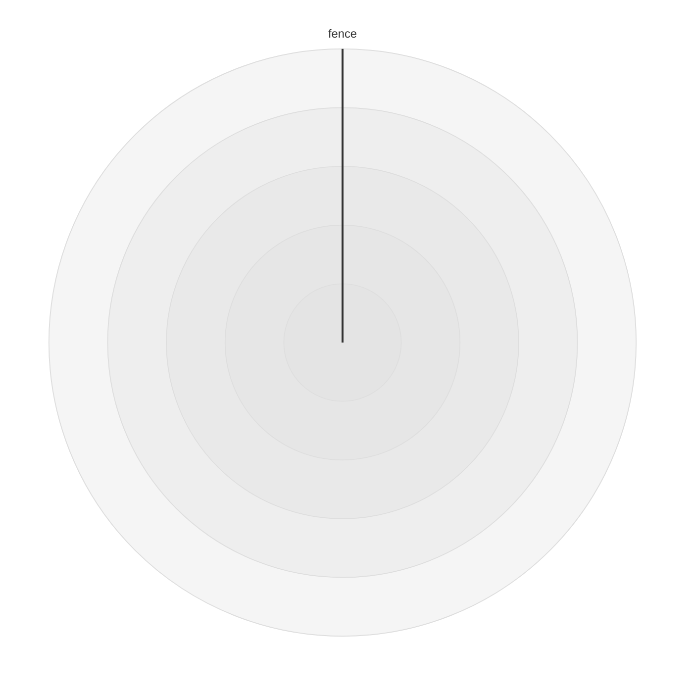

# Radar formatting rules

英語版: [radar.md](./radar.md)

決定された 29 項目に従い、
[radar の木](../../spec/docs/ast/radar.ja.md)
と共有の平坦な本文レイアウトを使います。
各規則で選択の理由を説明します。
保持する文字と mermaid.js との差は
[compatibility.ja.md](./compatibility.ja.md)に記します。

## Rules

### Header

`radar-beta` を第 1 列に置き、普通の最初の文を次の行へ移します。
見出しを見つけやすくするためです。
作者が書いたコロンの有無を保ちます。
別置コロン前の普通の空白は意味を持たないため、 `radar-beta:` に詰めます。
gitgraph の [Header](./gitgraph.ja.md#header) と同じ選択です。
hidden form、global trivia、semicolon の保護区間では境界を保ちます。
空の本文は空のままです。

[fixture: radar/header/joined-empty]

[fixture: radar/header/join-separated-empty-alternative]

[fixture: radar/header/bare-inline]

[fixture: radar/header/joined-inline]

[fixture: radar/header/join-separated-inline-alternative]

[fixture: radar/header/inline-title]

[fixture: radar/header/inline-a11y]

[fixture: radar/header/inline-block]

[fixture: radar/header/header-hidden-colon]

[fixture: radar/header/header-global-colon]

[fixture: radar/header/header-comment]

[fixture: radar/header/hidden-yaml-before-header-colon]

[corpus fixture: radar/header-colon-inline]

[corpus fixture: radar/header-separated-colon]

[corpus fixture: radar/header-repeated]

[corpus fixture: radar/header-colon-newline]

[corpus fixture: radar/spec-radar-test-ts-f0d1a74d]

入力（escape 表記）: `"radar-beta : curve trial{4}\n"`

出力
([header/join-separated-inline-alternative-output.mmd](../tests/fixtures/radar/header/join-separated-inline-alternative-output.mmd)):

```mmd
radar-beta:
  curve trial{4}
```

### Indentation

共有の平坦な本文 printer を使います。
普通の文、独立コメント、Root directive は設定の 1 段字下げします。
通常は 2 spaces、tabWidth 4 なら 4 spaces、0 なら 0 spaces です。
列に文法上の意味がないため、0 も使えます。
useTabs は幅 0 でも 1 tab を使います。
entry の継続行は 2 段です。
値の継続列、hidden の内側と closer、保持する prefix は各規則に従います。

[fixture: radar/indentation/indent-two]

[fixture: radar/indentation/indent-four]

[fixture: radar/indentation/indent-zero]

[fixture: radar/indentation/indent-tabs]

[fixture: radar/indentation/zero-tabs]

入力（escape 表記）: `"radar-beta\naxis North\nticks 7\n"`

設定: `{"tabWidth": 4}`

出力
([indentation/indent-four-output.mmd](../tests/fixtures/radar/indentation/indent-four-output.mmd)):

```mmd
radar-beta
    axis North
    ticks 7
```

### Statements one per line

普通の axis、curve、options、共通文は 1 文ずつ改行します。
作者の文の単位を見せるためです。
一つの keyword のカンマ群は分割せず、keyword も複製しません。
カンマのない隣接 option は別の文です。
`ticks 7max 8` も 2 文になります。
共通の行値は物理 EOL までの keyword に見える文字も所有します。
空の説明ブロックも文として残し、保護された見出しと本文の群を優先します。

[fixture: radar/statements-one-per-line/all-inline-kinds]

[fixture: radar/statements-one-per-line/line-owns-keywords]

[fixture: radar/statements-one-per-line/empty-block-interleaved]

[corpus fixture: radar/gram-inline-statements]

[corpus fixture: radar/tail-axis-semicolon]

入力（escape 表記）:
`"radar-beta axis North axis South curve one{1}curve two{2}ticks 7 max 9 min 2 showLegend false graticule polygon\n"`

出力
([statements-one-per-line/all-inline-kinds-output.mmd](../tests/fixtures/radar/statements-one-per-line/all-inline-kinds-output.mmd)):

```mmd
radar-beta
  axis North
  axis South
  curve one{1}
  curve two{2}
  ticks 7
  max 9
  min 2
  showLegend false
  graticule polygon
```

### Groups and commas

群の keyword と最初の member の間は普通の空白 1 個にします。
axis、curve、options、entry のカンマは前を詰め、後を 1 space にします。
xychart と quadrant と同じ見た目にそろえるためです。
axis・curve・options の群には可視改行を追加しません。
その文法では拒否されるためです。
trivia のある間隙は書かれた接触と分離を保ちます。

[fixture: radar/groups-and-commas/axis-comma]

[fixture: radar/groups-and-commas/curve-comma]

[fixture: radar/groups-and-commas/options-comma]

[fixture: radar/groups-and-commas/entry-comma]

[corpus fixture: radar/gram-axis-before-comma-visible]

[corpus fixture: radar/gram-curve-newline-comma]

[corpus fixture: radar/gram-option-comma-trailing]

[corpus fixture: radar/gram-entry-newline-before-comma]

入力（escape 表記）: `"radar-beta\naxis North [\"N\"] ,\tSouth , East\n"`

出力
([groups-and-commas/axis-comma-output.mmd](../tests/fixtures/radar/groups-and-commas/axis-comma-output.mmd)):

```mmd
radar-beta
  axis North["N"], South, East
```

### Labels

ラベルは `axis A["label"]`、`curve c['label']` と印字します。
`[` の前後と `]` の前の普通の空白を詰めます。
名前に付くラベルを一つに見せるためです。
ラベルの省略と空文字列は区別します。
引用符の内側は値として扱い、hidden と global の境界を優先します。

[fixture: radar/labels/axis-double-brackets]

[fixture: radar/labels/curve-single-brackets]

[fixture: radar/labels/empty-and-absent-label]

入力（escape 表記）: `"radar-beta\naxis North \t[ \t\"North label\"\t ]\n"`

出力
([labels/axis-double-brackets-output.mmd](../tests/fixtures/radar/labels/axis-double-brackets-output.mmd)):

```mmd
radar-beta
  axis North["North label"]
```

### Curve braces

`c{1, 2}`、`c["C"]{A: 1}` と印字します。
開き波括弧の前と内側の両端の普通の空白を詰めます。
付属部品の接着は architecture、リストの内端は xychart と同じです。
これは entry の波括弧です。
説明ブロックの空白は共有の説明規則に従います。

[fixture: radar/curve-braces/brace-tight]

[fixture: radar/curve-braces/label-before-brace]

入力（escape 表記）: `"radar-beta\ncurve trial \t{ \t4, 5 \t}\n"`

出力
([curve-braces/brace-tight-output.mmd](../tests/fixtures/radar/curve-braces/brace-tight-output.mmd)):

```mmd
radar-beta
  curve trial{4, 5}
```

### Multi-line statements

文法が空白として読む entry の改行は、trivia がなければ結合します。
対象は `{` の後、カンマの後、`}` の前です。
数だけのリストも名前つきリストも、xychart・quadrant と同様に 1 行にします。
カンマの前や名前つき entry の途中へ改行を追加しません。
コメントや Root directive のある改行は残します。
普通の継続行とコメントは 2 段、別行の `}` は文の位置にそろえます。
ほかの普通の間隙は結合できます。
hidden の境界、値の行、semicolon の保護区間は継続列を含め保ちます。
保護区間内に継続の字下げを足しません。
その後の普通の間隙には通常の空白規則を適用します。
終端行に別の文の semicolon がある場合も共有の結合検査で保ちます。
前の style に似たラベルと結合すると、その文の Db が変わりうるためです。

[fixture: radar/multi-line-statements/leading-trailing-entry-lines]

[fixture: radar/multi-line-statements/positional-after-comma]

[fixture: radar/multi-line-statements/named-after-comma]

[fixture: radar/multi-line-statements/entry-comment-after-comma]

[fixture: radar/multi-line-statements/entry-inline-comment]

[fixture: radar/multi-line-statements/entry-global-lines]

[fixture: radar/multi-line-statements/trailing-entry-comment]

[fixture: radar/multi-line-statements/leading-entry-comment]

[fixture: radar/multi-line-statements/named-outer-multiline-kept]

[fixture: radar/multi-line-statements/named-comment-after-comma]

[fixture: radar/multi-line-statements/semicolon-terminal-line]

[fixture: radar/multi-line-statements/protected-semicolon-later-curve-label]

[fixture: radar/multi-line-statements/protected-semicolon-entry-comment]

[fixture: radar/multi-line-statements/protected-semicolon-named-entries]

[fixture: radar/multi-line-statements/protected-semicolon-after-opening-brace]

[fixture: radar/multi-line-statements/protected-semicolon-before-closing-brace]

[fixture: radar/multi-line-statements/protected-semicolon-written-indentation]

[fixture: radar/multi-line-statements/protected-semicolon-tabs]

[fixture: radar/multi-line-statements/protected-semicolon-first-line-semicolon]

[fixture: radar/multi-line-statements/protected-semicolon-zero-width]

[fixture: radar/multi-line-statements/protected-semicolon-hidden-suffix]

[fixture: radar/multi-line-statements/protected-semicolon-root-directive]

[fixture: radar/multi-line-statements/protected-semicolon-same-line-suffix-gap]

[fixture: radar/multi-line-statements/protected-semicolon-semicolon-with-hidden-gap]

[fixture: radar/multi-line-statements/protected-semicolon-later-semicolon-blank-lines]

入力（escape 表記）: `"radar-beta\ncurve trial{4,\n%% entry note\n5\n}\n"`

出力
([multi-line-statements/entry-comment-after-comma-output.mmd](../tests/fixtures/radar/multi-line-statements/entry-comment-after-comma-output.mmd)):

```mmd
radar-beta
  curve trial{4,
    %% entry note
    5}
```

### Named entries

作者が書いたコロンの有無を保ちます。
`A: 1` はコロンの前を詰め、後を 1 space にします。
`A 1` は間を 1 space にし、列揃えはしません。
句読法を保ちながら、同じ意味の空白をそろえるためです。
軸名 `accTitle` と `accDescr` へのコロン追加は安全ではありません。
共通の複合 token が優先してしまうためです。

[fixture: radar/named-entries/named-colon-gap]

[fixture: radar/named-entries/named-no-colon-gap]

[fixture: radar/named-entries/mixed-colon-spelling]

[fixture: radar/named-entries/accessibility-identifiers]

入力（escape 表記）:
`"radar-beta\naxis North,South\ncurve trial{North 4,South:5}\n"`

出力
([named-entries/mixed-colon-spelling-output.mmd](../tests/fixtures/radar/named-entries/mixed-colon-spelling-output.mmd)):

```mmd
radar-beta
  axis North, South
  curve trial{North 4, South: 5}
```

### Numbers

entry と ticks・max・min の数は NumericLiteral の source span を印字します。
整数、小数の先行・末尾ゼロ、丸められる精度、subnormal、 underflow、
overflow の綴りを保ちます。
double 値からの再出力は綴りを失います。
radar が拒否する指数表記や Infinity を出すこともあるためです。

[fixture: radar/numbers/raw-number-forms]

[fixture: radar/numbers/raw-option-numbers]

[corpus fixture: radar/db-number-rounded]

[corpus fixture: radar/db-number-subnormal]

[corpus fixture: radar/db-number-underflow]

[corpus fixture: radar/db-number-overflow]

[corpus fixture: radar/db-option-overflow]

入力（escape 表記）:
`"radar-beta\ncurve trial{0004.5000,9007199254740993,0.12345678901234567890,0}\n"`

出力
([numbers/raw-number-forms-output.mmd](../tests/fixtures/radar/numbers/raw-number-forms-output.mmd)):

```mmd
radar-beta
  curve trial{0004.5000, 9007199254740993, 0.12345678901234567890, 0}
```

### Options

option の keyword と値の間は普通の空白 1 個にします。
boolean・graticule の固定小文字、数の綴り、カンマ群、反復と順序を保ちます。
既定値への置換、ticks の 32 への制限、min・max の並べ替えはしません。
公開された値は作者の構文ではないためです。
radar の描画設定から文の値を補いません。

[fixture: radar/options/option-gaps]

[fixture: radar/options/adjacent-numeric-option]

[fixture: radar/options/adjacent-boolean-option]

[fixture: radar/options/option-repetitions]

[fixture: radar/options/min-max-order-kept]

[corpus fixture: radar/db-ticks-cap-fraction]

[corpus fixture: radar/config-drawing-only]

[corpus fixture: radar/config-frontmatter-options-cannot-reject]

入力（escape 表記）:
`"radar-beta\nshowLegend\t false,ticks\t7,max  8,min\t2,graticule\tpolygon\n"`

出力
([options/option-gaps-output.mmd](../tests/fixtures/radar/options/option-gaps-output.mmd)):

```mmd
radar-beta
  showLegend false, ticks 7, max 8, min 2, graticule polygon
```

### Quotes

ラベルの StringLiteral は完全な source span を保ちます。
一重・二重・反対側の引用符、空・空白だけの文字列、escape、HTML、 entity、
内部の空白、hidden に見える文字を含みます。
singleQuote でも再引用しません。
空ラベルの削除は ID への fallback を変えます。
内側の空白を畳んでも Db が変わりうるためです。

[fixture: radar/quotes/quotes-and-empty]

[fixture: radar/quotes/padding-label]

[fixture: radar/quotes/escape-label]

[fixture: radar/quotes/label-html-entity]

[fixture: radar/quotes/hidden-looking-label]

[fixture: radar/quotes/whitespace-only-labels]

入力（escape 表記）:
`"radar-beta\naxis North['single \"other\"'],South[\"double 'other'\"],East[\"\"]\ncurve trial['']{1,2,3}\n"`

設定: `{"singleQuote": true}`

出力
([quotes/quotes-and-empty-output.mmd](../tests/fixtures/radar/quotes/quotes-and-empty-output.mmd)):

```mmd
radar-beta
  axis North['single "other"'], South["double 'other'"], East[""]
  curve trial['']{1, 2, 3}
```

### Title

共有の共通行レイアウトを使います。
共通空白の外端を除き、非空の値の前は 1 space にします。
null と空白だけの値は `title` にします。
同じ意味の外端だけをそろえ、内部の綴り、引用符、見かけの keyword を保ちます。
コメントや directive を挟んでも、次の物理行から値を取りません。
trivia のある値と保護区間は原文の間隙を保ちます。

[fixture: radar/title/title-edge-trim]

[fixture: radar/title/title-empty]

[fixture: radar/title/title-null-next-comment]

[fixture: radar/title/title-null-next-global]

[fixture: radar/title/title-quote-raw]

入力（escape 表記）: `"radar-beta\ntitle\t  Topic  words\t \n"`

出力
([title/title-edge-trim-output.mmd](../tests/fixtures/radar/title/title-edge-trim-output.mmd)):

```mmd
radar-beta
  title Topic  words
```

### Accessibility lines

共有の `accTitle: value` と `accDescr: value` を使います。
コロンは keyword に接着し、外端を除いた非空の値の前は 1 space です。
空の値はコロンで終え、次行の値を結合しません。
外側をそろえても内部の文字は書き換えません。
コロン後の波括弧は行値のままです。
trivia・hidden・semicolon の保護を優先します。

[fixture: radar/accessibility-lines/a11y-lines-fixed]

[fixture: radar/accessibility-lines/a11y-empty-next]

[fixture: radar/accessibility-lines/a11y-line-braces-fixed]

[fixture: radar/accessibility-lines/a11y-no-next-comment]

入力（escape 表記）:
`"radar-beta\naccTitle \t:   Access  words\t\naccDescr\t:   Detail  words \n"`

出力
([accessibility-lines/a11y-lines-fixed-output.mmd](../tests/fixtures/radar/accessibility-lines/a11y-lines-fixed-output.mmd)):

```mmd
radar-beta
  accTitle: Access  words
  accDescr: Detail  words
```

### Description blocks

説明は共有の `layoutDescriptionBlock` を通します。
keyword と opener、内端の接触は保ち、存在する外端の空白は 1 個にします。
空白だけの内部は、空白で囲む文字がないため `{}` にします。
opener 前の普通の空白は結合し、実際の trivia のある改行は残します。
コメント・directive だけの内部、非空の継続列、内部の空行を保ちます。
別行の opener と closer は文にそろえます。
最初の閉じ波括弧で値を終えます。

[fixture: radar/description-blocks/block-empty-fixed]

[fixture: radar/description-blocks/block-touching-fixed]

[fixture: radar/description-blocks/block-closer-fixed]

[fixture: radar/description-blocks/block-opener-plain-fixed]

[fixture: radar/description-blocks/block-comment-fixed]

[fixture: radar/description-blocks/block-global-only-fixed]

[fixture: radar/description-blocks/block-global-opener-fixed]

[fixture: radar/description-blocks/block-comment-opener-fixed]

[fixture: radar/description-blocks/block-multiline-global]

[test: radar/description-blocks/unicode-empty]

入力（escape 表記）:
`"radar-beta\naccDescr{Word}\naccDescr { Word }\naccDescr{Left }\naccDescr { Right}\n"`

出力
([description-blocks/block-touching-fixed-output.mmd](../tests/fixtures/radar/description-blocks/block-touching-fixed-output.mmd)):

```mmd
radar-beta
  accDescr{Word}
  accDescr { Word }
  accDescr{Left }
  accDescr { Right}
```

### Multiline values

printWidth で折り返しません。
新しい可視改行は群の部品を拒否させ、値の詰め直しは Db を変えうるためです。
ラベル・値の物理継続行、列、内部の空行を保ちます。
別行の説明 closer だけは共有の位置揃えを使います。
長い axis 群と entry リストも折り返しません。

[fixture: radar/multiline-values/long-axis-no-wrap]

[fixture: radar/multiline-values/long-entries-no-wrap]

[fixture: radar/multiline-values/physical-value-columns]

入力（escape 表記）:
`"radar-beta\naxis North[\"first\n   second\n\nlast\"]\ncurve trial['other\n  continuation']{4}\n"`

出力
([multiline-values/physical-value-columns-output.mmd](../tests/fixtures/radar/multiline-values/physical-value-columns-output.mmd)):

```mmd
radar-beta
  axis North["first
   second

last"]
  curve trial['other
  continuation']{4}
```

### Source order

本文、axis・curve・option の群、entry の順と全出現を保ちます。
前方参照、重複軸・curve・entry、余分な名前つき entry、最初の値 0、
prototype に似た名前、空の共通代入を残します。
別の curve は異なる entry 形式を選べます。
数だけのリストと名前つきリストを相互変換しません。
解決済み Db は作者の選択を再現できず、並べ替えや削除で読みが変わるためです。

[fixture: radar/source-order/declaration-order-kept]

[fixture: radar/source-order/duplicate-zero-resolution]

[fixture: radar/source-order/common-resets-kept]

[fixture: radar/source-order/prototype-names-kept]

[fixture: radar/source-order/mixed-curve-forms]

入力（escape 表記）:
`"radar-beta\ncurve trial{South:5,North:4,Extra:9,North:6}\naxis North,South,North\ncurve trial{7}\n"`

出力
([source-order/declaration-order-kept-output.mmd](../tests/fixtures/radar/source-order/declaration-order-kept-output.mmd)):

```mmd
radar-beta
  curve trial{South: 5, North: 4, Extra: 9, North: 6}
  axis North, South, North
  curve trial{7}
```

### Comments

普通の独立コメントは本文 1 段、見出し前は第 1 列にそろえます。
inline コメントは行と接着を保ち、分離した空白は 1 個にします。
mark、本文、末尾の空白を保ちます。
native コメントは物理 EOL で終わり、LS・PS は内容のままです。
先に始まった文字列と説明が percent の文字を所有する場合もあります。
除去された共通領域は完全な原文と継続列を保ちます。
共有の配置規則で文字の owner を変えないためです。

[fixture: radar/comments/standalone-comments]

[fixture: radar/comments/inline-comment-sides]

[fixture: radar/comments/common-percent-stop]

[fixture: radar/comments/value-percent-owned]

[corpus fixture: radar/comment-ls]

[corpus fixture: radar/comment-ps]

[corpus fixture: radar/common-block-comment]

[test: radar/comments/native-comment-ls-ps]

入力（escape 表記）:
`"radar-beta\naxis North[\"N%%literal\"]\naccDescr {a%%literal}\n"`

出力
([comments/value-percent-owned-output.mmd](../tests/fixtures/radar/comments/value-percent-owned-output.mmd)):

```mmd
radar-beta
  axis North["N%%literal"]
  accDescr {a%%literal}
```

### Global directives

Root directive の内容、順、owner を保ちます。
部品や値の内部の directive も残します。
同じ印字行の中では、両側の接触・分離を保ちます。
元は同じ行にあった単位を別の行へ分けるときは、
間の directive を次の単位に付けます。
右側の接触・分離は保ち、左側の接触は切れます。
普通の独立した開始位置は本文 1 段です。
複数行の内部と EOF に届く未完の末尾は書かれたままです。
JSON 整形や集約はしません。
除去時に周囲が接合され、部品の境界の空白を消すと受理を壊しうるためです。
native の RadarIgnoredText directive は別の原文ノードです。

[fixture: radar/global-directives/header-to-body]

[fixture: radar/global-directives/global-components]

[fixture: radar/global-directives/global-named-gaps]

[fixture: radar/global-directives/global-option-space]

[fixture: radar/global-directives/global-value-source]

[fixture: radar/global-directives/global-standalone]

[fixture: radar/global-directives/global-multiline]

[fixture: radar/global-directives/global-unclosed-eof]

[fixture: radar/global-directives/both-separated]

[fixture: radar/global-directives/left-separated]

入力（escape 表記）:
`"radar-beta\naxis North%%{wrap}%%[%%{wrap}%%\"N\"%%{wrap}%%]\ncurve trial%%{wrap}%%{4}\n"`

出力
([global-directives/global-components-output.mmd](../tests/fixtures/radar/global-directives/global-components-output.mmd)):

```mmd
radar-beta
  axis North%%{wrap}%%[%%{wrap}%%"N"%%{wrap}%%]
  curve trial%%{wrap}%%{4}
```

### Hidden forms

RadarIgnoredText の source span は AST の owner で 1 回だけ印字します。
owner は textBeforeHeader、textBeforeColon、body、
member・entry・option・共通文の間隙です。
value は共通 trivia を除くため、値ではなく範囲を印字します。
member の間隙を本文の文に昇格せず、hidden YAML・JSON を整形しません。
空の内部、3 fence で 1 match、別 match、後の有効な closer、
内部の global・comment による切断を保ちます。
普通の body opener は字下げできますが、内部と closer の列は保ちます。
hidden form の前に改行を新設しません。
文字列と共通値が持つ hidden に見える文字も所有を保ちます。
native form の照合に失敗したコメントはコメントのままです。

[fixture: radar/hidden-forms/axis-hidden-members]

[fixture: radar/hidden-forms/axis-hidden-label-gaps]

[fixture: radar/hidden-forms/curve-hidden-members]

[fixture: radar/hidden-forms/curve-hidden-label-entries-gaps]

[fixture: radar/hidden-forms/number-entry-hidden-owners]

[fixture: radar/hidden-forms/named-entry-hidden-owners]

[fixture: radar/hidden-forms/options-hidden-all-kinds]

[fixture: radar/hidden-forms/yaml-body-opaque]

[fixture: radar/hidden-forms/yaml-gap-keyword]

[fixture: radar/hidden-forms/yaml-label-gap]

[fixture: radar/hidden-forms/yaml-named-gap]

[fixture: radar/hidden-forms/yaml-three-fences]

[fixture: radar/hidden-forms/yaml-two-forms]

[fixture: radar/hidden-forms/yaml-later-closer]

[fixture: radar/hidden-forms/native-later-closer]

[fixture: radar/hidden-forms/native-fallback-comment]

[fixture: radar/hidden-forms/hidden-global-cut]

[fixture: radar/hidden-forms/hidden-comment-region]

[fixture: radar/hidden-forms/hidden-header-yaml]

[fixture: radar/hidden-forms/hidden-multiline-body]

[corpus fixture: radar/lex-common-hidden-yaml-block-owner]

[corpus fixture: radar/lex-common-hidden-percent-block-owner]

[corpus fixture: radar/lex-hidden-yaml-opener-selected-control]

[corpus fixture: radar/lex-hidden-native-opener-selected]

[corpus fixture: radar/lex-hidden-two-suffixes]

[corpus fixture: radar/hidden-yaml-adjacent-eof]

入力（escape 表記）:
`"radar-beta\naxis North%%{!open}%%\n[%%{!value}%%\n\"N\"%%{!close}%%\n]\n"`

出力
([hidden-forms/axis-hidden-label-gaps-output.mmd](../tests/fixtures/radar/hidden-forms/axis-hidden-label-gaps-output.mmd)):

```mmd
radar-beta
  axis North%%{!open}%%
[%%{!value}%%
"N"%%{!close}%%
]
```

### Hidden boundaries

ノード範囲外の消費 LF と closer 後の空白は共有の保護を使います。
closer 後の space・tab は EOL を可視に保てます。
それがない共通文の suffix は次の文の前に予備 LF が必要です。
EOF 自身も文を終えます。
EOL が不要な axis・curve・options でも、書かれた境界を保ちます。
見出し端の例外は見出し自身の hidden form だけに適用します。
その行に残る文も本文の境界を持ちます。
群の最後の member の suffix も同じ共有処理へ渡します。
複数 suffix、可視 EOL 後の form、EOF の closer 後の空白も保ちます。
外側の余分な空行は共有の空行規則に従います。

[fixture: radar/hidden-boundaries/hidden-axis-no-spare-needed]

[fixture: radar/hidden-boundaries/hidden-title-space]

[fixture: radar/hidden-boundaries/hidden-acctitle-tab]

[fixture: radar/hidden-boundaries/hidden-accdescr-spare]

[fixture: radar/hidden-boundaries/hidden-block-spare]

[fixture: radar/hidden-boundaries/hidden-yaml-block-space]

[fixture: radar/hidden-boundaries/hidden-header-no-spare-fixed]

[fixture: radar/hidden-boundaries/header-line-statement-spare-fixed]

[fixture: radar/hidden-boundaries/two-suffix-owners]

[fixture: radar/hidden-boundaries/body-after-visible-eol]

[fixture: radar/hidden-boundaries/hidden-yaml-close-padding-eof]

[fixture: radar/hidden-boundaries/hidden-common-title-spare]

[fixture: radar/hidden-boundaries/hidden-acctitle-spare]

[fixture: radar/hidden-boundaries/hidden-accdescr-space]

[fixture: radar/hidden-boundaries/hidden-block-space]

[fixture: radar/hidden-boundaries/header-axis-suffix]

入力（escape 表記）: `"radar-beta%%{}%% axis A%%{}%%\n\ncurve c{1}"`

出力
([hidden-boundaries/header-axis-suffix-output.mmd](../tests/fixtures/radar/hidden-boundaries/header-axis-suffix-output.mmd)):

```mmd
radar-beta%%{}%% axis A%%{}%%

  curve c{1}
```

### Retained prefix

textBeforeHeader があれば、見出し keyword までの prefix 全体を保ちます。
先頭 LF、コメントの列、渡された bare line の trivia、second scan の form、
real・hidden YAML の順を含みます。
共有の keepsPrefix で、無視された YAML の frontmatter への昇格を防ぎます。
title と設定が変わりうるためです。
普通のコメントだけの prefix は root の整形を使います。

[fixture: radar/retained-prefix/retained-leading-lf]

[fixture: radar/retained-prefix/real-then-hidden]

[fixture: radar/retained-prefix/second-scan-retained]

[fixture: radar/retained-prefix/prefix-between-forms]

[corpus fixture: radar/detect-retained-three-native]

[corpus fixture: radar/retained-directive-between-bare]

入力（escape 表記）:
`"\n---\ntitle: Ignored title\n---\nradar-beta\naxis North\n"`

出力
([retained-prefix/retained-leading-lf-output.mmd](../tests/fixtures/radar/retained-prefix/retained-leading-lf-output.mmd)):

```mmd

---
title: Ignored title
---
radar-beta
  axis North
```

### Semicolons

すべての authored semicolon を共有の protectSemicolonPrefixes で保ちます。
文字区間の最初の非空白から最後の semicolon までを保護します。
交差する値と trivia を全体で含め、安全な後方の間隙を整えます。
保護された見出しと最初の文の群はまとめて残します。
style・classDef の選択、2 回の除去、大小文字・colon・hash の非該当形、
Unicode の区間境界、directive 除去後の接合を保ちます。
選択された semicolon の削除でも別のものが選択され、値が変わりえます。
radar に普通の semicolon 区切りはありません。

[fixture: radar/semicolons/native-axis-value]

[fixture: radar/semicolons/semicolon-value-kept]

[fixture: radar/semicolons/semicolon-selected-kept]

[fixture: radar/semicolons/semicolon-header-protected]

[fixture: radar/semicolons/semicolon-component-protected]

[fixture: radar/semicolons/semicolon-nontrigger-cases]

[fixture: radar/semicolons/semicolon-both-passes]

[fixture: radar/semicolons/semicolon-global-rejoin]

[fixture: radar/semicolons/semicolon-cross-value]

[fixture: radar/semicolons/semicolon-comment-crossing]

[test: radar/semicolons/semicolon-ls-segment]

入力（escape 表記）:
`"radar-beta\ntitle style:#red;;\naxis North[\"classDef:#blue;;\"]\n"`

出力
([semicolons/semicolon-selected-kept-output.mmd](../tests/fixtures/radar/semicolons/semicolon-selected-kept-output.mmd)):

```mmd
radar-beta
  title style:#red;;
  axis North["classDef:#blue;;"]
```

### Blank lines

文や trivia の間の普通の ASCII 空行は最大 1 行にします。
文書・本文の端と見出し直後の普通の空行は除きます。
空白だけの行は空行にそろえます。
余分な空間を増やさず、まとまりを保つためです。
必要な hidden LF には先に共有の境界規則を適用します。
値、説明、directive・hidden の内部、共通領域の接合、prefix は保ちます。

[fixture: radar/blank-lines/blanks-ordinary]

[fixture: radar/blank-lines/blanks-comment]

[fixture: radar/blank-lines/blanks-value-kept]

[fixture: radar/blank-lines/hidden-excess-blanks]

[fixture: radar/blank-lines/hidden-end-blanks]

入力（escape 表記）:
`"\n\nradar-beta\n\n\naxis North\n \t\n\ncurve trial{4}\n\n"`

出力
([blank-lines/blanks-ordinary-output.mmd](../tests/fixtures/radar/blank-lines/blanks-ordinary-output.mmd)):

```mmd
radar-beta
  axis North

  curve trial{4}
```

### Trailing whitespace

見出し、完了した axis・curve・options、説明 closer 後の無害な空白を除きます。
共通の行値の外端は共有の trim に従います。
コメント末尾、値の物理継続行、directive・hidden の内部、保護区間、
保持する prefix は残します。
hidden closer 後の空白は EOF でも残します。
受理を左右しうるためです。

[fixture: radar/trailing-whitespace/trailing-safe]

[fixture: radar/trailing-whitespace/trailing-comment-kept]

[fixture: radar/trailing-whitespace/trailing-label-kept]

[fixture: radar/trailing-whitespace/trailing-hidden-eof-kept]

入力（escape 表記）:
`"radar-beta \t\naxis North \t\ncurve trial{4} \t\nticks 7 \t\naccDescr {Detail} \t\n"`

出力
([trailing-whitespace/trailing-safe-output.mmd](../tests/fixtures/radar/trailing-whitespace/trailing-safe-output.mmd)):

```mmd
radar-beta
  axis North
  curve trial{4}
  ticks 7
  accDescr {Detail}
```

### Frontmatter yaml

安全な real frontmatter だけ共有の保護つき YAML 整形を使います。
区切りの空白、不正な YAML、字下げされた fence、HTML の危険、
整形で fence が生じる本文は保ちます。
tabWidth 0 でも YAML の入れ子と block scalar は共有の正の最小幅を使います。
hidden YAML と保持する prefix は不透明なままです。
有効な設定と無視される文字を分けるためです。
描画設定を option の文へ移しません。
frontmatter への fallback を戻す空の本文 title も削除しません。

[fixture: radar/frontmatter-yaml/frontmatter-safe]

[fixture: radar/frontmatter-yaml/frontmatter-fence-padding]

[fixture: radar/frontmatter-yaml/frontmatter-html-guard]

[fixture: radar/frontmatter-yaml/frontmatter-indented-keep]

[fixture: radar/frontmatter-yaml/frontmatter-positive-minimum]

[fixture: radar/frontmatter-yaml/frontmatter-malformed-kept]

[fixture: radar/frontmatter-yaml/frontmatter-delimiter-guard]

[fixture: radar/frontmatter-yaml/frontmatter-empty-title-fallback]

入力（escape 表記）:
`"---\ntitle:   Radar topic\nconfig: {theme: dark, radar: {width: 250}}\n---\nradar-beta\naxis North\n"`

出力
([frontmatter-yaml/frontmatter-safe-output.mmd](../tests/fixtures/radar/frontmatter-yaml/frontmatter-safe-output.mmd)):

```mmd
---
title: Radar topic
config: { theme: dark, radar: { width: 250 } }
---
radar-beta
  axis North
```

### Line terminators and unicode

共有の Prettier host の改行を使います。
物理 CR・CRLF は LF として読み、設定された LF・CRLF・CR で出します。
ラベル、共通値、hidden form、frontmatter の内側も同じです。
LS・PS・NBSP・BOM は字句上の役割を保ち、一般的な間隙にはしません。
共通値の外端 trim と説明 opener 前の普通の空白だけが正規化対象です。
ラベルの LS・PS を LF にすると Db が変わります。
host は先頭 BOM を除去・復元します。
元の byte や frontmatter の状態は保証しません。

[corpus fixture: radar/line-ls-between]

[corpus fixture: radar/line-ps-between]

[corpus fixture: radar/space-nbsp-body]

[corpus fixture: radar/space-bom-body]

[test: radar/line-terminators-and-unicode/cr-structural]

[test: radar/line-terminators-and-unicode/crlf-values]

[test: radar/line-terminators-and-unicode/crlf-hidden]

[test: radar/line-terminators-and-unicode/unicode-values]

[test: radar/line-terminators-and-unicode/unicode-line-edges]

[test: radar/line-terminators-and-unicode/unicode-block-opener]

[test: radar/line-terminators-and-unicode/frontmatter-cr]

[test: radar/line-terminators-and-unicode/leading-bom-header]

[test: radar/line-terminators-and-unicode/output-crlf]

[test: radar/line-terminators-and-unicode/output-cr]

[test: radar/line-terminators-and-unicode/hidden-content]

[test: radar/line-terminators-and-unicode/description-content]

入力（escape 表記）: `"radar-beta\raxis North\rcurve trial{4}\r"`

出力（escape 表記）: `"radar-beta\n  axis North\n  curve trial{4}\n"`

### Final newline

普通の受理入力は設定された改行 1 個で終えます。
空の本文と共通行、完了した説明、コメント、閉じた hidden form も同じです。
普通の末尾空行を除き、ファイル末尾をそろえます。
EOF に届く global directive の末尾と必要な hidden・prefix の境界は保ちます。
その内部に文字を追加しません。

[fixture: radar/final-newline/final-comment]

[fixture: radar/final-newline/final-hidden-closed]

[fixture: radar/final-newline/final-yaml-closed]

[corpus fixture: radar/spec-radar-test-ts-80aac02a]

[corpus fixture: radar/common-acctitle-eof]

[corpus fixture: radar/c4-container-header-eof]

入力（escape 表記）: `"radar-beta\naccDescr {Detail}%%{!suffix}%%"`

出力
([final-newline/final-hidden-closed-output.mmd](../tests/fixtures/radar/final-newline/final-hidden-closed-output.mmd)):

```mmd
radar-beta
  accDescr {Detail}%%{!suffix}%%
```

### Specified readings

既存の 6 差異に従います。
directive-as-token-boundary、ignored-semicolon-as-token-boundary、
html-tag-in-frontmatter、embedded-data-opaque、
bare-percent-line-before-header、c4-keyword-anywhere です。
原子的な切断は拒否し、ほかの印つき入力は仕様の読みを使います。
radar に opaque 比較から除く固有の受理設定 key はありません。
raw の拒否には raw Db がありません。
空ラベル、空説明、全体の hidden form はノードであり、新しい差異ではありません。
standalone の失敗は修復した出力を返さず構文エラーにします。
Markdown は埋め込みを辞退します。
[互換性](./compatibility.ja.md#radar-の原文の群と-hidden-境界)
も参照してください。

[corpus fixture: radar/directive-header-middle]

[corpus fixture: radar/div-semicolon-id]

[corpus fixture: radar/div-html-frontmatter-cross]

[corpus fixture: radar/div-html-frontmatter-reverse]

[corpus fixture: radar/div-html-frontmatter-value]

[corpus fixture: radar/frontmatter-invalid-keeps-config]

[corpus fixture: radar/bare-before-header-nbsp]

[corpus fixture: radar/c4-component-axis-label]

[corpus fixture: radar/db-empty-labels]

[corpus fixture: radar/common-block-empty-interleaved]

[test: radar/specified-readings/specified-bare-unicode]

たとえば `radar-beta\naxis A%%{wrap}%%B` は名前を切断し、
修復した出力を返しません。

### Markdown fences

共有の Markdown 経路で、dedent 済みの内容に同じ規則を適用します。
fence・list・quote の字下げと EOL は host が担当します。
最後の hidden padding を含め、内容の最終行の空白は host が削ります。
途中の共通文 suffix の後で次の文に必要な空白は残します。
内容の規則を一つに保つためです。
host の出力と冪等性は、内容の Db と原文保持とは別に検査します。

[test: radar Markdown: top-level]

[test: radar Markdown: list]

[test: radar Markdown: quote]

[test: radar Markdown: zero]

[test: radar Markdown: tabs]

[test: radar Markdown: hidden-gap]

[test: radar Markdown: hidden-boundary]

[test: radar Markdown: preheader]

[test: radar Markdown: frontmatter]

[test: radar Markdown: global-and-semicolons]

[test: radar Markdown: final-comment]

[test: radar Markdown: final-hidden-padding]

[test: radar Markdown: rejected]

入力:

````markdown

````

出力:

````markdown

````
