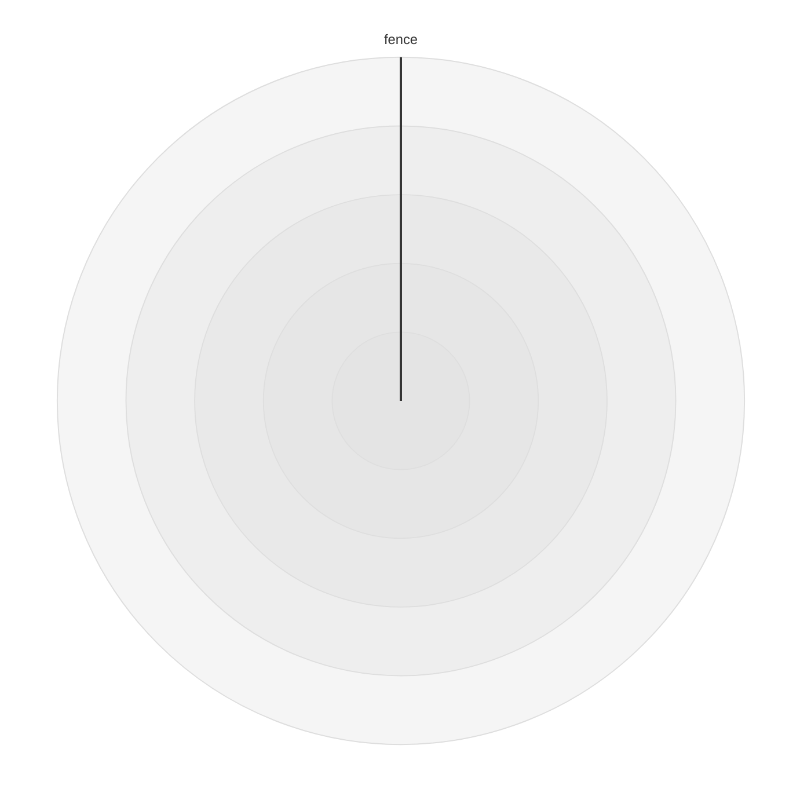

# Radar formatting rules

Japanese version: [radar.ja.md](./radar.ja.md)

The printer follows the 29 adopted items using the authored
[radar tree](../../spec/docs/ast/radar.md) and shared flat-body layouts. Each
rule explains its choice; [compatibility.md](./compatibility.md) records
preserved text and differences from mermaid.js.

## Rules

### Header

Print `radar-beta` at column one and put an ordinary first statement on the next
line so the heading is easy to find. Keep the author's colon presence; compact
ordinary whitespace before a separate colon to `radar-beta:`, as in gitgraph's
[Header](./gitgraph.md#header). That whitespace has no meaning. Hidden forms,
global trivia and protected semicolon segments keep their source boundaries
instead. Empty bodies remain empty.

[fixture: radar/header/joined-empty]

[fixture: radar/header/join-separated-empty-alternative]

[fixture: radar/header/bare-inline]

[fixture: radar/header/joined-inline]

[fixture: radar/header/join-separated-inline-alternative]

[fixture: radar/header/inline-title]

[fixture: radar/header/inline-a11y]

[fixture: radar/header/inline-block]

[fixture: radar/header/header-hidden-colon]

[fixture: radar/header/header-global-colon]

[fixture: radar/header/header-comment]

[fixture: radar/header/hidden-yaml-before-header-colon]

[corpus fixture: radar/header-colon-inline]

[corpus fixture: radar/header-separated-colon]

[corpus fixture: radar/header-repeated]

[corpus fixture: radar/header-colon-newline]

[corpus fixture: radar/spec-radar-test-ts-f0d1a74d]

Input (escaped): `"radar-beta : curve trial{4}\n"`.

Output
([header/join-separated-inline-alternative-output.mmd](../tests/fixtures/radar/header/join-separated-inline-alternative-output.mmd)):

```mmd
radar-beta:
  curve trial{4}
```

### Indentation

Use the shared flat-body printer: ordinary statements, standalone comments and
Root directives stand one configured step in. The default is two spaces;
tabWidth four uses four spaces, and tabWidth zero uses zero spaces because
columns have no grammatical meaning. useTabs uses one tab, even at width zero.
Entry continuation lines use two steps; written value columns, hidden
interiors/closers and retained prefixes keep their own rules.

[fixture: radar/indentation/indent-two]

[fixture: radar/indentation/indent-four]

[fixture: radar/indentation/indent-zero]

[fixture: radar/indentation/indent-tabs]

[fixture: radar/indentation/zero-tabs]

Input (escaped): `"radar-beta\naxis North\nticks 7\n"`.

Options: `{"tabWidth": 4}`.

Output
([indentation/indent-four-output.mmd](../tests/fixtures/radar/indentation/indent-four-output.mmd)):

```mmd
radar-beta
    axis North
    ticks 7
```

### Statements one per line

Print each ordinary axis, curve, options or common statement on its own line to
expose the authored statement units. A keyword's comma group remains one
statement; never duplicate its keyword. Adjacent options without a comma are
separate statements, including `ticks 7max 8`. A common line owns apparent
keywords through physical EOL. Empty descriptions remain statements; protected
header/body groups take precedence.

[fixture: radar/statements-one-per-line/all-inline-kinds]

[fixture: radar/statements-one-per-line/line-owns-keywords]

[fixture: radar/statements-one-per-line/empty-block-interleaved]

[corpus fixture: radar/gram-inline-statements]

[corpus fixture: radar/tail-axis-semicolon]

Input (escaped):
`"radar-beta axis North axis South curve one{1}curve two{2}ticks 7 max 9 min 2 showLegend false graticule polygon\n"`.

Output
([statements-one-per-line/all-inline-kinds-output.mmd](../tests/fixtures/radar/statements-one-per-line/all-inline-kinds-output.mmd)):

```mmd
radar-beta
  axis North
  axis South
  curve one{1}
  curve two{2}
  ticks 7
  max 9
  min 2
  showLegend false
  graticule polygon
```

### Groups and commas

Put one ordinary space between a group keyword and its first member. A comma has
no space before it and one after it, in axis, curve, options and entry lists.
This makes lists consistent with xychart and quadrant. Do not insert visible
newlines into axis/curve/options groups: those grammars reject them.
Trivia-bearing gaps retain their written contact.

[fixture: radar/groups-and-commas/axis-comma]

[fixture: radar/groups-and-commas/curve-comma]

[fixture: radar/groups-and-commas/options-comma]

[fixture: radar/groups-and-commas/entry-comma]

[corpus fixture: radar/gram-axis-before-comma-visible]

[corpus fixture: radar/gram-curve-newline-comma]

[corpus fixture: radar/gram-option-comma-trailing]

[corpus fixture: radar/gram-entry-newline-before-comma]

Input (escaped): `"radar-beta\naxis North [\"N\"] ,\tSouth , East\n"`.

Output
([groups-and-commas/axis-comma-output.mmd](../tests/fixtures/radar/groups-and-commas/axis-comma-output.mmd)):

```mmd
radar-beta
  axis North["N"], South, East
```

### Labels

Print attached labels as `axis A["label"]` and `curve c['label']`: ordinary gaps
before `[`, after `[` and before `]` are empty. This makes the label read with
its name. Keep absent labels distinct from empty quoted labels. Quote interiors
are values, not component spacing, and hidden/global boundaries take precedence.

[fixture: radar/labels/axis-double-brackets]

[fixture: radar/labels/curve-single-brackets]

[fixture: radar/labels/empty-and-absent-label]

Input (escaped): `"radar-beta\naxis North \t[ \t\"North label\"\t ]\n"`.

Output
([labels/axis-double-brackets-output.mmd](../tests/fixtures/radar/labels/axis-double-brackets-output.mmd)):

```mmd
radar-beta
  axis North["North label"]
```

### Curve braces

Print `c{1, 2}` and `c["C"]{A: 1}`: ordinary gaps before the opening brace and
at both interior ends are empty. Attached components and the list's tight inner
edges follow the architecture and xychart choices. These are entry braces;
description-block spacing uses the shared description rule.

[fixture: radar/curve-braces/brace-tight]

[fixture: radar/curve-braces/label-before-brace]

Input (escaped): `"radar-beta\ncurve trial \t{ \t4, 5 \t}\n"`.

Output
([curve-braces/brace-tight-output.mmd](../tests/fixtures/radar/curve-braces/brace-tight-output.mmd)):

```mmd
radar-beta
  curve trial{4, 5}
```

### Multi-line statements

Join trivia-free entry newlines where the grammar reads them as whitespace:
after `{`, after a comma and before `}`. Positional and named lists then fit on
one line, as in xychart and quadrant. Never add a newline before a comma or
inside a named entry. Keep newlines holding comments or Root directives;
ordinary continuation lines and comments use two indentation steps, while a
separate `}` aligns with its statement. Other plain gaps may still join. Hidden
boundaries, value lines and protected semicolon segments remain written,
including their continuation columns. No continuation indentation is added
inside a protected segment; ordinary spacing still applies after it. Shared
joining checks also keep a terminal line containing another statement's
semicolon: joining a preceding style-like label could change that statement's
Db.

[fixture: radar/multi-line-statements/leading-trailing-entry-lines]

[fixture: radar/multi-line-statements/positional-after-comma]

[fixture: radar/multi-line-statements/named-after-comma]

[fixture: radar/multi-line-statements/entry-comment-after-comma]

[fixture: radar/multi-line-statements/entry-inline-comment]

[fixture: radar/multi-line-statements/entry-global-lines]

[fixture: radar/multi-line-statements/trailing-entry-comment]

[fixture: radar/multi-line-statements/leading-entry-comment]

[fixture: radar/multi-line-statements/named-outer-multiline-kept]

[fixture: radar/multi-line-statements/named-comment-after-comma]

[fixture: radar/multi-line-statements/semicolon-terminal-line]

[fixture: radar/multi-line-statements/protected-semicolon-later-curve-label]

[fixture: radar/multi-line-statements/protected-semicolon-entry-comment]

[fixture: radar/multi-line-statements/protected-semicolon-named-entries]

[fixture: radar/multi-line-statements/protected-semicolon-after-opening-brace]

[fixture: radar/multi-line-statements/protected-semicolon-before-closing-brace]

[fixture: radar/multi-line-statements/protected-semicolon-written-indentation]

[fixture: radar/multi-line-statements/protected-semicolon-tabs]

[fixture: radar/multi-line-statements/protected-semicolon-first-line-semicolon]

[fixture: radar/multi-line-statements/protected-semicolon-zero-width]

[fixture: radar/multi-line-statements/protected-semicolon-hidden-suffix]

[fixture: radar/multi-line-statements/protected-semicolon-root-directive]

[fixture: radar/multi-line-statements/protected-semicolon-same-line-suffix-gap]

[fixture:
radar/multi-line-statements/protected-semicolon-semicolon-with-hidden-gap]

[fixture:
radar/multi-line-statements/protected-semicolon-later-semicolon-blank-lines]

Input (escaped): `"radar-beta\ncurve trial{4,\n%% entry note\n5\n}\n"`.

Output
([multi-line-statements/entry-comment-after-comma-output.mmd](../tests/fixtures/radar/multi-line-statements/entry-comment-after-comma-output.mmd)):

```mmd
radar-beta
  curve trial{4,
    %% entry note
    5}
```

### Named entries

Keep authored optional colons. Print `A: 1` with no ordinary space before the
colon and one after, or `A 1` with one space and no alignment. This retains
punctuation while giving equivalent padding a consistent form. Adding a colon is
unsafe for axis names `accTitle` and `accDescr`: common composite tokens would
take priority.

[fixture: radar/named-entries/named-colon-gap]

[fixture: radar/named-entries/named-no-colon-gap]

[fixture: radar/named-entries/mixed-colon-spelling]

[fixture: radar/named-entries/accessibility-identifiers]

Input (escaped):
`"radar-beta\naxis North,South\ncurve trial{North 4,South:5}\n"`.

Output
([named-entries/mixed-colon-spelling-output.mmd](../tests/fixtures/radar/named-entries/mixed-colon-spelling-output.mmd)):

```mmd
radar-beta
  axis North, South
  curve trial{North 4, South: 5}
```

### Numbers

Print NumericLiteral source spans in entries and ticks/max/min. Preserve integer
digits, decimal leading/trailing zeros, rounded precision, subnormals, underflow
and overflow. Reprinting double values loses spelling and can produce exponents
or Infinity, which radar's number grammar rejects.

[fixture: radar/numbers/raw-number-forms]

[fixture: radar/numbers/raw-option-numbers]

[corpus fixture: radar/db-number-rounded]

[corpus fixture: radar/db-number-subnormal]

[corpus fixture: radar/db-number-underflow]

[corpus fixture: radar/db-number-overflow]

[corpus fixture: radar/db-option-overflow]

Input (escaped):
`"radar-beta\ncurve trial{0004.5000,9007199254740993,0.12345678901234567890,0}\n"`.

Output
([numbers/raw-number-forms-output.mmd](../tests/fixtures/radar/numbers/raw-number-forms-output.mmd)):

```mmd
radar-beta
  curve trial{0004.5000, 9007199254740993, 0.12345678901234567890, 0}
```

### Options

Use one ordinary space between an option keyword and its value. Keep fixed
lowercase boolean/graticule words, numeric spellings, comma groups and every
repeated assignment in source order. Do not substitute effective defaults, cap
ticks at 32 or reorder min/max: publication is not authored syntax. Radar
drawing configuration does not supply these statement values.

[fixture: radar/options/option-gaps]

[fixture: radar/options/adjacent-numeric-option]

[fixture: radar/options/adjacent-boolean-option]

[fixture: radar/options/option-repetitions]

[fixture: radar/options/min-max-order-kept]

[corpus fixture: radar/db-ticks-cap-fraction]

[corpus fixture: radar/config-drawing-only]

[corpus fixture: radar/config-frontmatter-options-cannot-reject]

Input (escaped):
`"radar-beta\nshowLegend\t false,ticks\t7,max  8,min\t2,graticule\tpolygon\n"`.

Output
([options/option-gaps-output.mmd](../tests/fixtures/radar/options/option-gaps-output.mmd)):

```mmd
radar-beta
  showLegend false, ticks 7, max 8, min 2, graticule polygon
```

### Quotes

Keep each label's complete StringLiteral source span: single/double quotes,
opposite quotes, empty/whitespace-only text, escapes, HTML, entities, internal
padding and hidden-looking text. singleQuote does not re-encode it. Removing an
empty label changes the ID fallback, and collapsing interior whitespace can
change the Db.

[fixture: radar/quotes/quotes-and-empty]

[fixture: radar/quotes/padding-label]

[fixture: radar/quotes/escape-label]

[fixture: radar/quotes/label-html-entity]

[fixture: radar/quotes/hidden-looking-label]

[fixture: radar/quotes/whitespace-only-labels]

Input (escaped):
`"radar-beta\naxis North['single \"other\"'],South[\"double 'other'\"],East[\"\"]\ncurve trial['']{1,2,3}\n"`.

Options: `{"singleQuote": true}`.

Output
([quotes/quotes-and-empty-output.mmd](../tests/fixtures/radar/quotes/quotes-and-empty-output.mmd)):

```mmd
radar-beta
  axis North['single "other"'], South["double 'other'"], East[""]
  curve trial['']{1, 2, 3}
```

### Title

Use the shared common-line layout: trim common-whitespace edges and put one
space before a nonempty value; null/whitespace-only values print `title`. This
removes equivalent exterior padding while retaining internal spelling, quotes
and apparent keywords. Never take a value from the next physical line, including
across comments or directives. Trivia-bearing values and protected segments keep
their source gaps.

[fixture: radar/title/title-edge-trim]

[fixture: radar/title/title-empty]

[fixture: radar/title/title-null-next-comment]

[fixture: radar/title/title-null-next-global]

[fixture: radar/title/title-quote-raw]

Input (escaped): `"radar-beta\ntitle\t  Topic  words\t \n"`.

Output
([title/title-edge-trim-output.mmd](../tests/fixtures/radar/title/title-edge-trim-output.mmd)):

```mmd
radar-beta
  title Topic  words
```

### Accessibility lines

Reuse shared `accTitle: value` and `accDescr: value`: the colon touches its
keyword, and one space precedes a trimmed nonempty value. Empty values end at
the colon; never join a next-line value. Consistent outer spacing does not
rewrite internal text. Braces after a colon remain line text. Trivia/hidden and
semicolon protection take precedence.

[fixture: radar/accessibility-lines/a11y-lines-fixed]

[fixture: radar/accessibility-lines/a11y-empty-next]

[fixture: radar/accessibility-lines/a11y-line-braces-fixed]

[fixture: radar/accessibility-lines/a11y-no-next-comment]

Input (escaped):
`"radar-beta\naccTitle \t:   Access  words\t\naccDescr\t:   Detail  words \n"`.

Output
([accessibility-lines/a11y-lines-fixed-output.mmd](../tests/fixtures/radar/accessibility-lines/a11y-lines-fixed-output.mmd)):

```mmd
radar-beta
  accTitle: Access  words
  accDescr: Detail  words
```

### Description blocks

Route descriptions through shared `layoutDescriptionBlock`. Touching
keyword/opener and interior edges remain touching; present exterior runs become
one space. Whitespace-only interiors become `{}` because no text needs
surrounding space. Plain opener whitespace joins; real trivia keeps its break.
Preserve comment/directive-only interiors, nonempty continuation columns and
internal blanks; align a separate opener or closer with the statement. The first
closing brace still ends the value.

[fixture: radar/description-blocks/block-empty-fixed]

[fixture: radar/description-blocks/block-touching-fixed]

[fixture: radar/description-blocks/block-closer-fixed]

[fixture: radar/description-blocks/block-opener-plain-fixed]

[fixture: radar/description-blocks/block-comment-fixed]

[fixture: radar/description-blocks/block-global-only-fixed]

[fixture: radar/description-blocks/block-global-opener-fixed]

[fixture: radar/description-blocks/block-comment-opener-fixed]

[fixture: radar/description-blocks/block-multiline-global]

[test: radar/description-blocks/unicode-empty]

Input (escaped):
`"radar-beta\naccDescr{Word}\naccDescr { Word }\naccDescr{Left }\naccDescr { Right}\n"`.

Output
([description-blocks/block-touching-fixed-output.mmd](../tests/fixtures/radar/description-blocks/block-touching-fixed-output.mmd)):

```mmd
radar-beta
  accDescr{Word}
  accDescr { Word }
  accDescr{Left }
  accDescr { Right}
```

### Multiline values

Do not wrap at printWidth. New visible line breaks can reject group components,
and reflowing values can change the Db. Keep physical label/value continuation
lines, columns and internal blank lines; only a separate description closer uses
shared alignment. Long axis groups and entry lists stay unwrapped.

[fixture: radar/multiline-values/long-axis-no-wrap]

[fixture: radar/multiline-values/long-entries-no-wrap]

[fixture: radar/multiline-values/physical-value-columns]

Input (escaped):
`"radar-beta\naxis North[\"first\n   second\n\nlast\"]\ncurve trial['other\n  continuation']{4}\n"`.

Output
([multiline-values/physical-value-columns-output.mmd](../tests/fixtures/radar/multiline-values/physical-value-columns-output.mmd)):

```mmd
radar-beta
  axis North["first
   second

last"]
  curve trial['other
  continuation']{4}
```

### Source order

Keep body, axis/curve/option groups and entry order with every occurrence.
Preserve forward references, duplicate axes/curves/entries, extra named entries,
zero-first matches, prototype-shaped names and empty common assignments.
Different curves may use different entry forms; never convert positional and
named lists. A resolved Db cannot reproduce these authored choices, and sorting
or deleting them can change its reading.

[fixture: radar/source-order/declaration-order-kept]

[fixture: radar/source-order/duplicate-zero-resolution]

[fixture: radar/source-order/common-resets-kept]

[fixture: radar/source-order/prototype-names-kept]

[fixture: radar/source-order/mixed-curve-forms]

Input (escaped):
`"radar-beta\ncurve trial{South:5,North:4,Extra:9,North:6}\naxis North,South,North\ncurve trial{7}\n"`.

Output
([source-order/declaration-order-kept-output.mmd](../tests/fixtures/radar/source-order/declaration-order-kept-output.mmd)):

```mmd
radar-beta
  curve trial{South: 5, North: 4, Extra: 9, North: 6}
  axis North, South, North
  curve trial{7}
```

### Comments

Align ordinary standalone comments one body step in, or column one before the
header. Inline comments keep their line and touching side; separated gaps become
one space. Preserve marks, content and trailing padding. Native comments end at
physical EOL and keep LS/PS as content. Earlier strings/descriptions own
enclosed percent text; removed common regions keep their complete source and
continuation columns. These shared attachment rules prevent text from changing
owner.

[fixture: radar/comments/standalone-comments]

[fixture: radar/comments/inline-comment-sides]

[fixture: radar/comments/common-percent-stop]

[fixture: radar/comments/value-percent-owned]

[corpus fixture: radar/comment-ls]

[corpus fixture: radar/comment-ps]

[corpus fixture: radar/common-block-comment]

[test: radar/comments/native-comment-ls-ps]

Input (escaped):
`"radar-beta\naxis North[\"N%%literal\"]\naccDescr {a%%literal}\n"`.

Output
([comments/value-percent-owned-output.mmd](../tests/fixtures/radar/comments/value-percent-owned-output.mmd)):

```mmd
radar-beta
  axis North["N%%literal"]
  accDescr {a%%literal}
```

### Global directives

Keep Root directive content, order, ownership and each side's contact or
separation, including component/value-internal directives. Ordinary standalone
starts use one body step; multiline interiors and EOF-reaching unfinished
endings remain written. Never format these as JSON or gather them elsewhere:
removal joins surrounding text, so deleting a boundary space can reject an
accepted keyword/value pair. Native RadarIgnoredText directives are separate
authored nodes.

[fixture: radar/global-directives/global-components]

[fixture: radar/global-directives/global-named-gaps]

[fixture: radar/global-directives/global-option-space]

[fixture: radar/global-directives/global-value-source]

[fixture: radar/global-directives/global-standalone]

[fixture: radar/global-directives/global-multiline]

[fixture: radar/global-directives/global-unclosed-eof]

[fixture: radar/global-directives/both-separated]

[fixture: radar/global-directives/left-separated]

Input (escaped):
`"radar-beta\naxis North%%{wrap}%%[%%{wrap}%%\"N\"%%{wrap}%%]\ncurve trial%%{wrap}%%{4}\n"`.

Output
([global-directives/global-components-output.mmd](../tests/fixtures/radar/global-directives/global-components-output.mmd)):

```mmd
radar-beta
  axis North%%{wrap}%%[%%{wrap}%%"N"%%{wrap}%%]
  curve trial%%{wrap}%%{4}
```

### Hidden forms

Print every RadarIgnoredText source span exactly once at its AST owner:
textBeforeHeader, textBeforeColon, body, or a member/entry/option/common gap.
The node value omits shared trivia, so print its range, not its value. Do not
promote member gaps to body statements or format hidden YAML/JSON. Preserve
empty bodies, three fences forming one match, separate matches, later qualifying
closers and internal global/comment cuts. Ordinary body openers may indent;
interiors and closers keep their columns. Never invent a newline before a hidden
form. Strings/common values retain their hidden-looking content, and failed
native forms remain comments.

[fixture: radar/hidden-forms/axis-hidden-members]

[fixture: radar/hidden-forms/axis-hidden-label-gaps]

[fixture: radar/hidden-forms/curve-hidden-members]

[fixture: radar/hidden-forms/curve-hidden-label-entries-gaps]

[fixture: radar/hidden-forms/number-entry-hidden-owners]

[fixture: radar/hidden-forms/named-entry-hidden-owners]

[fixture: radar/hidden-forms/options-hidden-all-kinds]

[fixture: radar/hidden-forms/yaml-body-opaque]

[fixture: radar/hidden-forms/yaml-gap-keyword]

[fixture: radar/hidden-forms/yaml-label-gap]

[fixture: radar/hidden-forms/yaml-named-gap]

[fixture: radar/hidden-forms/yaml-three-fences]

[fixture: radar/hidden-forms/yaml-two-forms]

[fixture: radar/hidden-forms/yaml-later-closer]

[fixture: radar/hidden-forms/native-later-closer]

[fixture: radar/hidden-forms/native-fallback-comment]

[fixture: radar/hidden-forms/hidden-global-cut]

[fixture: radar/hidden-forms/hidden-comment-region]

[fixture: radar/hidden-forms/hidden-header-yaml]

[fixture: radar/hidden-forms/hidden-multiline-body]

[corpus fixture: radar/lex-common-hidden-yaml-block-owner]

[corpus fixture: radar/lex-common-hidden-percent-block-owner]

[corpus fixture: radar/lex-hidden-yaml-opener-selected-control]

[corpus fixture: radar/lex-hidden-native-opener-selected]

[corpus fixture: radar/lex-hidden-two-suffixes]

[corpus fixture: radar/hidden-yaml-adjacent-eof]

Input (escaped):
`"radar-beta\naxis North%%{!open}%%\n[%%{!value}%%\n\"N\"%%{!close}%%\n]\n"`.

Output
([hidden-forms/axis-hidden-label-gaps-output.mmd](../tests/fixtures/radar/hidden-forms/axis-hidden-label-gaps-output.mmd)):

```mmd
radar-beta
  axis North%%{!open}%%
[%%{!value}%%
"N"%%{!close}%%
]
```

### Hidden boundaries

Use shared hidden-gap protection for consumed LF outside a node range and
padding after its closer. Closing space/tab can leave EOL visible; a common
suffix without it needs a spare LF before another statement, while EOF itself
ends the statement. Keep authored boundaries for axis/curve/options too, even
though they need no EOL. Only the header's own hidden forms use the header-edge
exception; a statement kept on its line still has a body boundary. Group-final
member suffixes enter that same shared path. Preserve multiple suffixes, forms
after visible EOL and closer padding even at EOF; excess exterior blanks use the
shared blank-line rule.

[fixture: radar/hidden-boundaries/hidden-axis-no-spare-needed]

[fixture: radar/hidden-boundaries/hidden-title-space]

[fixture: radar/hidden-boundaries/hidden-acctitle-tab]

[fixture: radar/hidden-boundaries/hidden-accdescr-spare]

[fixture: radar/hidden-boundaries/hidden-block-spare]

[fixture: radar/hidden-boundaries/hidden-yaml-block-space]

[fixture: radar/hidden-boundaries/hidden-header-no-spare-fixed]

[fixture: radar/hidden-boundaries/header-line-statement-spare-fixed]

[fixture: radar/hidden-boundaries/two-suffix-owners]

[fixture: radar/hidden-boundaries/body-after-visible-eol]

[fixture: radar/hidden-boundaries/hidden-yaml-close-padding-eof]

[fixture: radar/hidden-boundaries/hidden-common-title-spare]

[fixture: radar/hidden-boundaries/hidden-acctitle-spare]

[fixture: radar/hidden-boundaries/hidden-accdescr-space]

[fixture: radar/hidden-boundaries/hidden-block-space]

[fixture: radar/hidden-boundaries/header-axis-suffix]

Input (escaped): `"radar-beta%%{}%% axis A%%{}%%\n\ncurve c{1}"`.

Output
([hidden-boundaries/header-axis-suffix-output.mmd](../tests/fixtures/radar/hidden-boundaries/header-axis-suffix-output.mmd)):

```mmd
radar-beta%%{}%% axis A%%{}%%

  curve c{1}
```

### Retained prefix

When textBeforeHeader is present, keep the complete prefix through the header
keyword: leading LF, comment columns, passed bare-line trivia, second-scan forms
and real/hidden YAML order. Shared keepsPrefix prevents cleanup from turning
ignored YAML into effective frontmatter and changing title/config. Ordinary
comment-only prefixes still use root formatting.

[fixture: radar/retained-prefix/retained-leading-lf]

[fixture: radar/retained-prefix/real-then-hidden]

[fixture: radar/retained-prefix/second-scan-retained]

[fixture: radar/retained-prefix/prefix-between-forms]

[corpus fixture: radar/detect-retained-three-native]

[corpus fixture: radar/retained-directive-between-bare]

Input (escaped): `"\n---\ntitle: Ignored title\n---\nradar-beta\naxis North\n"`.

Output
([retained-prefix/retained-leading-lf-output.mmd](../tests/fixtures/radar/retained-prefix/retained-leading-lf-output.mmd)):

```mmd

---
title: Ignored title
---
radar-beta
  axis North
```

### Semicolons

Keep every authored semicolon using shared protectSemicolonPrefixes. Protect a
textual segment from its first non-whitespace through its last semicolon,
extending through whole crossing values/trivia, and format safe suffix gaps.
Protected header/first-statement groups remain together. Preserve style/classDef
selection, both removal passes, case/colon/hash nontriggers, Unicode segment
boundaries and directive-rejoined triggers. Removing even a selected semicolon
can select another and change a value; radar has no ordinary semicolon
separators.

[fixture: radar/semicolons/semicolon-value-kept]

[fixture: radar/semicolons/semicolon-selected-kept]

[fixture: radar/semicolons/semicolon-header-protected]

[fixture: radar/semicolons/semicolon-component-protected]

[fixture: radar/semicolons/semicolon-nontrigger-cases]

[fixture: radar/semicolons/semicolon-both-passes]

[fixture: radar/semicolons/semicolon-global-rejoin]

[fixture: radar/semicolons/semicolon-cross-value]

[fixture: radar/semicolons/semicolon-comment-crossing]

[test: radar/semicolons/semicolon-ls-segment]

Input (escaped):
`"radar-beta\ntitle style:#red;;\naxis North[\"classDef:#blue;;\"]\n"`.

Output
([semicolons/semicolon-selected-kept-output.mmd](../tests/fixtures/radar/semicolons/semicolon-selected-kept-output.mmd)):

```mmd
radar-beta
  title style:#red;;
  axis North["classDef:#blue;;"]
```

### Blank lines

Keep at most one ordinary ASCII blank line between statements or trivia, and
remove ordinary document/body/header-edge blanks. Whitespace-only lines become
empty. This retains grouping without excess space. Required hidden LFs follow
shared boundary rules first; values, descriptions, directive/hidden interiors,
common-region joins and retained prefixes remain written.

[fixture: radar/blank-lines/blanks-ordinary]

[fixture: radar/blank-lines/blanks-comment]

[fixture: radar/blank-lines/blanks-value-kept]

[fixture: radar/blank-lines/hidden-excess-blanks]

[fixture: radar/blank-lines/hidden-end-blanks]

Input (escaped): `"\n\nradar-beta\n\n\naxis North\n \t\n\ncurve trial{4}\n\n"`.

Output
([blank-lines/blanks-ordinary-output.mmd](../tests/fixtures/radar/blank-lines/blanks-ordinary-output.mmd)):

```mmd
radar-beta
  axis North

  curve trial{4}
```

### Trailing whitespace

Remove harmless exterior ASCII padding after the header, completed
axis/curve/options statements and description closers. Shared common-line
trimming handles value edges. Keep comment tails, physical value continuations,
directive/hidden interiors, protected segments and retained prefixes. Hidden
closer padding remains even at EOF because it can decide acceptance.

[fixture: radar/trailing-whitespace/trailing-safe]

[fixture: radar/trailing-whitespace/trailing-comment-kept]

[fixture: radar/trailing-whitespace/trailing-label-kept]

[fixture: radar/trailing-whitespace/trailing-hidden-eof-kept]

Input (escaped):
`"radar-beta \t\naxis North \t\ncurve trial{4} \t\nticks 7 \t\naccDescr {Detail} \t\n"`.

Output
([trailing-whitespace/trailing-safe-output.mmd](../tests/fixtures/radar/trailing-whitespace/trailing-safe-output.mmd)):

```mmd
radar-beta
  axis North
  curve trial{4}
  ticks 7
  accDescr {Detail}
```

### Frontmatter yaml

Use the shared guarded YAML formatter only for safe real frontmatter. Keep
delimiter padding, malformed YAML, indented fences, HTML hazards and bodies
whose formatting would create a fence. At tabWidth zero YAML nesting/block
scalars use the shared positive minimum indentation. Hidden YAML and retained
prefixes stay opaque. This keeps effective data separate from ignored text; do
not move drawing settings into statement options or remove empty body titles
that restore the frontmatter fallback.

[fixture: radar/frontmatter-yaml/frontmatter-safe]

[fixture: radar/frontmatter-yaml/frontmatter-fence-padding]

[fixture: radar/frontmatter-yaml/frontmatter-html-guard]

[fixture: radar/frontmatter-yaml/frontmatter-indented-keep]

[fixture: radar/frontmatter-yaml/frontmatter-positive-minimum]

[fixture: radar/frontmatter-yaml/frontmatter-malformed-kept]

[fixture: radar/frontmatter-yaml/frontmatter-delimiter-guard]

[fixture: radar/frontmatter-yaml/frontmatter-empty-title-fallback]

Input (escaped):
`"---\ntitle:   Radar topic\nconfig: {theme: dark, radar: {width: 250}}\n---\nradar-beta\naxis North\n"`.

Output
([frontmatter-yaml/frontmatter-safe-output.mmd](../tests/fixtures/radar/frontmatter-yaml/frontmatter-safe-output.mmd)):

```mmd
---
title: Radar topic
config: { theme: dark, radar: { width: 250 } }
---
radar-beta
  axis North
```

### Line terminators and unicode

Use shared Prettier host line endings: read physical CR/CRLF as LF and print the
configured LF/CRLF/CR, including inside labels, common values, hidden forms and
frontmatter. LS/PS/NBSP/BOM keep their lexical roles instead of becoming general
gaps; only common-value edge trimming and plain description-opener whitespace
normalize them. Converting a label's LS/PS to LF changes its Db. The host
removes/restores a leading BOM and does not guarantee original bytes or
frontmatter status.

[corpus fixture: radar/line-ls-between]

[corpus fixture: radar/line-ps-between]

[corpus fixture: radar/space-nbsp-body]

[corpus fixture: radar/space-bom-body]

[test: radar/line-terminators-and-unicode/cr-structural]

[test: radar/line-terminators-and-unicode/crlf-values]

[test: radar/line-terminators-and-unicode/crlf-hidden]

[test: radar/line-terminators-and-unicode/unicode-values]

[test: radar/line-terminators-and-unicode/unicode-line-edges]

[test: radar/line-terminators-and-unicode/unicode-block-opener]

[test: radar/line-terminators-and-unicode/frontmatter-cr]

[test: radar/line-terminators-and-unicode/leading-bom-header]

[test: radar/line-terminators-and-unicode/output-crlf]

[test: radar/line-terminators-and-unicode/output-cr]

[test: radar/line-terminators-and-unicode/hidden-content]

[test: radar/line-terminators-and-unicode/description-content]

Input (escaped): `"radar-beta\raxis North\rcurve trial{4}\r"`.

Output (escaped): `"radar-beta\n  axis North\n  curve trial{4}\n"`.

### Final newline

Ordinary accepted inputs end with one configured newline, including empty
bodies/common lines, completed descriptions, comments and closed hidden forms.
Drop ordinary terminal blank lines for a consistent file ending. Preserve
EOF-reaching global-directive endings and required hidden/prefix boundaries
instead of appending text inside them.

[fixture: radar/final-newline/final-comment]

[fixture: radar/final-newline/final-hidden-closed]

[fixture: radar/final-newline/final-yaml-closed]

[corpus fixture: radar/spec-radar-test-ts-80aac02a]

[corpus fixture: radar/common-acctitle-eof]

[corpus fixture: radar/c4-container-header-eof]

Input (escaped): `"radar-beta\naccDescr {Detail}%%{!suffix}%%"`.

Output
([final-newline/final-hidden-closed-output.mmd](../tests/fixtures/radar/final-newline/final-hidden-closed-output.mmd)):

```mmd
radar-beta
  accDescr {Detail}%%{!suffix}%%
```

### Specified readings

Follow the six existing divergences: directive-as-token-boundary,
ignored-semicolon-as-token-boundary, html-tag-in-frontmatter,
embedded-data-opaque, bare-percent-line-before-header and c4-keyword-anywhere.
Atomic cuts reject; other marked inputs use their specified reading. Radar has
no acceptance-setting key to remove from opaque comparison. Raw rejection
supplies no raw Db. Empty labels/descriptions and whole hidden forms are
retained nodes, not new divergences. Standalone failures report syntax errors
without repaired output, and Markdown declines embedding. See
[compatibility](./compatibility.md#radar-authored-groups-and-hidden-boundaries).

[corpus fixture: radar/directive-header-middle]

[corpus fixture: radar/div-semicolon-id]

[corpus fixture: radar/div-html-frontmatter-cross]

[corpus fixture: radar/div-html-frontmatter-reverse]

[corpus fixture: radar/div-html-frontmatter-value]

[corpus fixture: radar/frontmatter-invalid-keeps-config]

[corpus fixture: radar/bare-before-header-nbsp]

[corpus fixture: radar/c4-component-axis-label]

[corpus fixture: radar/db-empty-labels]

[corpus fixture: radar/common-block-empty-interleaved]

[test: radar/specified-readings/specified-bare-unicode]

For example, `radar-beta\naxis A%%{wrap}%%B` cuts an atomic name and produces no
repaired output.

### Markdown fences

Apply the same rules to dedented payloads through the shared Markdown route. The
host supplies fence/list/quote indentation and EOL; it trims final payload-line
padding, including final hidden padding. Interior common-suffix padding remains
necessary before another statement. This keeps one payload rule while testing
host output/idempotence separately from payload Db and written text.

[test: radar Markdown: top-level]

[test: radar Markdown: list]

[test: radar Markdown: quote]

[test: radar Markdown: zero]

[test: radar Markdown: tabs]

[test: radar Markdown: hidden-gap]

[test: radar Markdown: hidden-boundary]

[test: radar Markdown: preheader]

[test: radar Markdown: frontmatter]

[test: radar Markdown: global-and-semicolons]

[test: radar Markdown: final-comment]

[test: radar Markdown: final-hidden-padding]

[test: radar Markdown: rejected]

Input:

````markdown

````

Output:

````markdown

````
