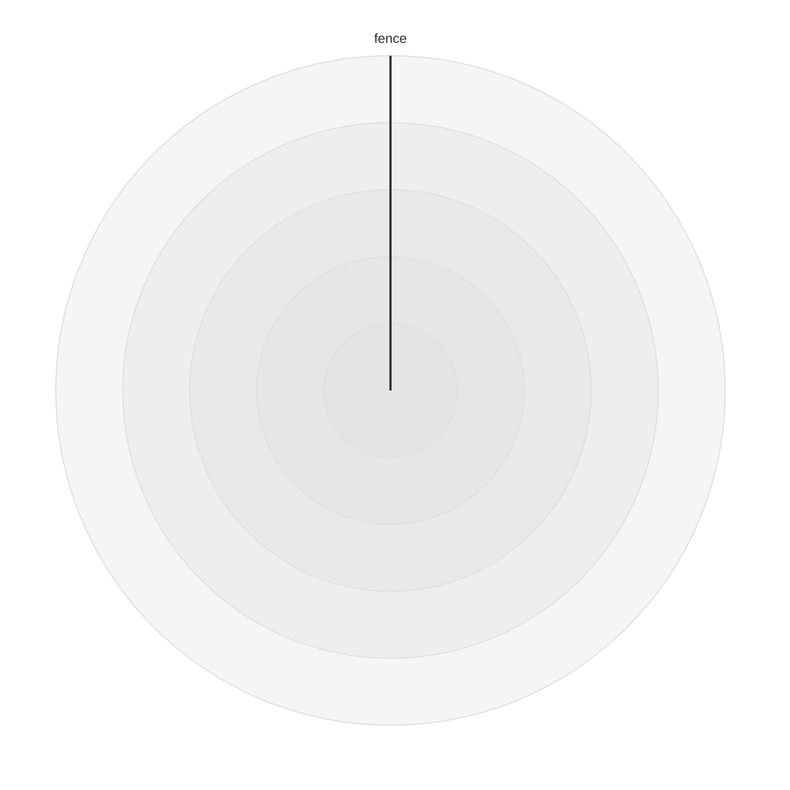

# Radar formatting rules

Japanese version: [radar.ja.md](./radar.ja.md)

The printer follows the 29 adopted items using the authored
[radar tree](../../spec/docs/ast/radar.md) and shared flat-body layouts. Each
rule explains its choice; [compatibility.md](./compatibility.md) records
preserved text and differences from mermaid.js.

## Rules

### Header

Print `radar-beta` at column one and put an ordinary first statement on the next
line so the heading is easy to find. A colon right after the header word is
removed, together with the whitespace before it: mermaid.js reads `radar-beta:`
and `radar-beta` as the same header, and the examples in its documentation write
the header without the colon 3 times against none (see
[The colon after a header](./compatibility.md#the-colon-after-a-header)). The
colon stays where a hidden form or a global directive lies between it and the
word, and where a `;`, the `---` of a hidden YAML block, or a directive that is
not closed touches it. For `radar-beta%%{wrap}%%:axis North`, the colon stays,
since every version of mermaid.js that counts rejects
`radar-beta%%{wrap}%%axis North` (see
[Forms kept for versions of mermaid.js that count](./compatibility.md#forms-kept-for-versions-of-mermaidjs-that-count)).
The colon stays before an unclosed directive too: `radar-beta:%%{x y`, a line
break, and `axis North` stay as written, since mermaid.js takes the directive
out with the line break after it and would read the header and `axis` as one
word, and every version of mermaid.js that counts rejects that text (see
[Forms kept for versions of mermaid.js that count](./compatibility.md#forms-kept-for-versions-of-mermaidjs-that-count)).
Hidden forms, global trivia and protected semicolon segments keep their source
boundaries instead. Empty bodies remain empty.

[fixture: radar/header/colon-removed] [fixture:
radar/header/colon-unclosed-directive-kept] [fixture:
radar/header/colon-yaml-kept] [fixture:
radar/header/colon-directive-before-hidden-yaml-kept] [fixture:
radar/header/joined-empty]

[fixture: radar/header/join-separated-empty-alternative]

[fixture: radar/header/bare-inline]

[fixture: radar/header/joined-inline]

[fixture: radar/header/join-separated-inline-alternative]

[fixture: radar/header/inline-title]

[fixture: radar/header/inline-a11y]

[fixture: radar/header/inline-block]

[fixture: radar/header/header-hidden-colon]

[fixture: radar/header/header-global-colon]

[fixture: radar/header/header-comment]

[fixture: radar/header/hidden-yaml-before-header-colon]

[corpus fixture: radar/header-colon-inline]

[corpus fixture: radar/header-separated-colon]

[corpus fixture: radar/header-repeated]

[corpus fixture: radar/header-colon-newline]

[corpus fixture: radar/spec-radar-test-ts-f0d1a74d]

Input (escaped): `"radar-beta : curve trial{4}\n"`.

Output
([header/join-separated-inline-alternative-output.mmd](../tests/fixtures/radar/header/join-separated-inline-alternative-output.mmd)):

```mmd
radar-beta
  curve trial{4}
```

### Indentation

Use the shared flat-body printer: ordinary statements, standalone comments and
Root directives stand one configured step in. The default is two spaces;
tabWidth four uses four spaces, and tabWidth zero uses zero spaces because
columns have no grammatical meaning. useTabs uses one tab, even at width zero.
Entry continuation lines use two steps; written value columns, hidden
interiors/closers and retained prefixes keep their own rules.

[fixture: radar/indentation/indent-two]

[fixture: radar/indentation/indent-four]

[fixture: radar/indentation/indent-zero]

[fixture: radar/indentation/indent-tabs]

[fixture: radar/indentation/zero-tabs]

Input (escaped): `"radar-beta\naxis North\nticks 7\n"`.

Options: `{"tabWidth": 4}`.

Output
([indentation/indent-four-output.mmd](../tests/fixtures/radar/indentation/indent-four-output.mmd)):

```mmd
radar-beta
    axis North
    ticks 7
```

### Statements one per line

Print each ordinary axis, curve, options or common statement on its own line to
expose the authored statement units. Rule 1 names no mark for the end of a
statement, so
[rule 2](./printed-form.md#2-a-gap-of-a-kind-that-prettier-does-not-have)
decides, as [er](./er.md#statements-one-per-line),
[gantt](./gantt.md#statements-one-per-line), and
[journey](./journey.md#statements-one-per-line) print each statement on a line
of its own, where no other rule keeps it as written (a line that holds a `;`
that the line rule ignores keeps its statements together; see
[Semicolons](#semicolons)). A keyword's comma group remains one statement; never
duplicate its keyword. Adjacent options without a comma are separate statements,
including `ticks 7max 8`. A common line owns apparent keywords through physical
EOL. Empty descriptions remain statements; protected header/body groups take
precedence.

[fixture: radar/statements-one-per-line/all-inline-kinds] [fixture:
radar/statements-one-per-line/line-rule-semicolon-keeps-statements-together]

[fixture: radar/statements-one-per-line/line-owns-keywords]

[fixture: radar/statements-one-per-line/empty-block-interleaved]

[corpus fixture: radar/gram-inline-statements]

[corpus fixture: radar/tail-axis-semicolon]

Input (escaped):
`"radar-beta axis North axis South curve one{1}curve two{2}ticks 7 max 9 min 2 showLegend false graticule polygon\n"`.

Output
([statements-one-per-line/all-inline-kinds-output.mmd](../tests/fixtures/radar/statements-one-per-line/all-inline-kinds-output.mmd)):

```mmd
radar-beta
  axis North
  axis South
  curve one{1}
  curve two{2}
  ticks 7
  max 9
  min 2
  showLegend false
  graticule polygon
```

### Groups and commas

Put one ordinary space between a group keyword and its first member. A comma has
no space before it and one after it, in axis, curve, options and entry lists.
This makes lists consistent with xychart and quadrant. Do not insert visible
newlines into axis/curve/options groups: those grammars reject them.
Trivia-bearing gaps retain their written contact.

[fixture: radar/groups-and-commas/axis-comma]

[fixture: radar/groups-and-commas/curve-comma]

[fixture: radar/groups-and-commas/options-comma]

[fixture: radar/groups-and-commas/entry-comma]

[corpus fixture: radar/gram-axis-before-comma-visible]

[corpus fixture: radar/gram-curve-newline-comma]

[corpus fixture: radar/gram-option-comma-trailing]

[corpus fixture: radar/gram-entry-newline-before-comma]

Input (escaped): `"radar-beta\naxis North [\"N\"] ,\tSouth , East\n"`.

Output
([groups-and-commas/axis-comma-output.mmd](../tests/fixtures/radar/groups-and-commas/axis-comma-output.mmd)):

```mmd
radar-beta
  axis North["N"], South, East
```

### Labels

Print attached labels as `axis A["label"]` and `curve c['label']`: ordinary gaps
before `[`, after `[` and before `]` are empty. This makes the label read with
its name. Keep absent labels distinct from empty quoted labels. Quote interiors
are values, not component spacing, and hidden/global boundaries take precedence.

[fixture: radar/labels/axis-double-brackets]

[fixture: radar/labels/curve-single-brackets]

[fixture: radar/labels/empty-and-absent-label]

Input (escaped): `"radar-beta\naxis North \t[ \t\"North label\"\t ]\n"`.

Output
([labels/axis-double-brackets-output.mmd](../tests/fixtures/radar/labels/axis-double-brackets-output.mmd)):

```mmd
radar-beta
  axis North["North label"]
```

### Curve braces

Print the braces of a curve of values only tight, `c{1, 2}`, and the braces of a
curve of named entries with one space inside each end, `c["C"]{ A: 1, B: 2 }`;
the gap before the opening brace is empty in both. A list of named entries is
the kind of braces that Prettier prints as an object, `{ a: 1, b: 2 }`, and a
list of values is the kind it prints as an array, `[1, 2, 3]`. The examples in
the documentation of mermaid.js write the 14 curves of values only with none
inside, and the one curve of named entries with one space inside each end. A
named entry without a colon (`{ A 1, B 2 }`) is a named entry too. The colon of
a named entry is the colon of a key: the entry gives its axis one value, so none
stands before it and one follows (step 2 of
[Which kind a colon is](./printed-form.md#which-kind-a-colon-is)). Attached
components and the list's tight inner edges follow the architecture and xychart
choices. These are entry braces; description-block spacing uses the shared
description rule.

[fixture: radar/curve-braces/brace-tight]

[fixture: radar/curve-braces/label-before-brace]

[fixture: radar/curve-braces/named-entries-space-inside]

[fixture: radar/curve-braces/named-entries-padding-collapsed]

[fixture: radar/curve-braces/named-and-value-curves-in-one-statement]

[fixture: radar/curve-braces/named-entries-directive-after-brace]

Input (escaped): `"radar-beta\ncurve trial \t{ \t4, 5 \t}\n"`.

Output
([curve-braces/brace-tight-output.mmd](../tests/fixtures/radar/curve-braces/brace-tight-output.mmd)):

```mmd
radar-beta
  curve trial{4, 5}
```

### Multi-line statements

In a statement without comments or directives, join entry newlines where the
grammar reads them as whitespace: after `{`, after a comma and before `}`.
Positional and named lists then fit on one line, as in xychart and quadrant.
Never add a newline before a comma or inside a named entry. Keep newlines
holding comments or Root directives; ordinary continuation lines and comments
use two indentation steps, while a separate `}` aligns with its statement.
Preserve other authored entry newlines in such a statement too, keeping the
commented list as a block as written. Hidden boundaries, value lines and
protected semicolon segments remain written, including their continuation
columns. No continuation indentation is added inside a protected segment;
ordinary spacing still applies after it. Shared joining checks also keep a
terminal line containing another statement's semicolon: joining a preceding
style-like label could change that statement's Db, and every version of
mermaid.js that counts draws different title text (see
[Forms kept for versions of mermaid.js that count](./compatibility.md#forms-kept-for-versions-of-mermaidjs-that-count)).

[fixture: radar/multi-line-statements/leading-trailing-entry-lines]

[fixture: radar/multi-line-statements/positional-after-comma]

[fixture: radar/multi-line-statements/named-after-comma]

[fixture: radar/multi-line-statements/entry-comment-after-comma]

[fixture: radar/multi-line-statements/entry-inline-comment]

[fixture: radar/multi-line-statements/entry-global-lines]

[fixture: radar/multi-line-statements/trailing-entry-comment]

[fixture: radar/multi-line-statements/leading-entry-comment]

[fixture: radar/multi-line-statements/named-outer-multiline-kept]

[fixture: radar/multi-line-statements/named-comment-after-comma]

[fixture: radar/multi-line-statements/semicolon-terminal-line]

[fixture: radar/multi-line-statements/protected-semicolon-later-curve-label]

[fixture: radar/multi-line-statements/protected-semicolon-entry-comment]

[fixture: radar/multi-line-statements/protected-semicolon-named-entries]

[fixture: radar/multi-line-statements/protected-semicolon-after-opening-brace]

[fixture: radar/multi-line-statements/protected-semicolon-before-closing-brace]

[fixture: radar/multi-line-statements/protected-semicolon-written-indentation]

[fixture: radar/multi-line-statements/protected-semicolon-tabs]

[fixture: radar/multi-line-statements/protected-semicolon-first-line-semicolon]

[fixture: radar/multi-line-statements/protected-semicolon-zero-width]

[fixture: radar/multi-line-statements/protected-semicolon-hidden-suffix]

[fixture: radar/multi-line-statements/protected-semicolon-root-directive]

[fixture: radar/multi-line-statements/protected-semicolon-same-line-suffix-gap]

[fixture:
radar/multi-line-statements/protected-semicolon-semicolon-with-hidden-gap]

[fixture:
radar/multi-line-statements/protected-semicolon-later-semicolon-blank-lines]

Input (escaped): `"radar-beta\ncurve trial{4,\n%% entry note\n5\n}\n"`.

Output
([multi-line-statements/entry-comment-after-comma-output.mmd](../tests/fixtures/radar/multi-line-statements/entry-comment-after-comma-output.mmd)):

```mmd
radar-beta
  curve trial{4,
    %% entry note
    5
  }
```

### Named entries

Keep authored optional colons. Print `A: 1` with no ordinary space before the
colon and one after, or `A 1` with one space and no alignment. This retains
punctuation while giving equivalent padding a consistent form. The one curve of
named entries in the examples of the documentation of mermaid.js writes a colon
after each of its 3 names, and none writes one without. `North 4` and `North: 4`
give the same Db and figure in the versions that count, and the formatter adds
and removes no colon. Rule 3 gives the colon form, so a name without a colon is
printed against rule 3 and waits to be fixed by the rule. Adding a colon is
unsafe for axis names `accTitle` and `accDescr`: common composite tokens would
take priority, and every version of mermaid.js that counts rejects
`curve c{accTitle: 1, accDescr 2}` (see
[Forms kept for versions of mermaid.js that count](./compatibility.md#forms-kept-for-versions-of-mermaidjs-that-count)).

[fixture: radar/named-entries/named-colon-gap]

[fixture: radar/named-entries/named-no-colon-gap]

[fixture: radar/named-entries/mixed-colon-spelling]

[fixture: radar/named-entries/accessibility-identifiers]

Input (escaped):
`"radar-beta\naxis North,South\ncurve trial{North 4,South:5}\n"`.

Output
([named-entries/mixed-colon-spelling-output.mmd](../tests/fixtures/radar/named-entries/mixed-colon-spelling-output.mmd)):

```mmd
radar-beta
  axis North, South
  curve trial{ North 4, South: 5 }
```

### Numbers

Print NumericLiteral source spans in entries and ticks/max/min. A plain decimal
is printed in the shortest form (`1.50` is `1.5`, `5.00` is `5`; see
[Spellings that are drawn the same](./compatibility.md#spellings-that-are-drawn-the-same)).
Preserve a zero at the start of the integer part, rounded precision, subnormals,
underflow and overflow. Reprinting double values loses spelling and can produce
exponents or Infinity, which radar's number grammar rejects.

[fixture: radar/numbers/shortest-form]

[fixture: radar/numbers/forms-kept]

[fixture: radar/numbers/raw-number-forms]

[fixture: radar/numbers/raw-option-numbers]

[corpus fixture: radar/db-number-rounded]

[corpus fixture: radar/db-number-subnormal]

[corpus fixture: radar/db-number-underflow]

[corpus fixture: radar/db-number-overflow]

[corpus fixture: radar/db-option-overflow]

Input (escaped):
`"radar-beta\ncurve trial{0004.5000,9007199254740993,0.12345678901234567890,0}\n"`.

Output
([numbers/raw-number-forms-output.mmd](../tests/fixtures/radar/numbers/raw-number-forms-output.mmd)):

```mmd
radar-beta
  curve trial{0004.5000, 9007199254740993, 0.12345678901234567890, 0}
```

### Options

Use one ordinary space between an option keyword and its value. Keep fixed
lowercase boolean/graticule words, numeric spellings, comma groups and every
repeated assignment in source order. Do not substitute effective defaults, cap
ticks at 32 or reorder min/max: publication is not authored syntax. Radar
drawing configuration does not supply these statement values.

[fixture: radar/options/option-gaps]

[fixture: radar/options/adjacent-numeric-option]

[fixture: radar/options/adjacent-boolean-option]

[fixture: radar/options/option-repetitions]

[fixture: radar/options/min-max-order-kept]

[corpus fixture: radar/db-ticks-cap-fraction]

[corpus fixture: radar/config-drawing-only]

[corpus fixture: radar/config-frontmatter-options-cannot-reject]

Input (escaped):
`"radar-beta\nshowLegend\t false,ticks\t7,max  8,min\t2,graticule\tpolygon\n"`.

Output
([options/option-gaps-output.mmd](../tests/fixtures/radar/options/option-gaps-output.mmd)):

```mmd
radar-beta
  showLegend false, ticks 7, max 8, min 2, graticule polygon
```

### Quotes

Keep each label's complete StringLiteral source span: empty text, escapes, HTML,
entities and hidden-looking text, with a run of spaces and tabs inside the text
printed as one space, so a text of spaces and tabs only becomes one space:
`["   "]` is printed `[" "]` (see
[Runs of whitespace in a text that are drawn the same](./compatibility.md#runs-of-whitespace-in-a-text-that-are-drawn-the-same)).
A string between `'` is printed between `"`, unless its text holds a `'`, a `"`,
a backslash, a line break, U+2028, U+2029, a backquote, `&`, `#`, or `<` (see
[Spellings that are drawn the same](./compatibility.md#spellings-that-are-drawn-the-same)),
and `singleQuote` is not read. Removing an empty label changes the ID fallback.

[fixture: radar/quotes/single-quote-sensitive-kept] [fixture:
radar/quotes/quotes-and-empty]

[fixture: radar/quotes/padding-label]

[fixture: radar/quotes/escape-label]

[fixture: radar/quotes/label-html-entity]

[fixture: radar/quotes/hidden-looking-label]

[fixture: radar/quotes/whitespace-only-labels]

Input (escaped):
`"radar-beta\naxis North['single \"other\"'],South[\"double 'other'\"],East[\"\"]\ncurve trial['']{1,2,3}\n"`.

Options: `{"singleQuote": true}`.

Output
([quotes/quotes-and-empty-output.mmd](../tests/fixtures/radar/quotes/quotes-and-empty-output.mmd)):

```mmd
radar-beta
  axis North['single "other"'], South["double 'other'"], East[""]
  curve trial[""]{1, 2, 3}
```

### Title

Use the shared common-line layout: trim common-whitespace edges and put one
space before a nonempty value; null/whitespace-only values print `title`. This
removes equivalent exterior padding while retaining internal spelling, quotes
and apparent keywords, apart from a run of spaces and tabs inside the value,
which is printed as one space (see
[Runs of whitespace in a text that are drawn the same](./compatibility.md#runs-of-whitespace-in-a-text-that-are-drawn-the-same)).
Never take a value from the next physical line, including across comments or
directives. Trivia-bearing values and protected segments keep their source gaps.
A `;` after the text of a title or of an accessibility line stays. Where the
line rule of mermaid.js does not apply to the line, as in `title T;` and
`title T;;` alone on their lines, the text holds the `;`, and the text with and
without it differs in the Db of 12.3.0 and in the drawn text of every version
that counts. Where the rule applies to the line (see
[Lines that hold a `;`](./compatibility.md#lines-that-hold-a-)), it ignores a
single `;`, which the text does not hold and which stays all the same
(`title style:#red;`); where two `;` follow, it ignores the last, and removing
one makes it ignore another (see
[A line that a `;` ends](./compatibility.md#a-line-that-a--ends)). Where a title
has text and no directive stands before its text or inside it, and no U+2028 or
U+2029 stands inside the text, the directives that end it are printed as
follows, by what stands before them and after them. A wide space is one of
U+000B, U+000C, U+00A0, U+1680, U+2000 to U+200A, U+202F, U+205F, U+3000, and
U+FEFF. Item 9 decides before item 6, and item 6 before the other items: where
item 6 splits a line, none of the others applies to it. A line that holds a `;`
in the text or in a directive and that item 6 would split is not stated here:

- Where only spaces and tabs, or nothing, stand before the directives, no `;`
  stands in the text before them or inside one of them, no directive holds a
  line break, a U+2028, or a U+2029, and nothing but spaces and tabs follow the
  last one, one space is printed before each directive that has spaces or tabs
  before it, and the spaces and tabs after the last one are left out, whatever
  the spaces and tabs at the end of the line.
- Where a wide space stands before the directives, they touch one another, and
  the end of the line or a comment touches the last one, the character is
  printed as one space with the rest of its run.
- Where a wide space stands before the directives and spaces or tabs and another
  directive or a comment follow the first one, the character stays, and each run
  of spaces and tabs after it before a directive or the comment is printed as
  one space.
- Where a U+2028 or U+2029 stands before the directives, they touch one another,
  and the end of the line touches the last one, it is printed as one space.
- Where a U+2028 or U+2029 stands before the directives, no comment follows the
  last one, and spaces or tabs follow the last one, or spaces or tabs and
  another directive follow the first one, the line stays as written.
- Where a U+2028 or U+2029 stands before the directives and a comment follows
  the last one, the comment region joins the next line of the source (see
  [A comment line after U+2028 or U+2029](./compatibility.md#a-comment-line-after-u2028-or-u2029)).
  The comment lines are removed, with the empty lines, the lines of whitespace,
  and the directive lines that stand before them, and the first line that is
  left decides. Where it is a statement or a line of whitespace, the line stays
  as written through that line. Where it is an empty line or a directive line,
  or no line is left, the U+2028 or U+2029 is dropped, the directives and the
  comment stand on a line of their own, a gap between them is printed as one
  space whatever whitespace it holds, and a U+2028 or U+2029 between them ends
  the line there. Where no comment line follows it, a directive line holds
  directives only, with no whitespace before, between, or after them (`%%{y}%%`,
  `%%{y}%%%%{z}%%`); an indented directive, a directive that whitespace follows,
  directives that whitespace separates, and a directive that text follows are
  statements there. A comment line holds a comment (`%% d`, `  %% d`,
  `%%{y}%% %% e`). A line of whitespace holds spaces, tabs, wide spaces, U+2028,
  and U+2029 only: U+0085 and U+180E are no whitespace, and a line that holds
  one of them is a statement. A line that stands before a comment line is
  removed with it where it holds nothing but whitespace, directives, and
  comments, whatever their arrangement: an empty line, a line of whitespace, a
  directive line, an indented directive, a directive that whitespace follows,
  and directives that whitespace separate (`%%{y}%%`, two spaces, and `%%{z}%%`)
  are removed, and a line that holds text, U+0085, U+180E, or a `;` outside a
  comment and a directive is a statement; a `;` inside a comment or a directive
  does not make a line one (`%% e;`, `%%{y}%% %% e;`, and `%%{y;z}%%` are
  removed).
- Where a wide space stands between two directives, the line stays as written,
  whatever follows the last one. So it does where a U+2028 or U+2029 stands
  between two directives and nothing, spaces, or tabs follow the last one. Where
  a comment follows the last directive, touching it or after spaces, tabs, or
  wide spaces, and a U+2028 or U+2029 stands between two directives, the comment
  region joins the next line of the source, as in item 6: where item 6 keeps the
  lines, they stay as written, runs included, and where item 6 would split the
  line, the paragraph after the list says how it is printed.
- Where a `;` stands in the text before the directives, whether the line rule of
  mermaid.js ignores it or not, or inside a directive, or a line break, a
  U+2028, or a U+2029 stands inside a directive, the line stays as written if
  spaces or tabs follow the last directive, whether the end of the line or a
  comment comes after them, or if spaces or tabs stand between two directives
  after it, and item 3 does not apply to it. If neither holds, the other items
  print the line as they print it without that `;`, line break, U+2028, or
  U+2029, so each run of spaces and tabs before a directive is one space. Where
  the line rule ignores a `;` that another `;` precedes, directly or after
  spaces, tabs, or a wide space (`title style:#red;;`, `title style:#red;  ;`),
  or that a U+2028 or U+2029 follows, the line stays as written whatever follows
  the last directive, a wide space, U+2028, or U+2029 before the first directive
  included.
- A `;` between two directives or after the last directive, with or without
  spaces and tabs around it, keeps the line as written. Where a U+2028 or U+2029
  stands after the last such `;` and a comment follows, what follows the `;` is
  printed as for one U+2028 or U+2029 in the paragraph after the list: the run
  after it and the run before the comment are one space (`title T %%{x}%%;`,
  U+2028, `%%{y}%%`, two spaces, and `%% c` are printed `title T %%{x}%%;`,
  U+2028, `%%{y}%%`, a space, and `%% c`), and two U+2028 or U+2029 after the
  `;` are not stated.
- Where a wide space stands after the last directive, also after spaces or tabs,
  the line stays as written, whatever follows the character. So it does where a
  U+2028 or U+2029 stands there and nothing follows it. Where a comment follows
  the U+2028 or U+2029, touching it or after spaces, tabs, or wide spaces, the
  comment region joins the next line of the source, as in item 6: where item 6
  keeps the lines, they stay as written, runs included, and where item 6 would
  split the line, the paragraph after the list says how it is printed. A title
  with a directive inside its text stays as written too.

Where no U+2028 or U+2029 stands before the directives, the line holds no `;`, a
comment follows the last directive, one or more U+2028 or U+2029 stand between
two directives or after the last one, and item 6 would split the line, the first
of them stays, with the gap before it as written, and the gap after it is
printed as one space where a directive or the comment follows it, and left out
where another U+2028 or U+2029 follows it; the gap before the comment is printed
as one space where it holds whitespace. Each later one is a line break: the
directives after a line break stand on a line of their own, and so does the
comment, with the whitespace before it left out (`title T %%{x}%%`, U+2028, two
spaces, `%%{y}%%`, U+2028, and `%% c` are printed `title T %%{x}%%`, U+2028, a
space, `%%{y}%%`, a line break, and `%% c`; `title T %%{x}%%`, U+2028,
`%%{y}%%`, U+2028, `%%{z}%%`, a space, and `%% c` are printed `title T %%{x}%%`,
U+2028, `%%{y}%%`, a line break, and `%%{z}%% %% c`; `title T %%{x}%%`, U+2028,
two spaces, U+2028, two spaces, `%%{y}%%`, two spaces, and `%% c` are printed
`title T %%{x}%%`, U+2028, a line break, and `%%{y}%% %% c`). Where one stands
before the directives, item 6 applies, and all of them are line breaks. Where
item 6 keeps the lines, they stay as written, runs included. Items 7 and 10
state the line with one U+2028 or U+2029; a line with two or more is printed by
this paragraph.

Where a comment follows the last directive, no U+2028 or U+2029 stands between
the text and the comment, and none of items 7 to 10 applies, a run of spaces and
tabs before each directive and before the comment is printed as one space, also
where the comment holds a `;` (see
[Texts after a keyword that are drawn the same](./compatibility.md#texts-after-a-keyword-that-are-drawn-the-same)).

Rule 1 names no mark for a gap beside a directive, so
[rule 2](./printed-form.md#2-a-gap-of-a-kind-that-prettier-does-not-have)
decides: the other diagram types of
[Texts after a keyword that are drawn the same](./compatibility.md#texts-after-a-keyword-that-are-drawn-the-same)
print a run of spaces and tabs before a directive as one space and leave out the
spaces at the end of the line (item 1). The other items say what the released
version prints for the gaps and the characters that the rules do not decide, and
a form that the other diagram types print differently stays as it is until it is
decided (see
[Where none of these rules gives a form](./printed-form.md#4-where-none-of-these-rules-gives-a-form)).

Where a U+2028 or U+2029 stands inside the text, or the value holds directives
only, the line stays as written if spaces or tabs follow the last directive,
whether the end of the line or a comment comes after them, or if spaces or tabs
stand between two directives, and item 3 does not apply to it; otherwise the
other items print it as they print a line of any other text, so each run of
spaces and tabs before a directive, the one after the keyword included, is one
space. In a title of directives only that holds one `;`, between two directives,
the gap before the `;` is left out where it holds spaces, tabs, and wide spaces
only, and stays as written where it holds a U+2028 or U+2029, and the gap after
the `;` is printed as one space, whatever whitespace it holds, a U+2028 or
U+2029 included, where nothing follows the last directive or a comment touches
it (`title`, a space, `%%{x}%%`, two spaces, `;`, two spaces, and `%%{y}%%` are
printed `title %%{x}%%; %%{y}%%`, and `title`, a space, `%%{x}%%`, U+2028, `;`,
two spaces, and `%%{y}%%` are printed `title %%{x}%%`, U+2028, `;`, a space, and
`%%{y}%%`). Where whitespace follows the last directive, or a comment follows it
after whitespace, the line stays as written. A `;` after the last directive of
such a title keeps its place: the gap before it is left out as above, the
spaces, tabs, and wide spaces after it are left out, a U+2028 or U+2029 after it
stays with the whitespace before it where no comment follows, the spaces and
tabs after the last one are left out, and a gap before a comment is printed as
one space (`title`, a space, `%%{x}%%`, two spaces, `;`, two spaces, and `%% c`
are printed `title %%{x}%%; %% c`). Where only `;` separate the directives, a
gap before the first `;` is left out where it holds spaces, tabs, and wide
spaces only, and stays where it holds a U+2028 or U+2029; a gap between two `;`
is one space where it holds spaces and tabs only, keeps a wide space that it
holds with each run of spaces and tabs in it one space, and stays as written
where it holds a U+2028 or U+2029; and the gap after the last `;` is one space
(`title`, a space, `%%{x}%%`, `;`, a no-break space, `;`, two spaces, and
`%%{y}%%` are printed `title %%{x}%%;`, a no-break space, `;`, a space, and
`%%{y}%%`). A U+0085 or U+180E is no whitespace: a title that holds one is no
title of directives only, and this paragraph does not state it. Where more `;`
or directives stand in such a title, and only spaces and tabs stand in its gaps,
the line stays as written where spaces or tabs stand between two directives that
no `;` separates, where a directive stands between two `;`, or where spaces or
tabs follow the last directive that stands after the last `;`; otherwise the
spaces and tabs before the first `;` are left out, each run of spaces and tabs
after a `;` is printed as one space, and the spaces and tabs at the end of the
line are left out (`title`, a space, `%%{x}%%`, two spaces, `;`, two spaces,
`;`, two spaces, and `%%{y}%%` are printed `title %%{x}%%; ; %%{y}%%`).

[fixture: title/title-directives-end-blanks-dropped] [fixture:
title/title-directives-end-tabs-dropped] [fixture:
title/title-directives-in-the-text-kept] [fixture:
title/title-directives-end-before-comment-line-and-empty-line] [fixture:
title/title-directives-then-comment] [fixture:
title/title-directives-end-at-the-end-of-the-text] [fixture:
radar/title/title-edge-trim] [fixture: radar/title/title-lone-semicolon-kept]
[fixture: radar/title/title-directive-semicolon-kept] [fixture:
radar/title/title-two-semicolons-kept] [fixture:
radar/semicolons/semicolon-selected-kept] [fixture:
radar/semicolons/title-single-ignored-semicolon-kept] [test: a no-break space
after the last directive of a title of a radar chart] [test: U+3000 after the
last directive of a title of a radar chart] [test: U+2028 after the last
directive of a title of a radar chart] [test: U+2029 after the last directive of
a title of a radar chart] [test: a space and a no-break space after the last
directive of a title of a radar chart] [test: a no-break space after the last of
two directives of a title of a radar chart] [test: a no-break space before the
directive that ends a title of a radar chart] [test: U+3000 before the directive
that ends a title of a radar chart] [test: a space, a no-break space, and a
space before the directive that ends a title of a radar chart] [test: a no-break
space before two directives that touch and end a title of a radar chart] [test:
a no-break space before a directive that a comment touches in a title of a radar
chart] [test: U+2028 before the directive that ends a title of a radar chart]
[test: U+2029 before the directive that ends a title of a radar chart] [test: a
no-break space before a directive that a space and another directive follow in a
title of a radar chart] [test: U+3000 before a directive that a space and a
comment follow in a title of a radar chart] [test: a tab and a no-break space
after the last directive of a title of a radar chart] [test: U+3000 before a
directive that a comment touches in a title of a radar chart] [test: U+3000
before two directives that touch and end a title of a radar chart] [test: U+3000
before a directive that a space and another directive follow in a title of a
radar chart] [test: a no-break space before a directive that a space and a
comment follow in a title of a radar chart] [test: a no-break space between two
directives that end a title of a radar chart] [test: U+3000 between two
directives that end a title of a radar chart] [test: a no-break space between
two directives, spaces after the last, in a title of a radar chart] [test:
U+3000 between two directives, spaces after the last, in a title of a radar
chart] [test: U+2028 before two directives that touch and end a title of a radar
chart] [test: U+2029 before two directives that touch and end a title of a radar
chart] [test: U+2028 before the last directive, a space and a tab after it, in a
title of a radar chart] [test: U+2029 before the last directive, a space and a
tab after it, in a title of a radar chart] [test: U+2028 before a directive that
a space and another directive follow in a title of a radar chart] [test: U+2029
before a directive that a space and another directive follow in a title of a
radar chart] [test: U+2028 between two directives that end a title of a radar
chart] [test: U+2029 between two directives that end a title of a radar chart]
[test: U+2028 between two directives, spaces after the last, in a title of a
radar chart] [test: U+2029 between two directives, spaces after the last, in a
title of a radar chart] [test: a space, a tab, and a no-break space after the
last directive of a title of a radar chart] [test: a space, a tab, and U+3000
after the last directive of a title of a radar chart] [test: a space, a tab, and
U+2028 after the last directive of a title of a radar chart] [test: a space, a
tab, and U+2029 after the last directive of a title of a radar chart] [test: a
semicolon before the directive of a title of a radar chart, spaces after it]
[test: a semicolon and spaces before the directive that ends a title of a radar
chart] [test: a semicolon after the last directive of a title of a radar chart,
spaces around it] [test: a semicolon before the directive of a title of a radar
chart, a tab after it] [test: a semicolon and a no-break space before the
directive of a title of a radar chart, spaces after it] [test: a semicolon and a
no-break space before the directive that ends a title of a radar chart] [test: a
semicolon touching the last directive of a title of a radar chart] [test: U+000B
before the directive that ends a title of a radar chart] [test: U+000C before
the directive that ends a title of a radar chart] [test: U+1680 before the
directive that ends a title of a radar chart] [test: U+2000 before the directive
that ends a title of a radar chart] [test: U+2001 before the directive that ends
a title of a radar chart] [test: U+2002 before the directive that ends a title
of a radar chart] [test: U+2003 before the directive that ends a title of a
radar chart] [test: U+2004 before the directive that ends a title of a radar
chart] [test: U+2005 before the directive that ends a title of a radar chart]
[test: U+2006 before the directive that ends a title of a radar chart] [test:
U+2007 before the directive that ends a title of a radar chart] [test: U+2008
before the directive that ends a title of a radar chart] [test: U+2009 before
the directive that ends a title of a radar chart] [test: U+200A before the
directive that ends a title of a radar chart] [test: U+202F before the directive
that ends a title of a radar chart] [test: U+205F before the directive that ends
a title of a radar chart] [test: U+FEFF before the directive that ends a title
of a radar chart] [test: U+000B before two directives that touch and end a title
of a radar chart] [test: U+000B before a directive that a comment touches in a
title of a radar chart] [test: U+000B between two directives that end a title of
a radar chart] [test: U+000B after the last directive of a title of a radar
chart] [test: a semicolon and U+000B before the directive that ends a title of a
radar chart] [test: U+000C before two directives that touch and end a title of a
radar chart] [test: U+000C before a directive that a comment touches in a title
of a radar chart] [test: U+000C between two directives that end a title of a
radar chart] [test: U+000C after the last directive of a title of a radar chart]
[test: a semicolon and U+000C before the directive that ends a title of a radar
chart] [test: U+1680 before two directives that touch and end a title of a radar
chart] [test: U+1680 before a directive that a comment touches in a title of a
radar chart] [test: U+1680 between two directives that end a title of a radar
chart] [test: U+1680 after the last directive of a title of a radar chart]
[test: a semicolon and U+1680 before the directive that ends a title of a radar
chart] [test: U+2000 before two directives that touch and end a title of a radar
chart] [test: U+2000 before a directive that a comment touches in a title of a
radar chart] [test: U+2000 between two directives that end a title of a radar
chart] [test: U+2000 after the last directive of a title of a radar chart]
[test: a semicolon and U+2000 before the directive that ends a title of a radar
chart] [test: U+2001 before two directives that touch and end a title of a radar
chart] [test: U+2001 before a directive that a comment touches in a title of a
radar chart] [test: U+2001 between two directives that end a title of a radar
chart] [test: U+2001 after the last directive of a title of a radar chart]
[test: a semicolon and U+2001 before the directive that ends a title of a radar
chart] [test: U+2002 before two directives that touch and end a title of a radar
chart] [test: U+2002 before a directive that a comment touches in a title of a
radar chart] [test: U+2002 between two directives that end a title of a radar
chart] [test: U+2002 after the last directive of a title of a radar chart]
[test: a semicolon and U+2002 before the directive that ends a title of a radar
chart] [test: U+2003 before two directives that touch and end a title of a radar
chart] [test: U+2003 before a directive that a comment touches in a title of a
radar chart] [test: U+2003 between two directives that end a title of a radar
chart] [test: U+2003 after the last directive of a title of a radar chart]
[test: a semicolon and U+2003 before the directive that ends a title of a radar
chart] [test: U+2004 before two directives that touch and end a title of a radar
chart] [test: U+2004 before a directive that a comment touches in a title of a
radar chart] [test: U+2004 between two directives that end a title of a radar
chart] [test: U+2004 after the last directive of a title of a radar chart]
[test: a semicolon and U+2004 before the directive that ends a title of a radar
chart] [test: U+2005 before two directives that touch and end a title of a radar
chart] [test: U+2005 before a directive that a comment touches in a title of a
radar chart] [test: U+2005 between two directives that end a title of a radar
chart] [test: U+2005 after the last directive of a title of a radar chart]
[test: a semicolon and U+2005 before the directive that ends a title of a radar
chart] [test: U+2006 before two directives that touch and end a title of a radar
chart] [test: U+2006 before a directive that a comment touches in a title of a
radar chart] [test: U+2006 between two directives that end a title of a radar
chart] [test: U+2006 after the last directive of a title of a radar chart]
[test: a semicolon and U+2006 before the directive that ends a title of a radar
chart] [test: U+2007 before two directives that touch and end a title of a radar
chart] [test: U+2007 before a directive that a comment touches in a title of a
radar chart] [test: U+2007 between two directives that end a title of a radar
chart] [test: U+2007 after the last directive of a title of a radar chart]
[test: a semicolon and U+2007 before the directive that ends a title of a radar
chart] [test: U+2008 before two directives that touch and end a title of a radar
chart] [test: U+2008 before a directive that a comment touches in a title of a
radar chart] [test: U+2008 between two directives that end a title of a radar
chart] [test: U+2008 after the last directive of a title of a radar chart]
[test: a semicolon and U+2008 before the directive that ends a title of a radar
chart] [test: U+2009 before two directives that touch and end a title of a radar
chart] [test: U+2009 before a directive that a comment touches in a title of a
radar chart] [test: U+2009 between two directives that end a title of a radar
chart] [test: U+2009 after the last directive of a title of a radar chart]
[test: a semicolon and U+2009 before the directive that ends a title of a radar
chart] [test: U+200A before two directives that touch and end a title of a radar
chart] [test: U+200A before a directive that a comment touches in a title of a
radar chart] [test: U+200A between two directives that end a title of a radar
chart] [test: U+200A after the last directive of a title of a radar chart]
[test: a semicolon and U+200A before the directive that ends a title of a radar
chart] [test: U+202F before two directives that touch and end a title of a radar
chart] [test: U+202F before a directive that a comment touches in a title of a
radar chart] [test: U+202F between two directives that end a title of a radar
chart] [test: U+202F after the last directive of a title of a radar chart]
[test: a semicolon and U+202F before the directive that ends a title of a radar
chart] [test: U+205F before two directives that touch and end a title of a radar
chart] [test: U+205F before a directive that a comment touches in a title of a
radar chart] [test: U+205F between two directives that end a title of a radar
chart] [test: U+205F after the last directive of a title of a radar chart]
[test: a semicolon and U+205F before the directive that ends a title of a radar
chart] [test: a semicolon and U+3000 before the directive that ends a title of a
radar chart] [test: U+FEFF before two directives that touch and end a title of a
radar chart] [test: U+FEFF before a directive that a comment touches in a title
of a radar chart] [test: U+FEFF between two directives that end a title of a
radar chart] [test: U+FEFF after the last directive of a title of a radar chart]
[test: a semicolon and U+FEFF before the directive that ends a title of a radar
chart] [test: a semicolon and U+2028 before the directive that ends a title of a
radar chart] [test: a semicolon and U+2029 before the directive that ends a
title of a radar chart] [test: a semicolon and a tab before the directive that
ends a title of a radar chart] [test: a semicolon that the line rule ignores and
spaces before the directive that ends a title of a radar chart] [test: a
semicolon that the line rule ignores before the directive of a title of a radar
chart, spaces after it] [test: a semicolon before the directive of a title of a
radar chart, a space and a comment after it] [test: a semicolon and spaces
before a directive that a comment touches in a title of a radar chart] [test: a
comment that ends with a semicolon after the last directive of a title of a
radar chart] [test: a comment that has a space before its semicolon after the
last directive of a title of a radar chart] [test: a comment that starts with a
semicolon after the last directive of a title of a radar chart] [test: a
semicolon inside the directive that ends a title, spaces after it, of a radar
chart] [test: a semicolon inside the directive that ends a title, spaces and a
comment after it, of a radar chart] [test: a semicolon inside the directive that
ends a title, a space and a comment after it, of a radar chart] [test: a
semicolon inside the last of two directives that end a title, spaces after it,
of a radar chart] [test: a semicolon inside the first of two directives that end
a title, spaces between them, of a radar chart] [test: a semicolon inside the
first of two directives that end a title, a space between them, of a radar
chart] [test: a semicolon inside the only directive that ends a title, spaces
before it, of a radar chart] [test: a semicolon inside the last of two
directives that end a title, spaces before both, of a radar chart] [test: a
semicolon inside a directive that a comment touches in a title, spaces before
the directive, of a radar chart] [test: a semicolon inside the first of two
directives that touch in a title, spaces before them, of a radar chart] [test: a
semicolon inside the directive that ends a title, a no-break space before it, of
a radar chart] [test: a semicolon inside the directive that ends a title, U+2028
before it, of a radar chart] [test: a semicolon in the text, two directives with
spaces between them, a title, of a radar chart] [test: a semicolon in the text,
two directives with a space between them, a title, of a radar chart] [test: a
semicolon and a space before two directives with spaces between them, a title,
of a radar chart] [test: a semicolon in the text, two directives with a tab
between them, a title, of a radar chart] [test: a semicolon in the text, two
directives that touch, spaces before them, a title, of a radar chart] [test: a
semicolon that touches two directives in a title, of a radar chart] [test: a
semicolon that touches the second of two directives in a title, of a radar
chart] [test: a semicolon that touches the first of two directives in a title,
of a radar chart] [test: a semicolon between two directives in a title, spaces
around it, of a radar chart] [test: a semicolon touching the last of two
directives in a title, of a radar chart] [test: a semicolon after the last of
two directives in a title, spaces around it and a comment after it, of a radar
chart] [test: a second semicolon touching the semicolon that the line rule
ignores, spaces and a directive after them, in a title of a radar chart] [test:
a second semicolon touching the semicolon that the line rule ignores, a
directive and spaces after them, in a title of a radar chart] [test: a second
semicolon touching the semicolon that the line rule ignores, a directive
touching them, in a title of a radar chart] [test: a second semicolon touching
the semicolon that the line rule ignores, a directive that a comment touches, in
a title of a radar chart] [test: a second semicolon touching the semicolon that
the line rule ignores, a directive and a space and a comment, in a title of a
radar chart] [test: spaces and a second semicolon after the semicolon that the
line rule ignores, a directive after them, in a title of a radar chart] [test: a
space and a second semicolon after the semicolon that the line rule ignores, a
directive after them, in a title of a radar chart] [test: a tab and a second
semicolon after the semicolon that the line rule ignores, a directive after
them, in a title of a radar chart] [test: a no-break space and a second
semicolon after the semicolon that the line rule ignores, a directive after
them, in a title of a radar chart] [test: a second semicolon touching the
semicolon that the line rule ignores, a no-break space and a directive after
them, in a title of a radar chart] [test: a second semicolon touching the
semicolon that the line rule ignores, U+2028 and a directive after them, in a
title of a radar chart] [test: two semicolons after the semicolon that the line
rule ignores, a directive after them, in a title of a radar chart] [test: U+2028
and a directive after the semicolon that the line rule ignores, in a title of a
radar chart] [test: U+2029 and a directive after the semicolon that the line
rule ignores, in a title of a radar chart] [test: U+2028, a directive and spaces
after the semicolon that the line rule ignores, in a title of a radar chart]
[test: two semicolons that the line rule does not ignore, spaces and a directive
after them, in a title of a radar chart] [test: text and a semicolon after the
semicolon that the line rule does not ignore, spaces and a directive after them,
in a title of a radar chart] [test: a tab and a directive after the semicolon
that the line rule ignores, in a title of a radar chart] [test: a no-break space
and a directive after the semicolon that the line rule ignores, in a title of a
radar chart] [test: spaces and a directive that a comment touches after the
semicolon that the line rule ignores, in a title of a radar chart] [test: spaces
and two directives with spaces between them after the semicolon that the line
rule ignores, in a title of a radar chart] [test: a semicolon at the end of a
title with whitespace around its text, of a radar chart] [test: a semicolon in
the text of a title, spaces and a directive after it, of a radar chart] [test:
spaces around a semicolon in the text of a title, a directive after it, of a
radar chart] [test: U+000B between two directives, spaces after the last, in a
title of a radar chart] [test: U+000B after the last directive and spaces of a
title of a radar chart] [test: U+000C between two directives, spaces after the
last, in a title of a radar chart] [test: U+000C after the last directive and
spaces of a title of a radar chart] [test: a no-break space after the last
directive and spaces of a title of a radar chart] [test: U+1680 between two
directives, spaces after the last, in a title of a radar chart] [test: U+1680
after the last directive and spaces of a title of a radar chart] [test: U+2000
between two directives, spaces after the last, in a title of a radar chart]
[test: U+2000 after the last directive and spaces of a title of a radar chart]
[test: U+2001 between two directives, spaces after the last, in a title of a
radar chart] [test: U+2001 after the last directive and spaces of a title of a
radar chart] [test: U+2002 between two directives, spaces after the last, in a
title of a radar chart] [test: U+2002 after the last directive and spaces of a
title of a radar chart] [test: U+2003 between two directives, spaces after the
last, in a title of a radar chart] [test: U+2003 after the last directive and
spaces of a title of a radar chart] [test: U+2004 between two directives, spaces
after the last, in a title of a radar chart] [test: U+2004 after the last
directive and spaces of a title of a radar chart] [test: U+2005 between two
directives, spaces after the last, in a title of a radar chart] [test: U+2005
after the last directive and spaces of a title of a radar chart] [test: U+2006
between two directives, spaces after the last, in a title of a radar chart]
[test: U+2006 after the last directive and spaces of a title of a radar chart]
[test: U+2007 between two directives, spaces after the last, in a title of a
radar chart] [test: U+2007 after the last directive and spaces of a title of a
radar chart] [test: U+2008 between two directives, spaces after the last, in a
title of a radar chart] [test: U+2008 after the last directive and spaces of a
title of a radar chart] [test: U+2009 between two directives, spaces after the
last, in a title of a radar chart] [test: U+2009 after the last directive and
spaces of a title of a radar chart] [test: U+200A between two directives, spaces
after the last, in a title of a radar chart] [test: U+200A after the last
directive and spaces of a title of a radar chart] [test: U+202F between two
directives, spaces after the last, in a title of a radar chart] [test: U+202F
after the last directive and spaces of a title of a radar chart] [test: U+205F
between two directives, spaces after the last, in a title of a radar chart]
[test: U+205F after the last directive and spaces of a title of a radar chart]
[test: U+3000 after the last directive and spaces of a title of a radar chart]
[test: U+FEFF between two directives, spaces after the last, in a title of a
radar chart] [test: U+FEFF after the last directive and spaces of a title of a
radar chart] [test: U+2028 after the last directive and spaces of a title of a
radar chart] [test: U+2029 after the last directive and spaces of a title of a
radar chart] [test: a no-break space between two directives, a comment touching
the last, in a title of a radar chart] [test: a no-break space between two
directives, a space and a comment after the last, in a title of a radar chart]
[test: a no-break space between two directives, spaces and a comment after the
last, in a title of a radar chart] [test: a no-break space after the last
directive, a comment touching it, in a title of a radar chart] [test: a no-break
space after the last directive, spaces and a comment after it, in a title of a
radar chart] [test: a no-break space after the last directive and spaces, spaces
and a comment after it, in a title of a radar chart] [test: a no-break space
after the last directive and a tab, spaces and a comment after it, in a title of
a radar chart] [test: U+2003 between two directives, a comment touching the
last, in a title of a radar chart] [test: U+2003 between two directives, a space
and a comment after the last, in a title of a radar chart] [test: U+2003 between
two directives, spaces and a comment after the last, in a title of a radar
chart] [test: U+2003 after the last directive, a comment touching it, in a title
of a radar chart] [test: U+2003 after the last directive, spaces and a comment
after it, in a title of a radar chart] [test: U+2003 after the last directive
and spaces, spaces and a comment after it, in a title of a radar chart] [test:
U+2003 after the last directive and a tab, spaces and a comment after it, in a
title of a radar chart] [test: a semicolon in the text, a no-break space between
two directives, in a title of a radar chart] [test: a semicolon in the text, a
no-break space after the last directive, in a title of a radar chart] [test: a
semicolon inside the directive, a no-break space after it, in a title of a radar
chart] [test: U+000B between a semicolon that the line rule ignores and a second
semicolon, a directive after them, in a title of a radar chart] [test: U+000C
between a semicolon that the line rule ignores and a second semicolon, a
directive after them, in a title of a radar chart] [test: U+1680 between a
semicolon that the line rule ignores and a second semicolon, a directive after
them, in a title of a radar chart] [test: U+2000 between a semicolon that the
line rule ignores and a second semicolon, a directive after them, in a title of
a radar chart] [test: U+2001 between a semicolon that the line rule ignores and
a second semicolon, a directive after them, in a title of a radar chart] [test:
U+2002 between a semicolon that the line rule ignores and a second semicolon, a
directive after them, in a title of a radar chart] [test: U+2003 between a
semicolon that the line rule ignores and a second semicolon, a directive after
them, in a title of a radar chart] [test: U+2004 between a semicolon that the
line rule ignores and a second semicolon, a directive after them, in a title of
a radar chart] [test: U+2005 between a semicolon that the line rule ignores and
a second semicolon, a directive after them, in a title of a radar chart] [test:
U+2006 between a semicolon that the line rule ignores and a second semicolon, a
directive after them, in a title of a radar chart] [test: U+2007 between a
semicolon that the line rule ignores and a second semicolon, a directive after
them, in a title of a radar chart] [test: U+2008 between a semicolon that the
line rule ignores and a second semicolon, a directive after them, in a title of
a radar chart] [test: U+2009 between a semicolon that the line rule ignores and
a second semicolon, a directive after them, in a title of a radar chart] [test:
U+200A between a semicolon that the line rule ignores and a second semicolon, a
directive after them, in a title of a radar chart] [test: U+202F between a
semicolon that the line rule ignores and a second semicolon, a directive after
them, in a title of a radar chart] [test: U+205F between a semicolon that the
line rule ignores and a second semicolon, a directive after them, in a title of
a radar chart] [test: U+3000 between a semicolon that the line rule ignores and
a second semicolon, a directive after them, in a title of a radar chart] [test:
U+FEFF between a semicolon that the line rule ignores and a second semicolon, a
directive after them, in a title of a radar chart] [test: U+000B before the
first of two directives that a space separates, in a title of a radar chart]
[test: U+000B before the first of two directives that spaces separate, in a
title of a radar chart] [test: U+000B before a directive that spaces and a
comment follow in a title of a radar chart] [test: U+000C before the first of
two directives that a space separates, in a title of a radar chart] [test:
U+000C before the first of two directives that spaces separate, in a title of a
radar chart] [test: U+000C before a directive that spaces and a comment follow
in a title of a radar chart] [test: a no-break space before the first of two
directives that spaces separate, in a title of a radar chart] [test: U+1680
before the first of two directives that a space separates, in a title of a radar
chart] [test: U+1680 before the first of two directives that spaces separate, in
a title of a radar chart] [test: U+1680 before a directive that spaces and a
comment follow in a title of a radar chart] [test: U+2000 before the first of
two directives that a space separates, in a title of a radar chart] [test:
U+2000 before the first of two directives that spaces separate, in a title of a
radar chart] [test: U+2000 before a directive that spaces and a comment follow
in a title of a radar chart] [test: U+2001 before the first of two directives
that a space separates, in a title of a radar chart] [test: U+2001 before the
first of two directives that spaces separate, in a title of a radar chart]
[test: U+2001 before a directive that spaces and a comment follow in a title of
a radar chart] [test: U+2002 before the first of two directives that a space
separates, in a title of a radar chart] [test: U+2002 before the first of two
directives that spaces separate, in a title of a radar chart] [test: U+2002
before a directive that spaces and a comment follow in a title of a radar chart]
[test: U+2003 before the first of two directives that a space separates, in a
title of a radar chart] [test: U+2003 before the first of two directives that
spaces separate, in a title of a radar chart] [test: U+2003 before a directive
that spaces and a comment follow in a title of a radar chart] [test: U+2004
before the first of two directives that a space separates, in a title of a radar
chart] [test: U+2004 before the first of two directives that spaces separate, in
a title of a radar chart] [test: U+2004 before a directive that spaces and a
comment follow in a title of a radar chart] [test: U+2005 before the first of
two directives that a space separates, in a title of a radar chart] [test:
U+2005 before the first of two directives that spaces separate, in a title of a
radar chart] [test: U+2005 before a directive that spaces and a comment follow
in a title of a radar chart] [test: U+2006 before the first of two directives
that a space separates, in a title of a radar chart] [test: U+2006 before the
first of two directives that spaces separate, in a title of a radar chart]
[test: U+2006 before a directive that spaces and a comment follow in a title of
a radar chart] [test: U+2007 before the first of two directives that a space
separates, in a title of a radar chart] [test: U+2007 before the first of two
directives that spaces separate, in a title of a radar chart] [test: U+2007
before a directive that spaces and a comment follow in a title of a radar chart]
[test: U+2008 before the first of two directives that a space separates, in a
title of a radar chart] [test: U+2008 before the first of two directives that
spaces separate, in a title of a radar chart] [test: U+2008 before a directive
that spaces and a comment follow in a title of a radar chart] [test: U+2009
before the first of two directives that a space separates, in a title of a radar
chart] [test: U+2009 before the first of two directives that spaces separate, in
a title of a radar chart] [test: U+2009 before a directive that spaces and a
comment follow in a title of a radar chart] [test: U+200A before the first of
two directives that a space separates, in a title of a radar chart] [test:
U+200A before the first of two directives that spaces separate, in a title of a
radar chart] [test: U+200A before a directive that spaces and a comment follow
in a title of a radar chart] [test: U+202F before the first of two directives
that a space separates, in a title of a radar chart] [test: U+202F before the
first of two directives that spaces separate, in a title of a radar chart]
[test: U+202F before a directive that spaces and a comment follow in a title of
a radar chart] [test: U+205F before the first of two directives that a space
separates, in a title of a radar chart] [test: U+205F before the first of two
directives that spaces separate, in a title of a radar chart] [test: U+205F
before a directive that spaces and a comment follow in a title of a radar chart]
[test: U+3000 before the first of two directives that spaces separate, in a
title of a radar chart] [test: U+FEFF before the first of two directives that a
space separates, in a title of a radar chart] [test: U+FEFF before the first of
two directives that spaces separate, in a title of a radar chart] [test: U+FEFF
before a directive that spaces and a comment follow in a title of a radar chart]
[test: a run before the directive after a U+2028 inside the text of a title of a
radar chart] [test: spaces after the directive after a U+2028 inside the text of
a title of a radar chart] [test: spaces after the directive after a U+2029
inside the text of a title of a radar chart] [test: spaces between two
directives after a U+2028 inside the text of a title of a radar chart] [test: a
tab after the directive after a U+2028 inside the text of a title of a radar
chart] [test: a run before two directives that touch after a U+2028 inside the
text of a title of a radar chart] [test: U+000B and spaces before the first of
two directives that spaces separate, in a title of a radar chart] [test: U+000C
and spaces before the first of two directives that spaces separate, in a title
of a radar chart] [test: a no-break space and spaces before the first of two
directives that spaces separate, in a title of a radar chart] [test: U+1680 and
spaces before the first of two directives that spaces separate, in a title of a
radar chart] [test: U+2000 and spaces before the first of two directives that
spaces separate, in a title of a radar chart] [test: U+2001 and spaces before
the first of two directives that spaces separate, in a title of a radar chart]
[test: U+2002 and spaces before the first of two directives that spaces
separate, in a title of a radar chart] [test: U+2003 and spaces before the first
of two directives that spaces separate, in a title of a radar chart] [test:
U+2004 and spaces before the first of two directives that spaces separate, in a
title of a radar chart] [test: U+2005 and spaces before the first of two
directives that spaces separate, in a title of a radar chart] [test: U+2006 and
spaces before the first of two directives that spaces separate, in a title of a
radar chart] [test: U+2007 and spaces before the first of two directives that
spaces separate, in a title of a radar chart] [test: U+2008 and spaces before
the first of two directives that spaces separate, in a title of a radar chart]
[test: U+2009 and spaces before the first of two directives that spaces
separate, in a title of a radar chart] [test: U+200A and spaces before the first
of two directives that spaces separate, in a title of a radar chart] [test:
U+202F and spaces before the first of two directives that spaces separate, in a
title of a radar chart] [test: U+205F and spaces before the first of two
directives that spaces separate, in a title of a radar chart] [test: U+3000 and
spaces before the first of two directives that spaces separate, in a title of a
radar chart] [test: U+FEFF and spaces before the first of two directives that
spaces separate, in a title of a radar chart] [test: a no-break space and a tab
before the first of two directives that a space separates, in a title of a radar
chart] [test: a no-break space before the first of two directives that a tab
separates, in a title of a radar chart] [test: U+2003 and a tab before the first
of two directives that a space separates, in a title of a radar chart] [test:
U+2003 before the first of two directives that a tab separates, in a title of a
radar chart] [test: U+2028 before the first of two directives that a tab
separates, in a title of a radar chart] [test: U+2029 before the first of two
directives that a tab separates, in a title of a radar chart] [test: a U+2028
inside the directive that ends a title, spaces before it, of a radar chart]
[test: a U+2028 inside the directive that ends a title, spaces after it, of a
radar chart] [test: a U+2029 inside the directive that ends a title, spaces
before it, of a radar chart] [test: a U+2029 inside the directive that ends a
title, spaces after it, of a radar chart] [test: a line break inside the
directive that ends a title, spaces before it, of a radar chart] [test: a line
break inside the directive that ends a title, spaces after it, of a radar chart]
[test: a U+2028 inside the first of two directives that spaces separate, in a
title of a radar chart] [test: a U+2028 inside the last of two directives,
spaces before both, in a title of a radar chart] [test: a U+2028 inside the
first of two directives that touch, spaces before them, in a title of a radar
chart] [test: a U+2028 inside the directive that ends a title, a no-break space
before it, of a radar chart] [test: a U+2028 inside a directive that a comment
touches in a title, spaces before it, of a radar chart] [test: a U+2028 inside a
directive that spaces and a comment follow in a title, of a radar chart] [test:
a line break inside the first of two directives that spaces separate, in a title
of a radar chart] [test: a line break inside the last of two directives, spaces
before both, in a title of a radar chart] [test: a line break inside the first
of two directives that touch, spaces before them, in a title of a radar chart]
[test: a line break inside the directive that ends a title, a no-break space
before it, of a radar chart] [test: a line break inside a directive that a
comment touches in a title, spaces before it, of a radar chart] [test: a line
break inside a directive that spaces and a comment follow in a title, of a radar
chart] [test: a tab between the keyword and the directive of a title of
directives only of a radar chart] [test: spaces between the keyword and the
directive of a title of directives only of a radar chart] [test: spaces after
the directive of a title of directives only of a radar chart] [test: spaces on
both sides of the directive of a title of directives only of a radar chart]
[test: two directives that spaces separate, a title of directives only of a
radar chart] [test: two directives that touch, spaces before them, a title of
directives only of a radar chart] [test: a comment that touches the directive of
a title of directives only of a radar chart] [test: a space and a comment after
the directive of a title of directives only of a radar chart] [test: a wide
space before two directives that spaces separate, one space before the first
directive, in a title of a radar chart] [test: a wide space before two
directives that spaces separate, a run of spaces before the first directive, in
a title of a radar chart] [test: a wide space before two directives that spaces
separate, a tab before the first directive, in a title of a radar chart] [test:
a wide space before two directives that spaces separate, U+2028 before the first
directive, in a title of a radar chart] [test: a wide space before two
directives that spaces separate, U+2029 before the first directive, in a title
of a radar chart] [test: a wide space before two directives that spaces
separate, a no-break space between the two directives, in a title of a radar
chart] [test: a wide space before two directives that spaces separate, U+2028
between the two directives, in a title of a radar chart] [test: a wide space
before two directives that spaces separate, U+2029 between the two directives,
in a title of a radar chart] [test: a wide space before two directives that
spaces separate, the first directive holds a line break inside, in a title of a
radar chart] [test: a wide space before two directives that spaces separate, the
last directive holds a line break inside, in a title of a radar chart] [test: a
wide space before two directives that spaces separate, the first directive holds
a `;` inside, in a title of a radar chart] [test: a wide space before two
directives that spaces separate, the last directive holds a `;` inside, in a
title of a radar chart] [test: a wide space before two directives that spaces
separate, the first directive holds a U+2028 inside, in a title of a radar
chart] [test: a wide space before two directives that spaces separate, the last
directive holds a U+2028 inside, in a title of a radar chart] [test: a wide
space before two directives that spaces separate, a comment touching the last
directive, in a title of a radar chart] [test: a wide space before two
directives that spaces separate, a value of directives only, in a title of a
radar chart] [test: a wide space before a directive that spaces and a comment
follow, one space before the first directive, in a title of a radar chart]
[test: a wide space before a directive that spaces and a comment follow, a run
of spaces before the first directive, in a title of a radar chart] [test: a wide
space before a directive that spaces and a comment follow, a tab before the
first directive, in a title of a radar chart] [test: a wide space before a
directive that spaces and a comment follow, one space after the last directive,
in a title of a radar chart] [test: a wide space before a directive that spaces
and a comment follow, a tab after the last directive, in a title of a radar
chart] [test: a wide space before a directive that spaces and a comment follow,
a no-break space after the last directive, in a title of a radar chart] [test: a
wide space before a directive that spaces and a comment follow, the first
directive holds a line break inside, in a title of a radar chart] [test: a wide
space before a directive that spaces and a comment follow, the first directive
holds a `;` inside, in a title of a radar chart] [test: a wide space before a
directive that spaces and a comment follow, the first directive holds a U+2028
inside, in a title of a radar chart] [test: a wide space before a directive that
spaces and a comment follow, a second directive touching the first, in a title
of a radar chart] [test: a wide space before a directive that spaces and a
comment follow, a second directive after a space, in a title of a radar chart]
[test: a wide space before a directive that spaces and a comment follow, a value
of directives only, in a title of a radar chart] [test: a wide space before two
directives that touch and a comment that touches the last, in a title of a radar
chart] [test: a wide space before two directives that touch and a comment that
touches the last, one space before the first directive, in a title of a radar
chart] [test: a wide space before two directives that touch and a comment that
touches the last, a run of spaces before the first directive, in a title of a
radar chart] [test: a wide space before two directives that touch and a comment
that touches the last, a tab before the first directive, in a title of a radar
chart] [test: a wide space before two directives that touch and a comment that
touches the last, one space after the last directive, in a title of a radar
chart] [test: a wide space before two directives that touch and a comment that
touches the last, a tab after the last directive, in a title of a radar chart]
[test: a wide space before two directives that touch and a comment that touches
the last, a no-break space after the last directive, in a title of a radar
chart] [test: a wide space before two directives that touch and a comment that
touches the last, the first directive holds a line break inside, in a title of a
radar chart] [test: a wide space before two directives that touch and a comment
that touches the last, the last directive holds a line break inside, in a title
of a radar chart] [test: a wide space before two directives that touch and a
comment that touches the last, the first directive holds a `;` inside, in a
title of a radar chart] [test: a wide space before two directives that touch and
a comment that touches the last, the last directive holds a `;` inside, in a
title of a radar chart] [test: a wide space before two directives that touch and
a comment that touches the last, the first directive holds a U+2028 inside, in a
title of a radar chart] [test: a wide space before two directives that touch and
a comment that touches the last, the last directive holds a U+2028 inside, in a
title of a radar chart] [test: a wide space before two directives that touch and
a comment that touches the last, a value of directives only, in a title of a
radar chart] [test: a U+2028 before two directives that touch, one space before
the first directive, in a title of a radar chart] [test: a U+2028 before two
directives that touch, a run of spaces before the first directive, in a title of
a radar chart] [test: a U+2028 before two directives that touch, a tab before
the first directive, in a title of a radar chart] [test: a U+2028 before two
directives that touch, one space after the last directive, in a title of a radar
chart] [test: a U+2028 before two directives that touch, a run of spaces after
the last directive, in a title of a radar chart] [test: a U+2028 before two
directives that touch, a tab after the last directive, in a title of a radar
chart] [test: a U+2028 before two directives that touch, a no-break space after
the last directive, in a title of a radar chart] [test: a U+2028 before two
directives that touch, U+2028 after the last directive, in a title of a radar
chart] [test: a U+2028 before two directives that touch, U+2029 after the last
directive, in a title of a radar chart] [test: a U+2028 before two directives
that touch, the first directive holds a line break inside, in a title of a radar
chart] [test: a U+2028 before two directives that touch, the last directive
holds a line break inside, in a title of a radar chart] [test: a U+2028 before
two directives that touch, the first directive holds a `;` inside, in a title of
a radar chart] [test: a U+2028 before two directives that touch, the last
directive holds a `;` inside, in a title of a radar chart] [test: a U+2028
before two directives that touch, the first directive holds a U+2028 inside, in
a title of a radar chart] [test: a U+2028 before two directives that touch, the
last directive holds a U+2028 inside, in a title of a radar chart] [test: a
U+2028 before two directives that touch, a value of directives only, in a title
of a radar chart] [test: a U+2028 before a directive that spaces follow, in a
title of a radar chart] [test: a U+2028 before a directive that spaces follow,
one space before the first directive, in a title of a radar chart] [test: a
U+2028 before a directive that spaces follow, a run of spaces before the first
directive, in a title of a radar chart] [test: a U+2028 before a directive that
spaces follow, a tab before the first directive, in a title of a radar chart]
[test: a U+2028 before a directive that spaces follow, U+2029 before the first
directive, in a title of a radar chart] [test: a U+2028 before a directive that
spaces follow, one space after the last directive, in a title of a radar chart]
[test: a U+2028 before a directive that spaces follow, a tab after the last
directive, in a title of a radar chart] [test: a U+2028 before a directive that
spaces follow, a no-break space after the last directive, in a title of a radar
chart] [test: a U+2028 before a directive that spaces follow, U+2028 after the
last directive, in a title of a radar chart] [test: a U+2028 before a directive
that spaces follow, U+2029 after the last directive, in a title of a radar
chart] [test: a U+2028 before a directive that spaces follow, the first
directive holds a line break inside, in a title of a radar chart] [test: a
U+2028 before a directive that spaces follow, the first directive holds a `;`
inside, in a title of a radar chart] [test: a U+2028 before a directive that
spaces follow, the first directive holds a U+2028 inside, in a title of a radar
chart] [test: a U+2028 before a directive that spaces follow, a second directive
after a space, in a title of a radar chart] [test: a U+2028 before two
directives that spaces separate, a no-break space between the two directives, in
a title of a radar chart] [test: a U+2028 before two directives that spaces
separate, U+2028 between the two directives, in a title of a radar chart] [test:
a U+2028 before two directives that spaces separate, U+2029 between the two
directives, in a title of a radar chart] [test: a U+2028 before two directives
that spaces separate, the first directive holds a line break inside, in a title
of a radar chart] [test: a U+2028 before two directives that spaces separate,
the last directive holds a line break inside, in a title of a radar chart]
[test: a U+2028 before two directives that spaces separate, the first directive
holds a `;` inside, in a title of a radar chart] [test: a U+2028 before two
directives that spaces separate, the last directive holds a `;` inside, in a
title of a radar chart] [test: a U+2028 before two directives that spaces
separate, the first directive holds a U+2028 inside, in a title of a radar
chart] [test: a U+2028 before two directives that spaces separate, the last
directive holds a U+2028 inside, in a title of a radar chart] [test: a directive
that holds a line break, spaces before it, one space before the first directive,
in a title of a radar chart] [test: a directive that holds a line break, spaces
before it, a tab before the first directive, in a title of a radar chart] [test:
a directive that holds a line break, spaces before it, U+2028 before the first
directive, in a title of a radar chart] [test: a directive that holds a line
break, spaces before it, U+2029 before the first directive, in a title of a
radar chart] [test: a directive that holds a line break, spaces before it, one
space after the last directive, in a title of a radar chart] [test: a directive
that holds a line break, spaces before it, a tab after the last directive, in a
title of a radar chart] [test: a directive that holds a line break, spaces
before it, a no-break space after the last directive, in a title of a radar
chart] [test: a directive that holds a line break, spaces before it, U+2028
after the last directive, in a title of a radar chart] [test: a directive that
holds a line break, spaces before it, U+2029 after the last directive, in a
title of a radar chart] [test: a directive that holds a line break, spaces
before it, a second directive after a space, in a title of a radar chart] [test:
a directive that holds a line break, spaces before it, a value of directives
only, in a title of a radar chart] [test: a directive that holds a U+2028,
spaces before it, one space before the first directive, in a title of a radar
chart] [test: a directive that holds a U+2028, spaces before it, a tab before
the first directive, in a title of a radar chart] [test: a directive that holds
a U+2028, spaces before it, U+2028 before the first directive, in a title of a
radar chart] [test: a directive that holds a U+2028, spaces before it, U+2029
before the first directive, in a title of a radar chart] [test: a directive that
holds a U+2028, spaces before it, one space after the last directive, in a title
of a radar chart] [test: a directive that holds a U+2028, spaces before it, a
tab after the last directive, in a title of a radar chart] [test: a directive
that holds a U+2028, spaces before it, a no-break space after the last
directive, in a title of a radar chart] [test: a directive that holds a U+2028,
spaces before it, U+2028 after the last directive, in a title of a radar chart]
[test: a directive that holds a U+2028, spaces before it, U+2029 after the last
directive, in a title of a radar chart] [test: a directive that holds a U+2028,
spaces before it, a second directive after a space, in a title of a radar chart]
[test: a directive that holds a U+2028, spaces before it, a value of directives
only, in a title of a radar chart] [test: a U+2028 inside the text, spaces
before the directive, one space before the first directive, in a title of a
radar chart] [test: a U+2028 inside the text, spaces before the directive, a tab
before the first directive, in a title of a radar chart] [test: a U+2028 inside
the text, spaces before the directive, a no-break space before the first
directive, in a title of a radar chart] [test: a U+2028 inside the text, spaces
before the directive, U+2028 before the first directive, in a title of a radar
chart] [test: a U+2028 inside the text, spaces before the directive, U+2029
before the first directive, in a title of a radar chart] [test: a U+2028 inside
the text, spaces before the directive, one space after the last directive, in a
title of a radar chart] [test: a U+2028 inside the text, spaces before the
directive, a tab after the last directive, in a title of a radar chart] [test: a
U+2028 inside the text, spaces before the directive, a no-break space after the
last directive, in a title of a radar chart] [test: a U+2028 inside the text,
spaces before the directive, U+2028 after the last directive, in a title of a
radar chart] [test: a U+2028 inside the text, spaces before the directive,
U+2029 after the last directive, in a title of a radar chart] [test: a U+2028
inside the text, spaces before the directive, the first directive holds a line
break inside, in a title of a radar chart] [test: a U+2028 inside the text,
spaces before the directive, the first directive holds a `;` inside, in a title
of a radar chart] [test: a U+2028 inside the text, spaces before the directive,
the first directive holds a U+2028 inside, in a title of a radar chart] [test: a
U+2028 inside the text, spaces before the directive, a second directive touching
the first, in a title of a radar chart] [test: a U+2028 inside the text, spaces
before the directive, a second directive after a space, in a title of a radar
chart] [test: a U+2028 inside the text, spaces before the directive, a comment
touching the last directive, in a title of a radar chart] [test: a U+2028 inside
the text, spaces before the directive, a value of directives only, in a title of
a radar chart] [test: a value of directives only, spaces after the directive, a
tab before the first directive, in a title of a radar chart] [test: a value of
directives only, spaces after the directive, one space after the last directive,
in a title of a radar chart] [test: a value of directives only, spaces after the
directive, a tab after the last directive, in a title of a radar chart] [test: a
value of directives only, spaces after the directive, a no-break space after the
last directive, in a title of a radar chart] [test: a value of directives only,
spaces after the directive, U+2028 after the last directive, in a title of a
radar chart] [test: a value of directives only, spaces after the directive,
U+2029 after the last directive, in a title of a radar chart] [test: a value of
directives only, spaces after the directive, the first directive holds a line
break inside, in a title of a radar chart] [test: a value of directives only,
spaces after the directive, the first directive holds a `;` inside, in a title
of a radar chart] [test: a value of directives only, spaces after the directive,
the first directive holds a U+2028 inside, in a title of a radar chart] [test: a
value of directives only, spaces after the directive, a second directive
touching the first, in a title of a radar chart] [test: a value of directives
only, spaces after the directive, a second directive after a space, in a title
of a radar chart] [test: a directive inside the text, spaces before and after
the last directive, in a title of a radar chart] [test: a directive inside the
text, spaces before and after the last directive, one space before the first
directive, in a title of a radar chart] [test: a directive inside the text,
spaces before and after the last directive, a tab before the first directive, in
a title of a radar chart] [test: a directive inside the text, spaces before and
after the last directive, a no-break space before the first directive, in a
title of a radar chart] [test: a directive inside the text, spaces before and
after the last directive, U+2028 before the first directive, in a title of a
radar chart] [test: a directive inside the text, spaces before and after the
last directive, U+2029 before the first directive, in a title of a radar chart]
[test: a directive inside the text, spaces before and after the last directive,
one space after the last directive, in a title of a radar chart] [test: a
directive inside the text, spaces before and after the last directive, a tab
after the last directive, in a title of a radar chart] [test: a directive inside
the text, spaces before and after the last directive, a no-break space after the
last directive, in a title of a radar chart] [test: a directive inside the text,
spaces before and after the last directive, U+2028 after the last directive, in
a title of a radar chart] [test: a directive inside the text, spaces before and
after the last directive, U+2029 after the last directive, in a title of a radar
chart] [test: a directive inside the text, spaces before and after the last
directive, the first directive holds a line break inside, in a title of a radar
chart] [test: a directive inside the text, spaces before and after the last
directive, the first directive holds a `;` inside, in a title of a radar chart]
[test: a directive inside the text, spaces before and after the last directive,
the first directive holds a U+2028 inside, in a title of a radar chart] [test: a
directive inside the text, spaces before and after the last directive, a second
directive touching the first, in a title of a radar chart] [test: a directive
inside the text, spaces before and after the last directive, a second directive
after a space, in a title of a radar chart] [test: a directive inside the text,
spaces before and after the last directive, a comment touching the last
directive, in a title of a radar chart] [test: a directive inside the text,
spaces before and after the last directive, a value of directives only, in a
title of a radar chart] [test: a `;` in the text, spaces before the directive,
one space before the first directive, in a title of a radar chart] [test: a `;`
in the text, spaces before the directive, one space after the last directive, in
a title of a radar chart] [test: a `;` in the text, spaces before the directive,
U+2028 after the last directive, in a title of a radar chart] [test: a `;` in
the text, spaces before the directive, U+2029 after the last directive, in a
title of a radar chart] [test: a `;` in the text, spaces before the directive,
the first directive holds a line break inside, in a title of a radar chart]
[test: a `;` in the text, spaces before the directive, the first directive holds
a `;` inside, in a title of a radar chart] [test: a `;` in the text, spaces
before the directive, the first directive holds a U+2028 inside, in a title of a
radar chart] [test: a `;` in the text, spaces between two directives, a tab
before the first directive, in a title of a radar chart] [test: a `;` in the
text, spaces between two directives, a no-break space before the first
directive, in a title of a radar chart] [test: a `;` in the text, spaces between
two directives, U+2028 before the first directive, in a title of a radar chart]
[test: a `;` in the text, spaces between two directives, U+2029 before the first
directive, in a title of a radar chart] [test: a `;` in the text, spaces between
two directives, a tab between the two directives, in a title of a radar chart]
[test: a `;` in the text, spaces between two directives, U+2028 between the two
directives, in a title of a radar chart] [test: a `;` in the text, spaces
between two directives, U+2029 between the two directives, in a title of a radar
chart] [test: a `;` in the text, spaces between two directives, the first
directive holds a line break inside, in a title of a radar chart] [test: a `;`
in the text, spaces between two directives, the last directive holds a line
break inside, in a title of a radar chart] [test: a `;` in the text, spaces
between two directives, the first directive holds a `;` inside, in a title of a
radar chart] [test: a `;` in the text, spaces between two directives, the last
directive holds a `;` inside, in a title of a radar chart] [test: a `;` in the
text, spaces between two directives, the first directive holds a U+2028 inside,
in a title of a radar chart] [test: a `;` in the text, spaces between two
directives, the last directive holds a U+2028 inside, in a title of a radar
chart] [test: a `;` in the text, spaces between two directives, a comment
touching the last directive, in a title of a radar chart] [test: a `;` between
two directives, spaces around it, one space before the first directive, in a
title of a radar chart] [test: a `;` between two directives, spaces around it, a
tab before the first directive, in a title of a radar chart] [test: a `;`
between two directives, spaces around it, a no-break space before the first
directive, in a title of a radar chart] [test: a `;` between two directives,
spaces around it, U+2028 before the first directive, in a title of a radar
chart] [test: a `;` between two directives, spaces around it, U+2029 before the
first directive, in a title of a radar chart] [test: a `;` between two
directives, spaces around it, one space after the last directive, in a title of
a radar chart] [test: a `;` between two directives, spaces around it, a run of
spaces after the last directive, in a title of a radar chart] [test: a `;`
between two directives, spaces around it, a tab after the last directive, in a
title of a radar chart] [test: a `;` between two directives, spaces around it, a
no-break space after the last directive, in a title of a radar chart] [test: a
`;` between two directives, spaces around it, U+2028 after the last directive,
in a title of a radar chart] [test: a `;` between two directives, spaces around
it, U+2029 after the last directive, in a title of a radar chart] [test: a `;`
between two directives, spaces around it, the first directive holds a line break
inside, in a title of a radar chart] [test: a `;` between two directives, spaces
around it, the last directive holds a line break inside, in a title of a radar
chart] [test: a `;` between two directives, spaces around it, the first
directive holds a `;` inside, in a title of a radar chart] [test: a `;` between
two directives, spaces around it, the last directive holds a `;` inside, in a
title of a radar chart] [test: a `;` between two directives, spaces around it,
the first directive holds a U+2028 inside, in a title of a radar chart] [test: a
`;` between two directives, spaces around it, the last directive holds a U+2028
inside, in a title of a radar chart] [test: a `;` between two directives, spaces
around it, one directive only, in a title of a radar chart] [test: a `;` between
two directives, spaces around it, a comment touching the last directive, in a
title of a radar chart] [test: a `;` between two directives, spaces around it, a
value of directives only, in a title of a radar chart] [test: a `;` after the
last directive, one space before the first directive, in a title of a radar
chart] [test: a `;` after the last directive, a tab before the first directive,
in a title of a radar chart] [test: a `;` after the last directive, a no-break
space before the first directive, in a title of a radar chart] [test: a `;`
after the last directive, U+2028 before the first directive, in a title of a
radar chart] [test: a `;` after the last directive, U+2029 before the first
directive, in a title of a radar chart] [test: a `;` after the last directive,
the first directive holds a line break inside, in a title of a radar chart]
[test: a `;` after the last directive, the first directive holds a `;` inside,
in a title of a radar chart] [test: a `;` after the last directive, the first
directive holds a U+2028 inside, in a title of a radar chart] [test: a `;` after
the last directive, a second directive touching the first, in a title of a radar
chart] [test: a `;` after the last directive, a second directive after a space,
in a title of a radar chart] [test: a `;` after the last directive, a comment
touching the last directive, in a title of a radar chart] [test: a `;` after the
last directive, a value of directives only, in a title of a radar chart] [test:
a U+2028 before two directives that a wide space separates, a comment after
them, one space before the first directive, in a title of a radar chart] [test:
a U+2028 before two directives that a wide space separates, a comment after
them, a tab before the first directive, in a title of a radar chart] [test: a
U+2028 before two directives that a wide space separates, a comment after them,
a no-break space before the first directive, in a title of a radar chart] [test:
a U+2028 before two directives that a wide space separates, a comment after
them, a value of directives only, in a title of a radar chart] [test: a U+2028
before a directive that a wide space and a comment follow, one space before the
first directive, in a title of a radar chart] [test: a U+2028 before a directive
that a wide space and a comment follow, a tab before the first directive, in a
title of a radar chart] [test: a U+2028 before a directive that a wide space and
a comment follow, a value of directives only, in a title of a radar chart]
[test: a `;` after the last directive, a U+2028 before the directives, a comment
after it, in a title of a radar chart] [test: a `;` after the last directive, a
U+2028 before the directives, a comment after it, one space before the first
directive, in a title of a radar chart] [test: a `;` after the last directive, a
U+2028 before the directives, a comment after it, a run of spaces before the
first directive, in a title of a radar chart] [test: a `;` after the last
directive, a U+2028 before the directives, a comment after it, a tab before the
first directive, in a title of a radar chart] [test: a `;` after the last
directive, a U+2028 before the directives, a comment after it, a no-break space
before the first directive, in a title of a radar chart] [test: a `;` after the
last directive, a U+2028 before the directives, a comment after it, U+2029
before the first directive, in a title of a radar chart] [test: a `;` after the
last directive, a U+2028 before the directives, a comment after it, the first
directive holds a line break inside, in a title of a radar chart] [test: a `;`
after the last directive, a U+2028 before the directives, a comment after it,
the first directive holds a `;` inside, in a title of a radar chart] [test: a
`;` after the last directive, a U+2028 before the directives, a comment after
it, the first directive holds a U+2028 inside, in a title of a radar chart]
[test: a `;` after the last directive, a U+2028 before the directives, a comment
after it, a second directive touching the first, in a title of a radar chart]
[test: a `;` after the last directive, a U+2028 before the directives, a comment
after it, a second directive after a space, in a title of a radar chart] [test:
a `;` after the last directive, a U+2028 before the directives, a comment after
it, no comment, in a title of a radar chart] [test: a `;` after the last
directive, a U+2028 before the directives, a comment after it, a value of
directives only, in a title of a radar chart] [test: a `;` between two
directives, a U+2028 before the directives, a comment after them, in a title of
a radar chart] [test: a `;` between two directives, a U+2028 before the
directives, a comment after them, one space before the first directive, in a
title of a radar chart] [test: a `;` between two directives, a U+2028 before the
directives, a comment after them, a run of spaces before the first directive, in
a title of a radar chart] [test: a `;` between two directives, a U+2028 before
the directives, a comment after them, a tab before the first directive, in a
title of a radar chart] [test: a `;` between two directives, a U+2028 before the
directives, a comment after them, a no-break space before the first directive,
in a title of a radar chart] [test: a `;` between two directives, a U+2028
before the directives, a comment after them, U+2029 before the first directive,
in a title of a radar chart] [test: a `;` between two directives, a U+2028
before the directives, a comment after them, the first directive holds a line
break inside, in a title of a radar chart] [test: a `;` between two directives,
a U+2028 before the directives, a comment after them, the last directive holds a
line break inside, in a title of a radar chart] [test: a `;` between two
directives, a U+2028 before the directives, a comment after them, the first
directive holds a `;` inside, in a title of a radar chart] [test: a `;` between
two directives, a U+2028 before the directives, a comment after them, the last
directive holds a `;` inside, in a title of a radar chart] [test: a `;` between
two directives, a U+2028 before the directives, a comment after them, the first
directive holds a U+2028 inside, in a title of a radar chart] [test: a `;`
between two directives, a U+2028 before the directives, a comment after them,
the last directive holds a U+2028 inside, in a title of a radar chart] [test: a
`;` between two directives, a U+2028 before the directives, a comment after
them, no comment, in a title of a radar chart] [test: a `;` between two
directives, a U+2028 before the directives, a comment after them, a value of
directives only, in a title of a radar chart] [test: a U+2028 after the last
directive that spaces and a comment follow, one space after the last directive,
in a title of a radar chart] [test: a U+2028 after the last directive that
spaces and a comment follow, a tab after the last directive, in a title of a
radar chart] [test: a U+2028 after the last directive that spaces and a comment
follow, no comment, in a title of a radar chart] [test: a U+2028 between two
directives, spaces and a comment after the last one, one space between the two
directives, in a title of a radar chart] [test: a U+2028 between two directives,
spaces and a comment after the last one, a run of spaces between the two
directives, in a title of a radar chart] [test: a U+2028 between two directives,
spaces and a comment after the last one, a tab between the two directives, in a
title of a radar chart] [test: a U+2028 between two directives, spaces and a
comment after the last one, a no-break space between the two directives, in a
title of a radar chart] [test: a U+2028 between two directives, spaces and a
comment after the last one, no comment, in a title of a radar chart] [test: a
directive, a `;`, two spaces, a directive, in a title of directives only of a
radar chart] [test: a directive, a space, a `;`, two spaces, a directive, in a
title of directives only of a radar chart] [test: a directive, a tab, a `;`, two
spaces, a directive, in a title of directives only of a radar chart] [test: a
directive, a no-break space, a `;`, two spaces, a directive, in a title of
directives only of a radar chart] [test: a directive, U+3000, a `;`, two spaces,
a directive, in a title of directives only of a radar chart] [test: a directive,
a vertical tab, a `;`, two spaces, a directive, in a title of directives only of
a radar chart] [test: a directive, a form feed, a `;`, two spaces, a directive,
in a title of directives only of a radar chart] [test: a directive, U+2028, a
`;`, two spaces, a directive, in a title of directives only of a radar chart]
[test: a directive, U+2029, a `;`, two spaces, a directive, in a title of
directives only of a radar chart] [test: a directive, a space, U+2028, a `;`,
two spaces, a directive, in a title of directives only of a radar chart] [test:
a directive, U+2028, a space, a `;`, two spaces, a directive, in a title of
directives only of a radar chart] [test: a directive, two spaces, a `;`, a
directive, in a title of directives only of a radar chart] [test: a directive,
two spaces, a `;`, a space, a directive, in a title of directives only of a
radar chart] [test: a directive, two spaces, a `;`, a tab, a directive, in a
title of directives only of a radar chart] [test: a directive, two spaces, a
`;`, a no-break space, a directive, in a title of directives only of a radar
chart] [test: a directive, two spaces, a `;`, U+3000, a directive, in a title of
directives only of a radar chart] [test: a directive, two spaces, a `;`, U+2028,
a directive, in a title of directives only of a radar chart] [test: a directive,
two spaces, a `;`, U+2029, a directive, in a title of directives only of a radar
chart] [test: a directive, two spaces, a `;`, a space, U+2028, a directive, in a
title of directives only of a radar chart] [test: a directive, two spaces, a
`;`, two spaces, a directive, a space, in a title of directives only of a radar
chart] [test: a directive, two spaces, a `;`, two spaces, a directive, two
spaces, in a title of directives only of a radar chart] [test: a directive, two
spaces, a `;`, two spaces, a directive, a tab, in a title of directives only of
a radar chart] [test: a directive, two spaces, a `;`, two spaces, a directive, a
no-break space, in a title of directives only of a radar chart] [test: a
directive, two spaces, a `;`, two spaces, a directive, U+3000, in a title of
directives only of a radar chart] [test: a directive, two spaces, a `;`, two
spaces, a directive, a vertical tab, in a title of directives only of a radar
chart] [test: a directive, two spaces, a `;`, two spaces, a directive, U+2028,
in a title of directives only of a radar chart] [test: a directive, two spaces,
a `;`, two spaces, a directive, U+2029, in a title of directives only of a radar
chart] [test: a directive, two spaces, a `;`, two spaces, a directive, a
comment, in a title of directives only of a radar chart] [test: a directive, two
spaces, a `;`, two spaces, a directive, a space, a comment, in a title of
directives only of a radar chart] [test: a directive, two spaces, a `;`, two
spaces, a directive, a tab, a comment, in a title of directives only of a radar
chart] [test: a directive, two spaces, a `;`, two spaces, a directive, a
no-break space, a comment, in a title of directives only of a radar chart]
[test: a directive, two spaces, a `;`, in a title of directives only of a radar
chart] [test: a directive, a `;`, two spaces, in a title of directives only of a
radar chart] [test: a directive, two spaces, a `;`, two spaces, in a title of
directives only of a radar chart] [test: a directive, two spaces, a `;`, a
comment, in a title of directives only of a radar chart] [test: a directive, a
`;`, a space, a comment, in a title of directives only of a radar chart] [test:
a directive, two spaces, a `;`, two spaces, a comment, in a title of directives
only of a radar chart] [test: a directive, a `;`, a comment, in a title of
directives only of a radar chart] [test: a directive, two spaces, a `;`, a tab,
a comment, in a title of directives only of a radar chart] [test: a directive, a
`;`, a `;`, in a title of directives only of a radar chart] [test: a directive,
two spaces, a `;`, a `;`, in a title of directives only of a radar chart] [test:
a directive, a `;`, two spaces, a `;`, in a title of directives only of a radar
chart] [test: a directive, two spaces, a `;`, two spaces, a `;`, in a title of
directives only of a radar chart] [test: a directive, two spaces, a `;`, two
spaces, a `;`, two spaces, a directive, in a title of directives only of a radar
chart] [test: a directive, a `;`, a `;`, two spaces, a directive, in a title of
directives only of a radar chart] [test: a directive, a directive, two spaces, a
`;`, two spaces, a directive, in a title of directives only of a radar chart]
[test: a directive, two spaces, a `;`, two spaces, a directive, a directive, in
a title of directives only of a radar chart] [test: a directive, a `;`, a
directive, a `;`, a directive, in a title of directives only of a radar chart]
[test: a directive, two spaces, a `;`, two spaces, a directive, two spaces, a
`;`, two spaces, a directive, in a title of directives only of a radar chart]
[test: a directive, two spaces, a `;`, two spaces, a directive, a `;`, in a
title of directives only of a radar chart] [test: a directive, two spaces, a
`;`, two spaces, a directive, two spaces, a `;`, in a title of directives only
of a radar chart] [test: a directive, two spaces, a directive, two spaces, a
`;`, two spaces, a directive, in a title of directives only of a radar chart]
[test: a directive, two spaces, a `;`, two spaces, a directive, two spaces, a
directive, in a title of directives only of a radar chart] [test: a directive, a
`;`, two spaces, a directive, two spaces, a `;`, two spaces, a directive, in a
title of directives only of a radar chart] [test: a directive, a `;`, a
directive, a `;`, in a title of directives only of a radar chart] [test: a `;`,
a directive, in a title of directives only of a radar chart] [test: a `;`, two
spaces, a directive, in a title of directives only of a radar chart] [test: a
directive, a `;`, two spaces, a `;`, two spaces, in a title of directives only
of a radar chart] [test: a `;` in the comment after the last directive, two
spaces around the `;` between two directives, in a title of directives only of a
radar chart] [test: a directive, a `;`, a no-break space, a `;`, two spaces, a
directive, in a title of directives only of a radar chart] [test: a directive, a
no-break space, a `;`, two spaces, a `;`, two spaces, a directive, in a title of
directives only of a radar chart] [test: a directive, a `;`, U+2028, a `;`, a
directive, in a title of directives only of a radar chart] [test: a directive,
two spaces, a `;`, two spaces, a no-break space, two spaces, a `;`, two spaces,
a directive, in a title of directives only of a radar chart] [test: a directive,
a `;`, a no-break space, a `;`, two spaces, a `;`, two spaces, a directive, in a
title of directives only of a radar chart] [test: a directive, U+2028, a `;`,
two spaces, a `;`, two spaces, a directive, in a title of directives only of a
radar chart] [test: U+2028 before a directive that a comment touches, a line
follows, in a title of a radar chart] [test: U+2028 before a directive that a
comment touches, the text ends, in a title of a radar chart] [test: U+2028
before a directive that a comment touches, an empty line follows, in a title of
a radar chart] [test: U+2028 before a directive that a comment follows after
spaces, a line follows, in a title of a radar chart] [test: U+2028 before a
directive that a comment follows after spaces, the text ends, in a title of a
radar chart] [test: U+2028 before a directive that a comment follows after
spaces, an empty line follows, in a title of a radar chart] [test: U+2029 before
a directive that a comment touches, a line follows, in a title of a radar chart]
[test: U+2029 before a directive that a comment touches, the text ends, in a
title of a radar chart] [test: U+2029 before a directive that a comment touches,
an empty line follows, in a title of a radar chart] [test: U+2029 before a
directive that a comment follows after spaces, a line follows, in a title of a
radar chart] [test: U+2029 before a directive that a comment follows after
spaces, the text ends, in a title of a radar chart] [test: U+2029 before a
directive that a comment follows after spaces, an empty line follows, in a title
of a radar chart] [test: U+2028 before a directive that a comment touches, a
comment line follows, in a title of a radar chart] [test: U+2028 before a
directive that a comment touches, a line of whitespace follows, in a title of a
radar chart] [test: U+2028 before a directive that a comment touches, a
directive line follows, in a title of a radar chart] [test: U+2028 before a
directive that a comment touches, a directive line and a comment line follow, in
a title of a radar chart] [test: U+2028 before a directive that a comment
touches, an empty line and a comment line follow, in a title of a radar chart]
[test: U+2028 before a directive that a comment touches, a directive line, an
empty line, and a comment line follow, in a title of a radar chart] [test:
U+2028 before a directive that a comment touches, an empty line and a directive
line follow, in a title of a radar chart] [test: U+2028 before a directive that
a comment touches, a directive line follows and the text ends, in a title of a
radar chart] [test: U+2028 before two directives with spaces between them that a
comment touches, the text ends, in a title of a radar chart] [test: U+2028
before two directives with a tab between them that a comment follows after
spaces, the text ends, in a title of a radar chart] [test: U+2029 before a
directive that a comment touches, a directive line and a comment line follow, in
a title of a radar chart] [test: U+2028 after the last directive, spaces and a
comment after it, a comment line follows, in a title of a radar chart] [test:
U+2028 after the last directive, spaces and a comment after it, a line of
whitespace follows, in a title of a radar chart] [test: U+2028 after the last
directive, spaces and a comment after it, a directive line follows, in a title
of a radar chart] [test: U+2028 after the last directive, spaces and a comment
after it, a directive line and a comment line follow, in a title of a radar
chart] [test: U+2028 after the last directive, spaces and a comment after it, an
empty line and a comment line follow, in a title of a radar chart] [test: U+2028
after the last directive, spaces and a comment after it, a directive line, an
empty line, and a comment line follow, in a title of a radar chart] [test:
U+2028 after the last directive, spaces and a comment after it, an empty line
and a directive line follow, in a title of a radar chart] [test: U+2028 after
the last directive, spaces and a comment after it, a directive line follows and
the text ends, in a title of a radar chart] [test: U+2028 after the last
directive, spaces and a comment after it, the text ends, in a title of a radar
chart] [test: U+2028 after the last directive, spaces and a comment after it, an
empty line follows, in a title of a radar chart] [test: U+2028 after the last
directive, spaces and a comment after it, a line follows, in a title of a radar
chart] [test: U+2029 after the last directive, spaces and a comment after it,
the text ends, in a title of a radar chart] [test: U+2028 after the last
directive, a comment touching it, the text ends, in a title of a radar chart]
[test: U+2028 after the last directive, a comment touching it, a directive line
follows, in a title of a radar chart] [test: U+2028 between two directives,
spaces and a comment after it, a comment line follows, in a title of a radar
chart] [test: U+2028 between two directives, spaces and a comment after it, a
line of whitespace follows, in a title of a radar chart] [test: U+2028 between
two directives, spaces and a comment after it, a directive line follows, in a
title of a radar chart] [test: U+2028 between two directives, spaces and a
comment after it, a directive line and a comment line follow, in a title of a
radar chart] [test: U+2028 between two directives, spaces and a comment after
it, an empty line and a comment line follow, in a title of a radar chart] [test:
U+2028 between two directives, spaces and a comment after it, a directive line,
an empty line, and a comment line follow, in a title of a radar chart] [test:
U+2028 between two directives, spaces and a comment after it, an empty line and
a directive line follow, in a title of a radar chart] [test: U+2028 between two
directives, spaces and a comment after it, a directive line follows and the text
ends, in a title of a radar chart] [test: U+2028 between two directives, spaces
and a comment after it, the text ends, in a title of a radar chart] [test:
U+2028 between two directives, spaces and a comment after it, an empty line
follows, in a title of a radar chart] [test: U+2028 between two directives,
spaces and a comment after it, a line follows, in a title of a radar chart]
[test: U+2029 between two directives, spaces and a comment after it, the text
ends, in a title of a radar chart] [test: U+2028 between two directives, a
comment touching it, the text ends, in a title of a radar chart] [test: U+2028
between two directives, a comment touching it, a directive line follows, in a
title of a radar chart] [test: U+2028 after the last directive and spaces,
spaces and a comment after it, the text ends, in a title of a radar chart]
[test: a U+2028 inside the text, a directive, and a comment after spaces, in a
title of a radar chart] [test: a U+2028 inside the text, a directive that a
comment touches, in a title of a radar chart] [test: a wide space before two
directives that spaces separate, the text ends, in a title of a radar chart]
[test: a wide space before a directive that spaces and a comment follow, the
text ends, in a title of a radar chart] [test: a wide space before two
directives that touch and a comment that touches the last, the text ends, in a
title of a radar chart] [test: a U+2028 before two directives that touch, the
text ends, in a title of a radar chart] [test: a U+2028 before a directive that
spaces follow, the text ends, in a title of a radar chart] [test: a U+2028
before two directives that spaces separate, the text ends, in a title of a radar
chart] [test: a directive that holds a line break, spaces before it, the text
ends, in a title of a radar chart] [test: a directive that holds a U+2028,
spaces before it, the text ends, in a title of a radar chart] [test: a U+2028
inside the text, spaces before the directive, the text ends, in a title of a
radar chart] [test: a value of directives only, spaces after the directive, the
text ends, in a title of a radar chart] [test: a directive inside the text,
spaces before and after the last directive, the text ends, in a title of a radar
chart] [test: a `;` in the text, spaces before the directive, the text ends, in
a title of a radar chart] [test: a `;` in the text, spaces between two
directives, the text ends, in a title of a radar chart] [test: a `;` between two
directives, spaces around it, the text ends, in a title of a radar chart] [test:
a `;` after the last directive, the text ends, in a title of a radar chart]
[test: a U+2028 before a directive that spaces and a comment follow, a comment
line follows, in a title of a radar chart] [test: a U+2028 before a directive
that spaces and a comment follow, an empty line follows, in a title of a radar
chart] [test: a U+2028 before a directive that spaces and a comment follow, a
line of whitespace follows, in a title of a radar chart] [test: a U+2028 before
a directive that spaces and a comment follow, a directive line follows, in a
title of a radar chart] [test: a U+2028 before a directive that spaces and a
comment follow, a comment line and a statement follow, in a title of a radar
chart] [test: a U+2028 before a directive that spaces and a comment follow, an
empty line and a statement follow, in a title of a radar chart] [test: a U+2028
before a directive that spaces and a comment follow, the text ends, in a title
of a radar chart] [test: a U+2028 before a directive that spaces and a comment
follow, a comment line follows, in a title of a radar chart] [test: a U+2028
before a directive that spaces and a comment follow, an empty line follows, in a
title of a radar chart] [test: a U+2028 before a directive that spaces and a
comment follow, a line of whitespace follows, in a title of a radar chart]
[test: a U+2028 before a directive that spaces and a comment follow, a directive
line follows, in a title of a radar chart] [test: a U+2028 before a directive
that spaces and a comment follow, a comment line and a statement follow, in a
title of a radar chart] [test: a U+2028 before a directive that spaces and a
comment follow, an empty line and a statement follow, in a title of a radar
chart] [test: a U+2028 before two directives that a wide space separates, a
comment after them, a comment line follows, in a title of a radar chart] [test:
a U+2028 before two directives that a wide space separates, a comment after
them, an empty line follows, in a title of a radar chart] [test: a U+2028 before
two directives that a wide space separates, a comment after them, a line of
whitespace follows, in a title of a radar chart] [test: a U+2028 before two
directives that a wide space separates, a comment after them, a directive line
follows, in a title of a radar chart] [test: a U+2028 before two directives that
a wide space separates, a comment after them, a comment line and a statement
follow, in a title of a radar chart] [test: a U+2028 before two directives that
a wide space separates, a comment after them, an empty line and a statement
follow, in a title of a radar chart] [test: a U+2028 before two directives that
a wide space separates, a comment after them, the text ends, in a title of a
radar chart] [test: a U+2028 before two directives that a wide space separates,
a comment after them, a comment line follows, in a title of a radar chart]
[test: a U+2028 before two directives that a wide space separates, a comment
after them, an empty line follows, in a title of a radar chart] [test: a U+2028
before two directives that a wide space separates, a comment after them, a line
of whitespace follows, in a title of a radar chart] [test: a U+2028 before two
directives that a wide space separates, a comment after them, a directive line
follows, in a title of a radar chart] [test: a U+2028 before two directives that
a wide space separates, a comment after them, a comment line and a statement
follow, in a title of a radar chart] [test: a U+2028 before two directives that
a wide space separates, a comment after them, an empty line and a statement
follow, in a title of a radar chart] [test: a U+2028 before a directive that a
wide space and a comment follow, a comment line follows, in a title of a radar
chart] [test: a U+2028 before a directive that a wide space and a comment
follow, an empty line follows, in a title of a radar chart] [test: a U+2028
before a directive that a wide space and a comment follow, a line of whitespace
follows, in a title of a radar chart] [test: a U+2028 before a directive that a
wide space and a comment follow, a directive line follows, in a title of a radar
chart] [test: a U+2028 before a directive that a wide space and a comment
follow, a comment line and a statement follow, in a title of a radar chart]
[test: a U+2028 before a directive that a wide space and a comment follow, an
empty line and a statement follow, in a title of a radar chart] [test: a U+2028
before a directive that a wide space and a comment follow, the text ends, in a
title of a radar chart] [test: a U+2028 before a directive that a wide space and
a comment follow, a comment line follows, in a title of a radar chart] [test: a
U+2028 before a directive that a wide space and a comment follow, an empty line
follows, in a title of a radar chart] [test: a U+2028 before a directive that a
wide space and a comment follow, a line of whitespace follows, in a title of a
radar chart] [test: a U+2028 before a directive that a wide space and a comment
follow, a directive line follows, in a title of a radar chart] [test: a U+2028
before a directive that a wide space and a comment follow, a comment line and a
statement follow, in a title of a radar chart] [test: a U+2028 before a
directive that a wide space and a comment follow, an empty line and a statement
follow, in a title of a radar chart] [test: a U+2028 before a directive that
spaces and a comment follow, an indented directive line follows, in a title of a
radar chart] [test: a U+2028 before a directive that spaces and a comment
follow, a directive and spaces follow, in a title of a radar chart] [test: a
U+2028 before a directive that spaces and a comment follow, two directives that
touch follow, in a title of a radar chart] [test: a U+2028 before a directive
that spaces and a comment follow, a directive and a comment on a line follow, in
a title of a radar chart] [test: a U+2028 before a directive that spaces and a
comment follow, a line of a no-break space follows, in a title of a radar chart]
[test: a U+2028 before a directive that spaces and a comment follow, a line of a
tab follows, in a title of a radar chart] [test: a U+2028 before a directive
that spaces and a comment follow, an indented comment line follows, in a title
of a radar chart] [test: a U+2028 before a directive that spaces and a comment
follow, an indented directive line follows, in a title of a radar chart] [test:
a U+2028 before a directive that spaces and a comment follow, a directive and
spaces follow, in a title of a radar chart] [test: a U+2028 before a directive
that spaces and a comment follow, two directives that touch follow, in a title
of a radar chart] [test: a U+2028 before a directive that spaces and a comment
follow, a directive and a comment on a line follow, in a title of a radar chart]
[test: a U+2028 before a directive that spaces and a comment follow, a line of a
no-break space follows, in a title of a radar chart] [test: a U+2028 before a
directive that spaces and a comment follow, a line of a tab follows, in a title
of a radar chart] [test: a U+2028 before a directive that spaces and a comment
follow, an indented comment line follows, in a title of a radar chart] [test: a
U+2028 before two directives that a wide space separates, a comment after them,
an indented directive line follows, in a title of a radar chart] [test: a U+2028
before two directives that a wide space separates, a comment after them, a
directive and spaces follow, in a title of a radar chart] [test: a U+2028 before
two directives that a wide space separates, a comment after them, two directives
that touch follow, in a title of a radar chart] [test: a U+2028 before two
directives that a wide space separates, a comment after them, a directive and a
comment on a line follow, in a title of a radar chart] [test: a U+2028 before
two directives that a wide space separates, a comment after them, a line of a
no-break space follows, in a title of a radar chart] [test: a U+2028 before two
directives that a wide space separates, a comment after them, a line of a tab
follows, in a title of a radar chart] [test: a U+2028 before two directives that
a wide space separates, a comment after them, an indented comment line follows,
in a title of a radar chart] [test: a U+2028 before two directives that a wide
space separates, a comment after them, an indented directive line follows, in a
title of a radar chart] [test: a U+2028 before two directives that a wide space
separates, a comment after them, a directive and spaces follow, in a title of a
radar chart] [test: a U+2028 before two directives that a wide space separates,
a comment after them, two directives that touch follow, in a title of a radar
chart] [test: a U+2028 before two directives that a wide space separates, a
comment after them, a directive and a comment on a line follow, in a title of a
radar chart] [test: a U+2028 before two directives that a wide space separates,
a comment after them, a line of a no-break space follows, in a title of a radar
chart] [test: a U+2028 before two directives that a wide space separates, a
comment after them, a line of a tab follows, in a title of a radar chart] [test:
a U+2028 before two directives that a wide space separates, a comment after
them, an indented comment line follows, in a title of a radar chart] [test: a
U+2028 before a directive that a wide space and a comment follow, an indented
directive line follows, in a title of a radar chart] [test: a U+2028 before a
directive that a wide space and a comment follow, a directive and spaces follow,
in a title of a radar chart] [test: a U+2028 before a directive that a wide
space and a comment follow, two directives that touch follow, in a title of a
radar chart] [test: a U+2028 before a directive that a wide space and a comment
follow, a directive and a comment on a line follow, in a title of a radar chart]
[test: a U+2028 before a directive that a wide space and a comment follow, a
line of a no-break space follows, in a title of a radar chart] [test: a U+2028
before a directive that a wide space and a comment follow, a line of a tab
follows, in a title of a radar chart] [test: a U+2028 before a directive that a
wide space and a comment follow, an indented comment line follows, in a title of
a radar chart] [test: a U+2028 before a directive that a wide space and a
comment follow, an indented directive line follows, in a title of a radar chart]
[test: a U+2028 before a directive that a wide space and a comment follow, a
directive and spaces follow, in a title of a radar chart] [test: a U+2028 before
a directive that a wide space and a comment follow, two directives that touch
follow, in a title of a radar chart] [test: a U+2028 before a directive that a
wide space and a comment follow, a directive and a comment on a line follow, in
a title of a radar chart] [test: a U+2028 before a directive that a wide space
and a comment follow, a line of a no-break space follows, in a title of a radar
chart] [test: a U+2028 before a directive that a wide space and a comment
follow, a line of a tab follows, in a title of a radar chart] [test: a U+2028
before a directive that a wide space and a comment follow, an indented comment
line follows, in a title of a radar chart] [test: a `;` after the last
directive, a U+2028 before the directives, a comment after it, the text ends, in
a title of a radar chart] [test: a `;` between two directives, a U+2028 before
the directives, a comment after them, the text ends, in a title of a radar
chart] [test: a U+2028 after the last directive that spaces and a comment
follow, a comment line follows, in a title of a radar chart] [test: a U+2028
after the last directive that spaces and a comment follow, an empty line
follows, in a title of a radar chart] [test: a U+2028 after the last directive
that spaces and a comment follow, a line of whitespace follows, in a title of a
radar chart] [test: a U+2028 after the last directive that spaces and a comment
follow, a directive line follows, in a title of a radar chart] [test: a U+2028
after the last directive that spaces and a comment follow, a comment line and a
statement follow, in a title of a radar chart] [test: a U+2028 after the last
directive that spaces and a comment follow, an empty line and a statement
follow, in a title of a radar chart] [test: a U+2028 after the last directive
that spaces and a comment follow, the text ends, in a title of a radar chart]
[test: a U+2028 after the last directive that spaces and a comment follow, a
comment line follows, in a title of a radar chart] [test: a U+2028 after the
last directive that spaces and a comment follow, an empty line follows, in a
title of a radar chart] [test: a U+2028 after the last directive that spaces and
a comment follow, a line of whitespace follows, in a title of a radar chart]
[test: a U+2028 after the last directive that spaces and a comment follow, a
directive line follows, in a title of a radar chart] [test: a U+2028 after the
last directive that spaces and a comment follow, a comment line and a statement
follow, in a title of a radar chart] [test: a U+2028 after the last directive
that spaces and a comment follow, an empty line and a statement follow, in a
title of a radar chart] [test: a U+2028 between two directives, spaces and a
comment after the last one, a comment line follows, in a title of a radar chart]
[test: a U+2028 between two directives, spaces and a comment after the last one,
an empty line follows, in a title of a radar chart] [test: a U+2028 between two
directives, spaces and a comment after the last one, a line of whitespace
follows, in a title of a radar chart] [test: a U+2028 between two directives,
spaces and a comment after the last one, a directive line follows, in a title of
a radar chart] [test: a U+2028 between two directives, spaces and a comment
after the last one, a comment line and a statement follow, in a title of a radar
chart] [test: a U+2028 between two directives, spaces and a comment after the
last one, an empty line and a statement follow, in a title of a radar chart]
[test: a U+2028 between two directives, spaces and a comment after the last one,
the text ends, in a title of a radar chart] [test: a U+2028 between two
directives, spaces and a comment after the last one, a comment line follows, in
a title of a radar chart] [test: a U+2028 between two directives, spaces and a
comment after the last one, an empty line follows, in a title of a radar chart]
[test: a U+2028 between two directives, spaces and a comment after the last one,
a line of whitespace follows, in a title of a radar chart] [test: a U+2028
between two directives, spaces and a comment after the last one, a directive
line follows, in a title of a radar chart] [test: a U+2028 between two
directives, spaces and a comment after the last one, a comment line and a
statement follow, in a title of a radar chart] [test: a U+2028 between two
directives, spaces and a comment after the last one, an empty line and a
statement follow, in a title of a radar chart] [test: a line of a directive, two
spaces before a comment line after a U+2028 before two directives, the text
ends, in a title of a radar chart] [test: a line of two spaces, a directive
before a comment line after a U+2028 before two directives, the text ends, in a
title of a radar chart] [test: a line of a tab, a directive before a comment
line after a U+2028 before two directives, the text ends, in a title of a radar
chart] [test: a line of a directive, a tab before a comment line after a U+2028
before two directives, the text ends, in a title of a radar chart] [test: a line
of a no-break space, a directive before a comment line after a U+2028 before two
directives, the text ends, in a title of a radar chart] [test: a line of a
directive, a no-break space before a comment line after a U+2028 before two
directives, the text ends, in a title of a radar chart] [test: a line of a
directive, two spaces, a directive before a comment line after a U+2028 before
two directives, the text ends, in a title of a radar chart] [test: a line of a
directive, U+2028 before a comment line after a U+2028 before two directives,
the text ends, in a title of a radar chart] [test: a line of a directive, a
space, a comment before a comment line after a U+2028 before two directives, the
text ends, in a title of a radar chart] [test: a line of a tab before a comment
line after a U+2028 before a directive, the text ends, in a title of a radar
chart] [test: a line of a no-break space before a comment line after a U+2028
before a directive, the text ends, in a title of a radar chart] [test: a line of
U+3000 before a comment line after a U+2028 before a directive, the text ends,
in a title of a radar chart] [test: a line of a vertical tab before a comment
line after a U+2028 before a directive, the text ends, in a title of a radar
chart] [test: a line of a form feed before a comment line after a U+2028 before
a directive, the text ends, in a title of a radar chart] [test: a line of U+2028
before a comment line after a U+2028 before a directive, the text ends, in a
title of a radar chart] [test: a line of U+2029 before a comment line after a
U+2028 before a directive, the text ends, in a title of a radar chart] [test: a
line of U+0085 before a comment line after a U+2028 before a directive, the text
ends, in a title of a radar chart] [test: a line of U+180E before a comment line
after a U+2028 before a directive, the text ends, in a title of a radar chart]
[test: U+2028 between two directives and after the last, a comment touches it,
the text ends, in a title of a radar chart] [test: U+2028 between two directives
and after the last, a comment follows after spaces, the text ends, in a title of
a radar chart] [test: U+2029 between two directives and after the last, a
comment follows after spaces, the text ends, in a title of a radar chart] [test:
U+2029 between two directives and U+2028 after the last, a comment follows after
a tab, the text ends, in a title of a radar chart] [test: U+2028 between two
directives and after the last, a comment follows after a no-break space, the
text ends, in a title of a radar chart] [test: U+2028 between two directives and
after the last, a comment follows after spaces, a statement follows, in a title
of a radar chart] [test: U+2028 between two directives and after the last, a
comment follows after spaces, an empty line and a statement follow, in a title
of a radar chart] [test: U+2028 between two directives and after the last, a
comment follows after spaces, a directive line and a statement follow, in a
title of a radar chart] [test: U+2028 between two directives and after the last,
a comment follows after spaces, a comment line and a statement follow, in a
title of a radar chart] [test: U+2028 between two directives and after the last,
a comment follows after spaces, a comment line follows and the text ends, in a
title of a radar chart] [test: U+2028 between two directives and after the last,
a comment follows after spaces, a directive line follows and the text ends, in a
title of a radar chart] [test: U+2028 between the first and the second of three
directives, between the second and the third, and after the third, a comment
touches it, the text ends, in a title of a radar chart] [test: U+2028 before the
directives, between two directives, and after the last, a comment touches it,
the text ends, in a title of a radar chart] [test: U+2028 between two directives
of a title of directives only and after the last, a comment follows after
spaces, the text ends, in a title of a radar chart] [test: U+2028 after the last
directive, a no-break space and a comment after it, the text ends, in a title of
a radar chart] [test: U+2028 between two directives, a no-break space and a
comment after the last, the text ends, in a title of a radar chart] [test:
U+2028 after the last directive, U+3000 and a comment after it, the text ends,
in a title of a radar chart] [test: U+2028 between two directives, U+3000 and a
comment after the last, the text ends, in a title of a radar chart] [test:
U+2028 after the last directive, a space and a no-break space and a comment
after it, the text ends, in a title of a radar chart] [test: U+2028 between two
directives, a space and a no-break space and a comment after the last, the text
ends, in a title of a radar chart] [test: U+2028 after the last directive, a
no-break space and a comment after it, a statement follows, in a title of a
radar chart] [test: U+2028 between two directives and after the last, two spaces
after the first, a comment touches the last U+2028, the text ends, in a title of
a radar chart] [test: U+2028 between two directives and after the last, a tab
after the first, a comment touches the last U+2028, the text ends, in a title of
a radar chart] [test: U+2028 between two directives and after the last, a
no-break space after the first, a comment touches the last U+2028, the text
ends, in a title of a radar chart] [test: U+2028 between two directives and
after the last, U+3000 after the first, a comment touches the last U+2028, the
text ends, in a title of a radar chart] [test: U+2028 between two directives and
after the last, two spaces before the first, a comment touches the last U+2028,
the text ends, in a title of a radar chart] [test: U+2028 between two directives
and after the last, a tab before the first, a comment touches the last U+2028,
the text ends, in a title of a radar chart] [test: U+2028 between two directives
and after the last, a no-break space before the first, a comment touches the
last U+2028, the text ends, in a title of a radar chart] [test: U+2029 between
two directives, two spaces after it, and U+2028 after the last, a comment
touches the last U+2028, the text ends, in a title of a radar chart] [test:
U+2028 between two directives of a title of directives only, two spaces after
it, and U+2028 after the last, a comment touches the last U+2028, the text ends,
in a title of a radar chart] [test: U+2028 between two directives, two spaces
after it, and U+2028 after the last, a comment touches the last U+2028, a
statement follows, in a title of a radar chart] [test: U+2028 between two
directives, two spaces after it, a comment touches the last directive, the text
ends, in a title of a radar chart] [test: U+2028 between two directives, two
spaces after it, a comment follows the last directive after spaces, the text
ends, in a title of a radar chart] [test: U+2028 between two directives, a
no-break space before the comment, the text ends, in a title of a radar chart]
[test: U+2028 between two directives, two spaces after it, a comment touches the
last directive, a statement follows, in a title of a radar chart] [test: U+2028
between the first and the second of three directives and between the second and
the third, a comment follows the third after a space, the text ends, in a title
of a radar chart] [test: U+2028 between the first and the second of three
directives and between the second and the third, a comment touches the third,
the text ends, in a title of a radar chart] [test: U+2029 between the first and
the second of three directives and between the second and the third, a comment
follows the third after two spaces, the text ends, in a title of a radar chart]
[test: U+2028 between the first and the second of three directives and between
the second and the third, a comment follows the third after a space, a statement
follows, in a title of a radar chart] [test: U+2028 between the first and the
second of three directives and between the second and the third of a title of
directives only, a comment follows the third after a space, the text ends, in a
title of a radar chart] [test: U+2028 between two directives and after the last,
a comment line stands between the last U+2028 and a statement, in a title of a
radar chart] [test: a `;` after the last directive, touching the directive,
U+2028 after it, the text ends, in a title of a radar chart] [test: a `;` after
the last directive, two spaces after the directive, U+2028 after it, the text
ends, in a title of a radar chart] [test: a `;` after the last directive,
touching the directive, U+2029 after it, the text ends, in a title of a radar
chart] [test: a `;` after the last directive, two spaces after the directive,
U+2029 after it, the text ends, in a title of a radar chart] [test: a `;` after
the last directive, touching the directive, a space and U+2028 after it, the
text ends, in a title of a radar chart] [test: a `;` after the last directive,
two spaces after the directive, a space and U+2028 after it, the text ends, in a
title of a radar chart] [test: a `;` after the last directive, touching the
directive, U+2028 and a space after it, the text ends, in a title of a radar
chart] [test: a `;` after the last directive, two spaces after the directive,
U+2028 and a space after it, the text ends, in a title of a radar chart] [test:
a `;` after the last directive, touching the directive, a no-break space and
U+2028 after it, the text ends, in a title of a radar chart] [test: a `;` after
the last directive, two spaces after the directive, a no-break space and U+2028
after it, the text ends, in a title of a radar chart] [test: a `;` after the
last directive, touching the directive, U+2028 and a no-break space after it,
the text ends, in a title of a radar chart] [test: a `;` after the last
directive, two spaces after the directive, U+2028 and a no-break space after it,
the text ends, in a title of a radar chart] [test: a `;` after the last
directive, touching the directive, U+2028, a space, and U+2028 after it, the
text ends, in a title of a radar chart] [test: a `;` after the last directive,
two spaces after the directive, U+2028, a space, and U+2028 after it, the text
ends, in a title of a radar chart] [test: a `;` after the last directive,
touching the directive, two spaces and U+2028 after it, the text ends, in a
title of a radar chart] [test: a `;` after the last directive, two spaces after
the directive, two spaces and U+2028 after it, the text ends, in a title of a
radar chart] [test: a `;` after the last directive, touching the directive, a
no-break space after it, the text ends, in a title of a radar chart] [test: a
`;` after the last directive, two spaces after the directive, a no-break space
after it, the text ends, in a title of a radar chart] [test: a `;` after the
last directive, touching the directive, U+3000 after it, the text ends, in a
title of a radar chart] [test: a `;` after the last directive, two spaces after
the directive, U+3000 after it, the text ends, in a title of a radar chart]
[test: a `;` after the last directive, U+2028 after it, a statement follows, in
a title of a radar chart] [test: a `;` after the last directive, two spaces and
U+2028 after it, a statement follows, in a title of a radar chart] [test: a `;`
after the last directive, a no-break space after it, a statement follows, in a
title of a radar chart] [test: a `;`, two spaces, a `;`, and U+2028 after the
last directive, the text ends, in a title of a radar chart] [test: a line of a
directive and a `;` before a comment line after a U+2028 before a directive, the
text ends, in a title of a radar chart] [test: a line of a `;` and a comment
before a comment line after a U+2028 before a directive, the text ends, in a
title of a radar chart] [test: a line of a comment that holds a `;` before a
comment line after a U+2028 before a directive, the text ends, in a title of a
radar chart] [test: a line of a directive and a comment that holds a `;` before
a comment line after a U+2028 before a directive, the text ends, in a title of a
radar chart] [test: a line of a directive that holds a `;` before a comment line
after a U+2028 before a directive, the text ends, in a title of a radar chart]
[test: a `;` before the U+2028 between two directives, a comment follows the
last directive after two spaces, the text ends, in a title of a radar chart]
[test: a `;` before the U+2028 between two directives, two spaces after the
U+2028, a comment follows the last directive after two spaces, the text ends, in
a title of a radar chart] [test: a `;` between two directives, a U+2028 after
the last directive, two spaces and a comment after it, the text ends, in a title
of a radar chart] [test: a `;` after the U+2028 between two directives, a
comment follows the last directive after two spaces, the text ends, in a title
of a radar chart] [test: a `;` before the U+2028 between two directives, two
spaces after the U+2028, a comment follows the last directive after two spaces,
a statement follows, in a title of a radar chart] [test: two U+2028 with two
spaces on each side between two directives, a comment follows the last directive
after two spaces, the text ends, in a title of a radar chart] [test: two U+2029
between two directives, a comment follows the last directive after two spaces,
the text ends, in a title of a radar chart] [test: U+2028 and U+2029 between two
directives, a comment follows the last directive after two spaces, the text
ends, in a title of a radar chart] [test: two U+2028 after the last directive, a
comment touches the second, the text ends, in a title of a radar chart] [test:
U+2028 and U+2029 with two spaces on each side after the last directive, a
comment follows the second after two spaces, the text ends, in a title of a
radar chart] [test: two U+2028 with two spaces on each side after a single
directive, a comment follows after two spaces, the text ends, in a title of a
radar chart]

[fixture: radar/title/title-empty]

[fixture: radar/title/title-null-next-comment]

[fixture: radar/title/title-null-next-global]

[fixture: radar/title/title-quote-raw]

[fixture: radar/semicolons/semicolon-selected-kept]

Input (escaped): `"radar-beta\ntitle\t  Topic  words\t \n"`.

Output
([title/title-edge-trim-output.mmd](../tests/fixtures/radar/title/title-edge-trim-output.mmd)):

```mmd
radar-beta
  title Topic words
```

### Accessibility lines

Reuse shared `accTitle: value` and `accDescr: value`: the colon touches its
keyword, and one space precedes a trimmed nonempty value. Empty values end at
the colon; never join a next-line value. Consistent outer spacing does not
rewrite internal text, except that a run of spaces and tabs inside the value of
an `accDescr` is printed as one space (see
[Runs of whitespace in a text that are drawn the same](./compatibility.md#runs-of-whitespace-in-a-text-that-are-drawn-the-same)),
and that of an `accTitle` stays as written, since the browser shows it as a
tooltip. Braces after a colon remain line text. Trivia/hidden and semicolon
protection take precedence. A `;` after the text of a title or of an
accessibility line stays. Where the line rule of mermaid.js does not apply to
the line, as in `accTitle: a;` and `accTitle: a;;` alone on their lines, the
text holds the `;`, and the text with and without it differs in the Db of 12.3.0
and in the drawn text of every version that counts. Where the rule applies to
the line (see [Lines that hold a `;`](./compatibility.md#lines-that-hold-a-)),
it ignores a single `;`, which the text does not hold and which stays all the
same (`accTitle: style:#red;`); where two `;` follow, it ignores the last, and
removing one makes it ignore another (see
[A line that a `;` ends](./compatibility.md#a-line-that-a--ends)). Where a value
has text and no directive stands before its text or inside it, and no U+2028 or
U+2029 stands inside the text, the directives that end it are printed as
follows, by what stands before them and after them. A wide space is one of
U+000B, U+000C, U+00A0, U+1680, U+2000 to U+200A, U+202F, U+205F, U+3000, and
U+FEFF. Where a U+2028 or U+2029 stands before the directives and a comment
follows the last one, the line is printed as under item 6 of the
[title list](#title), except that item 6 of this list decides before it, and
where item 6 of the title list splits the line, none of the items below applies
to it. A line that holds a `;` in the text or in a directive and that item 6 of
the title list would split is not stated here. The colon touches the keyword, so
a gap before it is printed as no gap even where the line stays as written:

- Where only spaces and tabs, or nothing, stand before the directives, no `;`
  stands in the text before them or inside one of them, no directive holds a
  line break, a U+2028, or a U+2029, and nothing but spaces and tabs follow the
  last one, one space is printed before each directive that has spaces or tabs
  before it, and the spaces and tabs after the last one are left out, whatever
  the spaces and tabs at the end of the line.
- Where a wide space stands before the directives, they touch one another, and
  the end of the line or a comment touches the last one, the character is
  printed as one space with the rest of its run. So it does where a U+2028 or
  U+2029 stands there and the end of the line touches the last one.
- Where a wide space stands before the directives and spaces or tabs and another
  directive or a comment follow the first one, the character stays, and each run
  of spaces and tabs after it before a directive or the comment is printed as
  one space.
- Where a U+2028 or U+2029 stands before the directives, no comment follows the
  last one, and spaces or tabs follow the last one, or spaces or tabs and
  another directive follow the first one, the line stays as written.
- Where a `;` stands in the text before the directives, whether the line rule of
  mermaid.js ignores it or not, or inside a directive, or a line break, a
  U+2028, or a U+2029 stands inside a directive, the line stays as written if
  spaces or tabs follow the last directive, whether the end of the line or a
  comment comes after them, or if spaces or tabs stand between two directives
  after it, and item 3 does not apply to it. If neither holds, the other items
  print the line as they print it without that `;`, line break, U+2028, or
  U+2029, so each run of spaces and tabs before a directive is one space. Where
  the line rule ignores a `;` that another `;` precedes, directly or after
  spaces, tabs, or a wide space (`accTitle: style:#red;;`,
  `accTitle: style:#red;  ;`), or that a U+2028 or U+2029 follows, the line
  stays as written whatever follows the last directive, a wide space, U+2028, or
  U+2029 before the first directive included.
- A `;` between two directives or after the last directive, with or without
  spaces and tabs around it, keeps the line as written. Where a U+2028 or U+2029
  stands after the last such `;` and a comment follows, what follows the `;` is
  printed as for one U+2028 or U+2029 in the paragraph after the
  [title list](#title): the run after it and the run before the comment are one
  space (`title T %%{x}%%;`, U+2028, `%%{y}%%`, two spaces, and `%% c` are
  printed `title T %%{x}%%;`, U+2028, `%%{y}%%`, a space, and `%% c`), and two
  U+2028 or U+2029 after the `;` are not stated.
- Where a wide space stands between two directives, the line stays as written,
  whatever follows the last one. So it does where a U+2028 or U+2029 stands
  between two directives and nothing, spaces, or tabs follow the last one. Where
  a comment follows the last directive, touching it or after spaces, tabs, or
  wide spaces, and a U+2028 or U+2029 stands between two directives, the comment
  region joins the next line of the source, as in item 6 of the
  [title list](#title): where item 6 of the title list keeps the lines, they
  stay as written, runs included, and where item 6 of the title list would split
  the line, the paragraph after the title list says how it is printed.
- Where a wide space stands after the last directive, also after spaces or tabs,
  the line stays as written, whatever follows the character. So it does where a
  U+2028 or U+2029 stands there and nothing follows it. Where a comment follows
  the U+2028 or U+2029, touching it or after spaces, tabs, or wide spaces, the
  comment region joins the next line of the source, as in item 6 of the
  [title list](#title): where item 6 of the title list keeps the lines, they
  stay as written, runs included, and where item 6 of the title list would split
  the line, the paragraph after the title list says how it is printed. A value
  with a directive inside its text stays as written too.

Where one or more U+2028 or U+2029 stand between two directives or after the
last one, and a comment follows, the line is printed as in the paragraph after
the [title list](#title).

Where a comment follows the last directive, no U+2028 or U+2029 stands between
the text and the comment, and none of items 5 to 8 applies, a run of spaces and
tabs before each directive and before the comment is printed as one space, also
where the comment holds a `;` (see
[Texts after a keyword that are drawn the same](./compatibility.md#texts-after-a-keyword-that-are-drawn-the-same)).

Rule 1 names no mark for a gap beside a directive, so
[rule 2](./printed-form.md#2-a-gap-of-a-kind-that-prettier-does-not-have)
decides: the other diagram types of
[Texts after a keyword that are drawn the same](./compatibility.md#texts-after-a-keyword-that-are-drawn-the-same)
print a run of spaces and tabs before a directive as one space and leave out the
spaces at the end of the line (item 1). The other items say what the released
version prints for the gaps and the characters that the rules do not decide, and
a form that the other diagram types print differently stays as it is until it is
decided (see
[Where none of these rules gives a form](./printed-form.md#4-where-none-of-these-rules-gives-a-form)).

Where a U+2028 or U+2029 stands inside the text, or the value holds directives
only, the line stays as written if spaces or tabs follow the last directive,
whether the end of the line or a comment comes after them, or if spaces or tabs
stand between two directives, and item 3 does not apply to it; otherwise the
other items print it as they print a line of any other text, so each run of
spaces and tabs before a directive, the one after the keyword included, is one
space.

[fixture: accessibility-lines/acc-directives-end-blanks-dropped] [fixture:
accessibility-lines/acc-directives-end-tabs-dropped] [fixture:
accessibility-lines/acc-directives-in-the-text-kept] [fixture:
accessibility-lines/acc-directives-then-comment] [fixture:
accessibility-lines/acctitle-directives-end-at-the-end-of-the-text] [fixture:
accessibility-lines/accdescr-directives-end-at-the-end-of-the-text] [fixture:
accessibility-lines/acc-directives-end-before-comment-line-and-empty-line]
[fixture: radar/accessibility-lines/a11y-lines-fixed] [fixture:
radar/accessibility-lines/acctitle-lone-semicolon-kept] [fixture:
radar/accessibility-lines/acctitle-directive-semicolon-kept] [fixture:
radar/accessibility-lines/acctitle-two-semicolons-kept] [fixture:
radar/accessibility-lines/accdescr-lone-semicolon-kept] [fixture:
radar/accessibility-lines/accdescr-directive-semicolon-kept] [fixture:
radar/accessibility-lines/accdescr-two-semicolons-kept] [fixture:
radar/accessibility-lines/acctitle-selected-semicolon-kept] [fixture:
radar/accessibility-lines/acctitle-selected-two-semicolons-kept] [fixture:
radar/accessibility-lines/accdescr-selected-semicolon-kept] [fixture:
radar/accessibility-lines/accdescr-selected-two-semicolons-kept] [test: a
no-break space after the last directive of an accTitle line of a radar chart]
[test: a no-break space before the directive that ends an accTitle line of a
radar chart] [test: a no-break space after the last directive of an accDescr
line of a radar chart] [test: a no-break space before the directive that ends an
accDescr line of a radar chart] [test: U+2028 before the directive that ends an
accTitle line of a radar chart] [test: a no-break space before a directive that
a space and a comment follow in an accDescr line of a radar chart] [test: the
gap before the colon of an accTitle line with a no-break space after its last
directive of a radar chart] [test: U+3000 after the last directive of an
accTitle line of a radar chart] [test: U+2028 after the last directive of an
accTitle line of a radar chart] [test: U+2029 after the last directive of an
accTitle line of a radar chart] [test: U+3000 before the directive that ends an
accTitle line of a radar chart] [test: U+2029 before the directive that ends an
accTitle line of a radar chart] [test: U+3000 after the last directive of an
accDescr line of a radar chart] [test: U+2028 after the last directive of an
accDescr line of a radar chart] [test: U+2029 after the last directive of an
accDescr line of a radar chart] [test: U+3000 before the directive that ends an
accDescr line of a radar chart] [test: U+2028 before the directive that ends an
accDescr line of a radar chart] [test: U+2029 before the directive that ends an
accDescr line of a radar chart] [test: a no-break space before a directive that
a space and a comment follow in an accTitle line of a radar chart] [test: U+2028
before the last directive, a space and a tab after it, in an accTitle line of a
radar chart] [test: U+2029 before the last directive, a space and a tab after
it, in an accTitle line of a radar chart] [test: a space, a tab, and a no-break
space after the last directive of an accTitle line of a radar chart] [test: a
space, a tab, and U+3000 after the last directive of an accTitle line of a radar
chart] [test: the gap before the colon of an accTitle line with U+3000 after its
last directive of a radar chart] [test: a space, a tab, and U+2028 after the
last directive of an accTitle line of a radar chart] [test: the gap before the
colon of an accTitle line with U+2028 after its last directive of a radar chart]
[test: a space, a tab, and U+2029 after the last directive of an accTitle line
of a radar chart] [test: the gap before the colon of an accTitle line with
U+2029 after its last directive of a radar chart] [test: a semicolon before the
directive of an accTitle line of a radar chart, spaces after it] [test: a
semicolon and spaces before the directive that ends an accTitle line of a radar
chart] [test: a semicolon after the last directive of an accTitle line of a
radar chart, spaces around it] [test: U+2028 before the last directive, a space
and a tab after it, in an accDescr line of a radar chart] [test: U+2029 before
the last directive, a space and a tab after it, in an accDescr line of a radar
chart] [test: a space, a tab, and a no-break space after the last directive of
an accDescr line of a radar chart] [test: the gap before the colon of an
accDescr line with a no-break space after its last directive of a radar chart]
[test: a space, a tab, and U+3000 after the last directive of an accDescr line
of a radar chart] [test: the gap before the colon of an accDescr line with
U+3000 after its last directive of a radar chart] [test: a space, a tab, and
U+2028 after the last directive of an accDescr line of a radar chart] [test: the
gap before the colon of an accDescr line with U+2028 after its last directive of
a radar chart] [test: a space, a tab, and U+2029 after the last directive of an
accDescr line of a radar chart] [test: the gap before the colon of an accDescr
line with U+2029 after its last directive of a radar chart] [test: a semicolon
before the directive of an accDescr line of a radar chart, spaces after it]
[test: a semicolon and spaces before the directive that ends an accDescr line of
a radar chart] [test: a semicolon after the last directive of an accDescr line
of a radar chart, spaces around it] [test: a semicolon before the directive of
an accTitle line of a radar chart, a space and a comment after it] [test: a
semicolon and spaces before a directive that a comment touches in an accTitle
line of a radar chart] [test: a comment that ends with a semicolon after the
last directive of an accTitle line of a radar chart] [test: a comment that has a
space before its semicolon after the last directive of an accTitle line of a
radar chart] [test: a comment that starts with a semicolon after the last
directive of an accTitle line of a radar chart] [test: a semicolon before the
directive of an accDescr line of a radar chart, a space and a comment after it]
[test: a semicolon and spaces before a directive that a comment touches in an
accDescr line of a radar chart] [test: a comment that ends with a semicolon
after the last directive of an accDescr line of a radar chart] [test: a comment
that has a space before its semicolon after the last directive of an accDescr
line of a radar chart] [test: a comment that starts with a semicolon after the
last directive of an accDescr line of a radar chart] [test: U+3000 before a
directive that a space and a comment follow in an accTitle line of a radar
chart] [test: the gap before the colon of an accTitle line with U+2028 before
the last directive, a space and a tab after it of a radar chart] [test: the gap
before the colon of an accTitle line with U+2029 before the last directive, a
space and a tab after it of a radar chart] [test: the gap before the colon of an
accTitle line with a semicolon before the directive, spaces after it of a radar
chart] [test: the gap before the colon of an accTitle line with a semicolon and
spaces before the directive that ends it of a radar chart] [test: the gap before
the colon of an accTitle line with a semicolon after the last directive of a
radar chart] [test: the gap before the colon of an accTitle line with a space, a
tab, and a no-break space after the last directive of a radar chart] [test: the
gap before the colon of an accTitle line with a space, a tab, and U+3000 after
the last directive of a radar chart] [test: the gap before the colon of an
accTitle line with a space, a tab, and U+2028 after the last directive of a
radar chart] [test: the gap before the colon of an accTitle line with a space, a
tab, and U+2029 after the last directive of a radar chart] [test: a semicolon
that the line rule ignores before the directive of an accTitle line of a radar
chart, spaces after it] [test: U+3000 before a directive that a space and a
comment follow in an accDescr line of a radar chart] [test: the gap before the
colon of an accDescr line with U+2028 before the last directive, a space and a
tab after it of a radar chart] [test: the gap before the colon of an accDescr
line with U+2029 before the last directive, a space and a tab after it of a
radar chart] [test: the gap before the colon of an accDescr line with a
semicolon before the directive, spaces after it of a radar chart] [test: the gap
before the colon of an accDescr line with a semicolon and spaces before the
directive that ends it of a radar chart] [test: the gap before the colon of an
accDescr line with a semicolon after the last directive of a radar chart] [test:
the gap before the colon of an accDescr line with a space, a tab, and a no-break
space after the last directive of a radar chart] [test: the gap before the colon
of an accDescr line with a space, a tab, and U+3000 after the last directive of
a radar chart] [test: the gap before the colon of an accDescr line with a space,
a tab, and U+2028 after the last directive of a radar chart] [test: the gap
before the colon of an accDescr line with a space, a tab, and U+2029 after the
last directive of a radar chart] [test: a semicolon that the line rule ignores
before the directive of an accDescr line of a radar chart, spaces after it]
[test: the gap before the colon of an accTitle line that holds only `a;` of a
radar chart] [test: the gap before the colon of an accDescr line that holds only
`a;` of a radar chart] [test: the gap before the colon of an accTitle line that
holds only `style:#x;` of a radar chart] [test: the gap before the colon of an
accTitle line with a semicolon inside the directive, spaces after it, of a radar
chart] [test: the gap before the colon of an accDescr line with a semicolon
inside the directive that ends it, of a radar chart] [test: a semicolon inside
the directive of an accDescr line, spaces and a comment after it, of a radar
chart] [test: a semicolon inside the directive that ends an accTitle line,
spaces before it, of a radar chart] [test: a second semicolon touching the
semicolon that the line rule ignores, a tab and a directive after them, in an
accTitle line of a radar chart] [test: spaces and a second semicolon after the
semicolon that the line rule ignores, a directive after them, in an accTitle
line of a radar chart] [test: a second semicolon touching the semicolon that the
line rule ignores, spaces and a directive after them, in an accDescr line of a
radar chart] [test: U+2029 and a directive after the semicolon that the line
rule ignores, in an accTitle line of a radar chart] [test: U+2028 and a
directive after the semicolon that the line rule ignores, in an accDescr line of
a radar chart] [test: spaces and a directive after the semicolon that the line
rule ignores, in an accDescr line of a radar chart] [test: a no-break space and
a directive after the semicolon that the line rule ignores, in an accDescr line
of a radar chart] [test: a tab before the text of a title that ends with a
semicolon, of a radar chart] [test: spaces before the text of an accTitle line
that ends with a semicolon, of a radar chart] [test: no gap before the text of
an accTitle line that ends with a semicolon, of a radar chart] [test: a tab
before the text of an accDescr line that ends with a semicolon, of a radar
chart] [test: the gap before the colon of an accTitle line that ends with a
semicolon, of a radar chart] [test: the gap before the colon of an accDescr line
with a semicolon inside the last of two directives, of a radar chart] [test:
U+000B before the directive that ends an accTitle line of a radar chart] [test:
U+000B before a directive that a space and a comment follow in an accDescr line
of a radar chart] [test: U+000B after the last directive of an accTitle line of
a radar chart] [test: U+000B after the last directive and spaces of an accDescr
line, spaces after it, of a radar chart] [test: U+000C before the directive that
ends an accTitle line of a radar chart] [test: U+000C before a directive that a
space and a comment follow in an accDescr line of a radar chart] [test: U+000C
after the last directive of an accTitle line of a radar chart] [test: U+000C
after the last directive and spaces of an accDescr line, spaces after it, of a
radar chart] [test: a no-break space after the last directive and spaces of an
accDescr line, spaces after it, of a radar chart] [test: U+1680 before the
directive that ends an accTitle line of a radar chart] [test: U+1680 before a
directive that a space and a comment follow in an accDescr line of a radar
chart] [test: U+1680 after the last directive of an accTitle line of a radar
chart] [test: U+1680 after the last directive and spaces of an accDescr line,
spaces after it, of a radar chart] [test: U+2000 before the directive that ends
an accTitle line of a radar chart] [test: U+2000 before a directive that a space
and a comment follow in an accDescr line of a radar chart] [test: U+2000 after
the last directive of an accTitle line of a radar chart] [test: U+2000 after the
last directive and spaces of an accDescr line, spaces after it, of a radar
chart] [test: U+2001 before the directive that ends an accTitle line of a radar
chart] [test: U+2001 before a directive that a space and a comment follow in an
accDescr line of a radar chart] [test: U+2001 after the last directive of an
accTitle line of a radar chart] [test: U+2001 after the last directive and
spaces of an accDescr line, spaces after it, of a radar chart] [test: U+2002
before the directive that ends an accTitle line of a radar chart] [test: U+2002
before a directive that a space and a comment follow in an accDescr line of a
radar chart] [test: U+2002 after the last directive of an accTitle line of a
radar chart] [test: U+2002 after the last directive and spaces of an accDescr
line, spaces after it, of a radar chart] [test: U+2003 before the directive that
ends an accTitle line of a radar chart] [test: U+2003 before a directive that a
space and a comment follow in an accDescr line of a radar chart] [test: U+2003
after the last directive of an accTitle line of a radar chart] [test: U+2003
after the last directive and spaces of an accDescr line, spaces after it, of a
radar chart] [test: U+2004 before the directive that ends an accTitle line of a
radar chart] [test: U+2004 before a directive that a space and a comment follow
in an accDescr line of a radar chart] [test: U+2004 after the last directive of
an accTitle line of a radar chart] [test: U+2004 after the last directive and
spaces of an accDescr line, spaces after it, of a radar chart] [test: U+2005
before the directive that ends an accTitle line of a radar chart] [test: U+2005
before a directive that a space and a comment follow in an accDescr line of a
radar chart] [test: U+2005 after the last directive of an accTitle line of a
radar chart] [test: U+2005 after the last directive and spaces of an accDescr
line, spaces after it, of a radar chart] [test: U+2006 before the directive that
ends an accTitle line of a radar chart] [test: U+2006 before a directive that a
space and a comment follow in an accDescr line of a radar chart] [test: U+2006
after the last directive of an accTitle line of a radar chart] [test: U+2006
after the last directive and spaces of an accDescr line, spaces after it, of a
radar chart] [test: U+2007 before the directive that ends an accTitle line of a
radar chart] [test: U+2007 before a directive that a space and a comment follow
in an accDescr line of a radar chart] [test: U+2007 after the last directive of
an accTitle line of a radar chart] [test: U+2007 after the last directive and
spaces of an accDescr line, spaces after it, of a radar chart] [test: U+2008
before the directive that ends an accTitle line of a radar chart] [test: U+2008
before a directive that a space and a comment follow in an accDescr line of a
radar chart] [test: U+2008 after the last directive of an accTitle line of a
radar chart] [test: U+2008 after the last directive and spaces of an accDescr
line, spaces after it, of a radar chart] [test: U+2009 before the directive that
ends an accTitle line of a radar chart] [test: U+2009 before a directive that a
space and a comment follow in an accDescr line of a radar chart] [test: U+2009
after the last directive of an accTitle line of a radar chart] [test: U+2009
after the last directive and spaces of an accDescr line, spaces after it, of a
radar chart] [test: U+200A before the directive that ends an accTitle line of a
radar chart] [test: U+200A before a directive that a space and a comment follow
in an accDescr line of a radar chart] [test: U+200A after the last directive of
an accTitle line of a radar chart] [test: U+200A after the last directive and
spaces of an accDescr line, spaces after it, of a radar chart] [test: U+202F
before the directive that ends an accTitle line of a radar chart] [test: U+202F
before a directive that a space and a comment follow in an accDescr line of a
radar chart] [test: U+202F after the last directive of an accTitle line of a
radar chart] [test: U+202F after the last directive and spaces of an accDescr
line, spaces after it, of a radar chart] [test: U+205F before the directive that
ends an accTitle line of a radar chart] [test: U+205F before a directive that a
space and a comment follow in an accDescr line of a radar chart] [test: U+205F
after the last directive of an accTitle line of a radar chart] [test: U+205F
after the last directive and spaces of an accDescr line, spaces after it, of a
radar chart] [test: U+3000 after the last directive and spaces of an accDescr
line, spaces after it, of a radar chart] [test: U+FEFF before the directive that
ends an accTitle line of a radar chart] [test: U+FEFF before a directive that a
space and a comment follow in an accDescr line of a radar chart] [test: U+FEFF
after the last directive of an accTitle line of a radar chart] [test: U+FEFF
after the last directive and spaces of an accDescr line, spaces after it, of a
radar chart] [test: a no-break space after the last directive of an accTitle
line, a comment touching it, of a radar chart] [test: a no-break space after the
last directive of an accDescr line, spaces and a comment after it, of a radar
chart] [test: U+2003 after the last directive of an accTitle line, a comment
touching it, of a radar chart] [test: U+2003 after the last directive of an
accDescr line, spaces and a comment after it, of a radar chart] [test: a
semicolon in the text, two directives with spaces between them, an accTitle
line, of a radar chart] [test: a semicolon in the text, two directives that
touch, spaces before them, an accTitle line, of a radar chart] [test: a
semicolon inside the first of two directives, a space between them, an accDescr
line, of a radar chart] [test: a semicolon inside the last of two directives,
spaces after it, an accDescr line, of a radar chart] [test: a semicolon inside
the last of two directives that end an accTitle line, spaces before both, of a
radar chart] [test: a semicolon that touches two directives in an accTitle line,
of a radar chart] [test: a semicolon after the last of two directives in an
accDescr line, spaces around it and a comment after it, of a radar chart] [test:
a semicolon in the text, a no-break space after the last directive, an accTitle
line, of a radar chart] [test: a semicolon inside the directive, a no-break
space after it, an accDescr line, of a radar chart] [test: U+000B between a
semicolon that the line rule ignores and a second semicolon, a directive after
them, in an accTitle line of a radar chart] [test: U+000C between a semicolon
that the line rule ignores and a second semicolon, a directive after them, in an
accTitle line of a radar chart] [test: a no-break space between a semicolon that
the line rule ignores and a second semicolon, a directive after them, in an
accTitle line of a radar chart] [test: U+1680 between a semicolon that the line
rule ignores and a second semicolon, a directive after them, in an accTitle line
of a radar chart] [test: U+2000 between a semicolon that the line rule ignores
and a second semicolon, a directive after them, in an accTitle line of a radar
chart] [test: U+2001 between a semicolon that the line rule ignores and a second
semicolon, a directive after them, in an accTitle line of a radar chart] [test:
U+2002 between a semicolon that the line rule ignores and a second semicolon, a
directive after them, in an accTitle line of a radar chart] [test: U+2003
between a semicolon that the line rule ignores and a second semicolon, a
directive after them, in an accTitle line of a radar chart] [test: U+2004
between a semicolon that the line rule ignores and a second semicolon, a
directive after them, in an accTitle line of a radar chart] [test: U+2005
between a semicolon that the line rule ignores and a second semicolon, a
directive after them, in an accTitle line of a radar chart] [test: U+2006
between a semicolon that the line rule ignores and a second semicolon, a
directive after them, in an accTitle line of a radar chart] [test: U+2007
between a semicolon that the line rule ignores and a second semicolon, a
directive after them, in an accTitle line of a radar chart] [test: U+2008
between a semicolon that the line rule ignores and a second semicolon, a
directive after them, in an accTitle line of a radar chart] [test: U+2009
between a semicolon that the line rule ignores and a second semicolon, a
directive after them, in an accTitle line of a radar chart] [test: U+200A
between a semicolon that the line rule ignores and a second semicolon, a
directive after them, in an accTitle line of a radar chart] [test: U+202F
between a semicolon that the line rule ignores and a second semicolon, a
directive after them, in an accTitle line of a radar chart] [test: U+205F
between a semicolon that the line rule ignores and a second semicolon, a
directive after them, in an accTitle line of a radar chart] [test: U+3000
between a semicolon that the line rule ignores and a second semicolon, a
directive after them, in an accTitle line of a radar chart] [test: U+FEFF
between a semicolon that the line rule ignores and a second semicolon, a
directive after them, in an accTitle line of a radar chart] [test: U+000B before
two directives that touch and end an accTitle line of a radar chart] [test:
U+000C before two directives that touch and end an accTitle line of a radar
chart] [test: a no-break space before two directives that touch and end an
accTitle line of a radar chart] [test: U+1680 before two directives that touch
and end an accTitle line of a radar chart] [test: U+2000 before two directives
that touch and end an accTitle line of a radar chart] [test: U+2001 before two
directives that touch and end an accTitle line of a radar chart] [test: U+2002
before two directives that touch and end an accTitle line of a radar chart]
[test: U+2003 before two directives that touch and end an accTitle line of a
radar chart] [test: U+2004 before two directives that touch and end an accTitle
line of a radar chart] [test: U+2005 before two directives that touch and end an
accTitle line of a radar chart] [test: U+2006 before two directives that touch
and end an accTitle line of a radar chart] [test: U+2007 before two directives
that touch and end an accTitle line of a radar chart] [test: U+2008 before two
directives that touch and end an accTitle line of a radar chart] [test: U+2009
before two directives that touch and end an accTitle line of a radar chart]
[test: U+200A before two directives that touch and end an accTitle line of a
radar chart] [test: U+202F before two directives that touch and end an accTitle
line of a radar chart] [test: U+205F before two directives that touch and end an
accTitle line of a radar chart] [test: U+3000 before two directives that touch
and end an accTitle line of a radar chart] [test: U+FEFF before two directives
that touch and end an accTitle line of a radar chart] [test: U+2028 before two
directives that touch and end an accTitle line of a radar chart] [test: U+2029
before two directives that touch and end an accTitle line of a radar chart]
[test: U+000B before the first of two directives that a space separates, in an
accTitle line of a radar chart] [test: U+000B before the first of two directives
that spaces separate, in an accTitle line of a radar chart] [test: U+000C before
the first of two directives that a space separates, in an accTitle line of a
radar chart] [test: U+000C before the first of two directives that spaces
separate, in an accTitle line of a radar chart] [test: a no-break space before
the first of two directives that a space separates, in an accTitle line of a
radar chart] [test: a no-break space before the first of two directives that
spaces separate, in an accTitle line of a radar chart] [test: U+1680 before the
first of two directives that a space separates, in an accTitle line of a radar
chart] [test: U+1680 before the first of two directives that spaces separate, in
an accTitle line of a radar chart] [test: U+2000 before the first of two
directives that a space separates, in an accTitle line of a radar chart] [test:
U+2000 before the first of two directives that spaces separate, in an accTitle
line of a radar chart] [test: U+2001 before the first of two directives that a
space separates, in an accTitle line of a radar chart] [test: U+2001 before the
first of two directives that spaces separate, in an accTitle line of a radar
chart] [test: U+2002 before the first of two directives that a space separates,
in an accTitle line of a radar chart] [test: U+2002 before the first of two
directives that spaces separate, in an accTitle line of a radar chart] [test:
U+2003 before the first of two directives that a space separates, in an accTitle
line of a radar chart] [test: U+2003 before the first of two directives that
spaces separate, in an accTitle line of a radar chart] [test: U+2004 before the
first of two directives that a space separates, in an accTitle line of a radar
chart] [test: U+2004 before the first of two directives that spaces separate, in
an accTitle line of a radar chart] [test: U+2005 before the first of two
directives that a space separates, in an accTitle line of a radar chart] [test:
U+2005 before the first of two directives that spaces separate, in an accTitle
line of a radar chart] [test: U+2006 before the first of two directives that a
space separates, in an accTitle line of a radar chart] [test: U+2006 before the
first of two directives that spaces separate, in an accTitle line of a radar
chart] [test: U+2007 before the first of two directives that a space separates,
in an accTitle line of a radar chart] [test: U+2007 before the first of two
directives that spaces separate, in an accTitle line of a radar chart] [test:
U+2008 before the first of two directives that a space separates, in an accTitle
line of a radar chart] [test: U+2008 before the first of two directives that
spaces separate, in an accTitle line of a radar chart] [test: U+2009 before the
first of two directives that a space separates, in an accTitle line of a radar
chart] [test: U+2009 before the first of two directives that spaces separate, in
an accTitle line of a radar chart] [test: U+200A before the first of two
directives that a space separates, in an accTitle line of a radar chart] [test:
U+200A before the first of two directives that spaces separate, in an accTitle
line of a radar chart] [test: U+202F before the first of two directives that a
space separates, in an accTitle line of a radar chart] [test: U+202F before the
first of two directives that spaces separate, in an accTitle line of a radar
chart] [test: U+205F before the first of two directives that a space separates,
in an accTitle line of a radar chart] [test: U+205F before the first of two
directives that spaces separate, in an accTitle line of a radar chart] [test:
U+3000 before the first of two directives that a space separates, in an accTitle
line of a radar chart] [test: U+3000 before the first of two directives that
spaces separate, in an accTitle line of a radar chart] [test: U+FEFF before the
first of two directives that a space separates, in an accTitle line of a radar
chart] [test: U+FEFF before the first of two directives that spaces separate, in
an accTitle line of a radar chart] [test: U+2028 before the first of two
directives that a space separates, in an accTitle line of a radar chart] [test:
U+2028 before the first of two directives that spaces separate, in an accTitle
line of a radar chart] [test: U+2029 before the first of two directives that a
space separates, in an accTitle line of a radar chart] [test: U+2029 before the
first of two directives that spaces separate, in an accTitle line of a radar
chart] [test: U+000B between two directives that end an accTitle line of a radar
chart] [test: U+000B between two directives, spaces after the last, in an
accDescr line of a radar chart] [test: U+000C between two directives that end an
accTitle line of a radar chart] [test: U+000C between two directives, spaces
after the last, in an accDescr line of a radar chart] [test: a no-break space
between two directives that end an accTitle line of a radar chart] [test: a
no-break space between two directives, spaces after the last, in an accDescr
line of a radar chart] [test: U+1680 between two directives that end an accTitle
line of a radar chart] [test: U+1680 between two directives, spaces after the
last, in an accDescr line of a radar chart] [test: U+2000 between two directives
that end an accTitle line of a radar chart] [test: U+2000 between two
directives, spaces after the last, in an accDescr line of a radar chart] [test:
U+2001 between two directives that end an accTitle line of a radar chart] [test:
U+2001 between two directives, spaces after the last, in an accDescr line of a
radar chart] [test: U+2002 between two directives that end an accTitle line of a
radar chart] [test: U+2002 between two directives, spaces after the last, in an
accDescr line of a radar chart] [test: U+2003 between two directives that end an
accTitle line of a radar chart] [test: U+2003 between two directives, spaces
after the last, in an accDescr line of a radar chart] [test: U+2004 between two
directives that end an accTitle line of a radar chart] [test: U+2004 between two
directives, spaces after the last, in an accDescr line of a radar chart] [test:
U+2005 between two directives that end an accTitle line of a radar chart] [test:
U+2005 between two directives, spaces after the last, in an accDescr line of a
radar chart] [test: U+2006 between two directives that end an accTitle line of a
radar chart] [test: U+2006 between two directives, spaces after the last, in an
accDescr line of a radar chart] [test: U+2007 between two directives that end an
accTitle line of a radar chart] [test: U+2007 between two directives, spaces
after the last, in an accDescr line of a radar chart] [test: U+2008 between two
directives that end an accTitle line of a radar chart] [test: U+2008 between two
directives, spaces after the last, in an accDescr line of a radar chart] [test:
U+2009 between two directives that end an accTitle line of a radar chart] [test:
U+2009 between two directives, spaces after the last, in an accDescr line of a
radar chart] [test: U+200A between two directives that end an accTitle line of a
radar chart] [test: U+200A between two directives, spaces after the last, in an
accDescr line of a radar chart] [test: U+202F between two directives that end an
accTitle line of a radar chart] [test: U+202F between two directives, spaces
after the last, in an accDescr line of a radar chart] [test: U+205F between two
directives that end an accTitle line of a radar chart] [test: U+205F between two
directives, spaces after the last, in an accDescr line of a radar chart] [test:
U+3000 between two directives that end an accTitle line of a radar chart] [test:
U+3000 between two directives, spaces after the last, in an accDescr line of a
radar chart] [test: U+FEFF between two directives that end an accTitle line of a
radar chart] [test: U+FEFF between two directives, spaces after the last, in an
accDescr line of a radar chart] [test: U+2028 between two directives that end an
accTitle line of a radar chart] [test: U+2028 between two directives, spaces
after the last, in an accDescr line of a radar chart] [test: U+2029 between two
directives that end an accTitle line of a radar chart] [test: U+2029 between two
directives, spaces after the last, in an accDescr line of a radar chart] [test:
a no-break space between two directives, a comment touching the last, in an
accTitle line of a radar chart] [test: a no-break space between two directives,
a space and a comment after the last, in an accTitle line of a radar chart]
[test: a no-break space between two directives, spaces and a comment after the
last, in an accTitle line of a radar chart] [test: U+2003 between two
directives, a comment touching the last, in an accTitle line of a radar chart]
[test: U+2003 between two directives, a space and a comment after the last, in
an accTitle line of a radar chart] [test: U+2003 between two directives, spaces
and a comment after the last, in an accTitle line of a radar chart] [test: a run
before the directive after a U+2028 inside the text of an accTitle line of a
radar chart] [test: spaces after the directive after a U+2028 inside the text of
an accTitle line of a radar chart] [test: U+000B before a directive that a
comment touches in an accTitle line of a radar chart] [test: U+000C before a
directive that a comment touches in an accTitle line of a radar chart] [test: a
no-break space before a directive that a comment touches in an accTitle line of
a radar chart] [test: U+1680 before a directive that a comment touches in an
accTitle line of a radar chart] [test: U+2000 before a directive that a comment
touches in an accTitle line of a radar chart] [test: U+2001 before a directive
that a comment touches in an accTitle line of a radar chart] [test: U+2002
before a directive that a comment touches in an accTitle line of a radar chart]
[test: U+2003 before a directive that a comment touches in an accTitle line of a
radar chart] [test: U+2004 before a directive that a comment touches in an
accTitle line of a radar chart] [test: U+2005 before a directive that a comment
touches in an accTitle line of a radar chart] [test: U+2006 before a directive
that a comment touches in an accTitle line of a radar chart] [test: U+2007
before a directive that a comment touches in an accTitle line of a radar chart]
[test: U+2008 before a directive that a comment touches in an accTitle line of a
radar chart] [test: U+2009 before a directive that a comment touches in an
accTitle line of a radar chart] [test: U+200A before a directive that a comment
touches in an accTitle line of a radar chart] [test: U+202F before a directive
that a comment touches in an accTitle line of a radar chart] [test: U+205F
before a directive that a comment touches in an accTitle line of a radar chart]
[test: U+3000 before a directive that a comment touches in an accTitle line of a
radar chart] [test: U+FEFF before a directive that a comment touches in an
accTitle line of a radar chart] [test: a no-break space and spaces before a
directive that a comment touches in an accTitle line of a radar chart] [test: a
no-break space and a tab before the directive that ends an accTitle line of a
radar chart] [test: U+000B and spaces before the first of two directives that
spaces separate, in an accTitle line of a radar chart] [test: U+000C and spaces
before the first of two directives that spaces separate, in an accTitle line of
a radar chart] [test: a no-break space and spaces before the first of two
directives that spaces separate, in an accTitle line of a radar chart] [test:
U+1680 and spaces before the first of two directives that spaces separate, in an
accTitle line of a radar chart] [test: U+2000 and spaces before the first of two
directives that spaces separate, in an accTitle line of a radar chart] [test:
U+2001 and spaces before the first of two directives that spaces separate, in an
accTitle line of a radar chart] [test: U+2002 and spaces before the first of two
directives that spaces separate, in an accTitle line of a radar chart] [test:
U+2003 and spaces before the first of two directives that spaces separate, in an
accTitle line of a radar chart] [test: U+2004 and spaces before the first of two
directives that spaces separate, in an accTitle line of a radar chart] [test:
U+2005 and spaces before the first of two directives that spaces separate, in an
accTitle line of a radar chart] [test: U+2006 and spaces before the first of two
directives that spaces separate, in an accTitle line of a radar chart] [test:
U+2007 and spaces before the first of two directives that spaces separate, in an
accTitle line of a radar chart] [test: U+2008 and spaces before the first of two
directives that spaces separate, in an accTitle line of a radar chart] [test:
U+2009 and spaces before the first of two directives that spaces separate, in an
accTitle line of a radar chart] [test: U+200A and spaces before the first of two
directives that spaces separate, in an accTitle line of a radar chart] [test:
U+202F and spaces before the first of two directives that spaces separate, in an
accTitle line of a radar chart] [test: U+205F and spaces before the first of two
directives that spaces separate, in an accTitle line of a radar chart] [test:
U+3000 and spaces before the first of two directives that spaces separate, in an
accTitle line of a radar chart] [test: U+FEFF and spaces before the first of two
directives that spaces separate, in an accTitle line of a radar chart] [test: a
no-break space and a tab before the first of two directives that a space
separates, in an accTitle line of a radar chart] [test: a no-break space before
the first of two directives that a tab separates, in an accTitle line of a radar
chart] [test: U+2003 and a tab before the first of two directives that a space
separates, in an accTitle line of a radar chart] [test: U+2003 before the first
of two directives that a tab separates, in an accTitle line of a radar chart]
[test: U+2028 before the first of two directives that a tab separates, in an
accTitle line of a radar chart] [test: U+2029 before the first of two directives
that a tab separates, in an accTitle line of a radar chart] [test: a U+2028
inside the directive that ends an accTitle line, spaces before it, of a radar
chart] [test: a U+2028 inside the directive that ends an accTitle line, spaces
after it, of a radar chart] [test: a U+2029 inside the directive that ends an
accTitle line, spaces before it, of a radar chart] [test: a U+2029 inside the
directive that ends an accTitle line, spaces after it, of a radar chart] [test:
a line break inside the directive that ends an accTitle line, spaces before it,
of a radar chart] [test: a line break inside the directive that ends an accTitle
line, spaces after it, of a radar chart] [test: a U+2028 inside the directive
that ends an accDescr line, spaces before it, of a radar chart] [test: a U+2028
inside the directive that ends an accDescr line, spaces after it, of a radar
chart] [test: a U+2029 inside the directive that ends an accDescr line, spaces
before it, of a radar chart] [test: a U+2029 inside the directive that ends an
accDescr line, spaces after it, of a radar chart] [test: a line break inside the
directive that ends an accDescr line, spaces before it, of a radar chart] [test:
a line break inside the directive that ends an accDescr line, spaces after it,
of a radar chart] [test: U+000B between the colon and the directive of an
accTitle line of directives only of a radar chart] [test: U+000C between the
colon and the directive of an accTitle line of directives only of a radar chart]
[test: a no-break space between the colon and the directive of an accTitle line
of directives only of a radar chart] [test: U+1680 between the colon and the
directive of an accTitle line of directives only of a radar chart] [test: U+2000
between the colon and the directive of an accTitle line of directives only of a
radar chart] [test: U+2001 between the colon and the directive of an accTitle
line of directives only of a radar chart] [test: U+2002 between the colon and
the directive of an accTitle line of directives only of a radar chart] [test:
U+2003 between the colon and the directive of an accTitle line of directives
only of a radar chart] [test: U+2004 between the colon and the directive of an
accTitle line of directives only of a radar chart] [test: U+2005 between the
colon and the directive of an accTitle line of directives only of a radar chart]
[test: U+2006 between the colon and the directive of an accTitle line of
directives only of a radar chart] [test: U+2007 between the colon and the
directive of an accTitle line of directives only of a radar chart] [test: U+2008
between the colon and the directive of an accTitle line of directives only of a
radar chart] [test: U+2009 between the colon and the directive of an accTitle
line of directives only of a radar chart] [test: U+200A between the colon and
the directive of an accTitle line of directives only of a radar chart] [test:
U+202F between the colon and the directive of an accTitle line of directives
only of a radar chart] [test: U+205F between the colon and the directive of an
accTitle line of directives only of a radar chart] [test: U+3000 between the
colon and the directive of an accTitle line of directives only of a radar chart]
[test: U+FEFF between the colon and the directive of an accTitle line of
directives only of a radar chart] [test: a directive that touches the keyword of
a title of directives only of a radar chart] [test: the gap before the colon of
an accDescr line of directives only of a radar chart] [test: spaces after the
directive of an accDescr line of directives only of a radar chart] [test: U+000B
between a semicolon that the line rule ignores and a second semicolon, a
directive after them, in an accDescr line of a radar chart] [test: U+000C
between a semicolon that the line rule ignores and a second semicolon, a
directive after them, in an accDescr line of a radar chart] [test: a no-break
space between a semicolon that the line rule ignores and a second semicolon, a
directive after them, in an accDescr line of a radar chart] [test: U+1680
between a semicolon that the line rule ignores and a second semicolon, a
directive after them, in an accDescr line of a radar chart] [test: U+2000
between a semicolon that the line rule ignores and a second semicolon, a
directive after them, in an accDescr line of a radar chart] [test: U+2001
between a semicolon that the line rule ignores and a second semicolon, a
directive after them, in an accDescr line of a radar chart] [test: U+2002
between a semicolon that the line rule ignores and a second semicolon, a
directive after them, in an accDescr line of a radar chart] [test: U+2003
between a semicolon that the line rule ignores and a second semicolon, a
directive after them, in an accDescr line of a radar chart] [test: U+2004
between a semicolon that the line rule ignores and a second semicolon, a
directive after them, in an accDescr line of a radar chart] [test: U+2005
between a semicolon that the line rule ignores and a second semicolon, a
directive after them, in an accDescr line of a radar chart] [test: U+2006
between a semicolon that the line rule ignores and a second semicolon, a
directive after them, in an accDescr line of a radar chart] [test: U+2007
between a semicolon that the line rule ignores and a second semicolon, a
directive after them, in an accDescr line of a radar chart] [test: U+2008
between a semicolon that the line rule ignores and a second semicolon, a
directive after them, in an accDescr line of a radar chart] [test: U+2009
between a semicolon that the line rule ignores and a second semicolon, a
directive after them, in an accDescr line of a radar chart] [test: U+200A
between a semicolon that the line rule ignores and a second semicolon, a
directive after them, in an accDescr line of a radar chart] [test: U+202F
between a semicolon that the line rule ignores and a second semicolon, a
directive after them, in an accDescr line of a radar chart] [test: U+205F
between a semicolon that the line rule ignores and a second semicolon, a
directive after them, in an accDescr line of a radar chart] [test: U+3000
between a semicolon that the line rule ignores and a second semicolon, a
directive after them, in an accDescr line of a radar chart] [test: U+FEFF
between a semicolon that the line rule ignores and a second semicolon, a
directive after them, in an accDescr line of a radar chart] [test: spaces
between two directives after a U+2028 inside the text of an accTitle line of a
radar chart] [test: spaces after the directive after a U+2029 inside the text of
an accTitle line of a radar chart] [test: a run before the directive after a
U+2029 inside the text of an accTitle line of a radar chart] [test: a run before
two directives that touch after a U+2028 inside the text of an accTitle line of
a radar chart] [test: spaces between two directives after a U+2028 inside the
text of an accDescr line of a radar chart] [test: spaces after the directive
after a U+2029 inside the text of an accDescr line of a radar chart] [test: a
run before the directive after a U+2029 inside the text of an accDescr line of a
radar chart] [test: a run before two directives that touch after a U+2028 inside
the text of an accDescr line of a radar chart] [test: a wide space before two
directives that spaces separate, in an accDescr line of a radar chart] [test: a
wide space before two directives that touch and a comment that touches the last,
in an accTitle line of a radar chart] [test: a wide space before two directives
that touch and a comment that touches the last, in an accDescr line of a radar
chart] [test: a U+2028 before two directives that touch, in an accDescr line of
a radar chart] [test: a U+2028 before a directive that spaces follow, in an
accTitle line of a radar chart] [test: a U+2028 before a directive that spaces
follow, in an accDescr line of a radar chart] [test: a U+2028 before two
directives that spaces separate, in an accDescr line of a radar chart] [test: a
U+2028 inside the text, spaces before the directive, in an accDescr line of a
radar chart] [test: a value of directives only, spaces after the directive, in
an accTitle line of a radar chart] [test: a directive inside the text, spaces
before and after the last directive, in an accTitle line of a radar chart]
[test: a directive inside the text, spaces before and after the last directive,
in an accDescr line of a radar chart] [test: a `;` in the text, spaces between
two directives, in an accDescr line of a radar chart] [test: a `;` between two
directives, spaces around it, in an accTitle line of a radar chart] [test: a `;`
between two directives, spaces around it, in an accDescr line of a radar chart]
[test: a `;` after the last directive, in an accTitle line of a radar chart]
[test: a `;` after the last directive, in an accDescr line of a radar chart]
[test: a `;` after the last directive, a U+2028 before the directives, a comment
after it, in an accTitle line of a radar chart] [test: a `;` after the last
directive, a U+2028 before the directives, a comment after it, in an accDescr
line of a radar chart] [test: a `;` between two directives, a U+2028 before the
directives, a comment after them, in an accTitle line of a radar chart] [test: a
`;` between two directives, a U+2028 before the directives, a comment after
them, in an accDescr line of a radar chart] [test: U+2028 before a directive
that a comment touches, a line follows, in an accTitle line of a radar chart]
[test: U+2028 before a directive that a comment touches, the text ends, in an
accTitle line of a radar chart] [test: U+2028 before a directive that a comment
follows after spaces, a line follows, in an accTitle line of a radar chart]
[test: U+2028 before a directive that a comment follows after spaces, the text
ends, in an accTitle line of a radar chart] [test: U+2029 before a directive
that a comment touches, a line follows, in an accTitle line of a radar chart]
[test: U+2029 before a directive that a comment touches, the text ends, in an
accTitle line of a radar chart] [test: U+2029 before a directive that a comment
follows after spaces, a line follows, in an accTitle line of a radar chart]
[test: U+2029 before a directive that a comment follows after spaces, the text
ends, in an accTitle line of a radar chart] [test: U+2028 before a directive
that a comment touches, a line follows, in an accDescr line of a radar chart]
[test: U+2028 before a directive that a comment touches, the text ends, in an
accDescr line of a radar chart] [test: U+2028 before a directive that a comment
follows after spaces, a line follows, in an accDescr line of a radar chart]
[test: U+2028 before a directive that a comment follows after spaces, the text
ends, in an accDescr line of a radar chart] [test: U+2029 before a directive
that a comment touches, a line follows, in an accDescr line of a radar chart]
[test: U+2029 before a directive that a comment touches, the text ends, in an
accDescr line of a radar chart] [test: U+2029 before a directive that a comment
follows after spaces, a line follows, in an accDescr line of a radar chart]
[test: U+2029 before a directive that a comment follows after spaces, the text
ends, in an accDescr line of a radar chart] [test: a U+2028 inside the text, a
directive, and a comment after spaces, in an accTitle line of a radar chart]
[test: a U+2028 inside the text, a directive that a comment touches, in an
accTitle line of a radar chart] [test: a U+2029 inside the text, a directive,
and a comment after spaces, in an accDescr line of a radar chart] [test: a
U+2028 inside the text, two directives that touch, and a comment after spaces,
in an accDescr line of a radar chart] [test: a wide space before two directives
that spaces separate, the text ends, in an accTitle line of a radar chart]
[test: a wide space before two directives that spaces separate, the text ends,
in an accDescr line of a radar chart] [test: a wide space before a directive
that spaces and a comment follow, the text ends, in an accTitle line of a radar
chart] [test: a wide space before a directive that spaces and a comment follow,
the text ends, in an accDescr line of a radar chart] [test: a wide space before
two directives that touch and a comment that touches the last, the text ends, in
an accTitle line of a radar chart] [test: a wide space before two directives
that touch and a comment that touches the last, the text ends, in an accDescr
line of a radar chart] [test: a U+2028 before two directives that touch, the
text ends, in an accTitle line of a radar chart] [test: a U+2028 before two
directives that touch, the text ends, in an accDescr line of a radar chart]
[test: a U+2028 before a directive that spaces follow, the text ends, in an
accTitle line of a radar chart] [test: a U+2028 before a directive that spaces
follow, the text ends, in an accDescr line of a radar chart] [test: a U+2028
before two directives that spaces separate, the text ends, in an accTitle line
of a radar chart] [test: a U+2028 before two directives that spaces separate,
the text ends, in an accDescr line of a radar chart] [test: a directive that
holds a line break, spaces before it, the text ends, in an accTitle line of a
radar chart] [test: a directive that holds a line break, spaces before it, the
text ends, in an accDescr line of a radar chart] [test: a directive that holds a
U+2028, spaces before it, the text ends, in an accTitle line of a radar chart]
[test: a directive that holds a U+2028, spaces before it, the text ends, in an
accDescr line of a radar chart] [test: a U+2028 inside the text, spaces before
the directive, the text ends, in an accTitle line of a radar chart] [test: a
U+2028 inside the text, spaces before the directive, the text ends, in an
accDescr line of a radar chart] [test: a value of directives only, spaces after
the directive, the text ends, in an accTitle line of a radar chart] [test: a
value of directives only, spaces after the directive, the text ends, in an
accDescr line of a radar chart] [test: a directive inside the text, spaces
before and after the last directive, the text ends, in an accTitle line of a
radar chart] [test: a directive inside the text, spaces before and after the
last directive, the text ends, in an accDescr line of a radar chart] [test: a
`;` in the text, spaces before the directive, the text ends, in an accTitle line
of a radar chart] [test: a `;` in the text, spaces before the directive, the
text ends, in an accDescr line of a radar chart] [test: a `;` in the text,
spaces between two directives, the text ends, in an accTitle line of a radar
chart] [test: a `;` in the text, spaces between two directives, the text ends,
in an accDescr line of a radar chart] [test: a `;` between two directives,
spaces around it, the text ends, in an accTitle line of a radar chart] [test: a
`;` between two directives, spaces around it, the text ends, in an accDescr line
of a radar chart] [test: a `;` after the last directive, the text ends, in an
accTitle line of a radar chart] [test: a `;` after the last directive, the text
ends, in an accDescr line of a radar chart] [test: a U+2028 before a directive
that spaces and a comment follow, the text ends, in an accTitle line of a radar
chart] [test: a U+2028 before a directive that spaces and a comment follow, a
comment line follows, in an accTitle line of a radar chart] [test: a U+2028
before a directive that spaces and a comment follow, an empty line follows, in
an accTitle line of a radar chart] [test: a U+2028 before a directive that
spaces and a comment follow, a line of whitespace follows, in an accTitle line
of a radar chart] [test: a U+2028 before a directive that spaces and a comment
follow, a directive line follows, in an accTitle line of a radar chart] [test: a
U+2028 before a directive that spaces and a comment follow, a comment line and a
statement follow, in an accTitle line of a radar chart] [test: a U+2028 before a
directive that spaces and a comment follow, an empty line and a statement
follow, in an accTitle line of a radar chart] [test: a U+2028 before a directive
that spaces and a comment follow, the text ends, in an accDescr line of a radar
chart] [test: a U+2028 before a directive that spaces and a comment follow, a
comment line follows, in an accDescr line of a radar chart] [test: a U+2028
before a directive that spaces and a comment follow, an empty line follows, in
an accDescr line of a radar chart] [test: a U+2028 before a directive that
spaces and a comment follow, a line of whitespace follows, in an accDescr line
of a radar chart] [test: a U+2028 before a directive that spaces and a comment
follow, a directive line follows, in an accDescr line of a radar chart] [test: a
U+2028 before a directive that spaces and a comment follow, a comment line and a
statement follow, in an accDescr line of a radar chart] [test: a U+2028 before a
directive that spaces and a comment follow, an empty line and a statement
follow, in an accDescr line of a radar chart] [test: a U+2028 before two
directives that a wide space separates, a comment after them, the text ends, in
an accTitle line of a radar chart] [test: a U+2028 before two directives that a
wide space separates, a comment after them, a comment line follows, in an
accTitle line of a radar chart] [test: a U+2028 before two directives that a
wide space separates, a comment after them, an empty line follows, in an
accTitle line of a radar chart] [test: a U+2028 before two directives that a
wide space separates, a comment after them, a line of whitespace follows, in an
accTitle line of a radar chart] [test: a U+2028 before two directives that a
wide space separates, a comment after them, a directive line follows, in an
accTitle line of a radar chart] [test: a U+2028 before two directives that a
wide space separates, a comment after them, a comment line and a statement
follow, in an accTitle line of a radar chart] [test: a U+2028 before two
directives that a wide space separates, a comment after them, an empty line and
a statement follow, in an accTitle line of a radar chart] [test: a U+2028 before
two directives that a wide space separates, a comment after them, the text ends,
in an accDescr line of a radar chart] [test: a U+2028 before two directives that
a wide space separates, a comment after them, a comment line follows, in an
accDescr line of a radar chart] [test: a U+2028 before two directives that a
wide space separates, a comment after them, an empty line follows, in an
accDescr line of a radar chart] [test: a U+2028 before two directives that a
wide space separates, a comment after them, a line of whitespace follows, in an
accDescr line of a radar chart] [test: a U+2028 before two directives that a
wide space separates, a comment after them, a directive line follows, in an
accDescr line of a radar chart] [test: a U+2028 before two directives that a
wide space separates, a comment after them, a comment line and a statement
follow, in an accDescr line of a radar chart] [test: a U+2028 before two
directives that a wide space separates, a comment after them, an empty line and
a statement follow, in an accDescr line of a radar chart] [test: a U+2028 before
a directive that a wide space and a comment follow, the text ends, in an
accTitle line of a radar chart] [test: a U+2028 before a directive that a wide
space and a comment follow, a comment line follows, in an accTitle line of a
radar chart] [test: a U+2028 before a directive that a wide space and a comment
follow, an empty line follows, in an accTitle line of a radar chart] [test: a
U+2028 before a directive that a wide space and a comment follow, a line of
whitespace follows, in an accTitle line of a radar chart] [test: a U+2028 before
a directive that a wide space and a comment follow, a directive line follows, in
an accTitle line of a radar chart] [test: a U+2028 before a directive that a
wide space and a comment follow, a comment line and a statement follow, in an
accTitle line of a radar chart] [test: a U+2028 before a directive that a wide
space and a comment follow, an empty line and a statement follow, in an accTitle
line of a radar chart] [test: a U+2028 before a directive that a wide space and
a comment follow, the text ends, in an accDescr line of a radar chart] [test: a
U+2028 before a directive that a wide space and a comment follow, a comment line
follows, in an accDescr line of a radar chart] [test: a U+2028 before a
directive that a wide space and a comment follow, an empty line follows, in an
accDescr line of a radar chart] [test: a U+2028 before a directive that a wide
space and a comment follow, a line of whitespace follows, in an accDescr line of
a radar chart] [test: a U+2028 before a directive that a wide space and a
comment follow, a directive line follows, in an accDescr line of a radar chart]
[test: a U+2028 before a directive that a wide space and a comment follow, a
comment line and a statement follow, in an accDescr line of a radar chart]
[test: a U+2028 before a directive that a wide space and a comment follow, an
empty line and a statement follow, in an accDescr line of a radar chart] [test:
a U+2028 before a directive that spaces and a comment follow, an indented
directive line follows, in an accTitle line of a radar chart] [test: a U+2028
before a directive that spaces and a comment follow, a directive and spaces
follow, in an accTitle line of a radar chart] [test: a U+2028 before a directive
that spaces and a comment follow, two directives that touch follow, in an
accTitle line of a radar chart] [test: a U+2028 before a directive that spaces
and a comment follow, a directive and a comment on a line follow, in an accTitle
line of a radar chart] [test: a U+2028 before a directive that spaces and a
comment follow, a line of a no-break space follows, in an accTitle line of a
radar chart] [test: a U+2028 before a directive that spaces and a comment
follow, a line of a tab follows, in an accTitle line of a radar chart] [test: a
U+2028 before a directive that spaces and a comment follow, an indented comment
line follows, in an accTitle line of a radar chart] [test: a U+2028 before a
directive that spaces and a comment follow, an indented directive line follows,
in an accDescr line of a radar chart] [test: a U+2028 before a directive that
spaces and a comment follow, a directive and spaces follow, in an accDescr line
of a radar chart] [test: a U+2028 before a directive that spaces and a comment
follow, two directives that touch follow, in an accDescr line of a radar chart]
[test: a U+2028 before a directive that spaces and a comment follow, a directive
and a comment on a line follow, in an accDescr line of a radar chart] [test: a
U+2028 before a directive that spaces and a comment follow, a line of a no-break
space follows, in an accDescr line of a radar chart] [test: a U+2028 before a
directive that spaces and a comment follow, a line of a tab follows, in an
accDescr line of a radar chart] [test: a U+2028 before a directive that spaces
and a comment follow, an indented comment line follows, in an accDescr line of a
radar chart] [test: a U+2028 before two directives that a wide space separates,
a comment after them, an indented directive line follows, in an accTitle line of
a radar chart] [test: a U+2028 before two directives that a wide space
separates, a comment after them, a directive and spaces follow, in an accTitle
line of a radar chart] [test: a U+2028 before two directives that a wide space
separates, a comment after them, two directives that touch follow, in an
accTitle line of a radar chart] [test: a U+2028 before two directives that a
wide space separates, a comment after them, a directive and a comment on a line
follow, in an accTitle line of a radar chart] [test: a U+2028 before two
directives that a wide space separates, a comment after them, a line of a
no-break space follows, in an accTitle line of a radar chart] [test: a U+2028
before two directives that a wide space separates, a comment after them, a line
of a tab follows, in an accTitle line of a radar chart] [test: a U+2028 before
two directives that a wide space separates, a comment after them, an indented
comment line follows, in an accTitle line of a radar chart] [test: a U+2028
before two directives that a wide space separates, a comment after them, an
indented directive line follows, in an accDescr line of a radar chart] [test: a
U+2028 before two directives that a wide space separates, a comment after them,
a directive and spaces follow, in an accDescr line of a radar chart] [test: a
U+2028 before two directives that a wide space separates, a comment after them,
two directives that touch follow, in an accDescr line of a radar chart] [test: a
U+2028 before two directives that a wide space separates, a comment after them,
a directive and a comment on a line follow, in an accDescr line of a radar
chart] [test: a U+2028 before two directives that a wide space separates, a
comment after them, a line of a no-break space follows, in an accDescr line of a
radar chart] [test: a U+2028 before two directives that a wide space separates,
a comment after them, a line of a tab follows, in an accDescr line of a radar
chart] [test: a U+2028 before two directives that a wide space separates, a
comment after them, an indented comment line follows, in an accDescr line of a
radar chart] [test: a U+2028 before a directive that a wide space and a comment
follow, an indented directive line follows, in an accTitle line of a radar
chart] [test: a U+2028 before a directive that a wide space and a comment
follow, a directive and spaces follow, in an accTitle line of a radar chart]
[test: a U+2028 before a directive that a wide space and a comment follow, two
directives that touch follow, in an accTitle line of a radar chart] [test: a
U+2028 before a directive that a wide space and a comment follow, a directive
and a comment on a line follow, in an accTitle line of a radar chart] [test: a
U+2028 before a directive that a wide space and a comment follow, a line of a
no-break space follows, in an accTitle line of a radar chart] [test: a U+2028
before a directive that a wide space and a comment follow, a line of a tab
follows, in an accTitle line of a radar chart] [test: a U+2028 before a
directive that a wide space and a comment follow, an indented comment line
follows, in an accTitle line of a radar chart] [test: a U+2028 before a
directive that a wide space and a comment follow, an indented directive line
follows, in an accDescr line of a radar chart] [test: a U+2028 before a
directive that a wide space and a comment follow, a directive and spaces follow,
in an accDescr line of a radar chart] [test: a U+2028 before a directive that a
wide space and a comment follow, two directives that touch follow, in an
accDescr line of a radar chart] [test: a U+2028 before a directive that a wide
space and a comment follow, a directive and a comment on a line follow, in an
accDescr line of a radar chart] [test: a U+2028 before a directive that a wide
space and a comment follow, a line of a no-break space follows, in an accDescr
line of a radar chart] [test: a U+2028 before a directive that a wide space and
a comment follow, a line of a tab follows, in an accDescr line of a radar chart]
[test: a U+2028 before a directive that a wide space and a comment follow, an
indented comment line follows, in an accDescr line of a radar chart] [test: a
`;` after the last directive, a U+2028 before the directives, a comment after
it, the text ends, in an accTitle line of a radar chart] [test: a `;` after the
last directive, a U+2028 before the directives, a comment after it, the text
ends, in an accDescr line of a radar chart] [test: a `;` between two directives,
a U+2028 before the directives, a comment after them, the text ends, in an
accTitle line of a radar chart] [test: a `;` between two directives, a U+2028
before the directives, a comment after them, the text ends, in an accDescr line
of a radar chart] [test: a U+2028 after the last directive that spaces and a
comment follow, the text ends, in an accTitle line of a radar chart] [test: a
U+2028 after the last directive that spaces and a comment follow, a comment line
follows, in an accTitle line of a radar chart] [test: a U+2028 after the last
directive that spaces and a comment follow, an empty line follows, in an
accTitle line of a radar chart] [test: a U+2028 after the last directive that
spaces and a comment follow, a line of whitespace follows, in an accTitle line
of a radar chart] [test: a U+2028 after the last directive that spaces and a
comment follow, a directive line follows, in an accTitle line of a radar chart]
[test: a U+2028 after the last directive that spaces and a comment follow, a
comment line and a statement follow, in an accTitle line of a radar chart]
[test: a U+2028 after the last directive that spaces and a comment follow, an
empty line and a statement follow, in an accTitle line of a radar chart] [test:
a U+2028 after the last directive that spaces and a comment follow, the text
ends, in an accDescr line of a radar chart] [test: a U+2028 after the last
directive that spaces and a comment follow, a comment line follows, in an
accDescr line of a radar chart] [test: a U+2028 after the last directive that
spaces and a comment follow, an empty line follows, in an accDescr line of a
radar chart] [test: a U+2028 after the last directive that spaces and a comment
follow, a line of whitespace follows, in an accDescr line of a radar chart]
[test: a U+2028 after the last directive that spaces and a comment follow, a
directive line follows, in an accDescr line of a radar chart] [test: a U+2028
after the last directive that spaces and a comment follow, a comment line and a
statement follow, in an accDescr line of a radar chart] [test: a U+2028 after
the last directive that spaces and a comment follow, an empty line and a
statement follow, in an accDescr line of a radar chart] [test: a U+2028 between
two directives, spaces and a comment after the last one, the text ends, in an
accTitle line of a radar chart] [test: a U+2028 between two directives, spaces
and a comment after the last one, a comment line follows, in an accTitle line of
a radar chart] [test: a U+2028 between two directives, spaces and a comment
after the last one, an empty line follows, in an accTitle line of a radar chart]
[test: a U+2028 between two directives, spaces and a comment after the last one,
a line of whitespace follows, in an accTitle line of a radar chart] [test: a
U+2028 between two directives, spaces and a comment after the last one, a
directive line follows, in an accTitle line of a radar chart] [test: a U+2028
between two directives, spaces and a comment after the last one, a comment line
and a statement follow, in an accTitle line of a radar chart] [test: a U+2028
between two directives, spaces and a comment after the last one, an empty line
and a statement follow, in an accTitle line of a radar chart] [test: a U+2028
between two directives, spaces and a comment after the last one, the text ends,
in an accDescr line of a radar chart] [test: a U+2028 between two directives,
spaces and a comment after the last one, a comment line follows, in an accDescr
line of a radar chart] [test: a U+2028 between two directives, spaces and a
comment after the last one, an empty line follows, in an accDescr line of a
radar chart] [test: a U+2028 between two directives, spaces and a comment after
the last one, a line of whitespace follows, in an accDescr line of a radar
chart] [test: a U+2028 between two directives, spaces and a comment after the
last one, a directive line follows, in an accDescr line of a radar chart] [test:
a U+2028 between two directives, spaces and a comment after the last one, a
comment line and a statement follow, in an accDescr line of a radar chart]
[test: a U+2028 between two directives, spaces and a comment after the last one,
an empty line and a statement follow, in an accDescr line of a radar chart]
[test: a directive that two spaces follow, before a comment line after a U+2028
before a directive, the text ends, in an accTitle line of a radar chart] [test:
a directive that two spaces follow, before a comment line after a U+2028 before
a directive, the text ends, in an accDescr line of a radar chart] [test: U+2028
between two directives and after the last, a comment follows after spaces, the
text ends, in an accTitle line of a radar chart] [test: U+2028 between two
directives and after the last, a comment follows after spaces, the text ends, in
an accDescr line of a radar chart] [test: U+2028 between two directives and
after the last, two spaces after the first, a comment touches the last U+2028,
the text ends, in an accTitle line of a radar chart] [test: U+2028 between two
directives and after the last, two spaces after the first, a comment touches the
last U+2028, the text ends, in an accDescr line of a radar chart] [test: U+2028
between the first and the second of three directives and between the second and
the third, a comment follows the third after a space, the text ends, in an
accTitle line of a radar chart] [test: U+2028 between the first and the second
of three directives and between the second and the third, a comment follows the
third after a space, the text ends, in an accDescr line of a radar chart] [test:
accTitle with a gap before the colon, a `;` before a U+2028, the text ends, in
an accTitle line of a radar chart] [test: accTitle with a gap before the colon,
a `;` after the U+2028, the text ends, in an accTitle line of a radar chart]
[test: accDescr with a gap before the colon, a `;` before a U+2028, the text
ends, in an accDescr line of a radar chart] [test: accDescr with a gap before
the colon, a `;` after the U+2028, the text ends, in an accDescr line of a radar
chart] [test: accTitle with a gap before the colon, a `;` inside a directive
that touches the text, the text ends, in an accTitle line of a radar chart]
[test: accTitle with a gap before the colon, a `;` inside a comment after the
text, the text ends, in an accTitle line of a radar chart] [test: accTitle with
a gap before the colon, a `;` right after the colon and a U+2028 after it, the
text ends, in an accTitle line of a radar chart] [test: a `;` before the U+2028
between two directives, a comment follows the last directive after two spaces,
the text ends, in an accTitle line of a radar chart] [test: two U+2028 with two
spaces on each side between two directives, a comment follows the last directive
after two spaces, the text ends, in an accTitle line of a radar chart] [test:
accTitle with a gap before the colon, a U+2028 before a `;`, and a second U+2028
after the `;`, the text ends, in an accTitle line of a radar chart] [test:
accDescr with a gap before the colon, a U+2028 before a `;`, and a second U+2028
after the `;`, the text ends, in an accDescr line of a radar chart] [test:
accTitle with a gap before the colon, a `;` before two U+2028, the text ends, in
an accTitle line of a radar chart] [test: accTitle with a gap before the colon,
a `;` inside a directive that a U+2028 follows, the text ends, in an accTitle
line of a radar chart] [test: accTitle with a gap before the colon, a `;` inside
a comment that a U+2028 follows, the text ends, in an accTitle line of a radar
chart] [test: accTitle with a gap before the colon, a U+2028 inside a directive
and a `;` after it inside the same directive, the text ends, in an accTitle line
of a radar chart] [test: accTitle with a gap before the colon, a U+2028 inside a
directive and no `;`, the text ends, in an accTitle line of a radar chart]
[test: accTitle with a gap before the colon, a U+2028 inside a directive and a
`;` inside a directive after it, the text ends, in an accTitle line of a radar
chart]

[fixture: radar/accessibility-lines/a11y-empty-next]

[fixture: radar/accessibility-lines/a11y-line-braces-fixed]

[fixture: radar/accessibility-lines/a11y-no-next-comment]

[fixture: radar/accessibility-lines/acc-title-semicolon-colon-gap]

Input (escaped):
`"radar-beta\naccTitle \t:   Access  words\t\naccDescr\t:   Detail  words \n"`.

Output
([accessibility-lines/a11y-lines-fixed-output.mmd](../tests/fixtures/radar/accessibility-lines/a11y-lines-fixed-output.mmd)):

```mmd
radar-beta
  accTitle: Access  words
  accDescr: Detail words
```

### Description blocks

Description blocks on one line follow
[A description block on one line](./compatibility.md#a-description-block-on-one-line).
A block whose text holds `%%` keeps its braces: every version of mermaid.js that
counts reads `accDescr {a%%literal}` as `a%%literal` and `accDescr: a%%literal`
as `a` (see
[Forms kept for versions of mermaid.js that count](./compatibility.md#forms-kept-for-versions-of-mermaidjs-that-count)).
For blocks that keep their braces, separate the keyword and opening brace with
one space so the block boundary is clear. Whitespace-only interiors become `{}`
because no text needs surrounding space. Plain opener whitespace joins; real
trivia keeps its break. Preserve comment/directive-only interiors. Rule 1 names
no mark for a line inside a block, so
[rule 2](./printed-form.md#2-a-gap-of-a-kind-that-prettier-does-not-have)
decides, as [xychart](./xychart.md#empty-description-blocks) and
[quadrant](./quadrant.md#empty-description-blocks) keep the contents and line
breaks of a block without text that holds a comment line or a directive.
Ordinary description body and standalone comment lines align one level inside
the statement: the Db removes indentation after LF. Rule 1 names no mark for the
indentation of a line inside a block, so
[rule 2](./printed-form.md#2-a-gap-of-a-kind-that-prettier-does-not-have)
decides: at the top level, [flowchart](./flowchart.md#multi-line-values),
[class](./class.md#multi-line-values), and [state](./state.md#multi-line-values)
align the lines of an `accDescr { ... }` body one step inside its statement.
Keep line breaks and interior blank lines, and the whitespace at the end of each
line of text except the last one; a line of whitespace only becomes an empty
line. The whitespace at the end of the last line of text is dropped where the
closer stands on a line of its own, and is printed as one space where the closer
follows it on that line. Align a separate opener or closer with the statement.
Directives and shared removed comment regions keep their complete source. The
first closing brace still ends the value.

[fixture: radar/description-blocks/block-touching-with-text-fixed] [fixture:
radar/description-blocks/block-empty-fixed] [fixture:
description-blocks/block-trailing-whitespace] [fixture:
description-blocks/block-trailing-whitespace-closer-on-the-text-line]

[fixture: radar/description-blocks/block-touching-fixed]

[fixture: radar/description-blocks/block-closer-fixed]

[fixture: radar/description-blocks/block-opener-plain-fixed]

[fixture: radar/description-blocks/block-comment-fixed]

[fixture: radar/description-blocks/block-global-only-fixed]

[fixture: radar/description-blocks/block-global-opener-fixed] [fixture:
radar/comments/value-percent-owned]

[fixture: radar/description-blocks/block-comment-opener-fixed]

[fixture: radar/description-blocks/block-multiline-global]

[test: radar/description-blocks/unicode-empty]

Input (escaped):
`"radar-beta\naccDescr{Word}\naccDescr { Word }\naccDescr{Left }\naccDescr { Right}\n"`.

Output
([description-blocks/block-touching-fixed-output.mmd](../tests/fixtures/radar/description-blocks/block-touching-fixed-output.mmd)):

```mmd
radar-beta
  accDescr: Word
  accDescr: Word
  accDescr: Left
  accDescr: Right
```

### Multiline values

Do not wrap at printWidth. New visible line breaks can reject group components,
and reflowing values can change the Db. Keep physical label continuation lines,
columns and internal blank lines. Description bodies use the shared indentation
above. Long axis groups and entry lists stay unwrapped.

[fixture: radar/multiline-values/long-axis-no-wrap]

[fixture: radar/multiline-values/long-entries-no-wrap]

[fixture: radar/multiline-values/physical-value-columns]

Input (escaped):
`"radar-beta\naxis North[\"first\n   second\n\nlast\"]\ncurve trial['other\n  continuation']{4}\n"`.

Output
([multiline-values/physical-value-columns-output.mmd](../tests/fixtures/radar/multiline-values/physical-value-columns-output.mmd)):

```mmd
radar-beta
  axis North["first
   second

last"]
  curve trial['other
  continuation']{4}
```

### Source order

Keep body, axis/curve/option groups and entry order with every occurrence.
Preserve forward references, duplicate axes/curves/entries, extra named entries,
zero-first matches, prototype-shaped names and empty common assignments.
Different curves may use different entry forms; never convert positional and
named lists. A resolved Db cannot reproduce these authored choices, and sorting
or deleting them can change its reading.

[fixture: radar/source-order/declaration-order-kept]

[fixture: radar/source-order/duplicate-zero-resolution]

[fixture: radar/source-order/common-resets-kept]

[fixture: radar/source-order/prototype-names-kept]

[fixture: radar/source-order/mixed-curve-forms]

Input (escaped):
`"radar-beta\ncurve trial{South:5,North:4,Extra:9,North:6}\naxis North,South,North\ncurve trial{7}\n"`.

Output
([source-order/declaration-order-kept-output.mmd](../tests/fixtures/radar/source-order/declaration-order-kept-output.mmd)):

```mmd
radar-beta
  curve trial{ South: 5, North: 4, Extra: 9, North: 6 }
  axis North, South, North
  curve trial{7}
```

### Comments

Align ordinary standalone comments one body step in, or column one before the
header. Inline comments keep their line, touching where they touch, and a run of
spaces and tabs before one becomes one space. Rule 1 names no mark before a
comment, so
[rule 2](./printed-form.md#2-a-gap-of-a-kind-that-prettier-does-not-have)
decides, as [sequence](./sequence.md#comments),
[journey](./journey.md#comments), and [timeline](./timeline.md#comments) print a
comment after a statement in the same way, where no other rule keeps the
whitespace as written; each of them names those cases in its own sections or in
[A comment right after a character](./compatibility.md#a-comment-right-after-a-character)
(whitespace that the Db holds, as after a `section` or a period, and whitespace
that changes what mermaid.js reads). Preserve marks, content and trailing
padding. Native comments end at physical EOL and keep LS/PS as content. Earlier
strings/descriptions own enclosed percent text; removed common regions keep
their complete source and continuation columns. These shared attachment rules
prevent text from changing owner.

[fixture: radar/comments/standalone-comments]

[fixture: radar/comments/inline-comment-sides] [fixture:
radar/comments/inline-gap-run-before-comment]

[fixture: radar/comments/common-percent-stop]

[fixture: radar/comments/value-percent-owned]

[corpus fixture: radar/comment-ls]

[corpus fixture: radar/comment-ps]

[corpus fixture: radar/common-block-comment]

[test: radar/comments/native-comment-ls-ps]

Input (escaped):
`"radar-beta\naxis North[\"N%%literal\"]\naccDescr {a%%literal}\n"`.

Output
([comments/value-percent-owned-output.mmd](../tests/fixtures/radar/comments/value-percent-owned-output.mmd)):

```mmd
radar-beta
  axis North["N%%literal"]
  accDescr { a%%literal }
```

### Global directives

Keep Root directive content, order and ownership, including
component/value-internal directives. Within a printed line, place a directive as
under [Directives](./flowchart.md#directives). When formatting splits units that
were on the same line, a directive in their gap moves with the following unit:
its right boundary stays touching or separated, while its left contact is
broken. Ordinary standalone starts use one body step; multiline interiors and
EOF-reaching unfinished endings remain written. Never format these as JSON or
gather them elsewhere: removal joins surrounding text, so deleting a
component-boundary space can reject an accepted keyword/value pair. Native
RadarIgnoredText directives are separate authored nodes.

[fixture: radar/global-directives/header-to-body]

[fixture: radar/global-directives/global-components]

[fixture: radar/global-directives/global-named-gaps]

[fixture: radar/global-directives/global-option-space]

[fixture: radar/global-directives/global-value-source]

[fixture: radar/global-directives/global-standalone]

[fixture: radar/global-directives/global-multiline]

[fixture: radar/global-directives/global-unclosed-eof]

[fixture: radar/global-directives/both-separated]

[fixture: radar/global-directives/left-separated]

Input (escaped):
`"radar-beta\naxis North%%{wrap}%%[%%{wrap}%%\"N\"%%{wrap}%%]\ncurve trial%%{wrap}%%{4}\n"`.

Output
([global-directives/global-components-output.mmd](../tests/fixtures/radar/global-directives/global-components-output.mmd)):

```mmd
radar-beta
  axis North%%{wrap}%%[%%{wrap}%%"N"%%{wrap}%%]
  curve trial%%{wrap}%%{4}
```

### Hidden forms

Print every RadarIgnoredText source span exactly once at its AST owner:
textBeforeHeader, textBeforeColon, body, or a member/entry/option/common gap.
The node value omits shared trivia, so print its range, not its value. Do not
promote member gaps to body statements or format hidden YAML/JSON. Preserve
empty bodies, three fences forming one match, separate matches, later qualifying
closers and internal global/comment cuts. Ordinary body openers may indent;
interiors and closers keep their columns. For the body YAML with `not: [yaml` as
its only interior line, that line and the closing `---` stay at column one,
since every version of mermaid.js that counts rejects the form with both
indented two spaces (see
[Forms kept for versions of mermaid.js that count](./compatibility.md#forms-kept-for-versions-of-mermaidjs-that-count)).
Never invent a newline before a hidden form. Strings/common values retain their
hidden-looking content, and failed native forms remain comments.

[fixture: radar/hidden-forms/axis-hidden-members]

[fixture: radar/hidden-forms/axis-hidden-label-gaps]

[fixture: radar/hidden-forms/curve-hidden-members]

[fixture: radar/hidden-forms/curve-hidden-label-entries-gaps]

[fixture: radar/hidden-forms/number-entry-hidden-owners]

[fixture: radar/hidden-forms/named-entry-hidden-owners]

[fixture: radar/hidden-forms/options-hidden-all-kinds]

[fixture: radar/hidden-forms/yaml-body-opaque]

[fixture: radar/hidden-forms/yaml-gap-keyword]

[fixture: radar/hidden-forms/yaml-label-gap]

[fixture: radar/hidden-forms/yaml-named-gap]

[fixture: radar/hidden-forms/yaml-three-fences]

[fixture: radar/hidden-forms/yaml-two-forms]

[fixture: radar/hidden-forms/yaml-later-closer]

[fixture: radar/hidden-forms/native-later-closer]

[fixture: radar/hidden-forms/native-fallback-comment]

[fixture: radar/hidden-forms/hidden-global-cut]

[fixture: radar/hidden-forms/hidden-comment-region]

[fixture: radar/hidden-forms/hidden-header-yaml]

[fixture: radar/hidden-forms/hidden-multiline-body]

[corpus fixture: radar/lex-common-hidden-yaml-block-owner]

[corpus fixture: radar/lex-common-hidden-percent-block-owner]

[corpus fixture: radar/lex-hidden-yaml-opener-selected-control]

[corpus fixture: radar/lex-hidden-native-opener-selected]

[corpus fixture: radar/lex-hidden-two-suffixes]

[corpus fixture: radar/hidden-yaml-adjacent-eof]

Input (escaped):
`"radar-beta\naxis North%%{!open}%%\n[%%{!value}%%\n\"N\"%%{!close}%%\n]\n"`.

Output
([hidden-forms/axis-hidden-label-gaps-output.mmd](../tests/fixtures/radar/hidden-forms/axis-hidden-label-gaps-output.mmd)):

```mmd
radar-beta
  axis North%%{!open}%%
[%%{!value}%%
"N"%%{!close}%%
]
```

### Hidden boundaries

Use shared hidden-gap protection for consumed LF outside a node range and
padding after its closer. Closing space/tab can leave EOL visible; a common
suffix without it needs a spare LF before another statement, while EOF itself
ends the statement. Keep authored boundaries for axis/curve/options too, even
though they need no EOL. Only the header's own hidden forms use the header-edge
exception; a statement kept on its line still has a body boundary. Group-final
member suffixes enter that same shared path. Preserve multiple suffixes, forms
after visible EOL and closer padding even at EOF; excess exterior blanks use the
shared blank-line rule.

[fixture: radar/hidden-boundaries/hidden-axis-no-spare-needed]

[fixture: radar/hidden-boundaries/hidden-title-space]

[fixture: radar/hidden-boundaries/hidden-acctitle-tab]

[fixture: radar/hidden-boundaries/hidden-accdescr-spare]

[fixture: radar/hidden-boundaries/hidden-block-spare]

[fixture: radar/hidden-boundaries/hidden-yaml-block-space]

[fixture: radar/hidden-boundaries/hidden-header-no-spare-fixed]

[fixture: radar/hidden-boundaries/header-line-statement-spare-fixed]

[fixture: radar/hidden-boundaries/two-suffix-owners]

[fixture: radar/hidden-boundaries/body-after-visible-eol]

[fixture: radar/hidden-boundaries/hidden-yaml-close-padding-eof]

[fixture: radar/hidden-boundaries/hidden-common-title-spare]

[fixture: radar/hidden-boundaries/hidden-acctitle-spare]

[fixture: radar/hidden-boundaries/hidden-accdescr-space]

[fixture: radar/hidden-boundaries/hidden-block-space]

[fixture: radar/hidden-boundaries/header-axis-suffix]

Input (escaped): `"radar-beta%%{}%% axis A%%{}%%\n\ncurve c{1}"`.

Output
([hidden-boundaries/header-axis-suffix-output.mmd](../tests/fixtures/radar/hidden-boundaries/header-axis-suffix-output.mmd)):

```mmd
radar-beta%%{}%% axis A%%{}%%

  curve c{1}
```

### Retained prefix

When textBeforeHeader is present, keep the complete prefix through the header
keyword: leading LF, comment columns, passed bare-line trivia, second-scan forms
and real/hidden YAML order. Shared keepsPrefix prevents cleanup from turning
ignored YAML into effective frontmatter and changing title/config. Ordinary
comment-only prefixes still use root formatting.

[fixture: radar/retained-prefix/retained-leading-lf]

[fixture: radar/retained-prefix/real-then-hidden]

[fixture: radar/retained-prefix/second-scan-retained]

[fixture: radar/retained-prefix/prefix-between-forms]

[corpus fixture: radar/detect-retained-three-native]

[corpus fixture: radar/retained-directive-between-bare]

Input (escaped): `"\n---\ntitle: Ignored title\n---\nradar-beta\naxis North\n"`.

Output
([retained-prefix/retained-leading-lf-output.mmd](../tests/fixtures/radar/retained-prefix/retained-leading-lf-output.mmd)):

```mmd

---
title: Ignored title
---
radar-beta
  axis North
```

### Semicolons

Keep every authored semicolon. A segment that holds a kept `;` is formatted as
anywhere else, except where formatting could change which `;` the line rule
ignores. The rule reads a segment from the first `:` after `style` or `classDef`
to the last `#` before its last kept `;`, with no whitespace between the `:` and
the `#` (see [Semicolons](./flowchart.md#semicolons)), so the gaps and the
padding inside that stretch keep whether they hold whitespace, a run becoming
one space, and the rest of the segment follows the ordinary rules of this
diagram. Text that no part of the layout holds stays as written. A statement
over several lines whose lines, joined with one space or with nothing, could
change which `;` the line rule ignores keeps the text of each segment, up to its
last kept `;`, as written; any other statement over several lines is formatted
like one on a single line.

[fixture: semicolons/stretch-kept-rest-formatted] [fixture:
semicolons/no-stretch-formatted] [fixture:
multi-line-statements/protected-semicolon-written-indentation]

Protected header/first-statement groups remain together. Preserve style/classDef
selection, both removal passes, case/colon/hash nontriggers, Unicode segment
boundaries and directive-rejoined triggers. Removing even a selected semicolon
can select another and change a value; radar has no ordinary semicolon
separators.

[fixture: radar/semicolons/native-axis-value]

[fixture: radar/semicolons/semicolon-value-kept]

[fixture: radar/semicolons/semicolon-selected-kept]

[fixture: radar/semicolons/semicolon-header-protected]

[fixture: radar/semicolons/semicolon-component-protected]

[fixture: radar/semicolons/semicolon-nontrigger-cases]

[fixture: radar/semicolons/semicolon-both-passes]

[fixture: radar/semicolons/semicolon-global-rejoin]

[fixture: radar/semicolons/semicolon-cross-value]

[fixture: radar/semicolons/semicolon-comment-crossing]

[test: radar/semicolons/semicolon-ls-segment]

Input (escaped):
`"radar-beta\ntitle style:#red;;\naxis North[\"classDef:#blue;;\"]\n"`.

Output
([semicolons/semicolon-selected-kept-output.mmd](../tests/fixtures/radar/semicolons/semicolon-selected-kept-output.mmd)):

```mmd
radar-beta
  title style:#red;;
  axis North["classDef:#blue;;"]
```

### Blank lines

Keep at most one ordinary ASCII blank line between statements or trivia, and
remove ordinary document/body/header-edge blanks. Whitespace-only lines become
empty. This retains grouping without excess space. Required hidden LFs follow
shared boundary rules first; values, descriptions, directive/hidden interiors,
common-region joins and retained prefixes remain written.

[fixture: radar/blank-lines/blanks-ordinary]

[fixture: radar/blank-lines/blanks-comment]

[fixture: radar/blank-lines/blanks-value-kept]

[fixture: radar/blank-lines/hidden-excess-blanks]

[fixture: radar/blank-lines/hidden-end-blanks]

Input (escaped): `"\n\nradar-beta\n\n\naxis North\n \t\n\ncurve trial{4}\n\n"`.

Output
([blank-lines/blanks-ordinary-output.mmd](../tests/fixtures/radar/blank-lines/blanks-ordinary-output.mmd)):

```mmd
radar-beta
  axis North

  curve trial{4}
```

### Trailing whitespace

Remove harmless exterior ASCII padding after the header, completed
axis/curve/options statements and description closers. Shared common-line
trimming handles value edges. Keep comment tails, physical value continuations,
directive/hidden interiors, protected segments and retained prefixes. Hidden
closer padding remains even at EOF because it can decide acceptance.

[fixture: radar/trailing-whitespace/trailing-safe]

[fixture: radar/trailing-whitespace/trailing-comment-kept]

[fixture: radar/trailing-whitespace/trailing-label-kept]

[fixture: radar/trailing-whitespace/trailing-hidden-eof-kept]

Input (escaped):
`"radar-beta \t\naxis North \t\ncurve trial{4} \t\nticks 7 \t\naccDescr {Detail} \t\n"`.

Output
([trailing-whitespace/trailing-safe-output.mmd](../tests/fixtures/radar/trailing-whitespace/trailing-safe-output.mmd)):

```mmd
radar-beta
  axis North
  curve trial{4}
  ticks 7
  accDescr: Detail
```

### Frontmatter yaml

Use the shared guarded YAML formatter only for safe real frontmatter. Keep
delimiter padding, malformed YAML, indented fences, HTML hazards and bodies
whose formatting would create a fence. At tabWidth zero YAML nesting/block
scalars use the shared positive minimum indentation. Hidden YAML and retained
prefixes stay opaque. This keeps effective data separate from ignored text; do
not move drawing settings into statement options or remove empty body titles
that restore the frontmatter fallback.

[fixture: radar/frontmatter-yaml/frontmatter-safe]

[fixture: radar/frontmatter-yaml/frontmatter-fence-padding]

[fixture: radar/frontmatter-yaml/frontmatter-html-guard]

[fixture: radar/frontmatter-yaml/frontmatter-indented-keep]

[fixture: radar/frontmatter-yaml/frontmatter-positive-minimum]

[fixture: radar/frontmatter-yaml/frontmatter-malformed-kept]

[fixture: radar/frontmatter-yaml/frontmatter-delimiter-guard]

[fixture: radar/frontmatter-yaml/frontmatter-empty-title-fallback]

Input (escaped):
`"---\ntitle:   Radar topic\nconfig: {theme: dark, radar: {width: 250}}\n---\nradar-beta\naxis North\n"`.

Output
([frontmatter-yaml/frontmatter-safe-output.mmd](../tests/fixtures/radar/frontmatter-yaml/frontmatter-safe-output.mmd)):

```mmd
---
title: Radar topic
config: { theme: dark, radar: { width: 250 } }
---
radar-beta
  axis North
```

### Line terminators and unicode

Use shared Prettier host line endings: read physical CR/CRLF as LF and print the
configured LF/CRLF/CR, including inside labels, common values, hidden forms and
frontmatter. LS/PS/NBSP/BOM keep their lexical roles instead of becoming general
gaps; only common-value edge trimming and plain description-opener whitespace
normalize them. Converting a label's LS/PS to LF changes its Db. The host
removes/restores a leading BOM and does not guarantee original bytes or
frontmatter status.

[corpus fixture: radar/line-ls-between]

[corpus fixture: radar/line-ps-between]

[corpus fixture: radar/space-nbsp-body]

[corpus fixture: radar/space-bom-body]

[test: radar/line-terminators-and-unicode/cr-structural]

[test: radar/line-terminators-and-unicode/crlf-values]

[test: radar/line-terminators-and-unicode/crlf-hidden]

[test: radar/line-terminators-and-unicode/unicode-values]

[test: radar/line-terminators-and-unicode/unicode-line-edges]

[test: radar/line-terminators-and-unicode/unicode-block-opener]

[test: radar/line-terminators-and-unicode/frontmatter-cr]

[test: radar/line-terminators-and-unicode/leading-bom-header]

[test: radar/line-terminators-and-unicode/output-crlf]

[test: radar/line-terminators-and-unicode/output-cr]

[test: radar/line-terminators-and-unicode/hidden-content]

[test: radar/line-terminators-and-unicode/description-content]

Input (escaped): `"radar-beta\raxis North\rcurve trial{4}\r"`.

Output (escaped): `"radar-beta\n  axis North\n  curve trial{4}\n"`.

### Final newline

Ordinary accepted inputs end with one configured newline, including empty
bodies/common lines, completed descriptions, comments and closed hidden forms.
Drop ordinary terminal blank lines for a consistent file ending. Preserve
EOF-reaching global-directive endings and required hidden/prefix boundaries
instead of appending text inside them.

[fixture: radar/final-newline/final-comment]

[fixture: radar/final-newline/final-hidden-closed]

[fixture: radar/final-newline/final-yaml-closed]

[corpus fixture: radar/spec-radar-test-ts-80aac02a]

[corpus fixture: radar/common-acctitle-eof]

[corpus fixture: radar/c4-container-header-eof]

Input (escaped): `"radar-beta\naccDescr {Detail}%%{!suffix}%%"`.

Output
([final-newline/final-hidden-closed-output.mmd](../tests/fixtures/radar/final-newline/final-hidden-closed-output.mmd)):

```mmd
radar-beta
  accDescr { Detail }%%{!suffix}%%
```

### Specified readings

Follow the six existing divergences: directive-as-token-boundary,
ignored-semicolon-as-token-boundary, html-tag-in-frontmatter,
embedded-data-opaque, bare-percent-line-before-header and c4-keyword-anywhere.
Atomic cuts reject; other marked inputs use their specified reading. Radar has
no acceptance-setting key to remove from opaque comparison. Raw rejection
supplies no raw Db. Empty labels/descriptions and whole hidden forms are
retained nodes, not new divergences. Standalone failures report syntax errors
without repaired output, and Markdown declines embedding. See
[compatibility](./compatibility.md#radar-authored-groups-and-hidden-boundaries).

[corpus fixture: radar/directive-header-middle]

[corpus fixture: radar/div-semicolon-id]

[corpus fixture: radar/div-html-frontmatter-cross]

[corpus fixture: radar/div-html-frontmatter-reverse]

[corpus fixture: radar/div-html-frontmatter-value]

[corpus fixture: radar/frontmatter-invalid-keeps-config]

[corpus fixture: radar/bare-before-header-nbsp]

[corpus fixture: radar/c4-component-axis-label]

[corpus fixture: radar/db-empty-labels]

[corpus fixture: radar/common-block-empty-interleaved]

[test: radar/specified-readings/specified-bare-unicode]

For example, `radar-beta\naxis A%%{wrap}%%B` cuts an atomic name and produces no
repaired output.

### Markdown fences

Apply the same rules to dedented payloads through the shared Markdown route. The
host supplies fence/list/quote indentation and EOL; it trims final payload-line
padding, including final hidden padding. Interior common-suffix padding remains
necessary before another statement. This keeps one payload rule while testing
host output/idempotence separately from payload Db and written text.

[test: radar Markdown: top-level]

[test: radar Markdown: list]

[test: radar Markdown: quote]

[test: radar Markdown: zero]

[test: radar Markdown: tabs]

[test: radar Markdown: hidden-gap]

[test: radar Markdown: hidden-boundary]

[test: radar Markdown: preheader]

[test: radar Markdown: frontmatter]

[test: radar Markdown: global-and-semicolons]

[test: radar Markdown: final-comment]

[test: radar Markdown: final-hidden-padding]

[test: radar Markdown: rejected]

Input:

````markdown

````

Output:

````markdown

````
