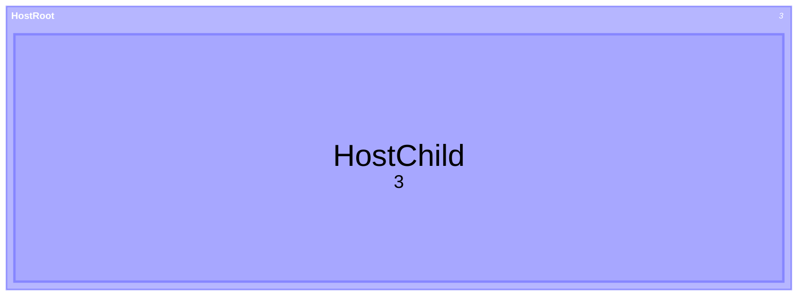

# Treemap formatting rules

英語版: [treemap.md](./treemap.md)

決定された 29 項目に従い、
[treemap の木](../../spec/docs/ast/treemap.ja.md)から整形します。
各規則で選択の理由を説明します。
semicolon の保護は普通の整形より優先します。
保持する文字と mermaid.js との差は [compatibility.ja.md](./compatibility.ja.md)に記します。

## Rules

### Header

見出しを第 1 列に置き、普通の最初の文を次行に移します。
見出しを見つけやすくするためです。
Db が等しい別名へ統一せず、作者が書いた `treemap` と `treemap-beta` を保ちます。
コロンは足さず、空本文も保ちます。

[fixture: treemap/header/stable]

[fixture: treemap/header/beta]

[fixture: treemap/header/common]

[fixture: treemap/header/empty]

入力（エスケープ表記）:
`" treemap\"HeadingRoot\"\n \"HeadingChild\":3"`.

出力 ([header/stable-output.mmd](../tests/fixtures/treemap/header/stable-output.mmd)):

```mmd
treemap
  "HeadingRoot"
    "HeadingChild": 3
```

### Indentation

AST の children から、書かれた順に親を読みます。
子を持つのは section だけで、leaf の後の深い行が別の根になることもあります。
statementsBefore の common 文と classDef は原文の位置を保ち、
親の判定に参加しません。
普通の根は設定の 1 段、子は親より 1 段深く置きます。
common 文と classDef は本文の 1 段に置きます。
同じ読みを持つ幅から、一貫した深さを選ぶためです。
tabWidth 0 でも、字下げが親子を決めるので 1 段 1 文字以上にします。
style と終端のない classDef に行が接する場合は接触を保ち、
その図の全根の基準を 0 にします。
後の根が子になるのを防ぐためです。

[fixture: treemap/indentation/irregular]

[fixture: treemap/indentation/leaf-not-parent]

[fixture: treemap/indentation/leaf-closes]

[fixture: treemap/indentation/leaf-pops-inner]

[fixture: treemap/indentation/common-and-class]

[fixture: treemap/indentation/all-root-leaves]

[fixture: treemap/indentation/four]

[fixture: treemap/indentation/zero]

[fixture: treemap/indentation/zero-tabs]

[fixture: treemap/indentation/glued-roots]

[fixture: treemap/indentation/glued-zero]

[fixture: treemap/indentation/glued-tabs]

入力（エスケープ表記）:
`"treemap\n    \"Top\"\n           \"Branch\"\n             \"Tip\":3\n      \"Sibling\":4\n \"Other\":5"`.

出力 ([indentation/irregular-output.mmd](../tests/fixtures/treemap/indentation/irregular-output.mmd)):

```mmd
treemap
  "Top"
    "Branch"
      "Tip": 3
    "Sibling": 4
  "Other": 5
```

### Carried indentation

外側の空白を消す前に、割り当て済みの indent を反映した AST の親子を使います。
見出し、section、leaf、classDef の終端、説明の閉じ括弧の後や、
空白だけの行の run が、LF を越えて次行の字下げになりえます。
その情報を次行の予定の列へ一度だけ移します。
物理行の先頭だけを測り直したり、二つ目の run を足したりしません。
数える run は common の除去処理で既に決まっています。

[fixture: treemap/carried-indentation/header-space]

[fixture: treemap/carried-indentation/header-tab]

[fixture: treemap/carried-indentation/section-space]

[fixture: treemap/carried-indentation/section-tab]

[fixture: treemap/carried-indentation/leaf-space]

[fixture: treemap/carried-indentation/leaf-tab]

[fixture: treemap/carried-indentation/class-space]

[fixture: treemap/carried-indentation/class-tab]

[fixture: treemap/carried-indentation/whitespace-line]

[fixture: treemap/carried-indentation/closer]

入力（エスケープ表記）:
`"treemap\n\"Top\"  \n\"Tip\":2"`.

出力 ([carried-indentation/section-space-output.mmd](../tests/fixtures/treemap/carried-indentation/section-space-output.mmd)):

```mmd
treemap
  "Top"
    "Tip": 2
```

### Tabs

入力の ASCII space と tab を、それぞれ 1 文字と数えます。
tab stop へは展開しません。
useTabs なら深さごとに 1 tab、それ以外は設定の正の幅の space で印字します。
見た目の文字をそろえ、順序つきの森を保つためです。

[fixture: treemap/tabs/mixed]

[fixture: treemap/tabs/configured]

[fixture: treemap/tabs/same-count]

入力（エスケープ表記）:
`"treemap\n \"TabRoot\"\n\t \"Branch\"\n \t \"Tip\":3"`.

出力 ([tabs/mixed-output.mmd](../tests/fixtures/treemap/tabs/mixed-output.mmd)):

```mmd
treemap
  "TabRoot"
    "Branch"
      "Tip": 3
```

### Statements one per line

普通の隣接行や閉じた説明の後の文は、元順で一文一行にします。
文の境界を見やすくするためです。
終端のない空の classDef と次の引用行の接触は、間の directive も含めて保ちます。
空白を足すと行が style に取り込まれるためです。
完了した classDef にこの接触の制約はありませんが、
semicolon の保護が優先します。
title や class style が既に所有する文字は、別文にしません。

[fixture: treemap/statements-one-per-line/adjacent]

[fixture: treemap/statements-one-per-line/glued-empty-class]

[fixture: treemap/statements-one-per-line/glued-class-directive]

[fixture: treemap/statements-one-per-line/completed-class]

[fixture: treemap/statements-one-per-line/block-adjacent]

[fixture: treemap/statements-one-per-line/title-owns-row]

入力（エスケープ表記）:
`"treemap\"Top\"  \"Left\":1   \"Right\",2\"Last\""`.

出力 ([statements-one-per-line/adjacent-output.mmd](../tests/fixtures/treemap/statements-one-per-line/adjacent-output.mmd)):

```mmd
treemap
  "Top"
    "Left": 1
    "Right", 2
  "Last"
```

### Separators

leaf の colon と comma の綴りを保ち、普通の空白は前 0、後 1 にします。
句読点を変えず、同じ読みの空白をそろえるためです。
NumericLiteral の中の comma は末尾も含めて数の一部として保ちます。
trivia のある gap は接触を保ちます。

[fixture: treemap/separators/colon]

[fixture: treemap/separators/comma]

[fixture: treemap/separators/numeric-commas]

[fixture: treemap/separators/trivia]

入力（エスケープ表記）:
`"treemap\n\"Colon\" \t: \t1,234.5"`.

出力 ([separators/colon-output.mmd](../tests/fixtures/treemap/separators/colon-output.mmd)):

```mmd
treemap
  "Colon": 1,234.5
```

### Selectors

`"section":::class` と `"leaf": value:::class` にします。
trivia のない marker と名前の間の改行を詰め、 `:::` の前後には空白を足しません。
そこでは字下げが許されないためです。
1 文字や keyword に似た名前も含め、selector の綴りと有無を保ちます。

[fixture: treemap/selectors/section-newlines]

[fixture: treemap/selectors/leaf-newlines]

[fixture: treemap/selectors/one-letter]

[fixture: treemap/selectors/underscore]

[fixture: treemap/selectors/keyword]

[fixture: treemap/selectors/keyword-prefix]

入力（エスケープ表記）:
`"treemap\n\"Section\"\n:::\nzz"`.

出力 ([selectors/section-newlines-output.mmd](../tests/fixtures/treemap/selectors/section-newlines-output.mmd)):

```mmd
treemap
  "Section":::zz
```

### Numbers

NumericLiteral の source span を保ちます。
区切り、underscore、dot、先頭と末尾のゼロ、桁を残します。
数値 field から印字し直しません。
Mermaid は `1_000` を 1 と読みます。
ほかの綴りも丸め、NaN、overflow、underflow になりえます。
再符号化すると Db が変わったり、拒否される構文になったりします。

[fixture: treemap/numbers/comma]

[fixture: treemap/numbers/underscore]

[fixture: treemap/numbers/dots]

[fixture: treemap/numbers/nan]

[fixture: treemap/numbers/leading-dot]

[fixture: treemap/numbers/trailing-comma]

[fixture: treemap/numbers/dot-underscore]

[fixture: treemap/numbers/precision]

[fixture: treemap/numbers/zeros]

[corpus fixture: treemap/db-number-overflow]

[corpus fixture: treemap/db-number-subnormal]

[corpus fixture: treemap/db-number-underflow]

入力（エスケープ表記）:
`"treemap\n\"Underscore\":1_000"`.

出力 ([numbers/underscore-output.mmd](../tests/fixtures/treemap/numbers/underscore-output.mmd)):

```mmd
treemap
  "Underscore": 1_000
```

### Names

StringLiteral の source span 全体を保ちます。
引用符、反対側の引用符、空名、空白だけの名、padding、 backslash、HTML、entity、
percent の文字と物理継続列を残します。
singleQuote では書き換えません。
backslash は引用符を escape せず、`\n` も decode しません。
これらの書き方は名前や受理を変えうるためです。

[fixture: treemap/names/quotes]

[fixture: treemap/names/backslash]

[fixture: treemap/names/empty]

[fixture: treemap/names/whitespace]

[fixture: treemap/names/html-entities]

[fixture: treemap/names/physical-columns]

[fixture: treemap/names/percent-owned]

[corpus fixture: treemap/lex-string-backslash-line-feed]

入力（エスケープ表記）:
`"treemap\n'  Other \"quote\"  ':1"`.

オプション: `{"singleQuote":true}`.

出力 ([names/quotes-output.mmd](../tests/fixtures/treemap/names/quotes-output.mmd)):

```mmd
treemap
  '  Other "quote"  ': 1
```

### Class definitions

`classDef` と作者の class 名の間を、普通の ASCII space 1 個にします。
この separator の普通の改行や Unicode 空白も詰めます。
複合規則は空白を要求しますが、幅は保持しないためです。
`title` で始まる名前を読み替えません。
selector と違い、class 名は 2 文字以上必要です。

[fixture: treemap/class-definitions/keyword-space]

[fixture: treemap/class-definitions/keyword-newline]

[fixture: treemap/class-definitions/title-prefix]

[test: treemap/class-definitions/unicode-gap]

入力（エスケープ表記）:
`"treemap\nclassDef\n\t zz"`.

出力 ([class-definitions/keyword-newline-output.mmd](../tests/fixtures/treemap/class-definitions/keyword-newline-output.mmd)):

```mmd
treemap
  classDef zz
```

### Style gaps

null でない style の前に、普通の space 1 個を置きます。
最大 separator 空白は空行を越えることもあります。
次の行や classDef に見える literal でも、その空白を詰めます。
AST が既に style として所有しているためです。
コメントや directive を含む separator は保持し、所有位置と必要な空白を保ちます。

[fixture: treemap/style-gaps/spaces]

[fixture: treemap/style-gaps/row-on-next-line]

[fixture: treemap/style-gaps/class-on-next-line]

[fixture: treemap/style-gaps/comment]

[fixture: treemap/style-gaps/directive]

入力（エスケープ表記）:
`"treemap\nclassDef zz\n\n  \"Apparent\":2"`.

出力 ([style-gaps/row-on-next-line-output.mmd](../tests/fixtures/treemap/style-gaps/row-on-next-line-output.mmd)):

```mmd
treemap
  classDef zz "Apparent":2
```

### Styles

TreemapLiteral の style span 全体を保ちます。
comma、colon の空白、escaped comma、引用符、percent、空 entry、
末尾の space と tab も残します。
CSS として分割、統合、整形しません。
綴りや entry の先頭空白は Db を変えうるためです。
末尾の空白も作者の値の文字として保ちます。

[fixture: treemap/styles/written]

[fixture: treemap/styles/trailing]

[fixture: treemap/styles/trailing-before-semicolon]

[fixture: treemap/styles/percent-owned]

[fixture: treemap/styles/quotes]

入力（エスケープ表記）:
`"treemap\nclassDef zz color:red , fill:blue,stroke:rgb(1\\,2\\,3),;"`.

出力 ([styles/written-output.mmd](../tests/fixtures/treemap/styles/written-output.mmd)):

```mmd
treemap
  classDef zz color:red , fill:blue,stroke:rgb(1\,2\,3),;
```

### Semicolons

書かれた semicolon はすべて保ちます。
class の終端、選ばれて無視されるもの、値の文字を区別します。
共有の行と prefix の保護を使い、区間の原文と列を保ちます。
保護区間の内部の行に字下げを足しません。
保持する行が row の境界を拘束する場合は、本文を原文保持します。
一部の行の indent だけを固定して残りをそろえません。
親子と semicolon の選択を、保護された末尾も含めて保つためです。
普通の改行や空白の選択より優先します。

[fixture: treemap/semicolons/terminator]

[fixture: treemap/semicolons/name]

[fixture: treemap/semicolons/selected]

[fixture: treemap/semicolons/two]

[fixture: treemap/semicolons/body-kept]

[fixture: treemap/semicolons/multiline-columns]

[fixture: treemap/semicolons/protected-class-column]

[fixture: treemap/semicolons/protected-class-zero]

[fixture: treemap/semicolons/protected-class-tabs]

[test: treemap/semicolons/protected-later-atom]

入力（エスケープ表記）:
`"treemap\nclassDef zz\n   color:#navy;;"`.

出力 ([semicolons/protected-class-column-output.mmd](../tests/fixtures/treemap/semicolons/protected-class-column-output.mmd)):

```mmd
treemap
  classDef zz
   color:#navy;;
```

### Title

共有の common line 配置を使います。
普通の common 空白の外端を除き、非空値の前を space 1 個にします。
null と空白だけの値は `title` だけにします。
Db の等しい外側の空白から 1 つを選び、
内側の空白や引用符に見える文字を保つためです。
コメントや directive を越えて次の物理行から値を取りません。
trivia を持つ値は書かれた境界を保ちます。

[fixture: treemap/title/padding]

[fixture: treemap/title/empty-next-comment]

[fixture: treemap/title/empty-next-directive]

[fixture: treemap/title/whitespace]

[fixture: treemap/title/quotes]

入力（エスケープ表記）:
`"treemap\ntitle\t  Topic  words \t\n\"AfterTitle\":3"`.

出力 ([title/padding-output.mmd](../tests/fixtures/treemap/title/padding-output.mmd)):

```mmd
treemap
  title Topic  words
  "AfterTitle": 3
```

### Accessibility lines

共有の `accTitle: value` と `accDescr: value` の配置を使います。
colon を keyword に付け、trim した非空値の前を space 1 個にし、
空値は colon で終えます。
内側の文字を保ち、colon 後の波括弧は行の文字として残します。
同じ読みの外側の空白を、ほかの図種とそろえるためです。
trivia の境界を保ち、次行の値を連結しません。

[fixture: treemap/accessibility-lines/title-padding]

[fixture: treemap/accessibility-lines/description-padding]

[fixture: treemap/accessibility-lines/title-empty]

[fixture: treemap/accessibility-lines/description-empty]

[fixture: treemap/accessibility-lines/colon-braces]

[fixture: treemap/accessibility-lines/trivia]

[test: treemap/accessibility-lines/unicode-edges]

入力（エスケープ表記）:
`"treemap\naccTitle \t: \t Access  words \t"`.

出力 ([accessibility-lines/title-padding-output.mmd](../tests/fixtures/treemap/accessibility-lines/title-padding-output.mmd)):

```mmd
treemap
  accTitle: Access  words
```

### Description blocks

共有の説明ブロック配置を使います。
keyword と opener、内端の接触を保ちます。
既存の端の空白は 1 space、空白だけの中身は `{}` にします。
囲む文字がないときは padding が不要なためです。
opener 前の普通の空白は詰めます。
コメントや directive だけの中身と境界、非空の継続列と内部の空行は保ちます。
別行の opener と closer は文の列にそろえます。
最初の `}` がブロックを閉じます。

[fixture: treemap/description-blocks/empty]

[fixture: treemap/description-blocks/touching]

[fixture: treemap/description-blocks/spaced]

[fixture: treemap/description-blocks/left-touching]

[fixture: treemap/description-blocks/right-touching]

[fixture: treemap/description-blocks/continuation]

[fixture: treemap/description-blocks/opener-newline]

[fixture: treemap/description-blocks/directive-only]

[fixture: treemap/description-blocks/comment-only]

[fixture: treemap/description-blocks/opener-comment]

[fixture: treemap/description-blocks/opener-directive]

[corpus fixture: treemap/common-block-first-close]

[test: treemap/description-blocks/unicode-empty]

[test: treemap/description-blocks/unicode-opener]

入力（エスケープ表記）:
`"treemap\naccDescr  {\n  first\n\n    second\n}\n\"AfterDescription\":3"`.

出力 ([description-blocks/continuation-output.mmd](../tests/fixtures/treemap/description-blocks/continuation-output.mmd)):

```mmd
treemap
  accDescr {
  first

    second
  }
  "AfterDescription": 3
```

### Long lines

printWidth によって名前、数、style、common 値を折り返しません。
値の改行は Db を変え、新しい style 行は拒否されうるためです。
作者が値に書いた改行も、整形の折返しとはみなさず保ちます。

[fixture: treemap/long-lines/name-and-number]

[fixture: treemap/long-lines/style-and-title]

入力（エスケープ表記）:
`"treemap\n\"A deliberately long name preserves every word and its internal spaces\":12345678901234567890"`.

オプション: `{"printWidth":20}`.

出力 ([long-lines/name-and-number-output.mmd](../tests/fixtures/treemap/long-lines/name-and-number-output.mmd)):

```mmd
treemap
  "A deliberately long name preserves every word and its internal spaces": 12345678901234567890
```

### Component newlines

trivia のない leaf の名前、区切り、数と、selector の部品の間の改行を、
普通の空白へ詰めます。
これらの部品の境界には同じ読みの配置があるためです。
コメントや directive がある gap と必要な改行は保ちます。
別行の selector の marker と名前は第 1 列に置きます。
そこに space や tab があると拒否されるためです。
leaf の区切りと数の継続行は文にそろえます。
ただし native コメント前の gap が既に字下げの run を持つなら、
二つ目の run は足しません。
独立した trivia の mark は第 1 列に置きます。

[fixture: treemap/component-newlines/leaf]

[fixture: treemap/component-newlines/leaf-comment]

[fixture: treemap/component-newlines/selector-comment]

[fixture: treemap/component-newlines/selector-directive]

[fixture: treemap/component-newlines/number-comment]

[fixture: treemap/component-newlines/leaf-inline-space]

[corpus fixture: treemap/comment-leaf-separator-indent]

入力（エスケープ表記）:
`"treemap\n\"Selector\":2%% gap\n:::zz"`.

出力 ([component-newlines/selector-comment-output.mmd](../tests/fixtures/treemap/component-newlines/selector-comment-output.mmd)):

```mmd
treemap
  "Selector": 2%% gap
:::zz
```

### Comments

普通の独立コメントの mark は第 1 列に置きます。
inline は同じ行に残し、内容、mark、末尾、順序、所有位置を保ちます。
native の bare や非 word コメント前に、新しい字下げの unit を作らないためです。
inline コメント前の空白が次行の indent なら、次行へ移します。
その結果コメントが直前の token に接しても、親子を保ちます。
common コメント領域とともに消えた空白を復元せず、 AST の親子を使います。
native コメント内の LS と PS は内容として保ちます。

[fixture: treemap/comments/standalone]

[fixture: treemap/comments/native-bare]

[fixture: treemap/comments/native-nonword]

[fixture: treemap/comments/carried-space]

[fixture: treemap/comments/carried-tab]

[fixture: treemap/comments/removed-indent]

[fixture: treemap/comments/header-inline]

[fixture: treemap/comments/tail]

[test: treemap/comments/native-ls-ps]

入力（エスケープ表記）:
`"treemap\n\"Top\"\n%% before child\n    \"Tip\":2\n%% final comment"`.

出力 ([comments/standalone-output.mmd](../tests/fixtures/treemap/comments/standalone-output.mmd)):

```mmd
treemap
  "Top"
%% before child
    "Tip": 2
%% final comment
```

### Directives

Root directive の全文、順序、部品や値の所有位置を保ちます。
独立 directive は第 1 列に置きます。
除去後に余分な字下げの run を残さないためです。
行頭の unit の中では、directive 前後の space と tab を合計します。
共有の leading gap 配置を使い、後側の gap が目標幅に収まる間は保ちます。
余れば最後の gap から縮め、残りを最初の directive 前に置きます。
前の行から渡る unit は、代わりに一度だけ次行へ移します。
class keyword と名前の必須空白を保ち、directive で代用しません。

[fixture: treemap/directives/leading]

[fixture: treemap/directives/shortened]

[fixture: treemap/directives/multiple]

[fixture: treemap/directives/multiline]

[fixture: treemap/directives/standalone]

[fixture: treemap/directives/carried]

[fixture: treemap/directives/name]

[fixture: treemap/directives/class-gap]

[fixture: treemap/directives/style]

[fixture: treemap/directives/selector]

入力（エスケープ表記）:
`"treemap\n\"Top\"\n %%{wrap}%% \"Tip\":2"`.

出力 ([directives/leading-output.mmd](../tests/fixtures/treemap/directives/leading-output.mmd)):

```mmd
treemap
  "Top"
   %%{wrap}%% "Tip": 2
```

### Prefix

見出し前の普通のコメント、directive、空行は共有の root 配置を使います。
検出の second scan で残った単行の percent 形式は、 Comment として、内部の Root
directive を一度だけ印字します。
frontmatter に昇格させる native hidden YAML はありません。
読めない retained YAML は拒否のままです。

[fixture: treemap/prefix/comment]

[fixture: treemap/prefix/second-scan]

[corpus fixture: treemap/bare-line-space]

[corpus fixture: treemap/detect-retained-bare-lf-control]

[corpus fixture: treemap/retained-yaml-no-bare]

入力（エスケープ表記）:
`"\n  %% leading note\ntreemap\n\"Prefix\":2"`.

出力 ([prefix/comment-output.mmd](../tests/fixtures/treemap/prefix/comment-output.mmd)):

```mmd
%% leading note
treemap
  "Prefix": 2
```

### Blank lines

普通の空行は最大 1 行とし、文書と本文の端の普通の空行を除きます。
文の間の空きを一定の範囲にそろえるためです。
空白だけの行が意味のある字下げなら、先に次の行へ移します。
名前、説明、directive、common コメント領域が所有する空行は保ちます。

[fixture: treemap/blank-lines/ordinary]

[fixture: treemap/blank-lines/comments]

[fixture: treemap/blank-lines/indent-run]

[fixture: treemap/blank-lines/name-interior]

入力（エスケープ表記）:
`"treemap\n\n\"Top\"\n\n\n \"Tip\":2\n\n"`.

出力 ([blank-lines/ordinary-output.mmd](../tests/fixtures/treemap/blank-lines/ordinary-output.mmd)):

```mmd
treemap
  "Top"

    "Tip": 2
```

### Trailing whitespace

全行の末尾を一括で削らず、所有者で決めます。
名前、style、コメント、directive の末尾は保ちます。
common の行値は共有の外端除去を使います。
構造の文字の後の run は次行の indent になりうるので、
その場合は一度だけ次行へ移します。
作者の値と親子の情報を分けて保つためです。
fixture の意味のある行末空白は、コードブロックでは正確に表示できません。

[fixture: treemap/trailing-whitespace/comment-content]

[fixture: treemap/trailing-whitespace/string-content]

[fixture: treemap/trailing-whitespace/style-content]

### Line terminators and unicode

共有の host の行末処理を使います。
値の中も含め、物理 CR と CRLF は printer に LF として届き、
出力は endOfLine に従います。
値に属する LS、PS、NBSP、BOM は保ちます。
native コメントは LS と PS では終わりません。
普通の common 値の外端は common Unicode 空白を除き、
class の separator もその空白を許します。
Unicode の行の字下げを追加する規則ではありません。
先頭 BOM の host による除去と復元には、共有の frontmatter の制限があります。

[test: treemap/line-terminators-and-unicode/cr-structure]

[test: treemap/line-terminators-and-unicode/crlf-values]

[test: treemap/line-terminators-and-unicode/unicode-values]

[test: treemap/line-terminators-and-unicode/frontmatter-cr]

[test: treemap/line-terminators-and-unicode/leading-bom]

[test: treemap/line-terminators-and-unicode/output-crlf]

[test: treemap/line-terminators-and-unicode/output-cr]

### Frontmatter yaml

安全な実際の先頭 frontmatter だけを、共有の guard 付き YAML 整形へ渡します。
字下げした fence、closer の padding、不正 YAML、 HTML 引用符の危険や、
整形で fence になる本文は原文を保ちます。
YAML の入れ子と block scalar は、tabWidth 0 でも 1 space 以上にします。
前処理と値を守りながら、安全な YAML の空白をそろえるためです。

[fixture: treemap/frontmatter-yaml/safe]

[fixture: treemap/frontmatter-yaml/zero]

[fixture: treemap/frontmatter-yaml/indent-guard]

[fixture: treemap/frontmatter-yaml/html-guard]

[fixture: treemap/frontmatter-yaml/malformed]

[fixture: treemap/frontmatter-yaml/closing-padding]

[fixture: treemap/frontmatter-yaml/delimiter-guard]

[fixture: treemap/frontmatter-yaml/title-reset]

[corpus fixture: treemap/div-frontmatter-invalid]

入力（エスケープ表記）:
`"---\ntitle: |\n  First\n  Second\nconfig: {treemap: {padding: 3}}\n---\ntreemap\n\"YamlZero\":2"`.

オプション: `{"tabWidth":0}`.

出力 ([frontmatter-yaml/zero-output.mmd](../tests/fixtures/treemap/frontmatter-yaml/zero-output.mmd)):

```mmd
---
title: |
 First
 Second
config: { treemap: { padding: 3 } }
---
treemap
 "YamlZero": 2
```

### Source order

本文の全出現と兄弟、根の順を保ちます。
空や重複した名と section、未使用や再定義された class、前方や未解決の selector、
common の空代入も残します。
class の蓄積、リセット、順序、親子を変えうるため、 sort、統合、削除はしません。
正規化した Db から再構築せず、作者の構文を印字します。

[fixture: treemap/source-order/repetitions]

[fixture: treemap/source-order/names-and-selectors]

[fixture: treemap/source-order/empty-assignments]

[corpus fixture: treemap/db-duplicate-names]

[corpus fixture: treemap/db-class-unused]

入力（エスケープ表記）:
`"treemap\n\"Top\"\n \"Right\":2\n \"Left\":1\nclassDef zz color:red;\nclassDef zz fill:blue;\ntitle Earlier\ntitle"`.

出力 ([source-order/repetitions-output.mmd](../tests/fixtures/treemap/source-order/repetitions-output.mmd)):

```mmd
treemap
  "Top"
    "Right": 2
    "Left": 1
  classDef zz color:red;
  classDef zz fill:blue;
  title Earlier
  title
```

### Final newline

普通の受理入力は、設定の改行 1 個で終えます。
空本文、行、common 文、閉じたブロック、コメントも同じです。
共有のファイル境界の選択にそろえるためです。
値の末尾は所有する文字として残します。
EOF まで届く未完の Root directive と保護された本文の末尾は、
元の終わり方を優先します。
拒否される未使用の字下げの run は修復しません。

[fixture: treemap/final-newline/row]

[fixture: treemap/final-newline/common]

[fixture: treemap/final-newline/block]

[fixture: treemap/final-newline/comment]

[fixture: treemap/final-newline/open-directive]

入力（エスケープ表記）:
`"treemap\n\"FinalComment\":2\n%% final"`.

出力 ([final-newline/comment-output.mmd](../tests/fixtures/treemap/final-newline/comment-output.mmd)):

```mmd
treemap
  "FinalComment": 2
%% final
```

### Specified readings

既存の 6 つの指定読みを使います。
directive-as-token-boundary、ignored-semicolon-as-token-boundary、
html-tag-in-frontmatter、embedded-data-opaque、
bare-percent-line-before-header、c4-keyword-anywhere です。
atomic な切断は修復せず拒否し、frontmatter の HTML の影響を分離します。
埋め込みは opaque とし、後の C4 語で選択図種を変えません。
opaque 比較で削る treemap 固有の受理設定 key はありません。
corpus の受理入力は記録された指定 Db と比較します。
raw で拒否される場合、比較できる raw Db はありません。

[corpus fixture: treemap/directive-header-middle]

[corpus fixture: treemap/div-semicolon-number-atom]

[corpus fixture: treemap/div-html-frontmatter-reverse]

[corpus fixture: treemap/div-html-frontmatter-title-value]

[corpus fixture: treemap/div-html-frontmatter-style-value]

[corpus fixture: treemap/div-frontmatter-invalid]

[corpus fixture: treemap/bare-before-header-space]

[corpus fixture: treemap/c4-component-section]

[corpus fixture: treemap/tail-leaf-semicolon]

[test: treemap/specified-readings/bare-unicode]

### Markdown fences

dedent した payload に同じ規則を適用します。
fence、list、quote の外側の字下げは Markdown host に任せます。
値の継続列に container の幅を足しません。
host の出力と冪等性を、payload の Db と別々に検査します。
host は最後のコード行の padding を、style の末尾も含めて除きます。
試験した場合の読みは保ちますが、作者の byte の保持にはこの制限があります。
拒否された fence は、host のコードを変えない経路に任せます。

[test: treemap Markdown: top-level]

[test: treemap Markdown: list]

[test: treemap Markdown: quote]

[test: treemap Markdown: zero]

[test: treemap Markdown: tabs]

[test: treemap Markdown: carried-indent]

[test: treemap Markdown: directives-comments]

[test: treemap Markdown: glued-class]

[test: treemap Markdown: protected]

[test: treemap Markdown: description]

[test: treemap Markdown: frontmatter]

[test: treemap Markdown: final-style-padding]

[test: treemap Markdown: rejected]

入力:

````markdown

````

出力:

````markdown

````
