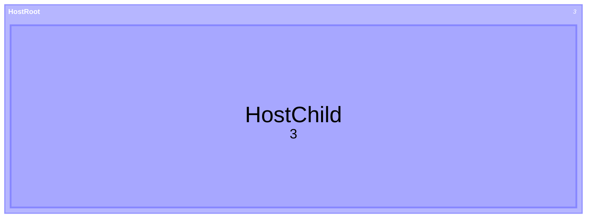

# Treemap formatting rules

Japanese version: [treemap.ja.md](./treemap.ja.md)

These rules apply the 29 adopted items to the authored
[treemap tree](../../spec/docs/ast/treemap.md). Each rule explains its choice.
Semicolon protection takes precedence over ordinary formatting.
[compatibility.md](./compatibility.md) records preserved text and differences
from mermaid.js.

## Rules

### Header

Put the header at column one and an ordinary first statement on the next line,
making the heading easy to find. Preserve the authored `treemap` or
`treemap-beta` keyword rather than choosing between Db-equivalent aliases. Add
no colon; an empty body stays empty.

[fixture: treemap/header/stable]

[fixture: treemap/header/beta]

[fixture: treemap/header/common]

[fixture: treemap/header/empty]

Input (escaped): `" treemap\"HeadingRoot\"\n \"HeadingChild\":3"`.

Output
([header/stable-output.mmd](../tests/fixtures/treemap/header/stable-output.mmd)):

```mmd
treemap
  "HeadingRoot"
    "HeadingChild": 3
```

### Indentation

Read parents from original AST indents in source order: pop open sections while
their indent is greater than or equal to the current row, then use the last
remaining section as parent. Push only sections. Leaves close sections but never
become parents; a later deep row can be another root. Common statements and
class definitions do not participate. Print ordinary roots one configured step
in and children one step deeper than their parent; common statements and class
definitions use one body step. This chooses consistent depths from equivalent
widths. Use at least one character per step at tabWidth zero because indentation
determines parentage. A styleless, unterminated class definition touching a row
keeps that contact; in such a diagram every root uses baseline zero, so later
roots cannot become children accidentally.

[fixture: treemap/indentation/irregular]

[fixture: treemap/indentation/leaf-not-parent]

[fixture: treemap/indentation/leaf-closes]

[fixture: treemap/indentation/leaf-pops-inner]

[fixture: treemap/indentation/common-and-class]

[fixture: treemap/indentation/all-root-leaves]

[fixture: treemap/indentation/four]

[fixture: treemap/indentation/zero]

[fixture: treemap/indentation/zero-tabs]

[fixture: treemap/indentation/glued-roots]

[fixture: treemap/indentation/glued-zero]

[fixture: treemap/indentation/glued-tabs]

Input (escaped):
`"treemap\n    \"Top\"\n           \"Branch\"\n             \"Tip\":3\n      \"Sibling\":4\n \"Other\":5"`.

Output
([indentation/irregular-output.mmd](../tests/fixtures/treemap/indentation/irregular-output.mmd)):

```mmd
treemap
  "Top"
    "Branch"
      "Tip": 3
    "Sibling": 4
  "Other": 5
```

### Carried indentation

Use the AST indent before removing exterior padding. A run after a header,
section, leaf, class terminator or description closer, or on a whitespace-only
line, can indent the next row across LF. Move its information once to that row’s
planned column. Do not measure only physical leading whitespace or add a second
indentation run. Common removals have already decided which runs count.

[fixture: treemap/carried-indentation/header-space]

[fixture: treemap/carried-indentation/header-tab]

[fixture: treemap/carried-indentation/section-space]

[fixture: treemap/carried-indentation/section-tab]

[fixture: treemap/carried-indentation/leaf-space]

[fixture: treemap/carried-indentation/leaf-tab]

[fixture: treemap/carried-indentation/class-space]

[fixture: treemap/carried-indentation/class-tab]

[fixture: treemap/carried-indentation/whitespace-line]

[fixture: treemap/carried-indentation/closer]

Input (escaped): `"treemap\n\"Top\"  \n\"Tip\":2"`.

Output
([carried-indentation/section-space-output.mmd](../tests/fixtures/treemap/carried-indentation/section-space-output.mmd)):

```mmd
treemap
  "Top"
    "Tip": 2
```

### Tabs

Count each source ASCII space and tab as one character, without tab-stop
expansion. Print one tab per depth with useTabs, otherwise the configured
positive space width. The character choice changes presentation while preserving
the ordered forest.

[fixture: treemap/tabs/mixed]

[fixture: treemap/tabs/configured]

[fixture: treemap/tabs/same-count]

Input (escaped): `"treemap\n \"TabRoot\"\n\t \"Branch\"\n \t \"Tip\":3"`.

Output
([tabs/mixed-output.mmd](../tests/fixtures/treemap/tabs/mixed-output.mmd)):

```mmd
treemap
  "TabRoot"
    "Branch"
      "Tip": 3
```

### Statements one per line

Print ordinary adjacent rows and statements after a closed description on
separate lines in source order, exposing statement boundaries. Keep an empty
unterminated class name touching its next quoted row, including intervening
directives: whitespace would consume that row as style. A completed class
definition has no such contact requirement; semicolon protection still takes
precedence. Text already owned by a title or class style is one value, not a new
statement.

[fixture: treemap/statements-one-per-line/adjacent]

[fixture: treemap/statements-one-per-line/glued-empty-class]

[fixture: treemap/statements-one-per-line/glued-class-directive]

[fixture: treemap/statements-one-per-line/completed-class]

[fixture: treemap/statements-one-per-line/block-adjacent]

[fixture: treemap/statements-one-per-line/title-owns-row]

Input (escaped): `"treemap\"Top\"  \"Left\":1   \"Right\",2\"Last\""`.

Output
([statements-one-per-line/adjacent-output.mmd](../tests/fixtures/treemap/statements-one-per-line/adjacent-output.mmd)):

```mmd
treemap
  "Top"
    "Left": 1
    "Right", 2
  "Last"
```

### Separators

Keep the leaf’s authored colon or comma, with no ordinary space before and one
after. This gives equivalent padding a consistent form without changing
punctuation. Commas inside NumericLiteral spans, including trailing commas,
remain part of the number. Trivia-bearing gaps keep their contact.

[fixture: treemap/separators/colon]

[fixture: treemap/separators/comma]

[fixture: treemap/separators/numeric-commas]

[fixture: treemap/separators/trivia]

Input (escaped): `"treemap\n\"Colon\" \t: \t1,234.5"`.

Output
([separators/colon-output.mmd](../tests/fixtures/treemap/separators/colon-output.mmd)):

```mmd
treemap
  "Colon": 1,234.5
```

### Selectors

Print `"section":::class` and `"leaf": value:::class`. Join trivia-free
marker/name newlines and add no spaces around `:::`: indentation there is
forbidden. Keep selector spelling and presence, including one-character and
keyword-like identifiers.

[fixture: treemap/selectors/section-newlines]

[fixture: treemap/selectors/leaf-newlines]

[fixture: treemap/selectors/one-letter]

[fixture: treemap/selectors/underscore]

[fixture: treemap/selectors/keyword]

[fixture: treemap/selectors/keyword-prefix]

Input (escaped): `"treemap\n\"Section\"\n:::\nzz"`.

Output
([selectors/section-newlines-output.mmd](../tests/fixtures/treemap/selectors/section-newlines-output.mmd)):

```mmd
treemap
  "Section":::zz
```

### Numbers

Keep each NumericLiteral source span: separators, underscores, dots,
leading/trailing zeros and precision. Do not reprint its numeric value. Mermaid
reads `1_000` as 1; other spellings can round, become NaN, overflow or
underflow. Re-encoding can change the Db or produce rejected numeric syntax.

[fixture: treemap/numbers/comma]

[fixture: treemap/numbers/underscore]

[fixture: treemap/numbers/dots]

[fixture: treemap/numbers/nan]

[fixture: treemap/numbers/leading-dot]

[fixture: treemap/numbers/trailing-comma]

[fixture: treemap/numbers/dot-underscore]

[fixture: treemap/numbers/precision]

[fixture: treemap/numbers/zeros]

[corpus fixture: treemap/db-number-overflow]

[corpus fixture: treemap/db-number-subnormal]

[corpus fixture: treemap/db-number-underflow]

Input (escaped): `"treemap\n\"Underscore\":1_000"`.

Output
([numbers/underscore-output.mmd](../tests/fixtures/treemap/numbers/underscore-output.mmd)):

```mmd
treemap
  "Underscore": 1_000
```

### Names

Keep complete StringLiteral source spans: single/double quotes, opposite quotes,
empty/whitespace-only names, padding, backslashes, HTML, entities, percent text
and physical continuation columns. singleQuote does not rewrite them.
Backslashes do not escape quotes or decode `\n`; these authored choices can
affect the name or acceptance.

[fixture: treemap/names/quotes]

[fixture: treemap/names/backslash]

[fixture: treemap/names/empty]

[fixture: treemap/names/whitespace]

[fixture: treemap/names/html-entities]

[fixture: treemap/names/physical-columns]

[fixture: treemap/names/percent-owned]

[corpus fixture: treemap/lex-string-backslash-line-feed]

Input (escaped): `"treemap\n'  Other \"quote\"  ':1"`.

Options: `{"singleQuote":true}`.

Output
([names/quotes-output.mmd](../tests/fixtures/treemap/names/quotes-output.mmd)):

```mmd
treemap
  '  Other "quote"  ': 1
```

### Class definitions

Use one ordinary ASCII space between `classDef` and its authored class name.
Join plain separating newlines and Unicode whitespace there because the
composite rule requires whitespace but does not retain its width. Do not
reinterpret names beginning with `title`; class names require at least two
characters, unlike selectors.

[fixture: treemap/class-definitions/keyword-space]

[fixture: treemap/class-definitions/keyword-newline]

[fixture: treemap/class-definitions/title-prefix]

[test: treemap/class-definitions/unicode-gap]

Input (escaped): `"treemap\nclassDef\n\t zz"`.

Output
([class-definitions/keyword-newline-output.mmd](../tests/fixtures/treemap/class-definitions/keyword-newline-output.mmd)):

```mmd
treemap
  classDef zz
```

### Style gaps

Put one ordinary space before a non-null style. Plain maximal separator
whitespace may cross blank lines; join it even when the literal looks like
another row or class definition. The AST already owns that text as style.
Preserve separator gaps containing comments/directives so their ownership and
required whitespace survive.

[fixture: treemap/style-gaps/spaces]

[fixture: treemap/style-gaps/row-on-next-line]

[fixture: treemap/style-gaps/class-on-next-line]

[fixture: treemap/style-gaps/comment]

[fixture: treemap/style-gaps/directive]

Input (escaped): `"treemap\nclassDef zz\n\n  \"Apparent\":2"`.

Output
([style-gaps/row-on-next-line-output.mmd](../tests/fixtures/treemap/style-gaps/row-on-next-line-output.mmd)):

```mmd
treemap
  classDef zz "Apparent":2
```

### Styles

Keep the whole TreemapLiteral style span, including comma/colon spacing, escaped
commas, quotes, percent text, empty entries and trailing spaces/tabs. Do not
split, merge or format it as CSS. Style spelling and leading entry padding can
affect the Db; trailing padding is retained as authored value text.

[fixture: treemap/styles/written]

[fixture: treemap/styles/trailing]

[fixture: treemap/styles/trailing-before-semicolon]

[fixture: treemap/styles/percent-owned]

[fixture: treemap/styles/quotes]

Input (escaped):
`"treemap\nclassDef zz color:red , fill:blue,stroke:rgb(1\\,2\\,3),;"`.

Output
([styles/written-output.mmd](../tests/fixtures/treemap/styles/written-output.mmd)):

```mmd
treemap
  classDef zz color:red , fill:blue,stroke:rgb(1\,2\,3),;
```

### Semicolons

Keep every authored semicolon: class terminators, selected ignored semicolons
and value characters. Use shared kept-line and protected-prefix rules; protected
segments retain their source text and columns, with no extra indentation on
their inner lines. If a kept line constrains a row boundary, preserve the body
as written rather than fixing some row indents and normalizing others. This
keeps parentage and semicolon selection together, including the protected
ending; it takes precedence over ordinary line and spacing choices.

[fixture: treemap/semicolons/terminator]

[fixture: treemap/semicolons/name]

[fixture: treemap/semicolons/selected]

[fixture: treemap/semicolons/two]

[fixture: treemap/semicolons/body-kept]

[fixture: treemap/semicolons/multiline-columns]

[fixture: treemap/semicolons/protected-class-column]

[fixture: treemap/semicolons/protected-class-zero]

[fixture: treemap/semicolons/protected-class-tabs]

[test: treemap/semicolons/protected-later-atom]

Input (escaped): `"treemap\nclassDef zz\n   color:#navy;;"`.

Output
([semicolons/protected-class-column-output.mmd](../tests/fixtures/treemap/semicolons/protected-class-column-output.mmd)):

```mmd
treemap
  classDef zz
   color:#navy;;
```

### Title

Use shared common-line placement: trim ordinary common-whitespace edges and
print one space before a nonempty value, or bare `title` for
null/whitespace-only text. This selects one Db-equivalent outer spacing without
rewriting internal spaces or quote-looking text. Never take a value from the
next physical line, across comments or directives. Trivia-bearing values retain
their written boundaries.

[fixture: treemap/title/padding]

[fixture: treemap/title/empty-next-comment]

[fixture: treemap/title/empty-next-directive]

[fixture: treemap/title/whitespace]

[fixture: treemap/title/quotes]

Input (escaped): `"treemap\ntitle\t  Topic  words \t\n\"AfterTitle\":3"`.

Output
([title/padding-output.mmd](../tests/fixtures/treemap/title/padding-output.mmd)):

```mmd
treemap
  title Topic  words
  "AfterTitle": 3
```

### Accessibility lines

Use the shared `accTitle: value` and `accDescr: value` layout: colon touching
the keyword, one space before a trimmed nonempty value, and no space after an
empty colon. Keep internal text; braces after a colon remain line text. These
equivalent outer gaps follow the other diagrams. Trivia retains boundaries and
no next-line value is joined.

[fixture: treemap/accessibility-lines/title-padding]

[fixture: treemap/accessibility-lines/description-padding]

[fixture: treemap/accessibility-lines/title-empty]

[fixture: treemap/accessibility-lines/description-empty]

[fixture: treemap/accessibility-lines/colon-braces]

[fixture: treemap/accessibility-lines/trivia]

[test: treemap/accessibility-lines/unicode-edges]

Input (escaped): `"treemap\naccTitle \t: \t Access  words \t"`.

Output
([accessibility-lines/title-padding-output.mmd](../tests/fixtures/treemap/accessibility-lines/title-padding-output.mmd)):

```mmd
treemap
  accTitle: Access  words
```

### Description blocks

Use shared description-block layout. Preserve touching keyword/opener and
interior edges; existing edge whitespace becomes one space, while
whitespace-only interiors become `{}` because no text needs surrounding padding.
Join plain opener whitespace, keep comment/directive-only interiors and their
boundaries, and preserve nonempty continuation columns and internal blank lines.
Align a separate opener or closer with its statement. The first `}` still closes
the block.

[fixture: treemap/description-blocks/empty]

[fixture: treemap/description-blocks/touching]

[fixture: treemap/description-blocks/spaced]

[fixture: treemap/description-blocks/left-touching]

[fixture: treemap/description-blocks/right-touching]

[fixture: treemap/description-blocks/continuation]

[fixture: treemap/description-blocks/opener-newline]

[fixture: treemap/description-blocks/directive-only]

[fixture: treemap/description-blocks/comment-only]

[fixture: treemap/description-blocks/opener-comment]

[fixture: treemap/description-blocks/opener-directive]

[corpus fixture: treemap/common-block-first-close]

[test: treemap/description-blocks/unicode-empty]

[test: treemap/description-blocks/unicode-opener]

Input (escaped):
`"treemap\naccDescr  {\n  first\n\n    second\n}\n\"AfterDescription\":3"`.

Output
([description-blocks/continuation-output.mmd](../tests/fixtures/treemap/description-blocks/continuation-output.mmd)):

```mmd
treemap
  accDescr {
  first

    second
  }
  "AfterDescription": 3
```

### Long lines

Do not wrap names, numbers, styles or common values at printWidth. New value
line breaks can change the Db, and new style lines can reject. Keep authored
value line breaks rather than treating them as layout opportunities.

[fixture: treemap/long-lines/name-and-number]

[fixture: treemap/long-lines/style-and-title]

Input (escaped):
`"treemap\n\"A deliberately long name preserves every word and its internal spaces\":12345678901234567890"`.

Options: `{"printWidth":20}`.

Output
([long-lines/name-and-number-output.mmd](../tests/fixtures/treemap/long-lines/name-and-number-output.mmd)):

```mmd
treemap
  "A deliberately long name preserves every word and its internal spaces": 12345678901234567890
```

### Component newlines

Join trivia-free leaf name/separator/number and selector component newlines into
ordinary spacing. These component boundaries admit equivalent layouts. Keep gaps
containing comments/directives and their required newlines. Separate selector
markers and identifiers start at column one because spaces/tabs there reject;
leaf separator/number continuations align with their statement unless an earlier
native-comment gap already supplies an indentation run, when no second run is
added. Standalone trivia marks start at column one.

[fixture: treemap/component-newlines/leaf]

[fixture: treemap/component-newlines/leaf-comment]

[fixture: treemap/component-newlines/selector-comment]

[fixture: treemap/component-newlines/selector-directive]

[fixture: treemap/component-newlines/number-comment]

[fixture: treemap/component-newlines/leaf-inline-space]

[corpus fixture: treemap/comment-leaf-separator-indent]

Input (escaped): `"treemap\n\"Selector\":2%% gap\n:::zz"`.

Output
([component-newlines/selector-comment-output.mmd](../tests/fixtures/treemap/component-newlines/selector-comment-output.mmd)):

```mmd
treemap
  "Selector": 2%% gap
:::zz
```

### Comments

Put ordinary standalone comment marks at column one; keep inline comments on
their line and preserve content, marks, tails, order and ownership. This avoids
introducing an indentation unit before native bare or nonword comments. When
whitespace before an inline comment supplied the next row’s indent, move it to
that row even if the comment then touches the preceding token. Use AST indents,
not whitespace already removed with common comment regions. Native comments
retain LS/PS as content.

[fixture: treemap/comments/standalone]

[fixture: treemap/comments/native-bare]

[fixture: treemap/comments/native-nonword]

[fixture: treemap/comments/carried-space]

[fixture: treemap/comments/carried-tab]

[fixture: treemap/comments/removed-indent]

[fixture: treemap/comments/header-inline]

[fixture: treemap/comments/tail]

[test: treemap/comments/native-ls-ps]

Input (escaped):
`"treemap\n\"Top\"\n%% before child\n    \"Tip\":2\n%% final comment"`.

Output
([comments/standalone-output.mmd](../tests/fixtures/treemap/comments/standalone-output.mmd)):

```mmd
treemap
  "Top"
%% before child
    "Tip": 2
%% final comment
```

### Directives

Keep Root directive text, order and component/value ownership; standalone
directives start at column one so removal leaves no extra indentation run. For
directives inside a row-leading unit, count spaces/tabs on both sides. Use
shared leading-gap placement: retain following gaps while they fit, shorten
excess from the last gap, then supply the remaining configured indentation
before the first directive. Earlier-line carried units move once instead. Keep
necessary class keyword/name whitespace and never use a directive as its
substitute.

[fixture: treemap/directives/leading]

[fixture: treemap/directives/shortened]

[fixture: treemap/directives/multiple]

[fixture: treemap/directives/multiline]

[fixture: treemap/directives/standalone]

[fixture: treemap/directives/carried]

[fixture: treemap/directives/name]

[fixture: treemap/directives/class-gap]

[fixture: treemap/directives/style]

[fixture: treemap/directives/selector]

Input (escaped): `"treemap\n\"Top\"\n %%{wrap}%% \"Tip\":2"`.

Output
([directives/leading-output.mmd](../tests/fixtures/treemap/directives/leading-output.mmd)):

```mmd
treemap
  "Top"
   %%{wrap}%% "Tip": 2
```

### Prefix

Use shared root placement for ordinary pre-header comments, directives and blank
lines. Preserve a detection second-scan single-line percent form as its Comment,
with its inner Root directive printed once. There is no native hidden YAML form
to promote into frontmatter; unreadable retained YAML remains rejected.

[fixture: treemap/prefix/comment]

[fixture: treemap/prefix/second-scan]

[corpus fixture: treemap/bare-line-space]

[corpus fixture: treemap/detect-retained-bare-lf-control]

[corpus fixture: treemap/retained-yaml-no-bare]

Input (escaped): `"\n  %% leading note\ntreemap\n\"Prefix\":2"`.

Output
([prefix/comment-output.mmd](../tests/fixtures/treemap/prefix/comment-output.mmd)):

```mmd
%% leading note
treemap
  "Prefix": 2
```

### Blank lines

Keep at most one ordinary blank line and remove ordinary blanks at document/body
edges, choosing a bounded separation between statements. First move any
meaningful whitespace-only indentation run to its row. Preserve blank lines
inside names, descriptions, directives and common comment regions as owned text.

[fixture: treemap/blank-lines/ordinary]

[fixture: treemap/blank-lines/comments]

[fixture: treemap/blank-lines/indent-run]

[fixture: treemap/blank-lines/name-interior]

Input (escaped): `"treemap\n\n\"Top\"\n\n\n \"Tip\":2\n\n"`.

Output
([blank-lines/ordinary-output.mmd](../tests/fixtures/treemap/blank-lines/ordinary-output.mmd)):

```mmd
treemap
  "Top"

    "Tip": 2
```

### Trailing whitespace

Decide by owner rather than trimming every line. Retain tails inside names,
styles, comments and directives; common line values use their shared exterior
trimming. Exterior runs after structural text may supply the next row’s indent
and move there once. This keeps authored values and parentage distinct. The
fixtures contain significant trailing whitespace that code blocks cannot display
reliably.

[fixture: treemap/trailing-whitespace/comment-content]

[fixture: treemap/trailing-whitespace/string-content]

[fixture: treemap/trailing-whitespace/style-content]

### Line terminators and unicode

Use shared host EOL handling: physical CR and CRLF reach the printer as LF,
including inside values, and output follows endOfLine. Keep LS/PS, NBSP and BOM
where they belong to value text; native comments do not end at LS/PS. Ordinary
common-value edges trim common Unicode whitespace, and class separators admit
it. This does not add Unicode row indentation. The host removes/restores a
file-leading BOM with the shared frontmatter limitation.

[test: treemap/line-terminators-and-unicode/cr-structure]

[test: treemap/line-terminators-and-unicode/crlf-values]

[test: treemap/line-terminators-and-unicode/unicode-values]

[test: treemap/line-terminators-and-unicode/frontmatter-cr]

[test: treemap/line-terminators-and-unicode/leading-bom]

[test: treemap/line-terminators-and-unicode/output-crlf]

[test: treemap/line-terminators-and-unicode/output-cr]

### Frontmatter yaml

Format only safe real leading frontmatter through shared guarded YAML
formatting. Keep indented fences, closing padding, malformed YAML, HTML quote
hazards and bodies that formatting could turn into fences as written. YAML
nested values and block scalars use at least one space at tabWidth zero. These
guards preserve preprocessing and values while ordinary safe YAML gets
consistent spacing.

[fixture: treemap/frontmatter-yaml/safe]

[fixture: treemap/frontmatter-yaml/zero]

[fixture: treemap/frontmatter-yaml/indent-guard]

[fixture: treemap/frontmatter-yaml/html-guard]

[fixture: treemap/frontmatter-yaml/malformed]

[fixture: treemap/frontmatter-yaml/closing-padding]

[fixture: treemap/frontmatter-yaml/delimiter-guard]

[fixture: treemap/frontmatter-yaml/title-reset]

[corpus fixture: treemap/div-frontmatter-invalid]

Input (escaped):
`"---\ntitle: |\n  First\n  Second\nconfig: {treemap: {padding: 3}}\n---\ntreemap\n\"YamlZero\":2"`.

Options: `{"tabWidth":0}`.

Output
([frontmatter-yaml/zero-output.mmd](../tests/fixtures/treemap/frontmatter-yaml/zero-output.mmd)):

```mmd
---
title: |
 First
 Second
config: { treemap: { padding: 3 } }
---
treemap
 "YamlZero": 2
```

### Source order

Preserve every body occurrence and ordered sibling/root, including
empty/duplicate names and sections, unused/repeated classes, forward or
unresolved selectors and empty common assignments. Do not sort, merge or remove
them: class accumulation, resets, order or parentage can change. Print authored
syntax rather than rebuilding it from the normalized Db.

[fixture: treemap/source-order/repetitions]

[fixture: treemap/source-order/names-and-selectors]

[fixture: treemap/source-order/empty-assignments]

[corpus fixture: treemap/db-duplicate-names]

[corpus fixture: treemap/db-class-unused]

Input (escaped):
`"treemap\n\"Top\"\n \"Right\":2\n \"Left\":1\nclassDef zz color:red;\nclassDef zz fill:blue;\ntitle Earlier\ntitle"`.

Output
([source-order/repetitions-output.mmd](../tests/fixtures/treemap/source-order/repetitions-output.mmd)):

```mmd
treemap
  "Top"
    "Right": 2
    "Left": 1
  classDef zz color:red;
  classDef zz fill:blue;
  title Earlier
  title
```

### Final newline

End ordinary accepted text with one configured newline, including empty bodies,
rows, common statements, closed blocks and comments. This follows the shared
file boundary choice. Value tails remain owned text; an unfinished Root
directive reaching EOF and a protected body ending keep their source ending. A
rejected unused indentation run is never repaired.

[fixture: treemap/final-newline/row]

[fixture: treemap/final-newline/common]

[fixture: treemap/final-newline/block]

[fixture: treemap/final-newline/comment]

[fixture: treemap/final-newline/open-directive]

Input (escaped): `"treemap\n\"FinalComment\":2\n%% final"`.

Output
([final-newline/comment-output.mmd](../tests/fixtures/treemap/final-newline/comment-output.mmd)):

```mmd
treemap
  "FinalComment": 2
%% final
```

### Specified readings

Use the six existing specified readings: directive-as-token-boundary,
ignored-semicolon-as-token-boundary, html-tag-in-frontmatter,
embedded-data-opaque, bare-percent-line-before-header and c4-keyword-anywhere.
Reject atomic cuts without repair, separate frontmatter HTML effects, leave
embedded data opaque, and retain the selected diagram across later C4 words. No
treemap-specific acceptance key is removed for opaque comparison. Compare
accepted corpus text with its recorded specified Db; raw-rejected cases have no
raw Db to compare.

[corpus fixture: treemap/directive-header-middle]

[corpus fixture: treemap/div-semicolon-number-atom]

[corpus fixture: treemap/div-html-frontmatter-reverse]

[corpus fixture: treemap/div-html-frontmatter-title-value]

[corpus fixture: treemap/div-html-frontmatter-style-value]

[corpus fixture: treemap/div-frontmatter-invalid]

[corpus fixture: treemap/bare-before-header-space]

[corpus fixture: treemap/c4-component-section]

[corpus fixture: treemap/tail-leaf-semicolon]

[test: treemap/specified-readings/bare-unicode]

### Markdown fences

Apply these rules to the dedented payload; the Markdown host supplies
fence/list/quote indentation. Do not add container columns to value
continuations. Test host output and idempotence separately from the payload Db.
The host trims padding on the final code line, including style tails; this
limits authored-byte preservation while leaving the reading unchanged in the
tested cases. Rejected fences follow the host’s unchanged-code route.

[test: treemap Markdown: top-level]

[test: treemap Markdown: list]

[test: treemap Markdown: quote]

[test: treemap Markdown: zero]

[test: treemap Markdown: tabs]

[test: treemap Markdown: carried-indent]

[test: treemap Markdown: directives-comments]

[test: treemap Markdown: glued-class]

[test: treemap Markdown: protected]

[test: treemap Markdown: description]

[test: treemap Markdown: frontmatter]

[test: treemap Markdown: final-style-padding]

[test: treemap Markdown: rejected]

Input:

````markdown

````

Output:

````markdown

````
