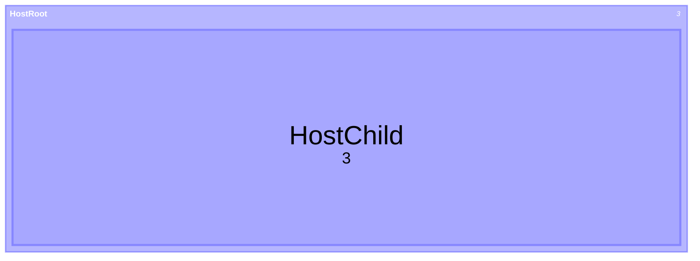

# Treemap formatting rules

Japanese version: [treemap.ja.md](./treemap.ja.md)

These rules apply the 29 adopted items to the authored
[treemap tree](../../spec/docs/ast/treemap.md). Each rule explains its choice.
Semicolon protection takes precedence over ordinary formatting.
[compatibility.md](./compatibility.md) records preserved text and differences
from mermaid.js.

## Rules

### Header

Put the header at column one and an ordinary first statement on the next line,
making the heading easy to find. The keyword is printed `treemap`, also where it
was written `treemap-beta`: every version of mermaid.js that counts and has the
diagram reads both names and draws them the same (see
[The names of a header](./compatibility.md#the-names-of-a-header)). Add no
colon: [rule 3](./printed-form.md#3-a-spelling) gives the header without one, as
the examples in the documentation of mermaid.js write all 8 headers of the
diagram without it, and every version of mermaid.js that counts rejects
`treemap:` and `treemap-beta:` (see
[The colon after a header](./compatibility.md#the-colon-after-a-header)). An
empty body stays empty.

[fixture: treemap/header/stable]

[fixture: treemap/header/beta]

[fixture: treemap/header/common]

[fixture: treemap/header/empty]

Input (escaped): `" treemap\"HeadingRoot\"\n \"HeadingChild\":3"`.

Output
([header/stable-output.mmd](../tests/fixtures/treemap/header/stable-output.mmd)):

```mmd
treemap
  "HeadingRoot"
    "HeadingChild": 3
```

### Indentation

Read parents from AST children in source order. Only sections have children; a
later deep row after a leaf can be another root. Common statements and class
definitions in statementsBefore keep their source position and do not determine
parents. Print ordinary roots one configured step in and children one step
deeper than their parent; common statements and class definitions use one body
step. This chooses consistent depths from equivalent widths.
[Rule 1](./printed-form.md#1-the-whitespace-beside-a-mark) puts ordinary roots,
common statements, and class definitions one configured step below the header,
as Prettier prints the lines inside a block. A child stands deeper, since
indentation determines parentage, one step below its parent. Use at least one
character per step at tabWidth zero because indentation determines parentage. A
title or an accessibility statement that was not written indented is the
exception and is printed at the start of its line (see [Title](#title)). A
styleless, unterminated class definition touching a row keeps that contact; in
such a diagram every root uses baseline zero, so later roots cannot become
children accidentally.

[fixture: treemap/indentation/irregular]

[fixture: treemap/indentation/leaf-not-parent]

[fixture: treemap/indentation/leaf-closes]

[fixture: treemap/indentation/leaf-pops-inner]

[fixture: treemap/indentation/common-and-class]

[fixture: treemap/indentation/all-root-leaves]

[fixture: treemap/indentation/four]

[fixture: treemap/indentation/zero]

[fixture: treemap/indentation/zero-tabs]

[fixture: treemap/indentation/glued-roots]

[fixture: treemap/indentation/glued-zero]

[fixture: treemap/indentation/glued-tabs]

Input (escaped):
`"treemap\n    \"Top\"\n           \"Branch\"\n             \"Tip\":3\n      \"Sibling\":4\n \"Other\":5"`.

Output
([indentation/irregular-output.mmd](../tests/fixtures/treemap/indentation/irregular-output.mmd)):

```mmd
treemap
  "Top"
    "Branch"
      "Tip": 3
    "Sibling": 4
  "Other": 5
```

### Carried indentation

Use the AST hierarchy, which already accounts for assigned indentation, before
removing exterior padding. A run after a header, section, leaf, class terminator
or description closer, or on a whitespace-only line, can indent the next row
across LF. Move its information once to that row’s planned column. Do not
measure only physical leading whitespace or add a second indentation run.
Mermaid.js counts spaces and tabs carried from the preceding line as the next
row’s indentation. Measuring only physical leading whitespace would turn that
child into another root, so the carried run is counted once, in the column of
the next row. Common removals have already decided which runs count.

Use the resulting row column for standalone comment lines too, including when
common comment removal discarded an earlier whitespace-only run.

[fixture: treemap/comments/removed-indent] [fixture:
treemap/carried-indentation/header-space]

[fixture: treemap/carried-indentation/header-tab]

[fixture: treemap/carried-indentation/section-space]

[fixture: treemap/carried-indentation/section-tab]

[fixture: treemap/carried-indentation/leaf-space]

[fixture: treemap/carried-indentation/leaf-tab]

[fixture: treemap/carried-indentation/class-space]

[fixture: treemap/carried-indentation/class-tab]

[fixture: treemap/carried-indentation/whitespace-line]

[fixture: treemap/carried-indentation/closer]

Input (escaped): `"treemap\n\"Top\"  \n\"Tip\":2"`.

Output
([carried-indentation/section-space-output.mmd](../tests/fixtures/treemap/carried-indentation/section-space-output.mmd)):

```mmd
treemap
  "Top"
    "Tip": 2
```

### Tabs

Count each source ASCII space and tab as one character, without tab-stop
expansion. Print one tab per depth with useTabs, otherwise the configured
positive space width. The character choice changes presentation while preserving
the ordered forest. A step is what the `useTabs` and `tabWidth` options of
Prettier say, as in [kanban](./kanban.md#indentation) and
[ishikawa](./ishikawa.md#indentation) diagrams.

[fixture: treemap/tabs/mixed]

[fixture: treemap/tabs/configured]

[fixture: treemap/tabs/same-count]

Input (escaped): `"treemap\n \"TabRoot\"\n\t \"Branch\"\n \t \"Tip\":3"`.

Output
([tabs/mixed-output.mmd](../tests/fixtures/treemap/tabs/mixed-output.mmd)):

```mmd
treemap
  "TabRoot"
    "Branch"
      "Tip": 3
```

### Statements one per line

Print ordinary adjacent rows and statements after a closed description on
separate lines in source order.
[Rule 2](./printed-form.md#2-a-gap-of-a-kind-that-prettier-does-not-have) gives
this form: two statements on one line are printed on lines of their own in a
[flowchart](./flowchart.md#statements-one-per-line) and in an
[ER diagram](./er.md#statements-one-per-line), where a statement after the `}`
of an attribute block also stands on the next line. Keep an empty unterminated
class name touching its next quoted row, including intervening directives:
whitespace would consume that row as style. A completed class definition has no
such contact requirement; semicolon protection still takes precedence. Text
already owned by a title or class style is one value, not a new statement.

[fixture: treemap/statements-one-per-line/adjacent]

[fixture: treemap/statements-one-per-line/empty-class-before-comment]

[fixture: treemap/statements-one-per-line/glued-empty-class]

[fixture: treemap/statements-one-per-line/glued-class-directive]

[fixture: treemap/statements-one-per-line/completed-class]

[fixture: treemap/statements-one-per-line/block-adjacent]

[fixture: treemap/statements-one-per-line/title-owns-row]

Input (escaped): `"treemap\"Top\"  \"Left\":1   \"Right\",2\"Last\""`.

Output
([statements-one-per-line/adjacent-output.mmd](../tests/fixtures/treemap/statements-one-per-line/adjacent-output.mmd)):

```mmd
treemap
  "Top"
    "Left": 1
    "Right", 2
  "Last"
```

### Separators

Keep the leaf’s authored colon or comma, with no ordinary space before and one
after. [Rule 1](./printed-form.md#1-the-whitespace-beside-a-mark) gives the
whitespace beside the comma, as Prettier prints `f(a,b)` as `f(a, b);`. Each
line adds a leaf, so the colon is not the colon of a key, and the examples in
the documentation of mermaid.js decide the whitespace before it (step 3 of
[Which kind a colon is](./printed-form.md#which-kind-a-colon-is)): of the
examples that write a space after the colon, 35 write no space before it and
none writes one (counted as under
[the examples that decide the whitespace before a colon](./compatibility.md#the-examples-that-decide-the-whitespace-before-a-colon)).
Commas inside NumericLiteral spans, including trailing commas, remain part of
the number. Trivia-bearing gaps keep their contact.

[fixture: treemap/separators/colon]

[fixture: treemap/separators/comma]

[fixture: treemap/separators/numeric-commas]

[fixture: treemap/separators/trivia]

Input (escaped): `"treemap\n\"Colon\" \t: \t1,234.5"`.

Output
([separators/colon-output.mmd](../tests/fixtures/treemap/separators/colon-output.mmd)):

```mmd
treemap
  "Colon": 1,234.5
```

### Selectors

Print `"section":::class` and `"leaf": value:::class`. Join trivia-free
marker/name newlines and add no spaces around `:::`: indentation there is
forbidden. Keep selector spelling and presence, including one-character and
keyword-like identifiers. Mermaid.js stores the identifier of a selector in the
Db as `classSelector`. A one-character or keyword-like identifier is therefore
kept: replacing or removing it changes that field.

[corpus fixture: treemap/lex-selector-single-letter]

[fixture: treemap/selectors/section-newlines]

[fixture: treemap/selectors/leaf-newlines]

[fixture: treemap/selectors/one-letter]

[fixture: treemap/selectors/underscore]

[fixture: treemap/selectors/keyword]

[fixture: treemap/selectors/keyword-prefix]

Input (escaped): `"treemap\n\"Section\"\n:::\nzz"`.

Output
([selectors/section-newlines-output.mmd](../tests/fixtures/treemap/selectors/section-newlines-output.mmd)):

```mmd
treemap
  "Section":::zz
```

### Numbers

A NumericLiteral that is digits with an optional fraction, or a fraction alone,
is printed in the shortest form: no zero at the end of the fraction and a `0`
before a `.` at the start (`1.50` is `1.5`, and `.5` is `0.5`; see
[Spellings that are drawn the same](./compatibility.md#spellings-that-are-drawn-the-same)).
Every other source span stays as written: a sign, a `.` at the end, separators,
underscores, a second dot, a zero at the start of the integer part, and more
than 15 digits. Do not reprint its numeric value. Mermaid reads `1_000` as 1;
other spellings can round, become NaN, overflow or underflow. Re-encoding can
change the Db or produce rejected numeric syntax.

[fixture: treemap/numbers/shortest-form] [fixture: treemap/numbers/forms-kept]
[fixture: treemap/numbers/trailing-dot-kept] [fixture: treemap/numbers/comma]

[fixture: treemap/numbers/underscore]

[fixture: treemap/numbers/dots]

[fixture: treemap/numbers/nan]

[fixture: treemap/numbers/leading-dot]

[fixture: treemap/numbers/trailing-comma]

[fixture: treemap/numbers/dot-underscore]

[fixture: treemap/numbers/precision]

[fixture: treemap/numbers/zeros]

[corpus fixture: treemap/db-number-overflow]

[corpus fixture: treemap/db-number-subnormal]

[corpus fixture: treemap/db-number-underflow]

Input (escaped): `"treemap\n\"Underscore\":1_000"`.

Output
([numbers/underscore-output.mmd](../tests/fixtures/treemap/numbers/underscore-output.mmd)):

```mmd
treemap
  "Underscore": 1_000
```

### Names

Keep complete StringLiteral source spans: empty names, padding, backslashes,
HTML, entities, percent text and physical continuation columns, with a run of
spaces and tabs inside the name printed as one space, so a name of spaces and
tabs only becomes one space. An empty quoted name still names a node in the Db,
so deleting its occurrence removes that node. Padding at the ends of a name is
name text: the exception for runs of whitespace shortens a run to one space and
never deletes the last space. Removing HTML from a name, or replacing an entity
by the text it decodes to, changes the name that mermaid.js stores. A pair of
percent signs inside a quoted name is name text too, and treating it as a
comment would change the name or leave the string unclosed. The columns of
continuation lines are characters of a multiline name as well, and
[the exception for runs of whitespace](./compatibility.md#runs-of-whitespace-in-a-text-that-are-drawn-the-same)
excludes multiline text, so reindenting them changes the Db. A name between `'`
is printed between `"`, unless it holds a `'`, a `"`, a backslash, a line break,
a backquote, `&`, `#`, or `<` (see
[Spellings that are drawn the same](./compatibility.md#spellings-that-are-drawn-the-same)),
and `singleQuote` is not read. [Rule 3](./printed-form.md#3-a-spelling) gives
the `"`: the examples in the documentation of mermaid.js write 408 of the 409
strings of the diagram types that read a string between `'` as well as between
`"`, as counted in [Strings between `"`](./compatibility.md#strings-between-).
Backslashes do not escape quotes or decode `\n`; these authored choices can
affect the name or acceptance.

[corpus fixture: treemap/db-empty-names] [corpus fixture:
treemap/space-name-values] [corpus fixture: treemap/html-fields] [corpus
fixture: treemap/entity-names] [corpus fixture: treemap/comment-in-name] [corpus
fixture: treemap/lex-string-multiline]

[fixture: treemap/names/quotes]

[fixture: treemap/names/backslash]

[fixture: treemap/names/empty]

[fixture: treemap/names/whitespace]

[fixture: treemap/names/html-entities]

[fixture: treemap/names/physical-columns]

[fixture: treemap/names/percent-owned]

[corpus fixture: treemap/lex-string-backslash-line-feed]

Input (escaped): `"treemap\n'  Other \"quote\"  ':1"`.

Options: `{"singleQuote":true}`.

Output
([names/quotes-output.mmd](../tests/fixtures/treemap/names/quotes-output.mmd)):

```mmd
treemap
  ' Other "quote" ': 1
```

### Class definitions

Use one ordinary ASCII space between `classDef` and its authored class name.
Spaces, tabs, and line breaks there are joined into that space:
[rule 1](./printed-form.md#1-the-whitespace-beside-a-mark) gives one space after
a keyword before what it takes, as Prettier prints `x = typeof`, a line break, a
tab, a space, and `y;` as `x = typeof y;`. Unicode whitespace there is joined
into the space too. mermaid.js needs whitespace there and does not keep its
width. Do not reinterpret names beginning with `title`; class names require at
least two characters, unlike selectors.

[fixture: treemap/class-definitions/keyword-space]

[fixture: treemap/class-definitions/keyword-newline]

[fixture: treemap/class-definitions/title-prefix]

[test: treemap/class-definitions/unicode-gap]

Input (escaped): `"treemap\nclassDef\n\t zz"`.

Output
([class-definitions/keyword-newline-output.mmd](../tests/fixtures/treemap/class-definitions/keyword-newline-output.mmd)):

```mmd
treemap
  classDef zz
```

### Style gaps

Put one ordinary space before a non-null style. The first style follows one
space in [flowchart](./flowchart.md#whitespace-between-tokens) and
[ER](./er.md#styles-and-classes) diagrams, so
[rule 2](./printed-form.md#2-a-gap-of-a-kind-that-prettier-does-not-have) gives
the same gap before a non-null style. Plain maximal separator whitespace may
cross blank lines; join it even when the literal looks like another row or class
definition. The AST already owns that text as style. Keep the line breaks in
separator gaps containing comments/directives and align their standalone trivia
and style continuation one level inside `classDef`, so the style remains visibly
attached to its definition. The maximal separator discards this indentation; the
style value itself is unchanged. Inline native comments that already supply an
indentation run and semicolon-protected segments of a statement over several
lines retain their existing columns.

[fixture: treemap/style-gaps/spaces]

[fixture: treemap/style-gaps/row-on-next-line]

[fixture: treemap/style-gaps/class-on-next-line]

[fixture: treemap/style-gaps/comment]

[fixture: treemap/style-gaps/directive]

[fixture: treemap/style-gaps/css-comment]

[fixture: treemap/style-gaps/css-directive-tabs]

[fixture: treemap/style-gaps/css-comment-semicolon-kept]

[fixture: treemap/style-gaps/css-comment-terminator-dropped]

Input (escaped): `"treemap\nclassDef zz\n\n  \"Apparent\":2"`.

Output
([style-gaps/row-on-next-line-output.mmd](../tests/fixtures/treemap/style-gaps/row-on-next-line-output.mmd)):

```mmd
treemap
  classDef zz "Apparent": 2
```

A U+2028 or U+2029 before a comment line ends the line of the `classDef`, as a
line feed does: the comment goes to a line of its own, and its comment line, a
directive, and the style that follows stand one level inside the `classDef`,
whether or not whitespace is written before the style.

[test:
treemap/style-gaps/class-definition-line-separator-directive-comment-class-on-next-line]
[test:
treemap/style-gaps/class-definition-line-separator-directive-comment-row-as-style]
[test:
treemap/style-gaps/class-definition-after-row-line-separator-directive-comment-row-as-style]
[test:
treemap/style-gaps/class-definition-line-separator-comment-class-on-next-line]
[test:
treemap/style-gaps/class-definition-line-separator-directive-comment-class-follows-at-once]
[test:
treemap/style-gaps/class-definition-line-separator-directive-comment-class-at-first-column]
[test:
treemap/style-gaps/class-definition-line-separator-comment-then-unclosed-directive]
[test: treemap/style-gaps/class-definition-line-separator-two-comment-lines]
[test:
treemap/style-gaps/class-definition-line-separator-comment-then-whitespace-line]
[test:
treemap/style-gaps/class-definition-ignored-semicolon-line-separator-comment]
[test:
treemap/style-gaps/class-definition-line-separator-comment-at-end-of-text]
[test:
treemap/style-gaps/class-definition-line-feed-directive-comment-class-on-next-line]
[test:
treemap/style-gaps/class-definition-paragraph-separator-directive-comment-class-on-next-line]
[test:
treemap/style-gaps/class-definition-paragraph-separator-directive-comment-row-as-style]
[test:
treemap/style-gaps/class-definition-paragraph-separator-after-row-directive-comment-row-as-style]
[test:
treemap/style-gaps/class-definition-paragraph-separator-comment-class-on-next-line]
[test:
treemap/style-gaps/class-definition-paragraph-separator-directive-comment-class-follows-at-once]
[test:
treemap/style-gaps/class-definition-paragraph-separator-directive-comment-class-at-first-column]

### Styles

The style of a `classDef` is printed as
[rule 1](./printed-form.md#1-the-whitespace-beside-a-mark) gives the colon of a
key in a style (`fill: #f00`), one space after a comma, and no whitespace at the
end of a line (see
[Styles that are drawn the same](./compatibility.md#styles-that-are-drawn-the-same)).
mermaid.js splits it at the commas that no backslash escapes, and takes the
whitespace around the name and the value of each style away before it draws; CSS
reads a run of whitespace as one. So a style has no whitespace before its first
`:` and one space after it where the value is not empty, a `,` has none before
it and one space after it, a run of spaces and tabs between two words of a style
is one space, and the style has no whitespace at its end. The Db keeps the
whitespace in each style, so it changes, but the figure is the same, which was
checked by drawing the chart before and after.

[fixture: treemap/styles/spaced] [fixture: treemap/styles/trailing] [fixture:
treemap/styles/trailing-before-semicolon] [fixture:
treemap/styles/escaped-comma-spaced]

A form feed at the end of the styles is dropped like a space or a tab, also
without a `;` after it, except where a character that CSS does not read as
whitespace (a no-break space or a vertical tab, for instance) is among the
whitespace at the end. That character ends the last style, and the form feeds
beside it stay: the spaces and tabs after the last such character are dropped as
at the end of any style, and a run of them before it is one space. Before a `%%`
comment on the same line, a run of spaces, tabs, and form feeds is printed as
one space under [rule 1](./printed-form.md#1-the-whitespace-beside-a-mark),
which gives one space before a comment that stands after something on its line,
as Prettier prints `x = 1;   // c` as `x = 1; // c` (see
[Whitespace at the end of a style](./compatibility.md#whitespace-at-the-end-of-a-style)).

[test: leaves out a form feed at the end of a style that CSS reads as
whitespace] [test: keeps a form feed beside a character that CSS does not read
as whitespace at the end of the classDef of a treemap] [test: prints a form feed
before a comment as one space]

A `,` that a backslash escapes is part of its style, the quotes of a string and
percent text are part of the value as written, and the runs inside a string, a
comment, and the parentheses of `url(` stay.

[fixture: treemap/styles/percent-owned] [fixture: treemap/styles/quotes]
[fixture: treemap/styles/string-runs-kept]

The style stays as written where printing it could change more than the
whitespace around the names and the values. An empty style between two commas,
or after the last one, stays, since the number of styles is in the Db. A style
that holds a `;`, or that has a directive on its line, stays too (a comment
after the last style does not keep it: it is formatted as usual, see
[Styles that are drawn the same](./compatibility.md#styles-that-are-drawn-the-same)):
a `;` there may be ignored by the line rule of mermaid.js, which reads the
whitespace between a `:` and a later `#`, and a second formatting must find the
same text. Spaces, tabs, and form feeds after a directive at the end of that
line are dropped like the whitespace at the end of other lines, unless a
character that CSS does not read as whitespace is in the whitespace at the end
of the style, before or after the directive: all the whitespace after the
directive then stays as written. The spacing inside the style stays as written.
The whitespace that separates the style from the name of the class is not part
of the style (see [Style gaps](#style-gaps)).

[fixture: treemap/styles/class-def-comment-after-last-style-formatted] [fixture:
treemap/styles/written] [fixture: treemap/styles/empty-entry-kept] [fixture:
treemap/styles/directive-line-kept] [fixture:
treemap/styles/directive-trailing-whitespace] [fixture:
semicolons/protected-class-column] [test: leaves out the whitespace after a
directive at the end of the classDef of a treemap] [test: keeps the whitespace
after a directive at the end of the classDef of a treemap where a character that
CSS does not read as whitespace is among it or before the directive]

Input (escaped):
`"treemap\nclassDef zz color:red , fill:blue,stroke:rgb(1\\,2\\,3),;"`.

Output
([styles/written-output.mmd](../tests/fixtures/treemap/styles/written-output.mmd)):

```mmd
treemap
  classDef zz color:red , fill:blue,stroke:rgb(1\,2\,3),
```

### Colors

A color in the style of a `classDef` is printed in lower case (see
[Colors that are drawn the same](./compatibility.md#colors-that-are-drawn-the-same)):
`classDef zz fill:#ABCDEF` is printed `classDef zz fill: #abcdef`. The versions
that count draw `#ABCDEF` and `#abcdef` the same. A `#` that is no color, such
as the `#ABC` of `url(#ABC)`, which refers to an element, stays as written. Its
case is part of the style that mermaid.js keeps in the Db, and a change of it is
no kind of change of the Db that formatting may make (see
[The check, and formatting that changes the Db](./printed-form.md#the-check-and-formatting-that-changes-the-db)).

[fixture: colors/colors-in-lower-case]

Input
([colors/colors-in-lower-case-input.mmd](../tests/fixtures/treemap/colors/colors-in-lower-case-input.mmd)):

```mmd
treemap-beta
"A"
  "B": 1:::zz
classDef zz fill:#ABCDEF,stroke:#DEF,color:#C0FFEE
classDef yy color:#333,fill:url(#ABC)
```

Output
([colors/colors-in-lower-case-output.mmd](../tests/fixtures/treemap/colors/colors-in-lower-case-output.mmd)):

```mmd
treemap
  "A"
    "B": 1:::zz
  classDef zz fill: #abcdef, stroke: #def, color: #c0ffee
  classDef yy color: #333, fill: url(#ABC)
```

### Semicolons

A `;` that ends a `classDef` statement with a style, at the end of its line, is
dropped: mermaid.js reads the statement the same without it. This holds for the
`;` that is a unit of the statement, as in `classDef zz fill:red;`, and for the
last `;` that the
[line rule of mermaid.js](../../spec/docs/common.md#style-and-classdef-lines)
ignores, as in `classDef zz color:#f00;`. Where another `;` of the line stays,
as the paragraphs below describe, this one stays with it.

[fixture: semicolons/class-terminator-dropped] [fixture:
semicolons/class-terminator-hash-dropped]

Spaces, tabs, and form feeds immediately before the dropped `;` are dropped with
it.

[fixture: semicolons/class-terminator-space-before-dropped]

A U+00A0, U+2028, U+2029, U+3000, U+000B (a vertical tab), or U+FEFF before the
`;` stays, and so does one after a `;` that the line rule ignores: CSS does not
read it as whitespace, so it ends the last style, and every version of
mermaid.js that counts draws another figure without it (see
[Whitespace at the end of a style](./compatibility.md#whitespace-at-the-end-of-a-style)
and
[Forms kept for versions of mermaid.js that count](./compatibility.md#forms-kept-for-versions-of-mermaidjs-that-count)).
Only the `;` is dropped, with the spaces, tabs, and form feeds after the last
such character, so `classDef zz fill:red`, U+00A0, `;` is printed
`classDef zz fill: red`, U+00A0, and `classDef zz fill:red`, U+2028, a space,
`;` is printed `classDef zz fill:red`, U+2028. A line that holds a U+2028 or
U+2029 stays as written, without the `;`, and a line with such a character after
a `;` that the line rule ignores stays as written with it.

[test: treemap spaces and tabs after U+2028 or U+2029 go with the dropped
terminator] [test: treemap/line-terminators-and-unicode/unicode-values] [test:
treemap/semicolons/class-terminator-unicode-space-before-kept] [test: treemap
style terminators dropped and whitespace that CSS does not read kept] [test:
treemap style terminators dropped and U+2028 and U+2029 kept before statements]
[test: keeps whitespace other than a space and a tab at the end of a style]
[test: keeps the whitespace after a `;` and after a directive that the line rule
removes]

Spaces, tabs, and form feeds after a `;` that the line rule ignores belong to
the style and are dropped too, except in a line that stays as written because
another `;` of it stays: they stay with the line.

[fixture: semicolons/class-terminator-hash-trailing-whitespace-dropped] [test:
keeps the whitespace after the last `;` of a line that holds another `;` that
stays]

The statement can end the text.

[fixture: semicolons/class-terminator-end-of-text-dropped]

The statement then takes the usual layout of a `classDef` line: indentation,
blank lines and comment lines around it, an empty description block before it,
and the run of whitespace after the `;` that indents the next row.

[fixture: semicolons/class-terminator-indented-dropped] [fixture:
semicolons/class-terminator-trailing-whitespace-dropped] [fixture:
semicolons/class-terminator-blank-and-comment-lines-dropped] [fixture:
semicolons/class-terminator-empty-description-block-dropped] [fixture:
style-gaps/css-comment-terminator-dropped]

The `;` stays where dropping it would change what is read: after a `classDef`
without a style, where the next line would become the style, and before another
statement on the same line.

[fixture: semicolons/terminator] [fixture:
semicolons/class-terminator-before-row-kept]

It stays too when a comment or a directive follows it on its line, when a
directive stands right before the `;` that is a unit of the statement, with or
without whitespace between, when it is part of the style, as in
`classDef zz fill: #f00;`, where `#f00;` is an entity, and when another `;` is
beside it, with a directive between the two or not.

[fixture: semicolons/class-terminator-comment-kept] [fixture:
semicolons/class-terminator-directive-kept] [fixture:
semicolons/class-terminator-entity-kept] [fixture:
semicolons/class-terminator-beside-semicolon-kept] [fixture:
semicolons/class-terminator-beside-semicolon-directive-kept]

It stays too after a U+2028 or U+2029 and then a comment line: the character is
no whitespace of the line rule and the comment line is removed, so dropping the
`;` and the character would change what mermaid.js draws, and the line is
printed as written.

[test: treemap/semicolons/class-terminator-after-separator-and-comment-kept]

The `;` stays too, with the character, where a U+2028 or U+2029 stands before
it, with whitespace between them if any, and a comment line follows its line,
directive lines between them included: without the `;` the statement goes on
after the comment line, which mermaid.js removes, and takes the statement after
it. Where the end of the text follows the comment line, nothing continues, and
the `;` stays only where whitespace that is no space or tab stands between the
character and the `;`: the comment line takes that whitespace with it (see
[Semicolons at the end of a style statement](./er.md#semicolons-at-the-end-of-a-style-statement)).

[test: treemap style terminators kept after U+2028 and U+2029 before comments]
[test: treemap a comment line at the end of the text keeps the terminator after
whitespace that is no space or tab] [test: treemap whitespace after U+2028 and
U+2029 keeps the terminator before comments] [test: treemap directive and
comment lines after a style terminator that follows U+2028] [test: treemap style
terminators dropped with a form feed, a space, and a tab]

A directive before a `;` that the line rule ignores stays and the `;` is
dropped.

[fixture: semicolons/class-terminator-hash-directive-dropped]

Where the `;` that ends the statement stays, the whitespace after it is the run
that indents the next statement: the whitespace between the `;` and a comment or
a directive that follows it on its line, between two directives, and at the end
of the line. mermaid.js counts the whitespace on both sides of a directive as
one run
([Headers and indentation](../../spec/docs/diagrams/treemap.md#headers-and-indentation)),
and reads a second run on the next line as a second indentation, which it
rejects.

[corpus fixture: treemap/gram-indent-around-global-directive] [corpus fixture:
treemap/gram-class-tail-space-next-indent] [corpus fixture:
treemap/gram-class-directive-tail-space-next-indent]

The run moves once to the planned column of the next statement, as in
[Carried indentation](#carried-indentation), so the comment or the directive
touches the `;`, and a comment or a directive touches a directive before it.
When the whitespace on the two sides of a directive makes the run, their sum
counts.

[fixture: semicolons/class-terminator-comment-run-moved] [fixture:
semicolons/class-terminator-directive-run-moved] [fixture:
semicolons/class-terminator-directives-run-moved] [fixture:
semicolons/class-terminator-run-sum-moved]

This holds when a `;` that the line rule ignores follows it, also when
whitespace or a directive lies between the two `;`.

[fixture: semicolons/class-terminator-ignored-run-moved] [fixture:
semicolons/class-terminator-ignored-comment-run-moved] [fixture:
semicolons/class-terminator-semicolons-run-moved] [fixture:
semicolons/class-terminator-directive-semicolon-run-moved]

It holds for a `classDef` without a style, when the next statement is a
`classDef`, and when comment lines and blank lines lie between.

[fixture: semicolons/class-terminator-styleless-run-moved] [fixture:
semicolons/class-terminator-class-run-moved] [fixture:
semicolons/class-terminator-comment-lines-run-moved]

Without whitespace after the `;`, the indentation of the next row is its own and
is printed at its planned column.

[fixture: semicolons/class-terminator-comment-row-indented-kept]

Where no `;` before it ends the statement, a `;` that the line rule ignores,
followed by text on its line, makes that text part of the style, so its
whitespace stays: `classDef zz a:#b ; %% c` keeps its line.

[fixture: semicolons/class-terminator-ignored-text-after-kept]

Keep every other authored semicolon: selected ignored semicolons, a `;` beside
another `;`, and value characters. A segment that holds a kept `;` is formatted
as anywhere else, except where formatting could change which `;` the line rule
ignores. The rule reads a segment from the first `:` after `style` or `classDef`
to the last `#` before its last kept `;`, with no whitespace between the `:` and
the `#` (see [Semicolons](./flowchart.md#semicolons)), so the gaps and the
padding inside that stretch keep whether they hold whitespace, a run becoming
one space, and the rest of the segment follows the ordinary rules of this
diagram. Text that no part of the layout holds stays as written. A statement
over several lines whose lines, joined with one space or with nothing, could
change which `;` the line rule ignores keeps the text of each segment, up to its
last kept `;`, as written; any other statement over several lines is formatted
like one on a single line.

[fixture: semicolons/stretch-kept-rest-formatted] [fixture:
semicolons/no-stretch-formatted] [fixture: semicolons/protected-class-column]

Protected segments of a statement over several lines retain their source
columns, with no extra indentation on their inner lines. If a kept line
constrains a row boundary, preserve the body as written rather than fixing some
row indents and normalizing others. This keeps parentage and semicolon selection
together, including the protected ending; it takes precedence over ordinary line
and spacing choices.

[fixture: treemap/semicolons/terminator]

[fixture: treemap/semicolons/name]

[fixture: treemap/semicolons/selected]

[fixture: treemap/semicolons/two]

[fixture: treemap/semicolons/body-kept]

[fixture: treemap/semicolons/multiline-columns]

[fixture: treemap/semicolons/protected-class-column]

[fixture: treemap/semicolons/protected-class-zero]

[fixture: treemap/semicolons/protected-class-tabs]

[test: treemap/semicolons/protected-later-atom]

Input (escaped): `"treemap\nclassDef zz\n   color:#navy;;"`.

Output
([semicolons/protected-class-column-output.mmd](../tests/fixtures/treemap/semicolons/protected-class-column-output.mmd)):

```mmd
treemap
  classDef zz
   color:#navy;;
```

### Title

Use shared common-line placement: trim ordinary common-whitespace edges and
print one space before a nonempty value, or bare `title` for
null/whitespace-only text.
[Rule 1](./printed-form.md#1-the-whitespace-beside-a-mark) gives one space
between `title` and its nonempty value, as Prettier prints `return  x` as
`return x;`, and drops the spaces and tabs at the end of a line, so a title of
spaces and tabs only prints bare `title`. The formatter prints a run of spaces
and tabs inside the text as one space (see
[Runs of whitespace in a text that are drawn the same](./compatibility.md#runs-of-whitespace-in-a-text-that-are-drawn-the-same)),
without rewriting quote-looking text. Quotes in title text are characters of the
title: mermaid.js reads the content after `title` as line text, so removing them
would change the title that it stores. Never take a value from the next physical
line, across comments or directives. Trivia-bearing values retain their written
boundaries. A directive between touching parts of a title disappears before
mermaid.js reads the text, so `title A%%{init: {}}%%B` is the title `AB`. Adding
whitespace beside that directive would change the title to `A B`, so the
touching boundaries stay. Where only directives follow the text of a title, they
are printed with one space before each that has spaces or tabs before it, and
the spaces and tabs after the last one are left out, unless a directive of the
line holds a line break, a `;`, a U+2028, or a U+2029 (see
[Directives that hold a line break or a semicolon](./compatibility.md#directives-that-hold-a-line-break-or-a-semicolon)
and
[Texts after a keyword that are drawn the same](./compatibility.md#texts-after-a-keyword-that-are-drawn-the-same)).

[corpus fixture: treemap/common-quotes-entities]

[corpus fixture: treemap/directive-title]

[fixture: title/title-directives-end-blanks-dropped] [fixture:
title/inline-directive-contact-kept]

A `title` with no text, written with whitespace before a directive or a comment
on its line, is printed with one space before the first of them, whether the
whitespace is one character or more, a tab, or, before a directive, a space and
a U+2028 or U+2029 (a title of whitespace only is a bare `title`), and with none
where nothing is written between the keyword and the directive: `title`, a
space, and `%%{init: {}}%%` is printed as it is, and `title`, three spaces, and
`%%{init: {}}%%` as the first. A U+2028 or U+2029 before a comment that joins
the next line (`title`, two spaces, the character, and `%% c`, with a row after
it) keeps the line as written, as the comment starts after the character:
mermaid.js reads the row after the comment as the text of the title, so the
title is `"A":1` and there is no leaf, while with one space before the comment
the title is empty and the row is a leaf (see
[Forms kept for versions of mermaid.js that count](./compatibility.md#forms-kept-for-versions-of-mermaidjs-that-count)).
The one whitespace character after the keyword is part of the keyword to
mermaid.js, so a title with no text ends at its keyword, and that character is a
gap of the line like the whitespace after a title with text.

[Rule 1](./printed-form.md#1-the-whitespace-beside-a-mark) gives one space
before a comment that stands after something on its line, as Prettier prints
`x = 1;   // c` as `x = 1; // c`.

[fixture: title/bare-title-directive-one-space] [fixture:
title/bare-title-directive-spaces] [fixture: title/bare-title-directive-tab]
[fixture: title/bare-title-directive-touching] [fixture:
title/bare-title-comment-spaces] [fixture:
title/bare-title-unclosed-directive-spaces] [test:
treemap/title/bare-title-directive-space-and-line-separator] [test:
treemap/title/bare-title-directive-space-and-paragraph-separator] [test:
treemap/title/bare-title-directive-spaces-and-line-separator] [test:
treemap/title/bare-title-comment-after-line-separator-kept] [test:
treemap/title/bare-title-comment-after-paragraph-separator-kept]

A U+2028 or U+2029 after the text of a `title` or `accTitle:` line, or after the
keyword where it has no text, with only whitespace before it, and a directive
and a comment after it, ends the line for the printer where a row follows the
comment after an empty line, with a directive line after the empty line or
without one, or after a bare directive line. A bare directive line holds
directives that touch each other and nothing else: no whitespace before,
between, or after them, and no `;`. A directive before the character, or before
the text of an `accTitle:` line, keeps the line (see below). The directive and
the comment are then printed on a line of their own with nothing between them,
as an inline comment is on any line that a row follows (see
[Comments](#comments)): `title`, a space, the character, a space, `%%{x}%%`, two
spaces, `%% c`, a blank line, and `"A":1` print `title`, `%%{x}%%%% c`, a blank
line, and `  "A": 1`, the same the second time.

[test: treemap/title/bare-title-line-separator-directive-comment-touch] [test:
treemap/title/bare-title-paragraph-separator-tabs-directive-comment-touch]
[test:
treemap/title/bare-title-line-separator-directive-comment-touch-before-directive-line]
[test: treemap/title/title-text-line-separator-directive-comment-touch] [test:
treemap/title/title-directive-text-line-separator-directive-comment-touch]
[test: treemap/title/acctitle-text-line-separator-directive-comment-touch]
[test: treemap/title/acctitle-bare-line-separator-directive-comment-touch]
[test:
treemap/title/title-text-line-separator-directive-comment-touch-before-directive-line]
[test:
treemap/title/acctitle-text-line-separator-directive-comment-touch-before-directive-line]
[test:
treemap/title/bare-title-paragraph-separator-directive-comment-touch-before-directive-line]
[test:
treemap/title/bare-title-line-separator-directive-comment-touch-before-touching-directives-line]
[test:
treemap/title/title-text-line-separator-directive-comment-touch-before-empty-line-and-directive-line-with-trailing-blanks]
[test:
treemap/title/title-text-line-separator-directive-comment-touch-before-empty-line-and-indented-directive-line]
[test:
treemap/title/title-text-line-separator-directive-comment-touch-before-empty-line-and-directive-line-with-two-directives]
[test:
treemap/title/acctitle-text-paragraph-separator-directive-comment-touch-before-empty-line-and-directive-line-with-trailing-blanks]

The line stays as written where the comment is followed directly by a row, by
one comment line or more and a row, by an empty line, a comment line, and a row,
by a line of whitespace only and a row, by a directive line that holds a comment
and a row, or by a directive line that is not bare and a row: one with
whitespace before or after a directive, a `;`, or whitespace between two
directives.

[test:
treemap/title/title-text-line-separator-directive-comment-before-two-comment-lines-kept]
[test:
treemap/title/bare-title-line-separator-directive-comment-before-row-kept]
[test:
treemap/title/bare-title-line-separator-directive-comment-before-comment-line-kept]
[test:
treemap/title/bare-title-line-separator-directive-comment-before-empty-line-and-comment-line-kept]
[test:
treemap/title/bare-title-line-separator-directive-comment-before-whitespace-line-kept]
[test:
treemap/title/bare-title-line-separator-directive-comment-before-directive-comment-line-kept]
[test:
treemap/title/title-text-line-separator-directive-comment-before-directive-line-with-trailing-blanks-kept]
[test:
treemap/title/title-text-line-separator-directive-comment-before-directive-line-with-semicolon-kept]
[test:
treemap/title/title-text-line-separator-directive-comment-before-indented-directive-line-kept]
[test:
treemap/title/title-text-line-separator-directive-comment-before-directive-line-with-two-directives-kept]
[test:
treemap/title/acctitle-text-paragraph-separator-directive-comment-before-directive-line-with-trailing-blanks-kept]

Where the comment is followed by the end of the text, with or without a line
feed after it, by a comment line and the end of the text, or by a bare directive
line and the end of the text, the line breaks at the character, and the
directive and the comment have one space between them. A directive line that is
not bare and the end of the text keep the line as written.

[test:
treemap/title/title-text-line-separator-directive-comment-at-end-without-line-feed-one-space]
[test:
treemap/title/bare-title-line-separator-directive-comment-at-end-one-space]
[test:
treemap/title/bare-title-line-separator-directive-comment-before-comment-line-at-end-one-space]
[test:
treemap/title/bare-title-line-separator-directive-comment-before-directive-line-at-end-one-space]
[test:
treemap/title/title-text-line-separator-directive-comment-before-directive-line-at-end-one-space]
[test:
treemap/title/acctitle-text-line-separator-directive-comment-before-directive-line-at-end-one-space]
[test:
treemap/title/bare-title-paragraph-separator-directive-comment-before-directive-line-at-end-one-space]
[test:
treemap/title/title-text-line-separator-directive-comment-before-directive-line-with-trailing-blanks-at-end-kept]
[test:
treemap/title/title-text-line-separator-directive-comment-before-directive-line-with-semicolon-at-end-kept]
[test:
treemap/title/title-text-line-separator-directive-comment-before-indented-directive-line-at-end-kept]
[test:
treemap/title/title-text-line-separator-directive-comment-before-directive-line-with-two-directives-at-end-kept]
[test:
treemap/title/acctitle-text-paragraph-separator-directive-comment-before-directive-line-with-semicolon-at-end-kept]

A directive before the character, or before the text of an `accTitle:` line,
does not break the line. Where an empty line and a row follow the comment, the
whitespace before the comment is printed as one space, as on any line (see
[Comments](#comments)), and where a row follows it directly the line stays as
written.

[test: treemap/title/bare-title-directive-before-line-separator-comment-kept]
[test:
treemap/title/acctitle-directive-text-line-separator-directive-comment-kept]
[test:
treemap/title/bare-title-directive-before-line-separator-directive-comment-before-empty-line-one-space]
[test:
treemap/title/acctitle-directive-text-line-separator-directive-comment-before-empty-line-one-space]
[test:
treemap/title/bare-title-directive-before-line-separator-directive-comment-before-row-kept]
[test:
treemap/title/acctitle-directive-text-line-separator-directive-comment-before-row-kept]
[test:
treemap/title/title-text-directive-before-line-separator-directive-comment-before-empty-line-one-space]
[test:
treemap/title/title-text-directive-before-paragraph-separator-directive-comment-before-empty-line-one-space]

A line that is a kept line, because a `;` that the line rule ignores comes
before the character, as in `title style:#x;`, stays as written whatever
follows: the whitespace after the character and between the directive and the
comment is kept, and the line is not broken at the character. A directive that
is not closed after the character takes the rest of the text where the text
after it does not start with a word character, so the line is not broken at the
character either: `title T`, the character, `%%{x`, a blank line, and `"A":1`
print `title T %%{x`, a blank line, and `"A":1`. Where a word follows, the
directive takes that word as its argument and the whitespace after it, and the
text after it goes on the line of the title (see
[A line that a directive that is not closed joins](./compatibility.md#a-line-that-a-directive-that-is-not-closed-joins)),
so mermaid.js keeps the whitespace around the character in the title, and the
line stays as written: with `y` before `"A":1`, the title is `T`, a space, the
character, a space, and `"A":1`.

[test:
treemap/title/title-text-ignored-semicolon-line-separator-directive-comment-kept]
[test:
treemap/title/title-text-two-ignored-semicolons-line-separator-directive-comment-kept]
[test: treemap/title/title-text-line-separator-unclosed-directive-joins-rest]
[test: treemap/title/title-text-line-separator-unclosed-directive-word-kept]

The other ways in which the comment can be followed, such as an empty line and
the end of the text, or an empty line and a bare directive line, are not stated
here.

A comment line after an empty title aligns with the next statement without
becoming the title's value.

[fixture: treemap/title/empty-next-comment]

A title that was not written indented is printed at the start of its line, and
the rows below it stay one step in: one that starts its line stays there, and
one that follows the header on its line (`treemaptitle T`) goes to the start of
the next line. The first version with the diagram rejects a title, an
`accTitle`, and an `accDescr` that is indented, while the later versions read
the same statement at the start of its line and one step in and draw both the
same, so printing it one step in would give a text that the first version
rejects (see
[Treemap parentage and authored values](./compatibility.md#treemap-parentage-and-authored-values)
and
[Forms kept for versions of mermaid.js that count](./compatibility.md#forms-kept-for-versions-of-mermaidjs-that-count)).
A comment line before such a title aligns with it. A title that is indented in
the source is printed one step in, like the other statements, since the first
version rejects it as written too.

[fixture: treemap/header/common] [fixture:
treemap/title/after-header-spaced-line-start] [fixture: treemap/title/padding]

[fixture: treemap/title/empty-next-comment]

[fixture: treemap/title/empty-next-directive]

[fixture: treemap/title/whitespace]

[fixture: treemap/title/quotes]

[fixture: treemap/title/line-start-kept]

[fixture: treemap/title/line-start-after-row-kept]

[fixture: treemap/title/line-start-tab-rows-kept]

[fixture: treemap/title/line-start-comment-aligned]

[fixture: treemap/title/indented-at-body-step]

Input (escaped): `"treemap\ntitle\t  Topic  words \t\n\"AfterTitle\":3"`.

Output
([title/padding-output.mmd](../tests/fixtures/treemap/title/padding-output.mmd)):

```mmd
treemap
title Topic words
  "AfterTitle": 3
```

### Accessibility lines

Use the shared `accTitle: value` and `accDescr: value` layout: colon touching
the keyword, one space before a trimmed nonempty value, and no space after an
empty colon. Keep internal text; braces after a colon remain line text.
[Rule 1](./printed-form.md#1-the-whitespace-beside-a-mark) gives these
equivalent outer gaps: those of the colon of a key, and no whitespace at the end
of a line. Trivia retains boundaries and no next-line value is joined. An
accessibility value ends at a line terminator or at the first `%%`, so a
statement on the next line is not part of it: mermaid.js reads `accTitle:`
followed by a leaf line as an empty title and a separate leaf. Joining the leaf
to the value would make mermaid.js read accessibility text instead of the leaf
and change the Db, so the line boundary stays. Where only directives follow the
text of the value, they are printed with one space before each that has spaces
or tabs before it, and the spaces and tabs after the last one are left out,
unless a directive of the line holds a line break, a `;`, a U+2028, or a U+2029
(see
[Directives that hold a line break or a semicolon](./compatibility.md#directives-that-hold-a-line-break-or-a-semicolon)
and
[Texts after a keyword that are drawn the same](./compatibility.md#texts-after-a-keyword-that-are-drawn-the-same)).

[corpus fixture: treemap/common-acctitle-next-statement]

[fixture: accessibility-lines/acc-directives-end-blanks-dropped]

An `accTitle` or `accDescr` statement is placed like a title: it is printed at
the start of its line unless it was written indented, in which case it is
printed one step in (see [Title](#title)).

[fixture: treemap/accessibility-lines/title-padding]

[fixture: treemap/accessibility-lines/description-padding]

[fixture: treemap/accessibility-lines/title-empty]

[fixture: treemap/accessibility-lines/description-empty]

[fixture: treemap/accessibility-lines/colon-braces]

[fixture: treemap/accessibility-lines/title-line-start-kept]

[fixture: treemap/accessibility-lines/description-line-start-kept]

[fixture: treemap/accessibility-lines/title-indented-at-body-step]

[fixture: treemap/accessibility-lines/description-indented-at-body-step]

[fixture: treemap/accessibility-lines/title-glued-after-header]

[fixture: treemap/accessibility-lines/trivia]

[test: treemap/accessibility-lines/unicode-edges]

Input (escaped): `"treemap\naccTitle \t: \t Access  words \t"`.

Output
([accessibility-lines/title-padding-output.mmd](../tests/fixtures/treemap/accessibility-lines/title-padding-output.mmd)):

```mmd
treemap
accTitle: Access  words
```

### Description blocks

Description blocks on one line follow
[A description block on one line](./compatibility.md#a-description-block-on-one-line).
For blocks that keep their braces, put one space between `accDescr` and `{`,
even when they originally touched.
[Rule 1](./printed-form.md#1-the-whitespace-beside-a-mark) gives it, as Prettier
prints `class A{}` as `class A {}`. Whitespace-only interiors become `{}`
because no text needs surrounding padding. Join plain opener whitespace, keep
comment/directive contents and their boundaries, and align body lines one step
inside the statement while retaining internal blank lines. Mermaid discards
indentation after LF from the description. Rule 1 keeps the line breaks between
the lines of text, since mermaid.js keeps them in the value and joining two
lines changes the description, and the row Blank lines of rule 1 gives the empty
lines among them: a run of them becomes one, and none stands at the start or the
end of the block. The released version keeps a run of empty lines and the empty
lines at the start and the end of the block as written, which that row does not
give. The body uses the configured indentation, including tabs and the positive
minimum step at width zero. Align a separate opener with its statement. A
separate `}` aligns with its statement.
[Rule 1](./printed-form.md#1-the-whitespace-beside-a-mark) gives this depth: it
puts the closing line at the level of the line that holds the `{`, as Prettier
prints the closing line of a block, and that line is the `accDescr` line or,
where a comment or a directive stands before the `{`, a later line at the level
of the statement. The first `}` still closes the block. A block that was not
written indented is printed at the start of its line, with its body one step
inside it (see [Title](#title)).

[fixture: treemap/description-blocks/blank-lines-at-the-ends-kept] [fixture:
treemap/description-blocks/brace-on-a-later-line]

[fixture: treemap/description-blocks/block-touching-with-text-fixed] [fixture:
treemap/description-blocks/empty]

[fixture: treemap/description-blocks/touching]

[fixture: treemap/description-blocks/spaced]

[fixture: treemap/description-blocks/left-touching]

[fixture: treemap/description-blocks/right-touching]

[fixture: treemap/description-blocks/continuation] [fixture:
treemap/description-blocks/blank-line-run-kept]

[fixture: treemap/description-blocks/body-tabs]

[fixture: treemap/description-blocks/opener-newline]

[fixture: treemap/description-blocks/directive-only]

[fixture: treemap/description-blocks/comment-only]

[fixture: treemap/description-blocks/opener-comment]

[fixture: treemap/description-blocks/opener-directive]

[fixture: treemap/description-blocks/line-start-kept]

[fixture: treemap/description-blocks/indented-at-body-step]

[fixture: treemap/description-blocks/spaced-after-header-line-start]

[corpus fixture: treemap/common-block-first-close]

[test: treemap/description-blocks/unicode-empty]

[test: treemap/description-blocks/unicode-opener]

Input (escaped):
`"treemap\naccDescr  {\n  first\n\n    second\n}\n\"AfterDescription\":3"`.

Output
([description-blocks/continuation-output.mmd](../tests/fixtures/treemap/description-blocks/continuation-output.mmd)):

```mmd
treemap
accDescr {
  first

  second
}
  "AfterDescription": 3
```

### Long lines

Do not wrap names, numbers, styles or common values at printWidth. New value
line breaks can change the Db, and new style lines can reject. Keep authored
value line breaks rather than treating them as layout opportunities.

[fixture: treemap/long-lines/name-and-number]

[fixture: treemap/long-lines/style-and-title]

Input (escaped):
`"treemap\n\"A deliberately long name preserves every word and its internal spaces\":12345678901234567890"`.

Options: `{"printWidth":20}`.

Output
([long-lines/name-and-number-output.mmd](../tests/fixtures/treemap/long-lines/name-and-number-output.mmd)):

```mmd
treemap
  "A deliberately long name preserves every word and its internal spaces": 12345678901234567890
```

### Component newlines

Join trivia-free leaf name/separator/number and selector component newlines into
ordinary spacing. These component boundaries admit equivalent layouts. Keep gaps
containing comments/directives and their required newlines. A selector after a
native comment keeps the line feed in front of it: without it mermaid.js reads
the selector as part of the comment, and the Db has no `classSelector` for it.
Separate selector markers and identifiers start at column one because
spaces/tabs there reject; leaf separator/number continuations align with their
statement unless an earlier native-comment gap already supplies an indentation
run, when no second run is added. Standalone trivia marks inside these component
gaps start at column one except in the class style separator described in
[Style gaps](#style-gaps). Comments between statements follow
[Comments](#comments).

[corpus fixture: treemap/comment-value-selector-gap]

[fixture: treemap/component-newlines/leaf]

[fixture: treemap/component-newlines/leaf-comment]

[fixture: treemap/component-newlines/selector-comment]

[fixture: treemap/component-newlines/selector-directive]

[fixture: treemap/component-newlines/number-comment]

[fixture: treemap/component-newlines/leaf-inline-space]

[corpus fixture: treemap/comment-leaf-separator-indent]

Input (escaped): `"treemap\n\"Selector\":2%% gap\n:::zz"`.

Output
([component-newlines/selector-comment-output.mmd](../tests/fixtures/treemap/component-newlines/selector-comment-output.mmd)):

```mmd
treemap
  "Selector": 2%% gap
:::zz
```

### Comments

Align standalone comment lines with the next statement, or the last statement at
EOF, to show their association. This applies whether the comment was shallower
or deeper than that statement, including before a dedent.
[Rule 1](./printed-form.md#1-the-whitespace-beside-a-mark) puts a comment line
among the statements one configured step below the header, as Prettier prints
every line inside a block at one level, whatever it holds. A comment line before
a child, or after the last statement where that is a child, aligns with that
child, which stands deeper since indentation determines parentage.

[fixture: treemap/comments/aligned-depths] [fixture:
treemap/comments/standalone] [fixture: treemap/comments/aligned-final]

The aligned forms include `%% text`, `%%!`, `%%!x`, `%%%`, `%%` followed by
spaces, and `%% {x}`. Successive comment lines align together, even across blank
lines.

[fixture: treemap/comments/aligned-forms] [fixture:
treemap/comments/aligned-blank-lines]

Use the same configured indentation as the statement, including tabs and the
positive minimum step at tabWidth zero.

[fixture: treemap/comments/aligned-tabs] [fixture:
treemap/comments/aligned-zero]

Comments before the header or in a body without statements stand at column one.

[fixture: treemap/prefix/comment] [fixture: treemap/comments/only-comments]

Between statements, keep a line of only `%%`, a line starting with `%%{` without
being a directive, and a standalone directive at column one: mermaid.js rejects
these lines when indented. Keep this distinction in mixed runs and at EOF.

[fixture: treemap/comments/native-bare] [fixture:
treemap/comments/native-nonword] [fixture: treemap/comments/unclosed-directive]
[fixture: treemap/comments/mixed-directives] [fixture:
treemap/comments/native-final]

Gaps inside statements follow [Component newlines](#component-newlines) and
[Style gaps](#style-gaps). Comment lines around an empty description block or a
semicolon-protected title still align with the following statement.

[fixture: treemap/comments/aligned-empty-description] [fixture:
treemap/comments/aligned-protected-title]

Keep inline comments on their line and preserve content, marks, tails, order and
ownership. When whitespace before an inline comment supplied the next row’s
indent, move it to that row even if the comment then touches the preceding
token. A space before the comment would be indentation as well: mermaid.js reads
the spaces and tabs at the end of a line as the indentation of the next row (the
specification's
[Headers and indentation](../../spec/docs/diagrams/treemap.md#headers-and-indentation)),
so the next row would have two runs of it, or the text would end with a run that
no row uses, and every version that counts rejects both (see
[Forms kept for versions of mermaid.js that count](./compatibility.md#forms-kept-for-versions-of-mermaidjs-that-count)).
Use the AST hierarchy rather than whitespace already removed with common comment
regions. Native comments retain LS/PS as content. Mermaid.js reads the text
after a U+2028 or U+2029 inside a native comment as part of the comment.
Replacing the character with a line feed would expose that text as diagram
syntax, which can change the Db or produce a rejected row.

[corpus fixture: treemap/comment-ls] [corpus fixture: treemap/comment-ps]

[test: treemap/comments/standalone-ls] [test: treemap/comments/standalone-ps]
[fixture: treemap/comments/standalone]

[fixture: treemap/comments/native-bare]

[fixture: treemap/comments/native-nonword]

[fixture: treemap/comments/carried-space]

[fixture: treemap/comments/carried-tab]

[fixture: treemap/comments/removed-indent]

[fixture: treemap/comments/header-inline]

[fixture: treemap/comments/tail]

[test: treemap/comments/native-ls-ps]

Input (escaped):
`"treemap\n\"Top\"\n%% before child\n    \"Tip\":2\n%% final comment"`.

Output
([comments/standalone-output.mmd](../tests/fixtures/treemap/comments/standalone-output.mmd)):

```mmd
treemap
  "Top"
    %% before child
    "Tip": 2
    %% final comment
```

### Directives

Keep Root directive text, order and component/value ownership; standalone
directives start at column one so removal leaves no extra indentation run,
except in [Style gaps](#style-gaps). For directives inside a row-leading unit,
count spaces/tabs on both sides. Use shared leading-gap placement: retain
following gaps while they fit, shorten excess from the last gap, then supply the
remaining configured indentation before the first directive. Earlier-line
carried units move once instead. Keep necessary class keyword/name whitespace
and never use a directive as its substitute. Mermaid.js requires whitespace
between `classDef` and its class name after the directives are removed. A
directive supplies no separating whitespace, so removing both gaps around it
would leave the rejected form `classDefzz`; at least one whitespace character
stays.

A directive that is not closed takes the whitespace after its argument, line
breaks included, so the next row goes on its line (see
[A line that a directive that is not closed joins](./compatibility.md#a-line-that-a-directive-that-is-not-closed-joins)),
and the rows on that line are read from the indentation before the first of
them. `"A" %%{x: w`, a line break, and `  "B": 1` make `B` a child of `A`, and
with `A` indented by two spaces `B` is its sibling in every version of
mermaid.js that counts (see
[Forms kept for versions of mermaid.js that count](./compatibility.md#forms-kept-for-versions-of-mermaidjs-that-count)).
A body with such a line is printed as written, as it is for a kept line that
constrains a row boundary (see [Semicolons](#semicolons)). The same holds for
two rows on one line with a directive that is not closed between them, since the
directive takes the whitespace after its argument, which is the indentation of
the second row.

[fixture: treemap/directives/unclosed-directive-joins-rows-kept] [fixture:
treemap/directives/unclosed-directive-between-rows-kept] [fixture:
treemap/directives/unclosed-directive-child-kept]

With useTabs, the retained gaps and the supplied indentation are all printed as
tabs: the whitespace on both sides of the directive is one indentation unit, in
which each character counts once whatever its kind (see [Tabs](#tabs)).

[fixture: treemap/directives/leading-use-tabs] [fixture:
treemap/directives/leading]

[fixture: treemap/directives/shortened]

[fixture: treemap/directives/multiple]

[fixture: treemap/directives/multiline]

[fixture: treemap/directives/standalone]

[fixture: treemap/directives/carried]

[fixture: treemap/directives/name]

[fixture: treemap/directives/class-gap]

[fixture: treemap/directives/style]

[fixture: treemap/directives/selector]

Input (escaped): `"treemap\n\"Top\"\n %%{wrap}%% \"Tip\":2"`.

Output
([directives/leading-output.mmd](../tests/fixtures/treemap/directives/leading-output.mmd)):

```mmd
treemap
  "Top"
   %%{wrap}%% "Tip": 2
```

### Prefix

Use shared root placement for ordinary pre-header comments, directives and blank
lines. Preserve a detection second-scan single-line percent form as its Comment,
with its inner Root directive printed once. There is no native hidden YAML form
to promote into frontmatter; retained YAML that cannot be read remains rejected.

[fixture: treemap/prefix/comment]

[fixture: treemap/prefix/second-scan]

[corpus fixture: treemap/bare-line-space]

[corpus fixture: treemap/detect-retained-bare-lf-control]

[corpus fixture: treemap/retained-yaml-no-bare]

Input (escaped): `"\n  %% leading note\ntreemap\n\"Prefix\":2"`.

Output
([prefix/comment-output.mmd](../tests/fixtures/treemap/prefix/comment-output.mmd)):

```mmd
%% leading note
treemap
  "Prefix": 2
```

### Blank lines

Keep at most one ordinary blank line and remove ordinary blanks at document/body
edges, choosing a bounded separation between statements. Prettier prints a run
of blank lines as one and none at the start or the end of a block or of the
file, so [rule 1](./printed-form.md#1-the-whitespace-beside-a-mark) gives these
blank-line gaps. First move any meaningful whitespace-only indentation run to
its row. Preserve blank lines inside names, descriptions, directives and common
comment regions as owned text. Blank lines inside a quoted name stay because
removing one removes a line feed from the name in the Db, and
[the exception for runs of whitespace](./compatibility.md#runs-of-whitespace-in-a-text-that-are-drawn-the-same)
excludes multiline text.

[corpus fixture: treemap/lex-string-multiline]

Blank lines between a comment line and its following statement do not change the
comment's target column.

[fixture: treemap/blank-lines/comments] [fixture:
treemap/comments/aligned-blank-lines] [fixture: treemap/blank-lines/ordinary]

[fixture: treemap/blank-lines/comments]

[fixture: treemap/blank-lines/indent-run]

[fixture: treemap/blank-lines/name-interior]

Input (escaped): `"treemap\n\n\"Top\"\n\n\n \"Tip\":2\n\n"`.

Output
([blank-lines/ordinary-output.mmd](../tests/fixtures/treemap/blank-lines/ordinary-output.mmd)):

```mmd
treemap
  "Top"

    "Tip": 2
```

### Trailing whitespace

Decide by owner rather than trimming every line. Retain tails inside names,
styles, comments and directives; common line values use their shared exterior
trimming. A multiline name keeps the whitespace at the ends of its lines because
mermaid.js stores physical continuation whitespace in the name. Trimming a line
tail would change that text in the Db, and
[the exception for runs of whitespace](./compatibility.md#runs-of-whitespace-in-a-text-that-are-drawn-the-same)
excludes multiline text. Exterior runs after structural text may supply the next
row’s indent and move there once. This keeps authored values and parentage
distinct. The fixtures contain significant trailing whitespace that code blocks
cannot display reliably.

[corpus fixture: treemap/lex-string-multiline]

[fixture: treemap/trailing-whitespace/comment-content]

[fixture: treemap/trailing-whitespace/string-content]

[fixture: treemap/trailing-whitespace/style-content]

### Line terminators and unicode

Use shared host EOL handling: physical CR and CRLF reach the printer as LF,
including inside values, and output follows endOfLine. Prettier converts CR and
CRLF to LF before the plugin reads the text, and the printer writes the line
ending that `endOfLine` selects (see [kanban](./kanban.md#line-terminators)).
Keep LS/PS, NBSP and BOM where they belong to value text; native comments do not
end at LS/PS. Ordinary common-value edges trim common Unicode whitespace, and
class separators admit it. This does not add Unicode row indentation. The host
removes/restores a file-leading BOM with the shared frontmatter limitation.

[test: treemap/line-terminators-and-unicode/cr-structure]

[test: treemap/line-terminators-and-unicode/crlf-values]

[test: treemap/line-terminators-and-unicode/unicode-values]

[test: treemap/line-terminators-and-unicode/frontmatter-cr]

[test: treemap/line-terminators-and-unicode/leading-bom]

[test: treemap/line-terminators-and-unicode/output-crlf]

[test: treemap/line-terminators-and-unicode/output-cr]

### Frontmatter yaml

Format only safe real leading frontmatter through shared guarded YAML
formatting. Safe leading frontmatter uses Prettier’s YAML formatter, as
[Frontmatter](./compatibility.md#frontmatter) specifies;
[rule 1](./printed-form.md#1-the-whitespace-beside-a-mark) therefore gives no
space before and one after mapping key colons, and one space inside braces
holding named values. Keep indented fences, closing padding, malformed YAML,
HTML quote hazards and bodies that formatting could turn into fences as written.
The frontmatter line `title: "<a b=\"c\">"` stays, since every version of
mermaid.js that counts rejects `title: '<a b="c">'` (see
[Forms kept for versions of mermaid.js that count](./compatibility.md#forms-kept-for-versions-of-mermaidjs-that-count)).
YAML nested values and block scalars use at least one space at tabWidth zero. At
zero width, every version of mermaid.js that counts rejects a block scalar and
draws the diagram differently when a nested `config` value is no longer nested
(see [Frontmatter](./compatibility.md#frontmatter) and
[Forms kept for versions of mermaid.js that count](./compatibility.md#forms-kept-for-versions-of-mermaidjs-that-count)).
These guards preserve preprocessing and values while ordinary safe YAML gets
consistent spacing.

[fixture: treemap/frontmatter-yaml/safe]

[fixture: treemap/frontmatter-yaml/zero]

[fixture: treemap/frontmatter-yaml/indent-guard]

[fixture: treemap/frontmatter-yaml/html-guard]

[fixture: treemap/frontmatter-yaml/malformed]

[fixture: treemap/frontmatter-yaml/closing-padding]

[fixture: treemap/frontmatter-yaml/delimiter-guard]

[fixture: treemap/frontmatter-yaml/title-reset]

[corpus fixture: treemap/div-frontmatter-invalid]

Input (escaped):
`"---\ntitle: |\n  First\n  Second\nconfig: {treemap: {padding: 3}}\n---\ntreemap\n\"YamlZero\":2"`.

Options: `{"tabWidth":0}`.

Output
([frontmatter-yaml/zero-output.mmd](../tests/fixtures/treemap/frontmatter-yaml/zero-output.mmd)):

```mmd
---
title: |
 First
 Second
config: { treemap: { padding: 3 } }
---
treemap
 "YamlZero": 2
```

### Source order

Preserve every body occurrence and ordered sibling/root, including
empty/duplicate names and sections, unused/repeated classes, forward or
unresolved selectors and empty common assignments. Do not sort, merge or remove
them: class accumulation, resets, order or parentage can change. Print authored
syntax rather than rebuilding it from the normalized Db.

[fixture: treemap/source-order/repetitions]

[fixture: treemap/source-order/names-and-selectors]

[fixture: treemap/source-order/empty-assignments]

[corpus fixture: treemap/db-duplicate-names]

[corpus fixture: treemap/db-class-unused]

Input (escaped):
`"treemap\n\"Top\"\n \"Right\":2\n \"Left\":1\nclassDef zz color:red;\nclassDef zz fill:blue;\ntitle Earlier\ntitle"`.

Output
([source-order/repetitions-output.mmd](../tests/fixtures/treemap/source-order/repetitions-output.mmd)):

```mmd
treemap
  "Top"
    "Right": 2
    "Left": 1
  classDef zz color: red
  classDef zz fill: blue
title Earlier
title
```

### Final newline

End ordinary accepted text with one configured newline, including empty bodies,
rows, common statements, closed blocks and comments. This follows the shared
file boundary choice. Prettier ends a file with one line break and no blank line
before it, so [rule 1](./printed-form.md#1-the-whitespace-beside-a-mark) gives
that final line break. Value tails remain owned text; an unfinished Root
directive reaching EOF and a protected body ending keep their source ending. A
rejected unused indentation run is never repaired.

A final standalone comment line aligns with the last statement.

[fixture: treemap/final-newline/comment] [fixture:
treemap/comments/aligned-final] [fixture: treemap/final-newline/row]

[fixture: treemap/final-newline/common]

[fixture: treemap/final-newline/block]

[fixture: treemap/final-newline/comment]

[fixture: treemap/final-newline/open-directive]

Input (escaped): `"treemap\n\"FinalComment\":2\n%% final"`.

Output
([final-newline/comment-output.mmd](../tests/fixtures/treemap/final-newline/comment-output.mmd)):

```mmd
treemap
  "FinalComment": 2
  %% final
```

### Specified readings

Use the six existing specified readings: directive-as-token-boundary,
ignored-semicolon-as-token-boundary, html-tag-in-frontmatter,
embedded-data-opaque, bare-percent-line-before-header and c4-keyword-anywhere.
Reject atomic cuts without repair, separate frontmatter HTML effects, leave
embedded data opaque, and retain the selected diagram across later C4 words. No
treemap-specific acceptance key is removed for opaque comparison. Compare
accepted corpus text with its recorded specified Db; raw-rejected cases have no
raw Db to compare.

[corpus fixture: treemap/directive-header-middle]

[corpus fixture: treemap/div-semicolon-number-atom]

[corpus fixture: treemap/div-html-frontmatter-reverse]

[corpus fixture: treemap/div-html-frontmatter-title-value]

[corpus fixture: treemap/div-html-frontmatter-style-value]

[corpus fixture: treemap/div-frontmatter-invalid]

[corpus fixture: treemap/bare-before-header-space]

[corpus fixture: treemap/c4-component-section]

[corpus fixture: treemap/tail-leaf-semicolon]

[test: treemap/specified-readings/bare-unicode]

### Markdown fences

Apply these rules to the dedented payload; the Markdown host supplies
fence/list/quote indentation. Do not add container columns to value
continuations. Continuation whitespace inside a multiline quoted name is part of
the name in the Db, so a column of the Markdown container added inside that name
would add characters to it.
[the exception for runs of whitespace](./compatibility.md#runs-of-whitespace-in-a-text-that-are-drawn-the-same)
excludes multiline text. Test host output and idempotence separately from the
payload Db. The host trims padding on the final code line, including style
tails; this limits authored-byte preservation while leaving the reading
unchanged in the tested cases. Rejected fences follow the host’s unchanged-code
route.

[corpus fixture: treemap/lex-string-multiline]

[test: treemap Markdown: top-level]

[test: treemap Markdown: list]

[test: treemap Markdown: quote]

[test: treemap Markdown: zero]

[test: treemap Markdown: tabs]

[test: treemap Markdown: carried-indent]

[test: treemap Markdown: directives-comments]

[test: treemap Markdown: glued-class]

[test: treemap Markdown: protected]

[test: treemap Markdown: description]

[test: treemap Markdown: frontmatter]

[test: treemap Markdown: final-style-padding]

[test: treemap Markdown: rejected]

Input:

````markdown

````

Output:

````markdown

````
